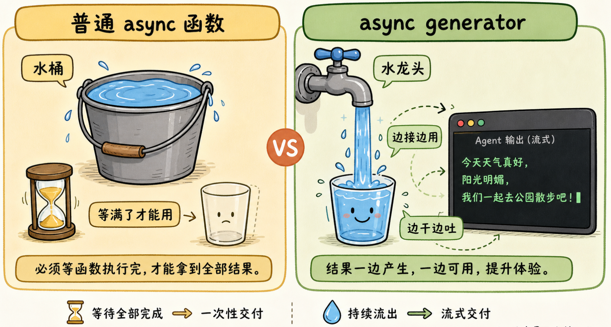
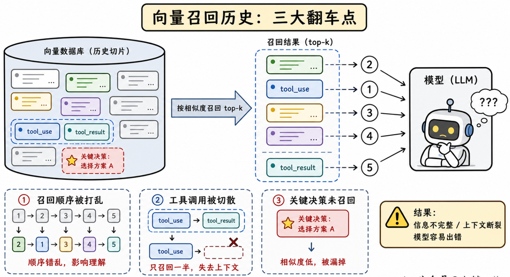
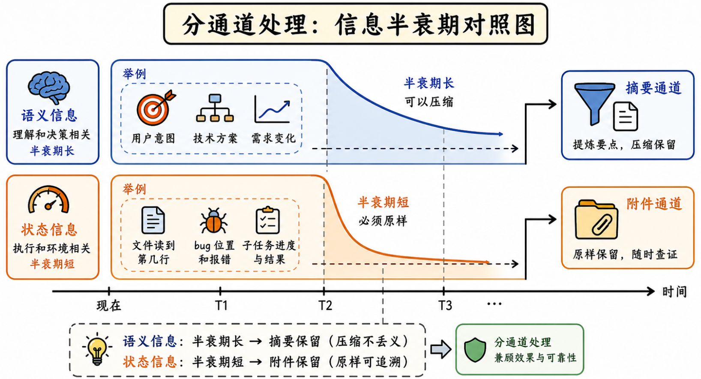
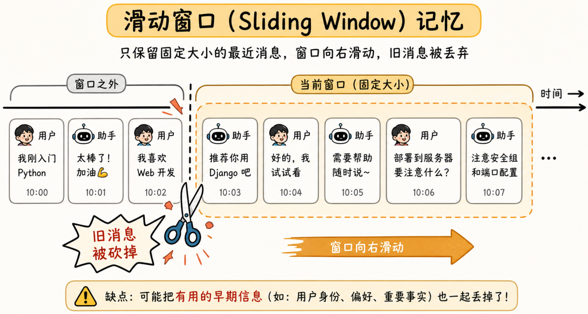
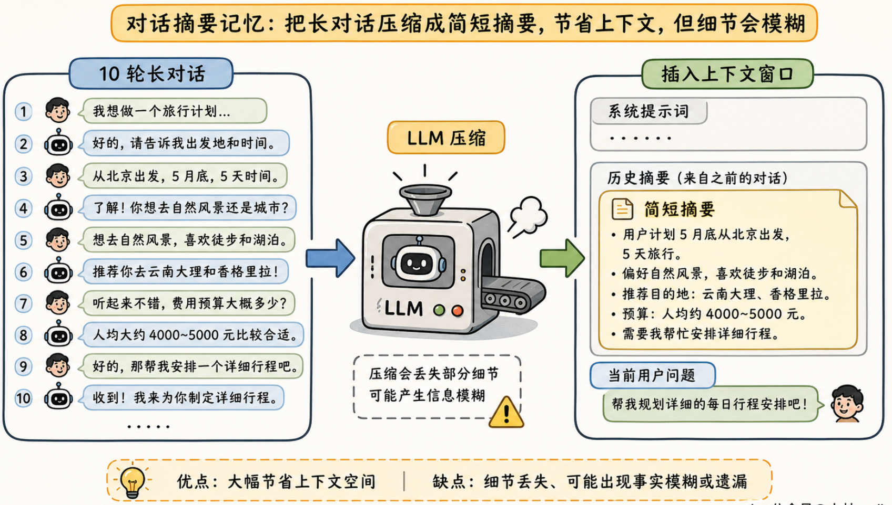
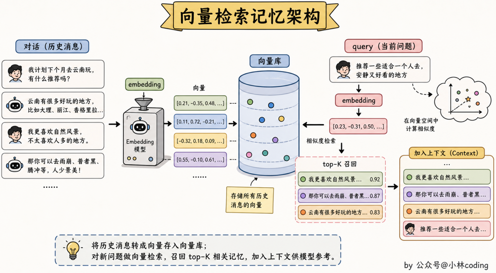
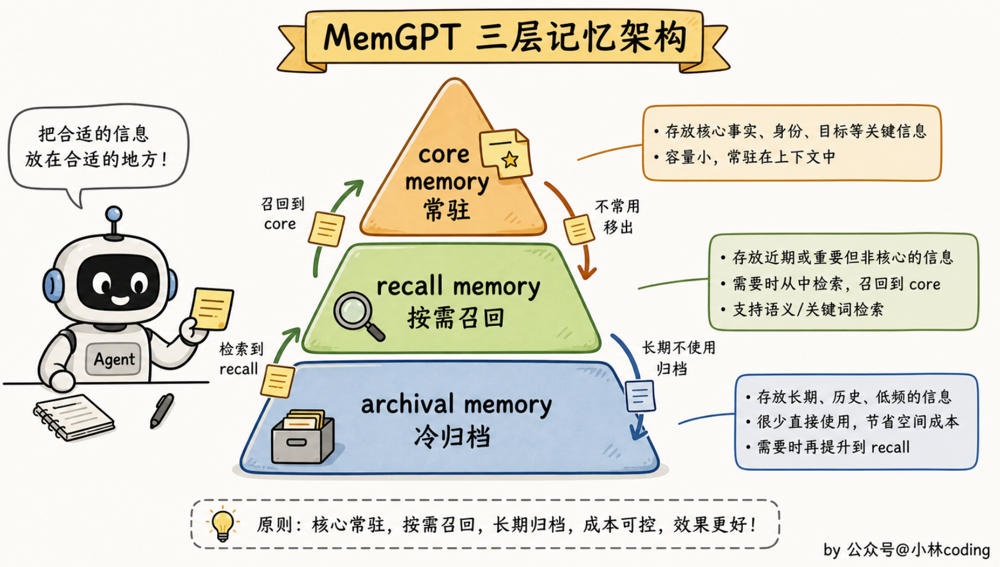
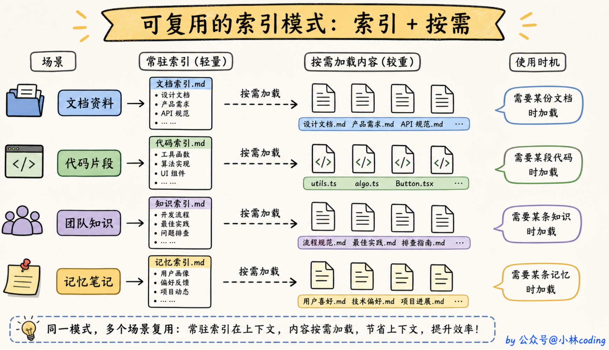
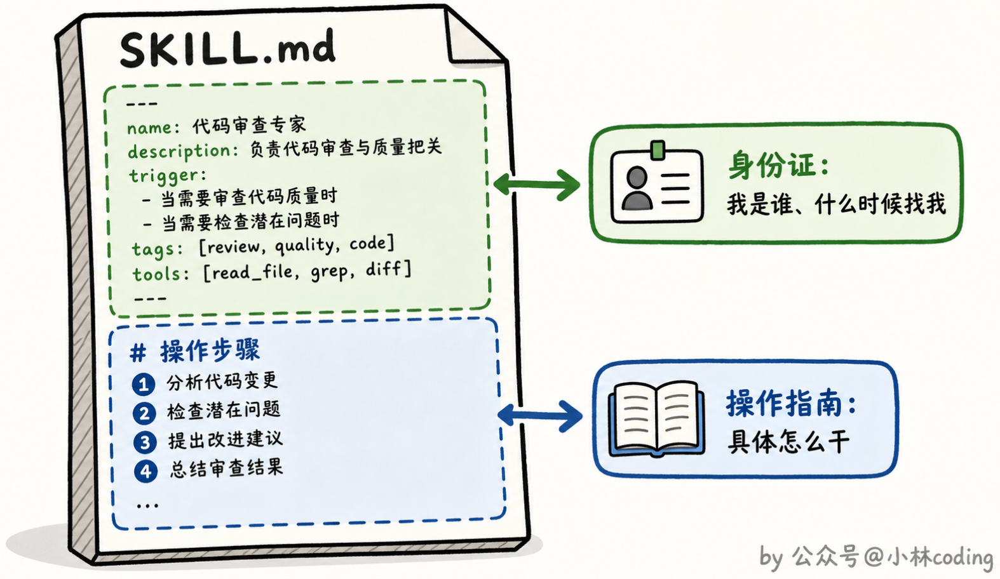
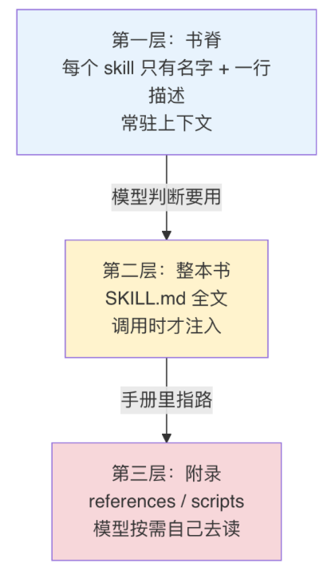

# DeepSeek Harness
## 总体架构

### 配置组装层
**Bundle（组合包）**  
是一个可分发、可复用的插件集合。它包含一组 Cordis 插件及其默认配置和挂载代码，提供一套基础能力。Bundle 里写的内容都是默认值，随时可以被上层修改、增加或删除。
**Profile（配置文件/预设）**  
是你本地的一个具名配置目录。它包含两部分：
1. **一份清单**：声明要按什么顺序加载哪些 Bundle。
2. **用户自己的 `cordis.patch.yml`**：对加载进来的 Bundle 做最终修改。

运行时流程是：
1. 按 Profile 的清单顺序，逐层叠加各个 Bundle，形成初始插件树。
2. 再应用用户自己的 `cordis.patch.yml`，对插件树进行增、删、改。
3. 最终插件树交给 Cordis 容器实例化并运行。

`dsh.profile` ：`dsh-base` 是每个 profile 的第一层（模型适配器、工具、持久化、沙箱与审批、凭据、遥测，约 90 个插件），`dsh-web-app` 在其上叠加浏览器应用，`dsh-headless` 叠加一个完全不带服务器的一次性 runner。用户自己的补丁在最顶层，可以对插件树进行**最后的**增、删、改。

各层的应用顺序是：profile 列出的每个组合包 → profile 级 `cordis.patch.yml` → home 级 → 任意 `--patch` overlay。一条 patch **按 id 定位某个条目并替换其整个 config**，或插入新条目。

### 运行时上下文层
配置组装完成后，系统会启动 Cordis 容器，根据插件树实例化所有插件。其中一部分插件，专门负责**向 Cordis 容器注册一个服务**，这个服务会挂到 `ctx` 上，供其他插件使用。此时，插件树被“压平”成了 **5 个核心服务入口**（`ctx.sessions`、`ctx.agents`、`ctx.tools`、`ctx.llm`、`ctx.systemPrompt`）。这棵树里所有插件的能力，最终通过这 5 个核心服务入口对外暴露。其他插件不需要知道某个能力来自树里的哪个插件。
### 事件扩展层
插件树被 Cordis 容器实例化后，提供服务的插件把能力注册到 ctx，消费型插件通过 inject 依赖这些 ctx 服务，并在各自监听的事件扩展点上介入，最终共同驱动 Agent Loop 运转。
## Cordis
下面基于5个核心概念来介绍Cordis插件框架
### Context  按名字存取服务的容器
是一个公共容器,每个模块**按名字注册**自己的能力,使用方**按名字取**。Cordis 的 **context**(就是代码里的 `ctx`)就是这个容器。
**注册**
```ts
import { Context, Service} from 'cordis'

abstract class Greeter extends Service{
	constructor(ctx: Context) {
		super(ctx, 'greeter')
	}
	
	abstract greet(name:string):string
}
```
注册的关键是
```ts
super(ctx, 'greeter')
```
它告诉 Cordis，将当前实例以 `'greeter'` 为名字注册到 Context 上（同一作用域重复注册同名服务会直接失败,不会"后写的覆盖先写），然后再补一段类型声明就可以让TypeScipt知道这项能力存在。
```ts
declare module 'cordis'{
	interface Context {
		greeter: Greeter
	}
}
```
但它暂时还是一个空壳，接着需要通过Plugin给它提供具体的能力(通过这样的方式也可以替换能力)
```ts
class EnglishGreeter extends Greeter {
	greet(name: string) {
		return 'Hello, ${name}!'
	}
}

class ChineseGreeter extends Greeter {
	greet(name: string) {
		return '你好,${name}!'
	}
}
```
安装
```ts
let greeterFiber = await ctx.plugin(EnglishGreeter)
app(ctx)
```
替换也是一样的
```ts
await greeterFiber.dispose()
greeterFiber = await ctx.plugin(ChineseGreeter)
app(ctx)
```
使用
```ts
ctx.greeter.greet('Alex')
```

注意:`ctx` 是个 Proxy(代理对象，读写及函数调用可被拦截并执行自定义逻辑),"读属性"这个动作会被拦截并转给服务解析器--所以 `ctx.shell` 不是读某个固定字段,而是"解析当前作用域(这个对象维护的本地服务表)里名为 `shell` 的服务"。这带来一个能力:**同一个名字在不同子作用域可以指向不同实现**(preset 就靠它给不同 agent 配不同能力)。例如：
```ts
const parentCtx = rootCtx.extend()          // 父作用域
const agentACtx = parentCtx.isolate()       // Agent A 的隔离作用域
const agentBCtx = parentCtx.isolate()       // Agent B 的隔离作用域

// 在 A 的作用域里注册 bash 实现
agentACtx.plugin(BashService)   // agentACtx.shell → BashService 实例

// 在 B 的作用域里注册 powershell 实现
agentBCtx.plugin(PowerShellService) // agentBCtx.shell → PowerShellService 实例
```
### fiber 与 effect  注册即副作用
插件 A 注册了工具、监听器、定时器
```ts
// plugin-a.ts
import { Context } from 'cordis'
import { defineTool } from 'dsh-tools'

export const name = 'plugin-a'
export const inject = ['tools']

export function apply(ctx: Context) {
  console.log('[A] apply 开始')

  // ① 事件监听器
  ctx.on('message', () => {
    console.log('[A] 收到 message 事件')
  })

  // ② 工具注册
  ctx.tools.register(defineTool({
    name: 'ping',
    description: 'Ping',
    parameters: {},
    async execute() { return 'pong' },
  }))

  // ③ 定时器（框架管不到，必须用 ctx.effect 显式包裹）
  ctx.effect(() => {
    console.log('[A] 定时器启动')
    const timer = setInterval(() => console.log('[A] tick'), 1000)
    return () => {
      console.log('[A] 定时器清理')
      clearInterval(timer)
    }
  })

  // ④ 子插件
  ctx.plugin(ChildPlugin)

  console.log('[A] apply 结束')
}
```
那么A 被卸载后(配置删了、热重载、依赖消失),谁来收拾?
每次 `ctx.plugin()` 挂载会产生一个 **fiber**——这次挂载的运行时实例
```ts
const fiber = ctx.plugin(pluginA)
```
持有配置、依赖状态和**本次挂载注册的所有 effects**。
```
fiber(plugin-a)
├── config        本次挂载的配置
├── state         ACTIVE
├── effects       [ ①监听器, ②工具, ③定时器, ④子插件 ]
│                  （按注册顺序排列）
└── children      [ fiber(ChildPlugin) ]   ← ④ 子插件的 fiber
```
fiber 卸载时
```ts
await fiber.dispose()
```
清理函数按注册**逆序**执行并被等待。
```
开始卸载 fiber(plugin-a)
  ↓
逆序执行 effects：
  ④ 子插件      → 卸载 ChildPlugin 的 fiber（递归清理它的 effects）
  ③ 定时器      → 调用 clearInterval(timer)
  ② 工具        → 从 Tool Registry 移除 'ping'
  ① 监听器      → 移除 'message' 监听器
  ↓
等待所有 disposer 完成（包括异步）
  ↓
state = DISPOSED
```
这些撤销动作就是框架自动推导并绑定的；只有框架管不到的外部资源（比如上面的定时器），才需要你手动定义。
### 插件的三种形态
**函数插件**
```ts
export const name = 'tool-bash'
export const inject = ['tools', 'shell', 'systemPrompt', 'shellEnv']
export const Config = z.object({ ... })

export function apply(ctx: Context, config: Config): void {
  // 拿 ctx 注册工具、监听事件
}
```
- 适合“消费者”插件：依赖别的服务，注册工具/监听器。
- 框架识别：模块里有 `apply` 函数，就把它当插件入口。
- `name`、`inject`、`Config` 是**命名导出**，与 `apply` 平级，共同描述这个插件。
**Service子类**
```ts
// greeter-service/src/index.ts
export default class GreeterService extends Service {
  constructor(ctx: Context) {
    super(ctx, 'greeter')
  }
  greet(name: string) { return `Hello, ${name}!` }
}
```
- 适合“提供者”插件：向容器注册服务。
- 框架识别：模块的 **default export** 是 `Service` 子类，就把它当插件本体。
- 服务名、依赖等，由类内部 `super(ctx, 'greeter')` 和静态属性决定。
**带apply的对象**
```ts
export default {
  name: 'some-plugin',
  inject: ['tools'],
  apply(ctx: Context) {
    // ...
  },
}
```
- 等价于函数形态，只是把元数据和 `apply` 打包进一个对象。
- 适合需要动态构造插件对象的场景（比如工厂函数返回插件）。

三种形态**功能等价**，框架统一用 `ctx.plugin(plugin, config)` 挂载，返回 fiber。

函数插件和 Service 子类两者都是插件。不过一个是服务提供者（可以给别的插件用，通过名字获取其能力），而另一个仅仅是装配单元/消费者（其他插件在容器里找不到它、用不了它，但它内部封装了装配逻辑和工具能力，是给 Agent（大模型）和 Harness（运行时）用的）。
那Agent和Harness怎么找插件呢？
Harness 启动时，最先被挂载的是 **Loader 插件**，它是整个插件系统的入口。
Loader 的核心工作是读取 `cordis.yml` 配置文件，该文件用 `name` 字段声明要加载的插件模块。
```yaml
- name: '@deepseek-ai/dsh-tools'        # 工具注册表服务
- name: './tool-logger.ts'              # 日志插件
- name: './greet-tool.ts'               # 自定义工具插件
```
Loader 读取 `cordis.yml`，然后根据里面的配置，通过 `ctx.plugin()` 把一个个插件挂载到 `ctx` 上。最终留在 `ctx` 上的是插件实例（及其注册的 effect）。这就是 Harness“找到”插件的方式——**通过配置文件中的模块名（`name`）静态解析**，而不是运行时动态搜索（不同的预设会有不同的cordis.yml配置文件，因此有了不同的能力）。

导出纪律：
- **service 包**:default export 它的 Service 类;
- **函数插件**:只命名导出 `name` / `inject` / `Config` / `apply`,**不写 default export**。
两种形态不能混在一个 module 里——Loader 会把 default export 当成插件本体,同 module 的命名元数据就不再属于它,`inject` 等于丢失。
### Service + Inject  启动顺序不该由人排
依赖关系规定
```ts
export const name = 'consumer-optional'
export const inject = [] // 必须的服务需要写在inject数组里面

export function apply(ctx: Context) {
  // 可选服务用 `ctx.get(name)`,没提供时得到 `undefined`。
  const greeter = ctx.get('greeter')

  if (greeter) {
    console.log(greeter.greet('Optional'))
  } else {
    console.log('greeter 服务未提供，降级处理')
  }
}
```
一个服务可能会依赖其他多个服务，那么它们的启动顺序就应该是依赖的服务先启动，然后再启动它自己，并且依赖消失时它会跟着卸载,依赖恢复时再自动加载。所以这个启动顺序不应该由人来排，而是应该由依赖图（各个服务之间的依赖关系构成的图）来决定。
并且加载依赖服务的时候用的是其注册的名字而非具体实现，这也是支持替换实现的一部分。
```ts
export const name = 'tool-bash'
export const inject = ['tools', 'shell', 'systemPrompt', 'shellEnv']
```
### Event  五种派发方式
event 表达"发布一个扩展点,让未知的零个或多个插件参与"。
插件统一用 `ctx.on(name, listener)`进行监听，再监听到事件后执行自己的逻辑，从而参与进流程;**派发方式是事件契约的一部分**,由事件的拥有者(producer，Agent Loop 或者 Tool Runtime等关键插件，它们可以按指定方式派发事件)选定(监听该事件的插件按派发方式所定逻辑进行配合工作):

| 派发              | 语义                             | 典型用途                                   |
| --------------- | ------------------------------ | -------------------------------------- |
| `emit`          | 同步逐个通知，插件执行自己的逻辑，但忽略返回值        | 纯观察(如 `session/event` 广播)              |
| `parallel`      | 并发跑所有监听者,等全部结束                 | 通知多个互不相干的方                             |
| `serial`        | 各个插件逻辑依序 await执行,遇到首个 bail 值停止 | 顺序决策(如 `agent/turn-stopping`:有一个说不停就停) |
| `bail`          | serial 的同步版（同步顺序执行）            | 同上,无异步需求时                              |
| **`waterfall`** | **中间件/洋葱模型**                   | **拦截、包装、改写**(下文专讲)                     |
派发和监听的配合
```ts
// ① 插件先监听
ctx.on('tools/pre-execute', async (exec, next) => {
  console.log('插件 A 被触发了') // 监听到派发的事件后就执行该插件的逻辑
  return await next()
})

// ② 过了一段时间，Harness 决定派发
await ctx.waterfall('tools/pre-execute', exec, async () => {
  console.log('最内层默认行为')
  return { kind: 'allow' }
})
```
如果在一个扩展点发布了多次事件(派发类型可相同可不同，插件都会按派发类型执行若干次逻辑)。

**waterfall:这个仓库最重要的控制流**

`ctx.waterfall` 就是 Web 框架的 around-middleware。每个监听者收到 `(...args, next)`:

- 调用 `next(...)`:把(可能已被自己改过的)参数交给下一层;`next` 的返回值是内层的结果,可以再加工;
- **不调用 `next()` 直接返回:短路**,后面所有层和最内层的默认行为都不执行。

以 `tools/execute` 为例,洋葱是这样套起来的:最外层可能是 timeout 策略插件,再往里是审批插件,最核心是工具真正的执行器。每个插件包住"剩下的整条链"。

仓库规矩要读准:**"waterfall 监听者必须调用 `next()`"针对的是协作型监听者**(观察、校验、包装);**拥有单一决定权的监听者故意短路是设计的一部分**--比如权限插件拒绝一次工具调用,就是要短路。写和读代码时都要分清这是哪一种。
```ts
async function listenerA(payload, next) {
  console.log('A 进入')
  const inner = await next()      // 把控制权交给 B
  console.log('A 拿到内层结果:', inner)
  return `A 包装了(${inner})`
}
async function listenerB(payload, next) {
  console.log('B 进入')
  const inner = await next()      // 交给 C
  return `B 包装了(${inner})`
}
async function listenerC(payload, next) {
  console.log('C 进入')
  return 'C 的原始结果'           // 最内层
}
```

**Agent Loop中各个扩展点事件发布者(会变更)**

| 事件名称                      | 所属阶段   | 发布者（事件拥有者）                                        | 派发方式                                               | 核心作用简述                                                                                                              |
| ------------------------- | ------ | ------------------------------------------------- | -------------------------------------------------- | ------------------------------------------------------------------------------------------------------------------- |
| **`turn/start`**          | 轮次开始   | **Agent Loop 插件** (`@deepseek-ai/dsh-agent-loop`) | **持久化写入** (非 `emit`)                               | 领取首条输入，打开并初始化一个轮次（Turn），写入 Session 日志[](https://developer.aliyun.com/article/1760581#1)。                            |
| **`agent/pre-step`**      | 步骤预备   | **Agent Loop 插件**                                 | **waterfall**                                      | 拦截即将进入模型的 messages，允许插件改写消息内容，或直接拒绝该次请求（短路）[](https://yuanyou.blog.csdn.net/article/details/164338227#2)。           |
| **`step/start`**          | 步骤开始   | **Agent Loop 插件**                                 | **持久化写入** (非 `emit`)                               | 将 entered messages 追加为 `user/message`，并准备从日志派生模型历史，写入 Session 日志[](https://developer.aliyun.com/article/1760581#1)。 |
| **`agent/request`**       | 模型请求前  | **Agent Loop 插件**                                 | **waterfall**                                      | 拦截即将发往 LLM 的请求参数（如调整 temperature、修改 system prompt、注入 RAG 结果）。                                                       |
| **`llm/stream`**          | 模型推理   | **LLM 适配器插件** (`LlmRuntime`)                      | **waterfall**                                      | 拦截底层的流式请求（如替换模型供应商、添加代理、重试机制）。                                                                                      |
| **`assistant/chunk*`**    | 模型推理   | **LLM 适配器插件**                                     | **持久化写入** (在 0.1.5 后改为 `agent/assistant-stream` 帧) | 实时拦截并改写模型流式输出的每一个数据块（如流式敏感词过滤、实时 TTS 转换）。                                                                           |
| **`assistant/message`**   | 模型推理完成 | **Agent Loop 插件**                                 | **持久化写入**                                          | 模型完整回复生成后，作为持久会话事件写入日志[](https://developer.aliyun.com/article/1760581#1)。                                           |
| **`tools/pre-execute`**   | 工具执行前  | **Tool Runtime 插件** (`@monotonic/dsh-tools`)      | **waterfall**                                      | 权限校验、参数验证、危险操作二次确认，可返回 `deny` 短路后续执行。                                                                               |
| **`tools/execute`**       | 工具执行中  | **Tool Runtime 插件**                               | **waterfall**                                      | 包装工具的真正执行逻辑（如添加超时控制、重试机制、Mock 测试）。                                                                                  |
| **`tools/post-execute`**  | 工具执行后  | **Tool Runtime 插件**                               | **waterfall**                                      | 对工具返回的结果进行清洗、脱敏、格式化，或处理执行异常。                                                                                        |
| **`tool/result*`**        | 工具结果定稿 | **Tool Runtime 插件**                               | **持久化写入** (观察通知为 `emit`)                           | 工具执行结果最终确定，写入会话日志，并准备回传给模型[](https://www.npmjs.com/package/@monotykamary/dsh-tools#1)。                              |
| **`step/end`**            | 步骤结束   | **Agent Loop 插件**                                 | **持久化写入** (非 `emit`)                               | 判断当前步骤是否还有更多工作。若无，则退出本轮循环，写入 Session 日志[](https://developer.aliyun.com/article/1760581#1)。                          |
| **`agent/turn-stopping`** | 轮次停止前  | **Agent Loop 插件**                                 | **serial**                                         | 顺序决策轮次是否应该停止。任何一个插件返回非空值（如 `stop: true`），轮次即结束[](https://yuanyou.blog.csdn.net/article/details/164338227#2)。        |
| **`turn/end`**            | 轮次结束   | **Agent Loop 插件**                                 | **持久化写入** (非 `emit`)                               | 不再欠任何工作时，正式关闭轮次，清理会话级资源，写入 Session 日志[](https://developer.aliyun.com/article/1760581#1)。                            |

### 一个简单但完整的dsh工具插件结构
```ts
// src/index.ts
import type { Context } from '@deepseek-ai/cordis'
import { defineTool } from '@deepseek-ai/dsh-tools'

// ① 插件身份标识
export const name = 'greet-tool'

// ② 依赖声明
export const inject = ['tools']

// ③ 插件入口函数
export function apply(ctx: Context) {
  ctx.tools.register(defineTool({
    // ④ 工具元数据（给模型看的）
    name: 'greet',
    description: 'Greet someone by name.',
    parameters: {
      name: { type: 'string', required: true, description: 'The name to greet' },
    },
    // ⑤ 输出契约
    output: {
      schema: { type: 'string' },
      render: (_args, value) => [{ type: 'text', text: value }],
    },
    // ⑥ 执行逻辑（真正干活的代码）
    async execute(args) {
      return `Hello, ${args.name}!`
    },
  }))
}
```

## Turn and Step
dsh 的最小执行单元定义得非常精确：**一个步骤（step）= 一次模型请求 + 它调用的工具**；**一个轮次（turn）包含零个或多个步骤**，在领取首条输入时打开，不再欠下任何工作时关闭。

实线框是持久会话事件（写进日志），虚线框是 waterfall 实时扩展点（可拦截改写）。右侧回边是循环的关键——只要工具欠一个请求或新输入到达，就领取下一步；`agent/pre-step` 可以改写甚至拒绝已领取的消息。

注意循环的每一拍都会**先写日志再执行**——这个顺序是后面"模型可见即已记录"不变量的根基。

插件就是在Agent Loop中的各个实时扩展点注入自己的影响的（实现自己的功能）。
**预备阶段**
**`agent/pre-step`**
插件可在此拦截即将进入模型的消息，可以拒绝该次请求or改写消息并调用next()函数交给下一层插件进行处理。

**模型推理阶段**
**`agent/request`**
插件可在此拦截即将发往 LLM 的请求参数（如调整 temperature、修改 system prompt、注入 RAG 检索结果）。
**`llm/stream`**
插件可拦截底层的流式请求（例如替换不同的模型供应商、添加代理）。
**`assistant/chunk*`**
在模型流式输出每一个 chunk 时，插件可以实时拦截并改写（例如流式敏感词过滤、实时 TTS 转换、结构化输出解析）。

**工具执行阶段**
**`pre-execute`**
插件可在工具真正执行前拦截。用于权限校验（这个 Agent 是否有权调用该工具）、参数验证、危险操作二次确认、或者参数动态修改。
**`execute`**
工具实际执行的扩展点。插件可在此包装工具执行逻辑（例如添加超时控制、重试机制、Mock 测试）。
**`post-execute`**
工具执行完毕后的拦截点。插件可对工具返回的结果进行清洗、脱敏、格式化，或者处理工具执行抛出的异常。

插件在启动与注册阶段(Harness初始化时)，不仅定义了工具的执行逻辑，还必须向核心Harness提交一份工具元数据(Tool Schema，通常包含工具名称、功能描述和参数结构)。核心Harness会维护一个工具列表(Tool Registry)，当流程走到`agent/pre-step` 和 `agent/request` 时，Harness 会从 Tool Registry 中提取出当前 Agent 被授权使用的工具列表，按大模型指定格式(如OpenAI的tools)全量(工具数量少)或动态按需注入(工具数量非常多，可以先检索再注入相关的)。
到这插件把自己的工具准备好了，那插件是怎么用这些工具协助Agent完成任务的呢。在 **`agent/pre-step`** 或 **`agent/request`** 阶段通过改写 Prompt、注入 Few-shot 示例，甚至强制指定 `tool_choice`，引导大模型在特定场景下产生调用某工具的意图，然后在这个工具执行阶段会找到这个工具所属的插件(还有一些注册了全局拦截逻辑的插件)，Harness让出执行权让这些插件去执行这个工具。其实就是在工具执行阶段，Harness 会根据工具名路由到对应的插件及全局拦截逻辑插件。然后在 `pre-execute`、`execute`、`post-execute` 这些由 Harness 定义的扩展点上，注入并执行自己编写的回调逻辑。最终完成工具的调用，并把结果通过 Harness 写入 `tool/result`。  此时，流程走到 `step/end`。如果判断还有下一步则会继续该Turn。
## Session Log
DSH对会话历史的做法：只 append 不可变事件(`turn/start`、`user/message`、`assistant/chunk`、`tool/call`、`tool/result`、…),任何"当前状态"都是对事件的**投影(projection)**（在不可变事件流上进行处理后的现象，如压缩、改写）。通过这种方法可以实现以下需求：

| 需求   | 解决办法                                                              |
| ---- | ----------------------------------------------------------------- |
| 崩溃恢复 | 重放日志;崩溃留下的未闭合 turn 和 torn tail 由 `dsh-session-persistence` 在加载时修复 |
| 分叉   | 复制日志到边界处,继续各自 append。`ctx.sessions.fork(source, boundary?)`       |
| 压缩   | append 一条"surface 替换"事件，原始事件一个不动                                  |
| 多种读法 | 每个消费者(projector、query、title、telemetry)各自从事件流派生自己的读模型,互不干扰         |
这就是 event sourcing。**事实(发生了什么)和视图(现在看起来怎样)被彻底分开,事实层不可变,视图层随便算/处理。

对话历史在内存中的结构
```ts
// 内存中对话历史的容器，本质上是一个数组
class Session {
  events: SessionEvent[] = [] // 这就是那个有序列表
  
  // 核心方法：只允许追加（append-only）
  append(type: string, data: any) {
    const event = {
      seq: this.events.length, // 分配单调递增的序列号，等于当前数组长度
      type: type,              // 事件类型，如 'user/message'
      data: data,              // 具体数据
      timestamp: Date.now()    // 时间戳
    }
    Object.freeze(event)       // 冻结，不可再变
    this.events.push(event)    // 追加到数组末尾
    // ... 更新 Surface、广播事件等
  }
}
```

**内存对象与磁盘事实**两层的读写路径一图流:
```
调用方 ──session.append(type, data)──▶ 内存事实层
                                       │ 验证、冻结、分配单调递增 seq
                                       │ 更新内存 surface
                                       └─广播 session/event(live)──▶ UI 立刻可见
                                                              │
                                            dsh-session-persistence 监听,批量落盘
                                                              │
调用方 ──await ctx.sessions.flush(session)──▶ session/flush checkpoint,排空批量缓冲
```
两个层次**不是同一个 commit 点**:
- `session.append(type, data)`:在**内存**中验证、冻结、分配单调递增的 `seq`,更新内存 surface,广播 `session/event`。已接受的事件永不再变,`session.events` 是冻结快照。
- 持久化:`dsh-session` **自己不写磁盘**。它只发布 live 事件;`dsh-session-persistence` 监听这些事件,批量落盘。
- 需要"确定已落盘"的调用方,随后 `await ctx.sessions.flush(session)`,触发 `session/flush` durability checkpoint,把批量缓冲排空。
为什么不 append 即写盘?因为 UI 想立刻看到事件(内存 append 立即广播),而磁盘写是批量的(保证性能)。两层各自有明确的语义,谁需要哪种保证就调哪个。

### surface & raw log —— 模型看到的 & 实际发生过的
Session 内部有两层:
- **raw log**:全部历史事件,永久事实层,只增不减。
- **surface**:模型**当前**看到的消息层。普通 append 在 surface 尾部加一条;**compaction(压缩)产生的替换事件可以让旧消息不再进入后续请求**--但 raw 事件仍然都在。

surface层内容：

|事件类型|说明|是否在 Surface 中|
|---|---|---|
|**`system/message`**|系统提示词，定义了 Agent 的角色、能力和行为准则。|✅ **是**|
|**`user/message`**|用户的直接输入或系统注入的上下文信息。|✅ **是**|
|**`assistant/message`**|模型生成的完整回复，可能包含文本内容或工具调用请求。|✅ **是**|
|**`tool/result`**|工具执行完成后返回的结果。|✅ **是**|
|`turn/start`, `step/end`|轮次和步骤的边界标记。|❌ 否|
|`assistant/chunk`|模型输出的原始流式数据块。|❌ 否|
|`tool/call`|模型发起的工具调用请求。|❌ 否|
|重试、审批、压缩等插件事件|由插件扩展的事件。|❌ 否|
compaction 的完整流程(`dsh-compaction` + `compaction-basic`):

```
token 压力触发
  │ 选择一个安全边界(不能拆散 tool-call/result 配对)
  ▼
durable 事务:
  compaction/start
    -> summary 事实
    -> 一条带 surfaceOp: replace 的 user/message 检查点
  compaction/end
  ▼
从此 deriveMessages() 从替换点开始投影:
  模型看到"[总结] + 之后的消息",而不是全部历史
```

1. token 压力触发,选择一个**安全边界**;
2. durable 事务:`compaction/start` -> summary 事实 -> 一条带 `surfaceOp: replace` 的 `user/message` 检查点 -> `compaction/end`;
3. 从此 `deriveMessages()` 从替换点开始投影:模型看到"\[总结\] + 之后的消息",而不是全部历史。

三条配套纪律:

- **compaction 边界不能拆散 tool-call/result 配对**--把一个 tool call 切进总结、result 留在总结外,重建出的历史就是残缺的。
- 自动 compaction 只发生在活动 turn 的安全点;手动 `/compact` 要先获得空闲准入。不是"总在后台随时跑"。
- 人类 transcript、模型历史、UI 投影,**各自声明**自己读 raw 还是读 surface--因为两个答案都合法,但必须明确。

**铁律：任何进入模型请求的内容,必须能从 session log 重建;新增模型可见输入,必须新增 durable 事件。**
为什么必须铁律化?逐个看违反后的裂口:
- 假设某个插件在请求前临时拼了一段 workspace 说明,没落日志。那么日志重建出的"模型看到的内容"和**真实的**模型输入**分叉**了。
- 分叉一旦发生:resume 后模型行为不可复现;fork 出的分支和原会话"看着一样其实不一样";transcript 展示的输入模型根本没看到;调试时你以为的上下文不是实际的上下文

| 分叉的裂口 | 具体后果 |
|---|---|
| resume | 模型行为不可复现 |
| fork | 分支和原会话"看着一样其实不一样" |
| transcript | 展示的输入模型根本没看到 |
| 调试 | 你以为的上下文不是实际的上下文 |

注意精确含义:不是"每个中间步骤都要持久化",而是**最终到达模型的语义必须有 durable owner**。live 的 pre-step 可以随便改消息,但改完的结果会写成 durable `user/message`;prompt 组装的中间过程不必落日志,但组装结果进入了可重建的请求。这条规则有运行时 invariant 持续断言,不是靠自觉。

### 一个 log,五个读者

Session 目录下不只有一个包,而是一群各自独立的**投影消费者**:

| 包 | 从 log 派生出什么 |
|---|---|
| `session-persistence`(+jsonl/sqlite backend) | 磁盘事实 |
| `session-projection` | UI 用的同步一致快照 |
| `session-query` | 检索语料与有界读取(SQLite provider 加索引) |
| `session-title` | 标题(唯一的 title provider seam,辅助模型调用) |
| `session-telemetry` | 遥测投影 |

这就是 event sourcing 的回报:写入方只有一套 durable 事实,五种读法互不干扰、各自演化。新增一种读法 = 新增一个消费者插件,写入方零改动。
### 三个"版本号",三个完全不同的问题
一份 session 日志要能正确读写，需要同时满足三个维度的兼容性——事件语义、数据库表结构、文件字节编码。每个维度都有自己的版本管理方式。

| 版本号                              | 归属         | 管什么                                     | 打个比方           |
| -------------------------------- | ---------- | --------------------------------------- | -------------- |
| `SESSION_FORMAT_VERSION`         | dsh 自己     | **事件的语义格式**：每个事件类型代表什么、字段是什么含义、顺序怎么重建   | 书的**语言和内容版本**  |
| SQLite `SCHEMA_VERSION`          | SQLite 数据库 | **数据库布局**：表、列、索引、应用身份等                  | 书架的**结构和标签**   |
| JSONL backend 的 `compression` 配置 | 文件存储层      | **文件字节编码**：是 Zstandard 压缩帧，还是裸 JSONL 文本 | 书是**印刷版还是电子版** |
配套规则：
- 新增事件类型，不一定要提升 `SESSION_FORMAT_VERSION`。因为 dsh 的 `SessionEventMap` 里的成员默认是 **required-on-read**。意思是：**旧版本的 reader 如果遇到一个它不认识的事件类型，会直接拒绝读整份日志**，而不是悄悄跳过。这听起来很严格，但其实是保护机制——避免旧程序误解新数据。只有当你希望旧 reader 能安全跳过这个新事件时，才在事件信封上标记 ignorable: true。这样旧 reader 才会忽略它，继续读后面的。
- 当**旧 reader 无法保留日志的完整语义**时，才需要提升。比如：改变了已有事件的含义；改变了事件重建的顺序；让旧 reader 即使能读，也会理解错。如果只是添加一个可安全忽略的辅助事件，就不一定需要提升。
- 当前处于预发布阶段(v0):没有兼容承诺,旧格式直接拒绝,不做迁移路径。这是有明确结束条件的仓库策略(首个 tagged release 时移除),不是永久产品决定。
- 如果你把存储格式从 Zstandard 压缩换成裸 JSONL，或者反过来，**不能在同一份数据根目录下悄悄换**。因为旧程序可能按老编码去读，会读出一堆乱码。正确做法：**换编码就用新的 root 目录**，让新旧数据物理隔离。
遇到"数据打不开"时,先判断属于哪一层,再去读对应 owner 的错误信息;不要改版本常量绕过拒绝。
## Capability Seam 能力缝
一个 **capability seam**（能力缝）由三个角色构成，和Cordis框架对照起来看会比较清楚。

|角色|职责|在 Cordis 里的对应|
|---|---|---|
|**Service Definition**|声明接口，拥有 `ctx` 上那个 key|`declare module` 声明类型 + `Service` 基类约定|
|**Service Provider**|往容器里注册一个具体实现|`class XxxService extends Service` + `super(ctx, 'name')`|
|**Consumer**|只按接口取用，不知道背后是谁|`inject = ['name']` + `ctx.name`|

### Service Definition
这是 Seam 的“定义方”。它不提供具体能力，只**声明一个 key 和它的语义**（注册了一个可以供别人查找的名字，并且规定了这个名字应该提供怎么样的能力）。
```ts
// 定义方：声明 ctx 上有个叫 'shell' 的能力，类型是 ShellService
declare module 'cordis' {
  interface Context {
    shell: ShellService
  }
}

interface ShellService {
  exec(cmd: string): Promise<string>
}
```
### Service Provider
这是 Seam 的“实现方”。它把一个具体类挂到 ctx.shell 上。
```ts
class BashService extends Service implements ShellService {
  constructor(ctx: Context) {
    super(ctx, 'shell')  // 注册到 ctx.shell
  }
  async exec(cmd: string) { return await runBash(cmd) }
}

// 挂载
ctx.plugin(BashService)
```
也可以是另一个实现，只要满足 `ShellService` 接口：
```ts
class PowerShellService extends Service implements ShellService {
  constructor(ctx: Context) { super(ctx, 'shell') }
  async exec(cmd: string) { return await runPowerShell(cmd) }
}
```
**切换方式**
假设你正在开发一个 Agent，它需要用到网页搜索能力(web)。你安装了三个搜索 Provider 插件：

|Provider 插件名|注册的 id|需要什么|
|---|---|---|
|`@deepseek-ai/dsh-web-search-deepseek`|`deepseek-official`|`DEEPSEEK_API_KEY`|
|`@ltctfer/dsh-web-search-brave`|`brave-official`|`BRAVE_API_KEY`|
|`@mikasomaka/dsh-web-search`|`chain`|Gemini / Exa / Firecrawl 的 key|

基础包 `dsh-base` 默认把 `web` 这个 Capability Seam 的 `searchProvider` 固定为 `deepseek-official`。所以**默认情况下，你的 Agent 用的是 DeepSeek 官方搜索**。

这个dsh-base本质也是一个cordis.patch.yml
```yaml
- id: web
  config:
    searchProvider: deepseek-official
```

在你想把它换成 Brave 搜索：
在你的 profile 目录（例如 `~/.dsh/profiles/web/`）下，打开或创建 `cordis.patch.yml`，写入：
```yaml
- id: web
  config:
    searchProvider: brave-official
```
**就这么两行。** 注意 `- id: web` 对应的是 `web` 这个 Seam 的行，`config` 是**整块替换**，不是深度合并。所以如果你需要保留其他字段，必须一并重述。重启生效。

### Consumer
这是 Seam 的“消费方”。它只知道自己要用 `shell` 能力，不知道背后是 Bash 还是 PowerShell。
```ts[]()
export const name = 'tool-bash'
export const inject = ['shell']

export function apply(ctx: Context) {
  ctx.tools.register(defineTool({
    name: 'bash',
    async execute(args) {
      return await ctx.shell.exec(args.cmd)  // 只用接口，不关心实现
    },
  }))
}
```
### 为什么这种抽象有用
1. 替换实现不改 Consumer
你把 `BashService` 换成 `PowerShellService`：
- Provider 换了一个插件；
- Consumer 代码不变；
- `inject` 声明不变；
- 只是运行时的解析结果变了。
2. 作用域隔离，同名不同实现
```
const agentACtx = parentCtx.isolate()
const agentBCtx = parentCtx.isolate()

agentACtx.plugin(BashService)        // agentACtx.shell → Bash
agentBCtx.plugin(PowerShellService)  // agentBCtx.shell → PowerShell
```

两个 Agent 的代码都写 `ctx.shell`，但因为作用域不同，拿到的是不同实现。这就是 dsh preset 给不同 agent 配不同能力的核心机制。
### 一个完整的Seam例子
```ts
// ─── Service Definition（接口 + key 所有权）───
declare module 'cordis' {
  interface Context {
    greeter: GreeterService
  }
}
interface GreeterService {
  greet(name: string): string
}

// ─── Service Provider A（英文实现）───
class EnglishGreeter extends Service implements GreeterService {
  constructor(ctx: Context) { super(ctx, 'greeter') }
  greet(name: string) { return `Hello, ${name}!` }
}

// ─── Service Provider B（中文实现）───
class ChineseGreeter extends Service implements GreeterService {
  constructor(ctx: Context) { super(ctx, 'greeter') }
  greet(name: string) { return `你好，${name}！` }
}

// ─── Consumer（只认接口）───
export const name = 'greeting-tool'
export const inject = ['greeter']
export function apply(ctx: Context) {
  ctx.tools.register(defineTool({
    name: 'greet',
    async execute(args) {
      return ctx.greeter.greet(args.name)  // 不知道是英文还是中文实现
    },
  }))
}

// ─── 组装：选择哪个 Provider，就决定 Seam 背后是谁 ───
ctx.plugin(EnglishGreeter)   // 或 ctx.plugin(ChineseGreeter)
ctx.plugin(greetingTool)
```
### Execution World
模型在干活时，会同时用到各种工具：`bash` 跑命令、`read` 读文件、`glob` 扫路径、`LSP` 分析代码。  
如果这些工具各自看向不同的“现实”——比如 `bash` 在远程服务器上创建了文件，`read` 却在本地找——模型就会陷入精神分裂。**为了保证模型认知一致，所有工具必须运行在同一个“执行世界”里。**

这个“世界”由两个底层接缝定义：
- **`fs`（文件系统）**：负责文件的读写、路径解析和文件身份识别。
- **`subprocess`（子进程）**：负责进程的创建与执行，管理进程树。
- **它们的关系**：`shell`、`terminal`、`LSP`、进程型 `search` 等，都是 `subprocess` 的消费者；它们和 `fs` 一起，共同构成了这个世界的“物理法则”。

**切换世界：整体搬家，而不是逐个开分店**
**错误做法**：给每个工具（bash、read、glob...）都加一个 `remote: true` 的参数，让它们各自判断去本地还是远程。
**后果**：每个工具都要重复实现一遍“世界知识”，代码冗余，且极易遗漏（迟早漏掉一个，导致模型看到矛盾）。

**正确做法**：直接**整体替换 `fs` 和 `subprocess` 这两个 Provider**。
**效果**：就像“搬家”一样，把整个执行环境从本地搬到远程。所有上层工具（bash、read、glob 等）无需任何修改，它们会自动在新的远程世界里工作，因为 `ctx.fs` 和 `ctx.subprocess` 都指向了新的实现。

#### 沙箱
**`sandbox` 家族**：解决的是**同一个世界内**的进程约束问题（比如限制文件写入范围、禁止网络访问）。它是在“当前世界”里加规则，而不是换一个世界。

沙箱的核心是一个叫 `ctx.sandbox` 的服务。它包装子进程的启动参数（argv），然后施加一个**文件效果策略（file-effect policy）**。这个策略只有三种模式：
- **`read-only`**：禁止任何写入，除了 `/dev/null` 这类必需的 sink。
- **`workspace-write`**：只允许在工作区根目录及后端定义的临时区域下写入，工作区外一律拒绝。
- **`danger-full-access`**：绕过隔离，直接以原始权限运行。
消费方（比如 `dsh-bash-sandbox`）在启动每条命令时，都会经过这层包装。**命令本身还是在本机跑的，但它的写入能力被限制了。**

**沙箱和权限、审批的分工**
dsh 的安全设计是三层各管一件事：
1. **沙箱**：管“能碰哪些文件”——文件效果的边界。
2. **权限预设**：管“能做什么”——把沙箱模式和审批策略捆成一个命名预设（比如默认的 `workspace-write`+ `ask`）。
3. **审批**：管“危险动作要不要人点头”——只有 `allowed-once` 才放行。

沙箱不负责网络隔离，也不负责进程可见性，它只管控**文件效果**。网络和进程可见性不在它的词汇表里。

**真正的远程隔离环境**：直接整体替换 `fs` 和 `subprocess` 两个 Provider，把执行世界搬到远程，而不是给每个工具加 `remote` 分支。远程环境自带隔离边界（或者由 dsh 为远程环境配上对应的远程沙箱，在远程主机上执行策略），所以不要再在本机套一层本机沙箱——本机沙箱管不到远程进程，反而会造成边界冲突。切换执行世界时，沙箱能力也会跟着切换：如果远程需要沙箱约束，dsh 会使用远程沙箱实现，而不是复用本机沙箱。（沙箱只是文件效果隔离，约束了能操作的文件，执行环境还是一样的）。

|替换目标|正确做法|
|---|---|
|**换远程环境**|一起替换 `fs` + `subprocess` 两个 Provider（整体搬家）|
|**同一世界内的进程约束**|用 `sandbox` 家族，不换世界|
|**真正隔离的远程环境**|直接换 Provider，不再套本机沙箱|
# Claude Code 
## 架构设计
### 架构

- **引擎层**是 Agent 的「大脑」，负责思考和调度。它的关键设计原则是**不包含任何业务逻辑**，它不知道怎么读文件、怎么改代码、怎么搜索，这些全是工具层的事。引擎层只做三件事：第一，协调，把用户输入、系统指令、历史对话拼在一起，发给大模型；第二，分发，大模型说「我要用某个工具」时，找到对应的工具并执行；第三，决策，根据大模型的返回决定是继续循环还是结束对话。这种设计的好处是：**新增能力只需要新增一个工具，引擎层完全不用改**。
- **工具层**是 Agent 的全部「能力」，40 多个工具都在这一层。每个工具就是 Agent 的一个能力：执行 Shell 命令、读写文件、搜索代码、生成子 Agent……这些工具不是随便写的，它们遵循一个统一的规范。这个规范不仅定义了「工具能做什么」，还强制定义了三个安全属性：这个工具是只读的还是会改东西的？它是否具有破坏性需要额外确认？它能不能和其他工具同时执行？这三个属性不是「建议加上」的，而是类型系统强制要求的，漏了任何一个，代码就编译不过。这意味着每一把刀都有刀鞘，从出厂就配好了安全机制。
- **服务层**是所有层共享的「基础设施」。这一层包括三样东西：调大模型 API（不管是谁要调，主循环也好、子 Agent 也好，都走这一层）、上下文压缩（后面会详细讲的五步压缩策略）、MCP 协议（和外部工具服务器通信的标准接口）。你可以把它类比成大楼的水电煤，所有楼层都需要，但谁也不会自己去铺设管道。
- **安全与治理层**有点特殊，它不像其他三层那样各管一块，而是**像一张安全网罩在所有层上面**。权限系统决定哪些操作需要用户确认、哪些可以自动执行；Hook 系统允许在工具执行前后插入自定义行为（比如「每次 git push 前自动跑 lint」）；Bash 安全模块会对 Shell 命令做语法级别的分析，检测命令注入、路径逃逸等危险模式，而不是简单地用正则匹配关键词。
### Agent工作模式
Claude Code 没有采用 ReAct 的 Thought-Action-Observation 三步循环，而是用了一个更简洁的模式，我把它叫做 **Tool-Use Loop**。

ReAct 有几个问题：
- 第一个问题：Token 浪费。 每一轮都要输出一段 Thought 文本，这些文本要作为上下文的一部分发给 API，占用了宝贵的 Token 预算。对于编程 Agent 来说，一次任务可能循环 50 轮，每轮都写一段「我打算先读取……然后分析……」的思考过程，加起来就是好几万 Token 的浪费。
- 第二个问题：应用层代码太复杂。 你需要解析模型的输出，区分「哪部分是 Thought、哪部分是 Action」，然后提取 Action 调用工具，再把 Observation 拼回去。这个解析过程写起来很麻烦，而且很容易出 bug，因为模型输出的格式不一定标准，一崩就全崩了。
- 第三个问题：ReAct 是为「弱模型」设计的。 当大模型的推理能力不够强时，用显式的 Thought 来「强迫」它一步步思考是有意义的。但 Claude Opus 这种级别的模型，推理能力已经足够强了，它完全可以在内部完成推理，不需要在输出里显式写出每一步的思考过程。

**Tool-Use Loop**

模型在内部完成推理（通过 Extended Thinking，这是 Claude Opus 的一个能力，模型在生成回复前会在内部进行一段不可见的深度推理，不占用上下文空间），然后直接返回两种结果之一：
- **tool_use**：「我要用某个工具」，应用层执行工具，把结果拼入消息列表，继续循环
- **end_turn**：「我说完了」，跳出循环，把最终结果返回给用户

这个设计的核心哲学是：**信任模型的推理能力，保持应用层框架尽可能简单。**

来看 query.ts 中的核心循环，它的实际代码长这样（这是一段 TypeScript 代码，其中 yield 的作用是流式输出，你可以理解为一边接收 API 的响应，一边把每个 token 实时传给 UI 显示）：
```ts
async function* queryLoop(
  params: QueryParams,
  consumedCommandUuids: string[],
): AsyncGenerator<StreamEvent | Message, Terminal> {
  let state: State = { messages, toolUseContext, turnCount: 1, ... }

  while (true) {
    // 步骤 1：压缩上下文（五步从轻到重）
    // 步骤 2：调用大模型 API，流式接收
    for await (const event of streamAPI(params)) {
      yield event  // 流式输出每个 token
    }
    // 步骤 3：分析模型返回
    if (response.stopReason === 'end_turn') break  // 完成了，跳出循环

    // 步骤 4：执行工具调用（并发/串行编排）
    const toolResults = await executeToolCalls(toolUseMessages)

    // 步骤 5：更新 state，继续循环
    state = { ...state, messages: updatedMessages, turnCount: turnCount + 1 }
    continue
  }
}
```
注意 break 和 continue，模型说 end_turn 就 break 跳出循环，说 tool_use 就 continue 回到循环开头。整个决策逻辑就这么简单。

**为什么比React更好？**
**第一，Extended Thinking 让推理在「模型内部」完成。** 这段推理发生在模型内部，不占用应用的上下文空间，也不需要应用层去解析。所以 ReAct 的 Thought 步骤在 Claude 的架构里是多余的，模型已经在内部「想好了」，不需要在外部输出中再写一遍。
**第二，API 原生支持 tool_use。** Claude 的 API 原生支持工具调用，模型可以直接返回 tool_use 类型的响应，不需要用正则表达式从文本中提取「Action」。这消除了 ReAct 的格式解析问题，应用层代码变得极其简洁。
**第三，end_turn 作为天然的终止信号。** ReAct 需要一套额外的规则来判断「Agent 是否完成了」，比如检测输出中是否包含「Final Answer」。而 Tool-Use Loop 用模型的 end_turn 信号作为终止条件，这是 API 层面的原语，语义清晰，不需要任何解析。

ReAct 的设计哲学是「帮模型思考」，用显式的 Thought 步骤引导模型一步步推理。这在弱模型时代是必要的。
但 Claude Code 面对的是 Opus 级别的强模型，它的推理能力完全可以在内部完成，不需要应用层去「教」它怎么想。
所以 Claude Code 的 Tool-Use Loop 只做最简单的事：调 API、执行工具、再调 API。推理交给模型，执行交给工具，编排交给最简单的 while(true) 循环。这种「大道至简」的设计，反而是最高效的。

**Plan Mode**
Claude Code 不仅有 Tool-Use Loop 这种「边想边做」模式，还有 Plan Mode，一个更精细的两阶段工作流：先规划、再执行。

Plan Mode 的核心思想是：**复杂任务应该先规划再执行，避免方向跑偏、浪费精力。** 它并不是一个独立的框架，而是在同一个 Tool-Use Loop 中通过 EnterPlanMode 和 ExitPlanMode 两个工具实现的：

整个流程分三步： 
- 第一步：模型自主进入或用户手动触发。 当模型判断「这是一个复杂任务」时，它会调用 EnterPlanMode 工具。对于简单任务（修 typo、加 console.log），则明确不进入。用户也可以通过 Shift+Tab 手动切换。
- 第二步：只读探索 + 设计方案。 进入 Plan Mode 后，权限降为只读，模型只能用 Read、Grep、Glob 这些工具去探索代码库，不能写文件、不能改代码、不能跑命令。探索完后，把计划写入 .claude/plans/ 目录。每 5 轮对话，系统会偷偷给模型塞一张「小纸条」，提醒它「你现在还在 Plan Mode，别手痒改代码」，防止模型在长对话中「走神」。 
- 第三步：用户审批后实施。 模型调用 ExitPlanMode，此时需要用户确认。用户批准后，权限恢复为之前的模式，模型开始自由执行读写操作，按计划实施。 
Plan Mode 最值得学习的设计是**工具即能力**。
对模型来说，Plan Mode 不是一种特殊的「模式切换」，而只是调用了 EnterPlanMode 和 ExitPlanMode 这两个工具。  就像调用 Read 工具读文件一样自然。整个过程不需要引擎层做任何特殊处理，query() 仍然只是一个简单的 while(true) 循环。
## System Prompt
System Prompt 就是 Claude Code 的灵魂，它定义了 Agent 的身份、行为规范、可用工具、安全约束……一切。
但 Claude Code 的 System Prompt 不是一个静态的文本文件。它是**动态组装**的，由十几个 Section 拼接而成，而且在组装过程中做了非常精巧的**缓存优化**。


**角色定义与安全红线**
```
你是一个交互式代理（interactive agent），帮助用户完成软件工程任务。
请使用下面的指令和可用的工具来协助用户。

重要：你绝对不能为用户生成或猜测 URL，除非你确信这些 URL
是为了帮助用户完成编程任务。你可以使用用户在消息或本地文件中
提供的 URL。
```
注意两个关键点。第一，它把自己定位为「interactive agent」，而不是「assistant」或「chatbot」，这从一开始就暗示了模型应该主动采取行动，而不是被动回答。第二，立刻划了安全红线：不能乱编 URL。这看起来是个小事，但对编程 Agent 非常重要，如果模型瞎编一个 npm 包的 URL，用户执行了就可能中招。

紧接着是一段安全约束指令，这段话非常值得每个 Agent 开发者抄作业：
```
重要：允许协助已授权的安全测试、防御性安全研究、CTF 挑战赛
和教育场景。拒绝涉及破坏性技术、DoS 攻击、大规模目标扫描、
供应链攻击或用于恶意目的的检测规避请求。
```
这段 Prompt 没有用「绝对不能做 X」的口吻，而是先说「可以做什么」（授权的安全测试、CTF 挑战），再划定「不能做什么」（DoS、供应链攻击）。

这种「先肯定再约束」的写法，比纯禁止清单效果好得多，它给了模型清晰的判断依据，而不是一堆模糊的红线。

**行为准则**
几条精华部分：
关于修改代码前先阅读：
```
一般来说，不要对你没有阅读过的代码提出修改建议。如果用户
要求你查看或修改某个文件，先读一遍它。在提出修改建议之前，
先理解现有代码。
```
这条看起来简单，但解决了 Agent 的一个常见问题：很多 Agent 会根据用户描述直接生成代码，而不先看看现有代码是什么样的，结果经常和项目风格不一致或者引入重复实现。

关于代码风格：**少即是多**
```
不要在用户要求之外添加功能、重构代码或进行"改进"。修一个 bug
不需要顺手清理周围的代码。一个简单功能不需要额外的可配置性。

不要为一次性操作创建辅助函数、工具类或抽象层。
三行相似的代码比一个过早的抽象更好。
```
这个设计思路太重要了。如果你用过 Agent 写代码，你一定遇到过这种情况：你让它修一个 bug，它顺手把整个文件重构了，加了一堆你没要求的类型标注和错误处理。Claude Code 在 Prompt 里明确禁止了这种行为。

关于失败处理：先诊断再换方案
```
如果某个方案失败了，先诊断原因再决定是否换方案——读报错信息、
检查你的假设、尝试有针对性的修复。不要盲目重试完全相同的操作，
但也不要因为一次失败就放弃一个可行的方案。
```
这条解决了 Agent 的另一个常见问题，「摆烂式重试」或「草率放弃」。Claude Code 要求模型先搞清楚为什么失败了，再决定是修复还是换方案，而不是两个极端。

**操作安全**
Claude Code 对“什么操作需要用户确认” 做了非常详细的规定。
```
仔细考虑操作的可逆性（reversibility）和影响范围（blast radius）。
一般来说，你可以自由执行本地的、可逆的操作，比如编辑文件或
运行测试。但对于难以撤销、影响共享系统或有风险的操作，
请先和用户确认后再执行。

需要用户确认的高风险操作示例：
- 破坏性操作：删除文件/分支、删表、rm -rf
- 难以逆转的操作：force-push、git reset --hard、修改已发布的 commit
- 对他人可见的操作：推送代码、创建/关闭 PR、发送消息
- 上传到第三方工具：内容可能被缓存或索引，即使删除也无法撤回
```
这段的核心思想是用**可逆性**和**影响范围**两个维度来判断风险。读文件、改本地代码是低风险的（可逆、只影响本地），直接放行。git push、发 Slack 消息是高风险的（不可逆、影响他人），必须确认。

然后还有一句非常精妙的补充：
```
用户批准了某个操作（比如 git push）一次，并不意味着他在所有
场景下都批准这个操作。授权仅对指定的范围有效，不能超出范围。
```
这解决了「权限蔓延」的问题，用户同意了一次 push 不代表以后都自动 push，授权是一次性的、有范围的。这个原则在 Agent 权限设计中非常重要。

**工具使用指南**
```
当有专用工具可用时，不要用 Bash 来执行命令。使用专用工具可以
让用户更好地理解和审查你的工作。这一点至关重要：

- 读取文件用 Read 工具，而不是 cat、head、tail 或 sed
- 编辑文件用 Edit 工具，而不是 sed 或 awk
- 创建文件用 Write 工具，而不是 echo 重定向
- 搜索文件用 Glob 工具，而不是 find 或 ls
- 搜索内容用 Grep 工具，而不是 grep 或 rg
```
这条规则的设计动机值得深思。为什么不让模型直接用 cat 读文件、用 sed 改代码？技术上完全可以。

原因是可审查性。当模型调用 Read 工具读文件时，UI 会清晰地展示「Agent 正在读取 src/index.ts」。但如果模型执行 cat src/index.ts，用户看到的只是一条 Bash 命令和一大坨输出，完全不知道 Agent 在干什么。

而且，专用工具有专用的权限检查，Read 工具会检查文件路径是否在允许范围内，而 cat 命令就没有这层保护了。所以「用专用工具而不是 Bash」不仅是体验问题，更是安全问题。

**Git安全协议**
```
Git 安全协议：
- 绝不修改 git config
- 绝不执行破坏性 git 命令（push --force、reset --hard、
  checkout .、clean -f），除非用户明确要求
- 绝不跳过 hooks（--no-verify），除非用户明确要求
- 绝不 force push 到 main/master 分支，如果用户要求则发出警告

关键：始终创建新的 commit（NEW commit），而不是用 --amend 修改。
当 pre-commit hook 失败时，commit 实际上并没有发生——所以
--amend 会修改上一个（不相关的）commit，可能导致代码丢失。
正确做法是：修复问题后创建一个新的 commit。
```
最后一条关于 --amend 的警告特别值得注意。

很多人（包括一些 Agent 实现）在 commit 失败后会习惯性地 git commit --amend。但如果失败原因是 pre-commit hook 拒绝了，那么 commit 实际上没发生！

这时候 --amend 会修改上一个（不相关的）commit，可能导致代码丢失。这种微妙的 bug 很难被发现，Claude Code 直接在 Prompt 里防住了。

**输出风格约束**
```
# 输出效率
直奔重点。先尝试最简单的方案。要极度简洁。
工具调用之间的文字不超过 25 个词。最终回复不超过 100 个词。

先给出答案或行动，而不是推理过程。跳过填充词、开场白和
不必要的过渡句。不要复述用户说过的话——直接做就行。
```
25 个词的限制非常苛刻，这意味着模型在两次工具调用之间，基本只能说一句话。这个设计的目的是避免 Agent 「话痨」，没人想看 Agent 在每次读文件前先写一段「让我来看看这个文件的内容……」的废话。

**环境信息注入**
每次对话开始时，Claude Code会把当前环境信息注入System Prompt：
```
# 环境信息
- 主工作目录：/Users/you/my-project
- 是否为 Git 仓库：是
- 操作系统平台：darwin (macOS)
- Shell 类型：zsh
- 当前模型：Claude Opus 4.6 (1M context)
- 知识截止日期：2025 年 5 月
```
这些信息让模型知道自己「在哪里」，是什么操作系统、什么 Shell、什么项目目录。没有这些信息，模型可能会在 macOS 上执行 apt-get install，或者在 zsh 环境里用 bash 语法。

**分割线与三级缓存**
了解了各个 Section 的内容，我们回到一个很实际的问题：**这些 Section 是怎么组装到一起的？为什么组装方式会影响费用？**

先看一段组装后的 System Prompt 长什么样（简化版）：
```
┌─────────────────────────────────────────────────┐
│  [角色定义] 你是一个交互式代理，帮助用户完成...    │  ← 所有用户完全一样
│  [安全红线] 重要：允许协助已授权的安全测试...       │  ← 所有用户完全一样
│  [行为准则] 一般来说，不要对你没有阅读过的代码...   │  ← 所有用户完全一样
│  [操作安全] 仔细考虑操作的可逆性...               │  ← 所有用户完全一样
│  [工具使用] 当有专用工具可用时...                  │  ← 所有用户完全一样
│  [Git 安全] 绝不修改 git config...               │  ← 所有用户完全一样
│  [输出风格] 直奔重点，要极度简洁...               │  ← 所有用户完全一样
├────── __SYSTEM_PROMPT_DYNAMIC_BOUNDARY__ ────────┤
│  [环境信息] 主工作目录: /Users/you/my-project    │  ← 每个用户不一样
│  [CLAUDE.md] 本项目使用 TypeScript + Jest...      │  ← 每个项目不一样
│  [记忆指令] 你有一个持久记忆系统...               │  ← 每次对话可能不一样
│  [MCP 指令] 你已连接 GitHub MCP server...         │  ← 每个用户不一样
└─────────────────────────────────────────────────┘
```

看到中间那条粗线了吗？那就是 Claude Code 在 System Prompt 中插入的分割标记 __SYSTEM_PROMPT_DYNAMIC_BOUNDARY__。

**分割线之上的内容，对所有用户都完全一样。** 不管你是北京的 Java 工程师还是纽约的 Python 开发者，你看到的「角色定义」「行为准则」「Git 安全协议」这些内容是一模一样的。

**分割线之下的内容，每个用户都不同。** 你的工作目录、你的 CLAUDE.md、你的记忆文件、你连接的 MCP 服务，这些是因人而异的。

为什么要这么分？因为 Claude API 有一个 Prompt Cache 机制：如果两次请求的 Prompt 前缀完全相同，API 会复用上次的计算结果，费用可以降低 90%。对于几万 Token 的 System Prompt 来说，缓存命中与否意味着每次请求几美分和几美元的差距。

分割线之上的内容对所有用户都一样，所以可以全球所有用户共享同一份缓存——你用的和东京的开发者用的是同一份。而分割线之下的内容因人而异，没法共享，只能实时生成。

这就是 Claude Code 的三级缓存体系：全局缓存（分割线之上，跨组织跨用户共享）→ 组织缓存（同一组织内跨会话共享）→ 会话缓存（同一个 Section 在一次会话内只计算一次）。每一级都在帮 API 省钱。（所谓的组织是指Anthropic 的付费企业或团队账号体系）

各级缓存存储的内容

| 缓存级别 | 简单理解            | 存的内容                                           | 共享范围       |
| ---- | --------------- | ---------------------------------------------- | ---------- |
| 全局缓存 | 存所有用户都相同的内容     | 系统提示词里固定不变的部分；内置工具的定义                          | 所有用户和组织都一样 |
| 组织缓存 | 存同一个组织内相同的内容    | 组织统一配置；组织级 CLAUDE.md；组织自定义工具或 MCP 配置；统一规则      | 同一个组织内共享   |
| 会话缓存 | 存同一次会话里会重复发送的内容 | 项目 CLAUDE.md；环境信息；语言偏好；输出风格；MCP 指令；对话历史；工具调用结果 | 同一次会话内共享   |
## Agent Loop
### 引入
最简单的Agent Loop：
```
while (true) {
  调模型()
  if (模型说要用工具) {
    执行工具()
  } else {
    break
  }
}
```
但在真实生产环境里会被千锤百炼出无数个 bug：

- 用户中途按 Ctrl+C 怎么办？
- 工具跑到一半挂了，下一轮调模型会被 API 直接拒收，怎么救？
- 模型输出超长被截断了，怎么续？
- 上下文太长塞不进去了，要不要压缩？什么时候压？
- 跑了 50 轮还没收敛，要不要强行止损？

Claude Code 的 1729 行主循环代码，80% 都在处理这些「异常路径」，真正的「正常路径」可能 200 行就写完了。这也是我说它是一份工业级教科书的原因。
### 四层调用链
```ts
// 第一层 ask：SDK 入口，一次性调用
async function* ask(params) {
  const engine = new QueryEngine(config)
  yield* engine.submitMessage(params.prompt)
}

// 第二层 QueryEngine：管这次对话的会话状态
class QueryEngine {
  async *submitMessage(prompt) {
    // 处理 /斜杠命令、组装系统提示、注入上下文 ……
    yield* query({ messages, systemPrompt, tools, ... })
  }
}

// 第三层 query：流式包装层
async function* query(params) {
  yield* queryLoop(params)
}

// 第四层 queryLoop：核心循环本体
async function* queryLoop(params) {
  while (true) {
    // 准备消息 → 调模型 → 判断 → 执行工具 → 塞回结果
  }
}
```
注意每一层都是 yield* 接力往下传，意味着最里面 queryLoop 抛出的每一个事件，都能原封不动一路冒到最外面 ask 的调用方手里。这是「边干边吐」这条流水线能贯通的关键。

我们从外往里看每一层。

**最外面那层叫 ask**，是给 SDK 一次性调用的便捷入口。你写个脚本想跑一次 Claude，最少代码量就是 await ask({ prompt, ... })。它内部其实只做一件事：新建一个 QueryEngine 实例，然后转交给它。

**第二层 QueryEngine** 才是真正管「会话」的家伙。它维护着这次对话的消息历史、文件缓存、权限拒绝记录这些跨轮持久化的状态。你可以把它想象成一个对话窗口的「记账本」，每说一句话、每读一个文件，都得在它这里登记。

**第三层 query** 长得很特殊，它是个「会一边干活一边吐结果」的函数。普通函数是干完所有事情、最后一次性 return 一个结果。但 query 不一样，它会在干活的过程中，每完成一件事就立刻把结果抛出去给外面用。这种「边干边吐」的函数，在 JavaScript 里有个专门的名字，叫异步生成器（async generator）。

**最内层 queryLoop** 才是 while (true) 循环本体，是真正干活的「心脏」。

讲到这里你可能会问：为啥要分这么多层？尤其是 query 这一层，它就只是个简单的包装，为啥不直接把 queryLoop 暴露出去？

这就要讲到主循环最关键的一个设计选择：为什么必须用异步生成器？

普通的 `async` 函数，就像让你接一桶水。你打开水龙头之后，必须等水接满了，整桶端走，才能用。对应到 Agent 上，就是「你问一句，等几十秒模型把完整答案吐完，你才能看到结果」。

异步生成器就是水龙头本身。模型每吐出一个字符、每跑完一个工具，立刻就能流出来给你看。

这就是为什么你在 Claude Code 里敲完回车，能立刻看到模型一个字一个字地在打字，而不是干等几十秒突然蹦出一大段文字。这种「边干边吐」的能力，不仅是用户体感，更是后面第五章会讲到的「流式 + 并行工具执行」的前提条件。

异步生成器的语法长什么样？我们看一眼源码（来自 query.ts），里面有两个关键标记：
```ts
export async function* query(params) {
  const terminal = yield* queryLoop(params, ...)
  return terminal
}
```
第一个是函数前面那个 `*`（写法是 `async function*`），它告诉 JS 这是一个异步生成器，不是普通函数。第二个是 `yield*` 这个表达式，它的意思是「把 `queryLoop` 里所有抛出来的东西，原封不动地接力往外抛」，专门用来串联两个生成器。

这层包装看上去什么都没做，但它的作用是把对话生命周期的收尾工作（比如最后还要通知一些清理事件），和核心循环逻辑解耦开，让 `queryLoop` 只管「转圈」，不操心「转完之后还要给谁打招呼」。

query前后其实还有一些逻辑，上面没写：
```ts
export async function* query(
  params: QueryParams,
): AsyncGenerator<...> {
  // ① 前置逻辑：可能在进入循环前做初始化
  // ...

  const terminal = yield* queryLoop(params, ...) // ② 透传整个循环

  // ③ 后置逻辑：循环结束后的收尾工作
  await notifyCommandLifecycle('completed', ...)
  // 可能还有其他清理

  return terminal // ④ 返回终止原因
}
```
调用`queryLoop` 的不止一次，如果每处都写一遍前后置逻辑，要修改起来就很麻烦。
### 主循环转一圈，到底跑了哪些动作？
`queryLoop` 这个函数有近 1500 行，但骨架就是一个 `while (true)`。每一轮迭代，按顺序做五件事。

源码：
```ts
async function* queryLoop(params) {
  let state = { messages: [...], turnCount: 1, ... }

  while (true) {
    // 1. 准备消息：必要时压缩
    const messagesForQuery = maybeCompact(state.messages)

    // 2. 流式调大模型，边收边处理
    let toolUseBlocks = []
    let needsFollowUp = false
    for await (const chunk of callModel(messagesForQuery)) {
      yield chunk  // 文字块即时抛给用户
      if (chunk 是 tool_use 块) {
        toolUseBlocks.push(chunk)
        needsFollowUp = true
      }
    }

    // 3. 判断继续还是结束
    if (!needsFollowUp) {
      return { reason: 'completed' }
    }

    // 4. 执行所有 tool_use（可并行/串行）
    const toolResults = await runTools(toolUseBlocks)

    // 5. 塞回结果进下一轮
    state = {
      ...state,
      messages: [...messagesForQuery, ...assistantMessages, ...toolResults],
      turnCount: state.turnCount + 1,
    }
    // continue 回到 while 头部
  }
}
```
**第一步：准备消息**。

每一轮开始，主循环要拿到「截至目前的完整对话历史」，准备喂给模型。这里有个细节很容易被想当然：消息历史不是每轮开头都主动压一遍的，而是**被动触发**。主循环先按原样把消息发出去，**只有 API 返回 prompt_too_long（413）拒收了**，才补救压缩一次再重试这一轮。如果压完还是塞不下，就老老实实退出。

为什么不主动压？因为压缩本身也要烧 token 调一次小模型做摘要，能不压就不压。主循环的策略很朴素：先试试看，被拒了再补救。

`State.hasAttemptedReactiveCompact` 这个标志位的作用，**是同一轮内防止反复压**。一次压完还是塞不下，就别再压第二次了，避免陷入「压缩 → 还是塞不下 → 再压」的死循环。新一轮开始时这个标志会被重置。

**第二步：流式调大模型。**

讲这一步之前，我得先帮大家把一个后面会反复出现的概念铺一下，否则后面看代码会很懵。

**模型回话的两种姿势**

大模型每次回复你的内容，并不是只有一种格式。仔细看 Claude API 的返回，你会发现模型每次回复，里面可能塞着两种东西：

- 第一种是「文字块」，就是普通的文字内容，比如「这个 bug 是因为变量没初始化」。这是模型在跟你说话。

- 第二种是「工具调用块」，长得像 `{ 工具名: "Read", 参数: { 文件路径: "config.ts" } }` 这种结构化的请求。这是模型在告诉你「我现在想用某某工具，参数是这些，麻烦你帮我跑一下」。

这种「工具调用块」在 Anthropic API 协议里有个专门的名字，叫 `tool_use` 块（直译就是「使用工具」的意思）。后面的文字里我会经常用这个词，你只要记住「模型说要用工具的请求，就叫一个 `tool_use` 块」就够了。

铺垫完毕，回到第二步。

调模型这一步是用流式接收的，模型每吐出一小段内容（可能是几个字符），主循环立刻就能拿到。收到的可能是文字块的一部分，也可能是 `tool_use` 块的一部分。

主循环一边收，一边干两件事：把文字块往上抛出去（让用户能即时看到模型在打字），把 `tool_use` 块攒起来准备等会儿执行。

**第三步：判断继续还是结束。**

模型流完之后，主循环要回答一个最核心的问题：这一轮对话结束了，还是要继续？

这是整个主循环的「决策点」，我下一章专门讲。

**第四步：执行所有 tool_use。**

如果判断要继续，就把模型这一轮要求的所有工具调用都跑掉，拿到每个工具的执行结果。Claude Code 在这一步有一个非常骚的「流式并行」设计，第五章细讲。

**第五步：塞回结果，进下一轮。**

所有工具结果跑完了，把它们当作「user 角色的消息」塞回消息历史里，更新一下「跨轮要带的状态对象」（这个状态对象第六章会专门讲），然后 continue 回到 while 头部。
### Agent 怎么知道「该用工具」还是「该停下来」？
承接上一章的「决策点」，主循环第三步那个判断到底怎么做的？

我跟你说，这个判断简单到出乎你的意料：**就看模型返回里有没有 tool_use 块**。

主循环内部用一个布尔变量记录「这一轮要不要继续」，这个变量在源码里叫 needsFollowUp（直译就是「需要后续动作」）。判断逻辑就一条：

- 有 `tool_use` 块 → 把 `needsFollowUp` 标记为 true → 执行工具 → 继续循环
- 没有 `tool_use` 块 → 模型在跟你说话 → 结束循环
退出的时候，主循环还会附带一个「退出原因码」（在源码里叫 `reason`），告诉外面是因为啥结束的。最常见的退出原因叫 `completed`，意思就是「正常完成」。代码大致长这样：
```ts
if (!needsFollowUp) {
  // 模型没要求调工具，对话正常结束
  return { reason: 'completed' }
}
// 有 tool_use，跑完工具后 continue 回循环头
```
就这么个判断，没有什么复杂的状态机，没有什么意图识别，没有什么投票表决。

为啥这么简单？因为「决定下一步做什么」这件事，本身就是大模型的工作。你只要看它最后吐出来的是「文字」还是「工具调用请求」，就知道它的意图了。

我打个比方。你跟工位旁边的同事说：「帮我看下这个 bug。」他要么回你：「我得先看看你那段代码。」（动手 → 用工具），要么直接告诉你：「这是因为 X 导致的，你这样改一下就好了。」（停下 → 给答复）。

Claude 主循环的判断逻辑就是这么朴素。

**但是！「停下来」并不只有「正常完成」这一种姿势**。

这才是真正的工程深水区。

在 Claude Code 的主循环里，退出原因有十多种，每一种背后都对应着一个曾经踩过的坑：

- **正常完成**（`completed`）：模型说「搞定了」，对话结束。这是最幸福的一种
- **轮数封顶**（`max_turns`）：调用方传了 `maxTurns` 参数时生效，跑到上限就强行止损，防止模型跑飞烧钱（不传则不封顶，由其他退出条件兜底）
 - **流式调模型时被中断**（`aborted_streaming`）：模型还在吐字，用户按了 Ctrl+C
- **工具执行时被中断**（`aborted_tools`）：工具跑到一半，用户按了 Ctrl+C
- **输入超长救不回来**（`prompt_too_long`）：消息历史太长，连压缩都塞不进上下文窗口
- **输出超长救不回来**（`max_output_tokens_recovery`）：模型输出被截断，尝试 3 次续写后还是不行
- **被用户钩子拦下**（`stop_hook_prevented`）：用户配置了自定义钩子主动喊停（比如规定 git push 前必须先跑 lint，lint 没过就拦下，这个钩子机制叫 Stop Hook）
- **图片格式错误**（`image_error`）：传图的时候格式不对

这里列的是最有代表性的 8 个。源码里实际定义了 17 种 `reason`，剩下的多是细分子情况，原理一致，不影响理解。

看到这十几种 reason，你应该能感受到一件事：一个工业级的 Agent 主循环，它要兜住的从来不是「正常退出」，而是十几种「异常退出」。

这张图能让你直观感受到：**正常完成只是分支里最小的一支，其他三支才是大头**。

每一种异常退出，都不是一个简单的 `throw new Error`，而是需要：

- 第一，识别这种错误状态（每种错误的特征不一样）；
- 第二，做必要的清理（比如取消正在跑的工具、解锁资源）；
- 第三，返回结构化的 reason，让外层调用者知道是什么原因结束的，方便上报、重试或者给用户友好提示。

这才是「主循环」三个字背后真正的工程量。

### 模型还在吐字，工具就开跑了？这怎么做到的？
朴素做法是这样的：

- 第一步，等模型完整流完，把所有 `tool_use` 块都收齐。
- 第二步，挨个执行这些工具，等所有工具跑完。
- 第三步，把结果塞回去，进下一轮。

这个流程没毛病，能跑通。但仔细想想，**模型在「吐字」期间，工具在干等。工具开始执行了，模型又在干等。两段时间完全串行，CPU 和网络都在浪费**。

Claude Code 的做法是这样：

**模型一边流式输出，主循环就一边监听。一旦识别出一个完整的 tool_use 块，立刻把它丢给后台开始执行，不等模型流完。等模型流完，最早开始执行的那个工具，可能已经回结果了**。

这个负责后台执行的对象叫 `StreamingToolExecutor`（直译就是「流式工具执行器」）。它的核心就两个动作：「边收边开跑」和「最后一次性收结果」。

我把源码精简到最小，就两行：
```ts
// 模型流式输出时，每识别到一个工具调用就立刻丢到后台开跑
streamingToolExecutor.addTool(toolBlock, message)

// 模型流完后，把所有已完成的工具结果一次性收回来
const toolUpdates = streamingToolExecutor.getRemainingResults()
```
第一行 `addTool`，发生在主循环监听到模型吐出一个 `tool_use` 块的瞬间。这个工具立刻在后台开跑，主循环不等它，继续监听模型的下一段输出。

第二行 `getRemainingResults`，发生在模型完整流完之后。这时候所有工具都已经在后台跑了一会儿了，这里只是把已完成的结果一次性收上来。

**但并不是所有工具都能这么并行**。这里有个边界要讲清楚。

Claude Code 的工具在定义的时候，每个工具都有一个属性，标明它是「只读」还是「会改东西的」。

- 只读工具（比如 Read、Grep、Glob）：可以随便并行。你同时读 10 个文件，互不干扰
- 会改状态的工具（比如 Edit、Write、Bash）：必须串行。两个写文件操作如果并发跑，可能互相覆盖

这个属性是在工具定义时就声明的。

如果开发者一时忘了写，框架会 **fail-closed** 兜底，默认当成「会改东西的工具」（值为 false），强制串行执行。

也就是说，宁可错杀让你慢一点，也绝不会因为漏写而出现并发踩踏。

讲到这里，我想抛出一个延伸思考：**Claude Code 让 Agent 跑得快的秘密，不在于模型多聪明，而在于工程上把每一段空闲时间都榨干**。

这种「流式 + 并行」的设计，是把模型生成时间和工具执行时间高度重叠，最大化利用每一秒。

这才是真正的工程功力。

### 出错的时候，主循环凭什么让你毫无察觉？
Claude Code 之所以让你**感觉不到这些意外**，是因为主循环里藏了一堆兜底机制。这一章就挑三个最关键的细节讲讲：你看不见的部分，主循环都帮你处理了什么。

**跨轮状态对象：为什么不能用「全局变量」糊弄？**
我们先想一个朴素问题：主循环是个 while (true)，那「这一轮发生了什么」要怎么传给下一轮？

最朴素的做法是用闭包变量或者全局变量，比如「重试次数」就放一个外部变量，每轮 +1。能跑，但调试起来是噩梦：你看到代码继续循环了，根本不知道是因为哪个标志位被改了。

Claude Code 的做法是把所有跨轮要传的字段，**全部打包到一个状态对象里**，每一轮迭代开头读出来，结尾构造一个新的写回去。这个状态对象在源码里叫 State。

State 的关键字段长这样（我精简了一下，只保留最有代表性的几个）：
```ts
type State = {
  messages: Message[]                    // 累积的对话消息历史
  turnCount: number                      // 当前是第几轮
  maxOutputTokensRecoveryCount: number   // 输出截断已经恢复了几次
  hasAttemptedReactiveCompact: boolean   // 本轮是不是已经触发过压缩了
}
```
注意看后面两个字段，一个是「已经恢复了几次」，一个是「本轮是不是已经压缩过了」。它们的本质都是「计数器」或「防重复标志」（同一轮内只让某件事发生一次），目的就一个：**避免无限循环**。

举个例子：模型输出超长被截断了，主循环尝试恢复一下。如果恢复又失败，再来一次。但你不能无限重试，否则就死循环了。所以要计数：**最多 3 次**，超过就老老实实退出。

再比如：上下文塞不下了，主循环触发一次压缩。但同一轮内只能压一次，否则连续压缩没意义还浪费 token。所以要标志位：本轮已经压过了，就别再压了。

这些状态如果全藏在闭包变量里，调试的时候你根本不知道循环是因为什么继续的。摊在一个状态对象里，每一轮的「现场」都一目了然。

这就是为什么你用 Claude Code 跑几十轮工具也不会陷进死循环，所有「还要不要继续」的标志都摊在明处，每一轮的「现场」都能干净结束，不会因为某个藏起来的变量没复位就鬼打墙。

**工具跑挂之后，对话凭什么还能继续？**
这是一个 Anthropic API 的「冷知识」，没踩过坑的人根本想不到。

我先把这条 API 协议规矩说清楚：

第三章我们讲过，模型回话时会吐出 tool_use 块（工具调用请求）。工具跑完之后，要把执行结果以另一种格式塞回消息历史，这种「工具执行结果」叫 tool_result 块。

**API 协议有一条死规定：每个 tool_use 块，必须有一个对应的 tool_result 块跟它配对。如果消息历史里有个孤零零的 tool_use 没人接，下一轮请求直接被 API 拒收，报错说「工具调用 ID 对不上」。**

正常情况下没问题，工具跑完就有结果，配对很自然。但出错的时候呢？

比如：模型刚吐完 tool_use 块，网络突然断了，工具根本没开始跑；或者工具跑到一半，用户按了 Ctrl+C；或者模型出了问题，主循环临时切换到备用模型（这种切换机制叫「模型降级」），前一个模型吐出的 tool_use 就没机会执行了。

这些情况下，消息历史里就有了「孤立的 tool_use 块」。你不处理，下一轮想再调模型，API 直接拒收，会返回一个「请求格式不对」的错误。

Claude Code 的方案听起来有点奇葩：**合成一个假的工具结果塞回去，内容写「这个工具因为 XX 错误没执行」**。主循环里专门有段代码干这事，函数名也很直白，直译过来就是「把缺失的工具结果块补上」（源码里叫 yieldMissingToolResultBlocks）。

这段补救代码就三个关键：标明类型是 tool_result、内容是错误消息、附上对应的工具调用 ID 让 API 能配对上。简化后长这样：
```ts
yield 一条用户角色消息({
  类型: 'tool_result',           // 标明这是个工具结果
  内容: '这个工具没执行成功',     // 解释为啥失败
  is_error: true,                // 打个错误标记
  tool_use_id: 对应的工具调用ID, // 让 API 能配对上
})
```
这种设计可以叫「先认错，再继续」。API 协议是死的，但通过合成一个明确标了「这是错误」的假结果，主循环至少不会因为一个错误就彻底卡死，还能让模型知道「上个工具失败了」，从而做出合理的下一步决策。

这就是为什么你用 Claude Code 按 Ctrl+C 打断之后，下一句话依然能接得上，主循环替你把那个「没人接的工具调用」伪造了一个错误结果，让 API 协议这个死规矩不会因为一次中断就把整个对话废掉。

**模型输出被截断了，怎么让用户根本感觉不到？**
最后一个细节，关于「模型输出超长被截断」这个常见问题。

模型每一次返回都有个最大 token 数限制。Claude Code 常规默认是 32k，但在某些灰度场景下（背后是个可以开关的「特性开关」控制位）会被压到 8k 以控费。一旦模型一口气想吐 12k 的内容，到 8k 就被强行截断，剩下的 4k 没出来。这种状态在 API 协议里叫「输出 token 上限错误」。

换作一个简单点的实现可能就直接弹个错误框：「输出过长了，请重试」。或者更糟，干脆忽略截断，让你看到一段戛然而止的回答。

Claude Code 的处理是两段式的，非常有意思。

**第一段：静默升档。**

模型第一次触发 8k 截断时，主循环不报错，悄悄把上限调到 64k 然后重试这一轮。用户完全感知不到出过错，只是觉得「这次模型答得稍微慢了点」。

**第二段：在下一轮消息里轻轻推一把，让模型自己续写。**

如果调到 64k 还截断，那是真的输出太长了。

这时候主循环会在下一轮的消息里，塞一段话给模型：「上次输出超长被截断了，请直接从断点续写，不要道歉、不要回顾你刚才在干什么、把剩余工作拆成更小的块」（英文原文是 Output token limit hit. Resume directly — no apology, no recap...，后面还会指示模型「从断点续写、把剩余工作拆小」）。

让模型从断点继续往下写。

这种「在消息里轻推一把提示模型续写」的动作，英文里叫 nudge（轻推）。但 nudge 不能无限循环，会陷入死锁。

所以源码里写死了 3 次上限：续写 3 次还不行，主循环就老老实实退出，返回原因「输出超长救不回来」。

我想在这里抛出一个延伸思考：**工业级的容错，不是「报错弹窗」，而是用户根本感觉不到出过错**。

你用 Claude Code 这么多天，可能从来没注意过模型输出被截断这件事，因为它在背后默默地帮你处理了。这就是好工程的样子。

### 主循环背后藏着哪些设计哲学？
**一、边干边吐，让感知前置**。 用异步生成器把每个中间事件即时抛出去，用户体感「响应快」就是这么来的。

**二、状态显式管理**。 该计数的字段全部摊在一个状态对象里，不藏在闭包变量里。能调试的状态才是可靠的状态。

**三、引擎层不掺业务**。 主循环不知道工具具体在干嘛，新增能力零侵入，只需要往工具池里塞一个新工具就完事。

**四、错误恢复优先于优雅**。 每个失败路径都有兜底。宁可丑陋地合成一个假的工具结果塞回去，也不能优雅地崩溃。
## Context
### 基础知识
**为什么agent更废窗口/为什么需要上下文管理**
不同于聊天机器人，agent的窗口压力来自三处叠加。
**第一处，开局就是大头**。一个 agent 开局，光是 system prompt + 工具描述 + CLAUDE.md 这些「固定开支」，就要塞进 5k 到 10k token。你还没开始干活，桌子就已经占了一角。

**第二处，工具调用会在上下文里留下两条记录，而且持续累积**。这一点很多人不知道，是上下文爆得快的元凶之一。普通聊天里模型回一句话，上下文就多一条文本。但工具调用不一样：模型先发一条 tool_use（告诉系统我要调什么工具、参数是啥），工具跑完再回一条 tool_result（把结果塞回上下文），这两条都会留下来。

举个例子，agent 要读 a.py 这个文件，对话里会变成这样：

第一条 tool_use: Read("a.py")，相当于模型说「我要调 Read 工具读 a.py」
第二条 tool_result: <a.py 的完整内容>，是系统把文件读完、把内容返回给模型
真正吃窗口的不是「两条 vs 一条」这个数量差，而是 tool_result 里经常塞着几千 token 的文件内容或命令输出，并且会一直留在后续每一轮里被反复加载。调一次工具只是一次开销，但它留下的内容会在接下来每一轮被重新计费一次。

**第三处，大文件 Read 杀伤力巨大**。agent 经常要读源代码文件，一个稍微大点的源文件几千 token 起步，一万 token 也很常见。读三五个文件，桌子上就堆满了。

算笔账你就有概念了：一个稍微复杂点的编码 agent，开局 8k 加上读 5 个平均 5k 的文件等于 33k，再加上对话和中间的 grep、edit 工具调用，跑个十几轮，几万 token 没了。如果是那种持续好几个小时的长任务，分分钟逼近 200k 的天花板。

**加大上下文窗口的负担**
也不能仅通过加大模型的上下文窗口来解决，更大的上下文窗口应该是用来解决更长程的任务，如果只是为了解决同等程度的问题，去调整模型，明显不如上下文管理划算。

**第一个硬伤是钱**。上下文越长，单次推理的 token 消耗就越大，账单也跟着膨胀。一个长跑的 agent，如果不做上下文管理，token 消耗会按几何级数往上涨。

**第二个硬伤是慢**。Attention 机制的计算复杂度跟序列长度是平方相关的，上下文越长，模型生成第一个 token 的延迟（业内叫 TTFT，也就是「从你按下回车到看到第一个字」的那段等待）就越高。一个 5000 token 的对话 1 秒返回，一个 150k 的对话可能要等十几秒。

**第三个硬伤最致命，叫做 Lost in the Middle**。这是个挺有名的现象：当上下文非常长时，大模型对首尾信息记得清楚，对**中间段**则记忆模糊。你以为塞进去就是塞进去了？不一定，中间那一大段，模型可能瞟一眼就过去了。这是注意力机制的固有特性，跟窗口多大没关系，所以哪怕窗口扩到 1 亿 token，中间段的信息照样看不清楚。

所以光靠模型厂商扩窗口救不了 agent。要救，必须 agent 自己主动管理上下文。
### 为什么常见方案不够看？
**方案一：滑动窗口**
这是最常见的一种。逻辑也最直白：你设个阈值，比如对话超过 50 轮、或者总 token 超过 100k，就开始砍。从最老的消息开始往后砍，保留最新的若干条。

听起来不错对吧？又简单又快。

但你想啊，agent 跟普通聊天机器人不一样。一个 agent 跑复杂任务，最关键的决策往往就在最开始。比如用户开局说了一句「我们这次的目标是 A，注意一定要避免 B」，这种全局性指令，你把它砍掉了，后面 agent 就开始干 B 那种被禁止的事，等于完全失控。

而且工具调用是有「上下文依赖」的。你前面用 Read 读了一个文件，把文件内容存进了 tool_result。后面 agent 引用了这个内容做决策。如果你把那个 tool_result 砍了，后面那段引用就变成无源之水，模型一脸懵：我之前说的是基于啥来着？

所以滑动窗口本质是「用遗忘换续航」。对话能聊下去，但 agent 的脑子被打了。

**方案二：每N轮做摘要**
这是稍微进阶一点的方案。每过 10 轮、或者每过 50k token，触发一次摘要：把这一段对话扔给一个小模型，让它生成一段话总结，然后用这段总结替换原来的消息。

这个思路对不对？对。比滑动窗口好多了，至少信息没全丢。但你仔细一品，问题也不少。

第一，触发时机太死板。10 轮可能是个非常重要的关键节点，你这一刀切下去，模型把那 10 轮压缩成一段话，关键细节就丢了。5 轮可能根本啥都没干，你也去压一遍，反而把好好的对话切碎了。

第二，摘要的粒度也粗。一段话能装多少信息？对话里那些细微的状态、错误的修复过程、用户中途改的需求，全压成几句话，agent 接着干的时候很容易丢失这些细节。

所以「每 N 轮摘要」是一种「机械主义」的方案，看似在管理上下文，其实是在按节奏粗暴破坏对话连贯性。

**方案三：向量召回历史**
这个方案就更「高大上」了。逻辑是这样：把所有历史消息切成片，丢到向量数据库里。每次 agent 要回答新问题，先用问题去召回 top-k 个最相关的历史片段，然后塞进上下文。

这套思路在 RAG 系统里用得很普遍，所以很多人想当然觉得，agent 上下文也可以这么管。

但你拿到 agent 场景来用，会立刻翻车。

第一个问题，agent 的上下文是强时序依赖的。你说「先做 A 再做 B」，向量召回不管顺序，它按相似度召回，可能把 B 召回上来，A 落在了 top-k 外面。模型一看：「哦原来要做 B」，先做 B 去了，整个执行顺序就乱了。

第二个问题，**工具调用是「成对」出现的**，tool_use 和 tool_result 必须一起出现。向量切片可能把这两个切开了，留个 tool_use 在召回结果里，tool_result 没拿到，模型就疑惑：我之前调了这个工具结果呢？

第三个问题更要命：**召回 top-k 一定会漏掉东西**。agent 的关键决策点可能就藏在某一条不起眼的消息里，相似度不一定高，但它就是关键。一旦漏掉，整个对话的逻辑就断了。

所以向量召回这套，搞 RAG 检索文档行，搞 agent 上下文不行。这是两个完全不同的场景。

你看，这三种方案各有各的硬伤。面试官听完，要么觉得你「就这？」，要么觉得你「想得太简单了」。

### Claude Code 的5层压缩金字塔
Claude Code 的上下文管理**不是一招制敌**，而是一套从轻到重的 **5 层金字塔**。它的设计原则一句话讲清：**能不压就不压，必须压的时候从最轻的手段开始**。

5层从底（轻）到顶（重）大概是这样。

**第1层：大结果存磁盘**
agent 调一个 Read 工具读了 10MB 的日志？这种「单工具结果超 50KB」的情况会直接被拦截：完整内容写到磁盘文件，消息里只留一个 2KB 的预览。

完整内容**没丢**，模型需要时可以再次 Read 拿回来。零 API 开销。同一条消息里所有工具结果加起来还有个 200KB 总量上限，超了就挑大的存磁盘。

**第2层：Snip砍掉远古消息**
对话开头那几轮探索性提问可能已经完全没用了。Snip 这一层就负责把它们删掉，再插入一条「这之前的内容已被清理」的边界标记。

不过这里有个容易被一句话带过的细节得说清楚：到底删哪些远古消息，不是写死的规则，而是模型在正常回答的那一回合里，顺手用一个专门的 snip 工具，按消息 id 把没用的那几条标记出来，真正的删除动作才在本地完成。

所以它跟第 5 层 Auto-Compact 不一样。Auto-Compact 会专门「另发一次摘要请求」，Snip 没有这种独立调用，只是搭着模型本来就要跑的那一回合做的，顶多多注入一小段提示、给每条消息加个 id 标签，多花一点 token。换句话说它不是字面意义上的「零 API、纯本地」，但确实是一层很轻的开销。Snip 释放出来的 token 数还会传给第 5 层 Auto-Compact，避免两层重复压缩。

Snip工具由模型在正常回答的同一回合中被调用，模型判断哪些是无用消息，然后调用工具进行标记：
```
snip({from_id: "m0003", to_id: "m0007"})
```
真正的删除动作是在本地完成的，在模型标记之后的下一个请求处理循环中。根据之前标记的ID列表，删除那些消息，然后插入边界标记，提示此前历史已被清理。
**第三层：Micro-Compact 时间衰减**
距离上一次 API 调用超过约 60 分钟时触发。逻辑是：超过这个时间，大模型 API 端的 Prompt Cache 大概率已经过期了，那不如顺手清掉旧的工具结果。

具体做法：把「可重新获取」的工具结果（Read / Bash / Grep / Glob / WebSearch / Edit / Write）清空，只保留最近 5 个。子 agent 输出、Task 状态这类「不可重复」的结果绝不裁剪。

**第4层：Context Collapse 读时投影**
上下文达到 90% 时触发，95% 时升级。这一层最巧妙：**不修改原始消息**，只在调用 API 的那一刻动态计算一个压缩视图给模型。

原对话历史在本地完整保留，模型那边看到的是压缩版。这种「写时不动、读时投影」的思路在很多数据库里也常见。

**第5层：Auto-Compact全量摘要**
最重的兜底。上下文逼近窗口上限时触发（具体阈值是从原始窗口里留出约 33K 缓冲，由 20K 摘要输出预留加 13K 额外冗余组成，下文第五节细拆），**把整段对话全送进摘要器重写一份**，配套做文件恢复、缓存清理、消息重组。（后面详细介绍）

这一层是真正意义上的「全量重写」，代价最高（要一次 API 调用）但效果也最强。

**为什么要分5层**
这种「从轻到重」的设计有个隐藏的好处：绝大部分场景**根本走不到最顶层**。前面几层都在替后面「减负」，大文件没塞进上下文，Snip 就不会触发；Snip 把空间释放出来了，后面的重型压缩自然也不需要跑。

但这里有个点必须澄清，免得你翻源码时犯迷糊：第 4 层 Context Collapse 和第 5 层 Auto-Compact 不是「叠着用」的关系，而是**二选一**。Claude Code 内部有个开关来决定这次走哪一套，同一时刻只有一个在管事。源码里写得很直白，一旦 Context Collapse 启用，Auto-Compact 的触发判断会被直接短路掉，token 烧得再多也不会触发它。

为什么不让两个一起上？因为它们的触发线咬得太近。Context Collapse 在 90% 开始动作、95% 兜底，Auto-Compact 正好卡在中间的 93%。两个同时跑，Auto-Compact 会抢在前面把活干完，反手把 Context Collapse 正准备细粒度保存的上下文一锅端掉。与其让它们打架，不如用一个开关明确分工。

还有个细节能帮你少走弯路：Context Collapse 目前还是 Anthropic 内部灰度的实验特性，对外发布的版本会把这部分代码整个裁掉。所以你现在翻公开源码，大概率只能看到 Auto-Compact 这一条线，这也是本文把它当兜底主力来拆的原因。

5 层里有 2 层是纯本地、完全零 API 开销（大结果存磁盘和 Micro-Compact），Snip 那层也只是搭着模型正常回合顺手标记、不另发请求，同样很轻。真正贵的是最顶上那套全量重写，而且只有在前面几层都压不动的极端情况下才会动用。

**接下来我们只聚焦最顶上的第 5 层 Auto-Compact**，因为它是面试官最爱拷打的、设计最精妙的、也是最有面试加分价值的。
### Auto-Compact的整体思路
第一件，**绝对阈值触发**。不按轮数、不按百分比，按 token 数距离窗口上限的固定缓冲。

第二件，**全量重写对话**。这个最反直觉：所有历史消息，不分新旧，全部送进摘要器重新写一份。

第三件，**关键信息走另外的恢复通道**。文件内容、记忆文件（也就是 CLAUDE.md 这类）、异步任务的状态，这些东西不靠摘要保住，靠「重新注入」。
### 什么时候触发压缩？
如果让你来设计你会怎么定？常见思路无非这几种：按对话轮数（每 50 轮压一次）、按 token 数比例（占满窗口 80% 就压）、按时间间隔（每隔 30 分钟压一次）。

这些方案听起来都挺合理。但 Claude Code 都没用，它用的是一个更工程化的思路：距离上限的固定缓冲。

**阈值是怎么算的？**
直接看源码：
```ts
export const AUTOCOMPACT_BUFFER_TOKENS = 13_000

export function getAutoCompactThreshold(model: string): number {
  const effectiveContextWindow = getEffectiveContextWindowSize(model)
  return effectiveContextWindow - AUTOCOMPACT_BUFFER_TOKENS
}
```
它的触发线是这么算的：拿到模型的「有效上下文窗口」，再减去一个固定值 13k，得到的就是触发阈值。token 数一旦超过这条线，就开始压。

注意这里有个容易被绕进去的地方：「有效上下文窗口」并不等于模型原始的窗口大小。在算它的时候，Claude Code 已经先从原始窗口里抠掉了一块，专门留给摘要自己的输出用。这块预留藏在另一个常量里：
```ts
// Based on p99.99 of compact summary output being 17,387 tokens.
const MAX_OUTPUT_TOKENS_FOR_SUMMARY = 20_000
```
上面这两段都在 autoCompact 那个文件里。看注释你就明白了：摘要任务实际输出长度的 p99.99 分位是 17,387 token，Anthropic 真的去跑了大规模数据统计，把分布画出来，发现哪怕到 99.99% 这个极端分位，摘要输出也就 17.3k 左右。然后向上取整、再留一点安全冗余，凑成一个整 20k，作为「给摘要输出预留的位置」。

所以这里其实是两层缓冲叠在一起，别搞混了：

第一层是这 20k，从原始窗口里减掉，确保压缩时摘要那一大段输出有地方写得下，这一层才是 p99.99=17.3k 那个数据推出来的。

第二层才是前面代码里的 13k，它是在「原始窗口减掉 20k」之后，再额外往回缩的一道安全线，让压缩稍微提前一点触发、别贴着边界跑。源码注释并没有给这 13k 挂上 p99.99 的依据，它就是一道独立的二层保护。

这个细节看着不起眼，但很显工程师味儿。绝对值阈值的好处是可预测：不管模型窗口未来扩到 500k 还是 1M，触发线永远是「上限减掉这固定的 20k + 13k」，不会因为窗口变大就跟着膨胀。如果用 80% 这种比例，模型窗口越大，剩余预算就越大，**但摘要任务实际需要的预算其实没怎么变** （这是采用固定摘要门限的前提），那就是浪费。

**手动和自动触发的区别**
讲到这儿你应该注意到一件事：触发的逻辑是自动判断的。但 Claude Code 还提供了一个手动入口：/compact 命令。

那么手动和自动，走的是不是同一套逻辑？

答案有意思：核心压缩函数是同一个，但传入的参数不一样。

手动模式：你可以传一段 customInstructions（直译就是「自定义指令」），告诉摘要器「这次压缩，请特别关注 XXX 方面」。比如你正在调一个特定 bug，希望摘要的时候把这个 bug 的上下文重点保留。

自动模式：不接受用户指令，而且会偷偷打开一个开关叫 suppressFollowUpQuestions（直译就是「禁止生成后续提问」）。这个开关的意思是：摘要里禁止生成「需要进一步确认」类的问题。为啥要这么干？因为自动压缩通常发生在 agent 正在干活的时候，你不想压完了对话被一个新问题打断节奏。

**熔断和递归守卫**
自动模式还多了一个安全机制：**circuit breaker（电路断路器）**。如果 auto-compact 连续失败 3 次，系统就停止重试。

这个机制其实是踩坑踩出来的。源码注释里讲，曾经有 1000 多个会话因为反复触发压缩失败、不停重试，把 API 账单当烟花放。Anthropic 工程师肯定开过紧急复盘会，最后定下来连续失败 3 次就熔断。这种带着血味儿的设计，才是从生产环境里活下来的。

还有一个细节也挺有意思，叫**递归守卫**。Claude Code 在跑摘要任务的时候，本质上也是开了一个子 agent 去调模型生成摘要。这个子 agent 自己也是要消耗 token 的，那它会不会因为消耗多了又触发 auto-compact，进入死循环？

不会。源码里就这么一句判断：
```ts
if (querySource === 'session_memory' || querySource === 'compact') {
  return false
}
```
querySource 是当前API调用的「来源标签」，标识这次调用是干嘛的。压缩任务跑起来时会被标成 compact，会话记忆任务会被标成 session_memory。一旦判断来源是这两种之一，直接 return false 不再触发压缩。短短三行，就把无限递归这个坑堵死了。（那用于压缩的子agent上下文超限了怎么办？压缩agent的上下文增长是严格可控的，就是要压缩的消息 + 自己生成的摘要文本，是在总的窗口大小之下的，前面设计了一些冗余嘛，然后也被限制不可以调用任何工具这样的，所以不会用多少，如果真的还是超了，那么就等到压缩3次触发熔断了）
### 压什么、留什么、丢什么？
**全量重写整段对话**
这里换个角度问一下：如果让你来设计压缩机制，遇到一段 200 轮的对话，你会怎么处理？

绝大多数人的直觉是：保留最近 20 轮（最相关的），把前面那 180 轮压成一段摘要塞进去。这也是大多数 agent 框架的做法。

但 Claude Code 不是这么干的。它的做法非常激进：**所有 200 轮，全部送进摘要器，重新写一份。**

第一眼看到这个设计你大概率会愣一下：最近的对话也不保留？那 agent 不是丢了眼前正在做的事吗？

不过转念一想还真有道理。还记得第一节讲的**Lost in the Middle** 吗？就算你保留最近 20 轮，模型对中间几轮其实也看不清楚。与其留一堆半模糊的信息，不如全部压成结构化的精华，让模型一眼就能看清。

别急，最近的对话也有另外的恢复通道，等会儿讲。先看压缩之后的对话长啥样：
```ts
export function buildPostCompactMessages(result: CompactionResult): Message[] {
  return [
    result.boundaryMarker,      // 压缩边界标记
    ...result.summaryMessages,  // 摘要消息
    ...result.attachments,      // 文件、技能、计划等附件
    ...result.hookResults,      // hook 执行结果
  ]
}
```
读一下你就明白了。压缩之后的整个对话历史，被重写成了**四段式结构**。（压缩完继续工作时各段结构会映射到标准消息角色，如boundaryMarker -> system；summaryMessages、attachments -> user；hookResults -> system or user）

第一段，**边界标记**。一个特殊消息，记录这次压缩是自动还是手动、压缩前 token 是多少、最后一条消息的 ID 是啥。等于打个时间戳。（完整的对话历史会原封不动地保存在磁盘上，压缩操作只是替换了提供给AI的上下文）

第二段，**摘要消息**。这就是大头，前面 200 轮全部被压缩进这里。

第三段，**附件**。包括最近读过的文件、当前的计划文件、激活的技能、正在运行的异步任务状态等等。这就是「另外的恢复通道」。

第四段，**hook 结果**。用户配置的 hooks 在压缩时也会执行，结果一并注入。

所以你看，最近的对话不是没保留，是换了一种形式保留。最关键的几个上下文（文件状态、任务状态），单独走附件通道；语义层面的进度，走摘要；操作层面的最近行为，靠模型的常识去推断。

这套设计的妙处在于：它承认对话的不同信息有不同的「**半衰期**」（我觉得可以理解为可压缩性）。

举两组具体例子你就懂了。

像「用户想给登录接口加验证码」「之前的技术方案改成了 JWT」「我们决定用 Redis 做缓存」这种语义信息，压成一两句话基本不损失，摘要器可以总结。

像「a.py 第 42 行有个 bug 在改」「文件已经读到第 100 行」「子任务 X 跑完了，输出在 result.txt」这种状态信息，差一个字 agent 就接不上了，必须原样恢复。

语义信息走摘要、状态信息走附件，各管各的，效率最高。

记住一个画面：原来 200 条消息的对话，压缩后只剩 4 段东西（边界标记 + 摘要 + 附件 + hook），其他都不见了。

不过你可能立马有个新疑问：200 轮消息全送进摘要器，摘要器自己不会被撑爆吗？这就引出了 Claude Code 的下一手，先做预处理。

**microcompact预处理**
Auto-Compact 真要跑之前，还会先做一步预处理，叫 microcompact。

什么意思？就是先把对话里那些占大头的「工具调用结果」清空（应该也是清可重复获取的工具结果？），只留一个元数据占位符。涉及的工具包括 Read、Bash、Grep、Glob、WebFetch、WebSearch、Edit、Write 这些。这些工具的输出动辄几千几万 token，先把内容清掉，对话瞬间瘦一圈。

然后再把瘦完之后的对话送进摘要器，摘要器的负担也小很多，生成的摘要质量也更高。

顺便插一句澄清：microcompact 本身也是第 3 节金字塔里的第 3 层独立机制，会按时间衰减（距离上次 API 调用超过 60 分钟）单独触发，并不是只在 Auto-Compact 时才跑。本文为了叙事流畅，重点讲它在 Auto-Compact 流程里扮演的「预处理」角色，但你要知道它有自己的独立生命周期。

**文件恢复；5个、5K、50K**
那有人会问：内容都清空了，agent 后面怎么继续工作？比如最近读的那个文件，内容都没了，agent 怎么知道里面是啥？

这就要讲 Claude Code 的「文件恢复」策略了：
```ts
export const POST_COMPACT_MAX_TOKENS_PER_FILE = 5_000
export const POST_COMPACT_TOKEN_BUDGET = 50_000
export const POST_COMPACT_MAX_FILES_TO_RESTORE = 5
```
三个常量，看着不起眼，其实是工程化的精华：压缩之后，最多重新加载 5 个文件；每个文件最多塞 5k token；总预算不超过 50k token。

那怎么选这 5 个文件？按「最近活跃度」排，最近被 Read 过的优先。

这个设计实际上是把「最近文件」这个概念量化了。不是模糊地说「保留最近的」，而是用 5 个文件、5k 每文件、50k 总额这三个参数，把它工程化定义死。这样不管对话多复杂，文件恢复的开销都是可控的。


**CLAUDE.md 不进摘要**
讲完文件，看另一个值得讲的东西：记忆文件，比如 CLAUDE.md。

你可能会猜：CLAUDE.md 这种永久性的指令，压缩之后会被塞进附件里吧？

错。Claude Code 这里做了一个很反直觉的决策：**CLAUDE.md 不会被注入到压缩后的消息里**。

那它怎么生效？答案是：通过「清空缓存」让它在下一轮对话自动重新加载。

逻辑是这样的：Claude Code 内部有个叫 getUserContext 的缓存（用来存「用户级上下文」，CLAUDE.md 的内容就放在这）。每次对话开始，会先查这个缓存。压缩的时候，系统把这个缓存清掉。这样下一轮对话发起的时候，Claude Code 发现缓存空了，就会从磁盘重新读 CLAUDE.md。

为什么这么干？因为 CLAUDE.md 是「永久存活」的上下文，每一轮都会自动重新加载，不需要塞到压缩后的消息里占地方。这种「全局指令」和「当下对话」是两套机制管理的，互不干扰。

**system prompt 和异步任务**
还有一个角色得提一下：**system prompt**。

system prompt 完全不参与压缩。压缩之后，会用一个叫 buildEffectiveSystemPrompt 的方法（直译就是「构建有效的 system prompt」）重新构造一份新的，注入最新的工具列表、最新的权限设置、最新的 MCP server 列表。等于压缩完顺便把「操作手册」刷一遍。这样如果你在对话中途加了一个新工具，压缩之后 agent 就能立刻用上。

最后还有一类东西要保住：异步任务的状态。

如果你的 agent 起了几个子 agent 在后台跑任务，压缩的时候不能把这些任务状态丢了。Claude Code 把这些任务的状态（正在跑、跑完了、出错了）作为附件重新注入，确保压缩之后主 agent 依然能看到子任务的进度。

看到这儿你应该明白：Claude Code 的取舍逻辑，本质是信息分类管理。语义信息进摘要、状态信息走附件、永久信息靠缓存清理重新加载、操作配置每次重建。各司其职。

整节读下来如果只让你记一句话，那就是：**不同信息走不同通道，谁也别碰谁的地盘**。

### 摘要prompt是怎么设计的？
很多人觉得，让大模型写个摘要嘛，prompt 不就是「请总结一下以下对话」嘛？告诉你结论：Claude Code 的摘要 prompt 长达两百多行，光是「禁止工具调用」这一条警告就在里面重复了两次。听到这儿你大概能猜到，坑不少。

一点一点拆。

**防呆设计：禁止工具调用**
打开 prompt 文件的第一眼，你会看到这么一段：
```
CRITICAL: Respond with TEXT ONLY. Do NOT call any tools.
- Do NOT use Read, Bash, Grep, Glob, Edit, Write, or ANY other tool.
- Tool calls will be REJECTED and will waste your only turn.
- Your entire response must be plain text.
```
翻译一下：「严正警告，只能返回文本，不许调用任何工具。Read、Bash、Grep 这些都不行。你调用了我们会拒绝，你只有这一次机会，调了就废了」。

为什么要这么夹着喊？因为做摘要的本质是让模型只生成文字，把对话压缩成一段总结。但是模型很容易看到对话里提到「这个文件之前 Read 过」就自己手痒去 Read 一下，或者看到一个 bug 就想去 Bash 跑一下。

这种行为在普通对话里很合理（agent 就是要主动调工具嘛），但在做摘要时是大忌：要它总结历史，不是要它做新动作。一旦它去调工具了，这次摘要就废了，得重新来。

源码注释里讲了这是早期 Sonnet 4.6 留下的坑：那个版本的模型经常无视一次警告，所以工程师们干脆「前后包夹」，在 prompt 的开头讲一遍，结尾再讲一遍。

你能想象那个工程师改完 prompt、跑测试一看模型又偷偷调了 Read 的表情吗？干脆前后各喊一遍：「我说了不许调工具」「我再说一遍不许调工具」。这种细节读起来挺有画面感的，**再厉害的模型也有自己的「小动作」，prompt 工程很多时候就是在跟模型的惯性做拉扯**。


**输出格式：XML + 9部分清单**
Claude Code 要求摘要的输出长这样：
```
<analysis>
[模型的推理草稿，分析对话哪些重要]
</analysis>

<summary>
[结构化的摘要，按 9 个清单分块]
</summary>
```
\<analysis> 块是「草稿区」，让模型先想清楚再写。这块最终会被剥离掉，不进入压缩后的对话。它的存在纯粹是为了让模型有个「思考的空间」，写出来的摘要质量更高。

\<summary> 块才是真正进入对话的内容。

这块必须包含9个固定章节：
1. Primary Request and Intent（主要请求和意图）
2. Key Technical Concepts（关键技术概念）
3. Files and Code Sections（涉及的文件和代码段）
4. Errors and fixes（碰到的错误和修复方式）
5. Problem Solving（解决的问题）
6. **All user messages**（所有用户消息）
7. Pending Tasks（待办任务）
8. **Current Work**（当前正在做的事）
9. Optional Next Step（下一步建议）
这 9 项里其他几项都好理解，重点拎出来讲两项：第 6 项和第 8 项，这俩才是设计的灵魂。

**第6项：枚举所有用户消息**
光看名字你可能以为是「把所有用户消息复制一遍」？不是。它的意思是：**摘要里必须把所有不是 tool result 的用户消息列出来。**

为什么这么强调？因为 agent 是为人类服务的。用户在对话中可能在第 30 轮的时候改了一次需求、在第 80 轮的时候提了一个新约束、在第 150 轮的时候说「之前那个方向放弃吧」。这些信号是任务方向变化的关键，摘要里丢了一个，agent 接下来可能就走偏了。

所以这一项不是「概括」，是「枚举」，一个不能落。摘要器宁可篇幅长一点，也要把用户的所有发言都列清楚。

**第8项：最细颗粒度的当前进度**
这一项的要求是：**用最细的颗粒度描述 agent 当前正在做什么。**

注意是「最细」。不是「正在调试」，而是「正在调试登录模块的 token 刷新逻辑，刚发现 cookie 过期判断有 bug，正准备改 auth.ts 文件的 refreshToken 函数」。

为什么要这么细？想象一下压缩之后下一轮对话，agent 收到摘要后第一件事就是问自己：「我刚才做到哪了？」。摘要里这一项越细，agent 接续工作就越流畅。粗了的话，agent 会陷入「我好像在调试什么东西，但具体是啥？」的迷茫，可能会重新探索一遍上下文，浪费 token 和时间。

所以你看，9 个清单不是凑数。每一项都有它要解决的问题：意图不丢、技术方向不丢、文件状态不丢、错误教训不丢、用户每句话不丢、待办不丢、当前进度不丢。

剩下的 7 项也都各司其职，比如 Errors and fixes 让 agent 不会重复踩同一个坑，Pending Tasks 让 agent 知道还有哪些事没干完。

**摘要用什么模型？**
最后一个值得讲的细节：你以为摘要任务会用一个便宜的小模型？

错。Claude Code 用的是**当前对话的同一个模型**（也就是主 agent 用的那个，比如 Opus 4 或者 Sonnet 4）。

为什么不省钱用个小的？两个原因。

第一，摘要质量要保证。便宜的小模型生成的摘要丢东西多，下一轮 agent 就接不上。摘要本身是 agent 接续工作的「灵魂文件」，省这点钱不值。

第二，Prompt Cache 复用。这里插一句解释，prompt cache 是大模型 API 的一个能力：如果你这次请求和上次请求的开头部分（比如 system prompt、工具描述）是一样的，这部分会被缓存住，下次只算一次钱、推理也更快。Claude Code 的主对话本来就在用 prompt cache，压缩用同一个模型，能复用 system prompt 那部分的 cache，省下来的钱比换小模型省的还多。

### 压缩完之后怎么接续对话？
压缩本身讲完了，但还有一个工程问题：摘要生成完了，怎么把它塞回去，让对话无缝接下来？

这个细节其实挺关键。如果接得不好，模型下一轮会一脸懵：「我前面好像聊了好多东西，怎么突然就一段摘要？我是不是该重头来一次？」

**压缩流水线五步走**
第一步，把当前所有消息送进摘要器，生成摘要文本。

第二步，清空各种缓存，包括 readFileState（文件状态缓存）、loadedNestedMemoryPaths（嵌套记忆文件路径缓存）、getUserContext（用户上下文缓存）。这一步保证下一轮对话所有的状态都从干净的起点开始。

第三步，并发生成各种附件：最近的文件、异步 agent 的状态、技能配置等等。注意是并发，不是顺序，这能省一些时间。

第四步，调用前面讲过的 buildPostCompactMessages 把所有东西组装成新的消息链。

最后一步，新的消息链替换掉旧的，对话继续。

整个过程对外是透明的。用户那边看到的就是一句轻飘飘的提示「Compacted」，然后 agent 接着干活。

**旧消息真的丢了吗？**
那旧的消息哪去了？真的丢了。

除非你打开了 Kairos 模式（一种 transcript 备份机制），那种情况下旧消息会写到本地的一个 transcript 文件里，可以事后回查。但在对话本身里面，旧消息是回不来的，压缩是一次性的、破坏性的操作。

听起来挺暴力对吧？但其实是个明智的设计。如果允许「回滚」，整个对话状态就会很复杂，要维护「压缩前/压缩后」两套消息，token 也省不下来。一刀切，反而干净。


**让模型无缝接活的小心思**
不过 Claude Code 留了一个小心思：摘要的开头会被包装成这样一句话：

「本会话是从之前一次因上下文耗尽而中断的对话延续过来的。以下摘要概述了之前的对话内容。」

这句话很重要。它告诉模型一件事：**你不是从头开始的，你是接着干**。模型看到这句话，就不会傻乎乎地问「请问您想做什么」，而是直接顺着摘要的「Current Work」往下接活。

而且摘要的末尾还会带一个 transcript 文件路径。意思是说：「如果你需要查之前对话里的某个具体代码片段或者细节，可以读这个文件」。这给了 agent 一个「翻底牌」的兜底通道。

最后讲一个看着小但效果好的开关，叫 suppressFollowUpQuestions（前面也提过，中文直译就是「禁止生成后续提问」）。

这个开关只在 auto-compact 时打开。它的作用是：禁止摘要器在 Current Work 那部分生成「需要进一步确认」类的问题。

为什么？想象一下场景：用户正在让 agent 干一个长任务，token 烧着烧着触发了自动压缩。如果摘要里塞了一个问题：「请问您是希望优先 A 还是 B？」，那 agent 下一轮就会卡在这个问题上等用户回答，整个任务流被打断了。

而手动 /compact 的时候，这个开关是关闭的，因为用户主动触发压缩，本来就是个干预动作，模型问个问题确认一下也没毛病。

### 一道面试题
**Claude Code 的上下文窗口是怎么管理的？**

你可以先一句话亮观点：「Claude Code 用的不是滑动窗口、定期摘要、向量召回那一类常见方案，而是一种叫『全量重写加分通道恢复』的工程化思路。」

接下来分四层铺细节，节奏要稳。

第一层，触发时机。用的是绝对 token 阈值，公式是「有效上下文窗口减去 13k 缓冲」。这里有个细节最能体现你真翻过源码：所谓「有效上下文窗口」本身就已经先从原始窗口里抠掉了约 20k，专门留给摘要自己的输出，而这 20k 才是基于摘要任务 p99.99 输出长度（实测 17,387 token）向上取整加冗余得来的；13k 是在这之上再加的一道独立缓冲。所以离原始窗口的距离其实是 20k 加 13k 约 33k。这一层讲清楚，面试官就知道你不是临时抱佛脚。

第二层，取舍逻辑。反直觉的点是它不保留最近 N 条，而是把所有历史消息一刀切全部送进摘要器重写一份。关键的状态信息单独走「附件通道」恢复，比如最近读过的 5 个文件（每个最多 5k token，总预算 50k）、异步任务状态、当前计划文件。CLAUDE.md 这种永久指令则不进摘要，而是通过清空 getUserContext 缓存让它在下一轮自动重新加载。

第三层，摘要 prompt 设计。用 9 部分结构化清单约束输出，重点强调「所有用户消息」必须枚举不能落、「当前正在做的事」要精确到文件和函数名。摘要用的是当前对话的同一个模型，不省钱换小模型，目的是保证质量，顺便复用 prompt cache。

第四层，接续机制。压缩之后会清空文件状态缓存、并发生成附件、用 buildPostCompactMessages 把新消息链组装好。摘要外面包一句「本会话是从之前一次因上下文耗尽而中断的对话延续过来的」，让模型知道自己是接力不是从头开始。自动触发时还会打开 suppressFollowUpQuestions 开关，避免摘要里塞新问题打断当前任务。

讲完这四层，最后用一句话收口：「Claude Code 这套设计反映的不是『省 token』的小聪明，而是『信息分通道管理』的工程哲学。」这句话留给面试官细品，整段回答就稳了。

### 一些总结
上下文管理不是「省 token」，是「保信息结构」。

很多 agent 项目把上下文压缩当成一个性能优化问题来做，逻辑是「窗口要爆了，赶紧砍点东西」。

但 Claude Code 不是这么想的，它把上下文管理当成 agent 的「灵魂工程」：意图、进度、错误教训、待办、用户每一句话，这些才是 agent 能接续工作的本钱。token 数只是表面，保住这些结构化信息才是核心。

不同信息有不同的半衰期，要分别管理。

当未来上下文窗口扩到 1 亿 token，是否还需要 compaction？

我的预测是：仍然需要。

理由是 Lost in the Middle 现象不是上下文窗口大小的问题，是注意力机制的固有特性。窗口再大，中间段的信息照样会被模型「看不清楚」。所以无论窗口怎么膨胀，**主动管理信息结构**这件事永远不会过时。
## 记忆
### 基础知识
**LLM其实没记忆**
LLM 本身根本「记不住」任何东西，它是彻头彻尾无状态的。（本质就是一个输入token，根据概率预测输出token的东西嘛）

每次你按下回车，对它来说都是「从头看一遍」：把系统提示词（system prompt）、所有历史对话、当前问题，全部塞进去，然后输出一个回复。

你以为它记得，其实是因为你的客户端（比如 ChatGPT 的网页前端）偷偷把历史消息又一起发了过去。所谓「上下文窗口」，就是塞这些消息的最大长度。

**agent真正缺的是哪种记忆**
agent 跟聊天最大的不同，是它在**长跑**。

调工具、读文件、调 API、再调工具、再读文件……跑着跑着上下文就爆窗口了。你不能指望它「每次都把昨天的对话全念一遍」，那点窗口光塞历史都不够。

更关键的是，agent 想记住的东西，跟「历史对话」其实不是一回事。

agent 真正想记住的，大概是这几类东西：

光靠把对话历史存起来，再搞个 RAG 检索（RAG 即「检索增强生成」，先去资料库里查到相关内容、再拼进上下文给模型参考），根本解决不了上面这些问题。

我觉得一个更贴切的比喻，是把 LLM 想象成一个得了失忆症的实习生。

这个实习生很聪明，写代码、查资料、做调研样样都行。但他每天早上一来上班，**啥都不记得**。你必须在他工位上贴满便签：「你叫某某某」「这是你正在做的项目」「老板不喜欢 PPT 用斜体」……否则他每天都从零开始，干一天还干不出昨天的进度。

那「记忆机制」要解决的核心问题，就变成了：**这些便签贴在哪、谁来贴、什么时候撕掉。**

在盘点之前，还得再说清一件事，免得后面看糊涂：记忆其实分两种。

一种是**短期记忆**，说白了就是上下文窗口本身，装着当前这轮对话；窗口快满了，就把旧消息压缩（compaction）一下腾地方。前面讲的「把历史重新念一遍」，管的就是它。另一种是**长期记忆**，持久化存到磁盘、能跨会话活下来；前面说 agent 真正缺的那四类东西（用户画像、偏好、项目动态、外部指针），全属于这一类。
### 业界主流的记忆方案为什么不够看
**滑动窗口Memory**
最直观、最暴力的一种。

原理是把最近 N 轮对话原样保留，超过 N 轮的就丢掉。

听上去合理对吧？反正窗口有限，丢就丢呗。

但有个问题，**你丢的不一定是没用的**。

**关键信息和无关信息混在一起被丢**，是滑动窗口的硬伤。

**对话摘要Memory**
那再聪明点。不直接砍，而是定期**把旧对话用 LLM 总结一下**，把摘要塞回上下文。

这样原文丢了，但「精华」保留下来了。

听起来还不错？我们看个真实场景。

假设用户在 20 轮前说过一句「我们的 API gateway 用的是 Kong，不是 nginx」。LLM 做摘要的时候觉得这句不太重要，就压成了「讨论了一些技术栈细节」。等下一次你问「我们的 API gateway 怎么排查 502」，agent 完全不知道你用的是 Kong，按 nginx 给你答了一通。

**重要的细节被压糊**，这是摘要 Memory 的硬伤。而且 LLM 做摘要本身要耗 token、有延迟，每隔几轮就摘一次，成本不低。

**向量检索Memory**

先说清楚 embedding 是什么。你可以把它理解成，给每段文字在一个高维空间里标一个坐标，意思相近的两段话，坐标也会靠得近。

向量检索就是基于这个坐标做文章。它把每条对话或每条记忆转成 embedding 向量（也就是上面说的那个坐标），存进向量数据库。每次新对话来，先把用户当前的问题（query）也转成向量，然后跟数据库里所有记忆比一比坐标远近，召回最相似的前 K 条（业界叫 top-K）塞回上下文。

这个方案也存在一些问题：

**第一个问题，相似不等于相关**。你问「这段代码有没有 bug」，向量检索可能把过去所有讨论 bug 的对话都召回来，但其中只有一两条跟当前代码真正相关，剩下的全是噪音。模型一被噪音淹没，就开始胡言乱语。

**第二个问题，召回不稳定**。embedding 模型换一个，召回结果差别巨大。你今天用 OpenAI 的 embedding 表现好好的，明天换成开源的，记忆系统可能从「能用」变「不能用」。

**第三个问题，维护成本高**。要部署向量数据库（pinecone、qdrant、milvus 任选一个），要选 embedding 模型，要管 chunk 大小，要管索引更新，要管冲突合并……上线一套向量记忆系统，工程量比写 agent 主流程还大。

**第四个问题最致命，用户没法看**。你存进向量数据库的记忆是一堆 768 维浮点数，人脑根本读不懂。哪天 agent 给你召回了一条错的记忆，你想去看看是哪条记忆引起的？对不起，先把向量反查回原文，还要 debug 一通索引。

**分层存储Memory**
原理是把记忆分成几层：core memory（常驻上下文）、recall memory（最近对话可召回）、archival memory（远期归档）。LLM 自己当操作系统，**用工具调用主动在不同层之间搬数据**。

这套设计学术上确实漂亮，但工程上落地的反馈是「概念太多、迁移成本太大」。让 agent 自己管理三层记忆，意味着每个 prompt 都要训练它什么时候搬、搬哪条，复杂度直接翻倍。

而且分层归分层，**搬数据的依据本质上还是「相关性匹配」**，依然要靠 embedding 召回，前面那几个硬伤一个都没躲过去。

**四类方案的共同病根**
你把四个方案摆一起，会发现它们其实有几个共同的硬伤。

**第一，自由文本无约束**。存什么、不存什么没规则，结果记忆库迅速膨胀成垃圾堆。

**第二，不区分类型**。「用户画像」「项目动态」「外部指针」全部一锅炖、用同一种方式检索，最后哪个都查不准。

**第三，没有老化机制**。一条记忆存进去就是永久的。今天你跟 agent 说「我们项目用 Kong」，半年后换成了 nginx，旧记忆还在告诉它你用 Kong。这种「权威的错误」比没记忆还糟糕。

**第四，重检索、轻写入**。所有方案都把精力花在「怎么查到」，但「该不该存」「存什么」这一步基本是放任的，导致垃圾进、垃圾出。
### Claude Code 两层记忆架构概览

**静态层是 CLAUDE.md** 体系，本质是「声明式指令」。你写好放那里，agent 启动时全量加载。这一层解决的是「我们怎么协作」「这个项目要遵守什么规则」这种**确定性的事情**。

**动态层是自动记忆系统**，本质是「学习式偏好」。agent 在跟你互动的过程中，把它认为「值得记下来的事」自动写成记忆文件存到磁盘上，下次对话再按需检索。这一层解决的是「我从跟你的互动中学到了什么」这种**不确定的事情**。

打个比方，**静态层就像你工位上的「公司员工手册」**，每个新员工入职都得看一遍；动态层就像你工位旁那本「**自己的工作笔记**」，写的是「老板不喜欢 PPT 用斜体」「张三的需求经常变」这种你慢慢摸索出来的东西。
### 静态层：CLAUDE.md的六个层级
**为什么不能只有一个CLAUDE.md**
我们先想一个问题，如果只有一个 CLAUDE.md，会发生什么？

你很快会发现，想往里塞的「规则」根本不是同一个来源。公司级的强制策略（比如「禁止 commit secrets」）得全员生效、谁也改不得；你个人的习惯（比如 commit message 用中文）希望跨所有项目通用；项目自己的规则要签入 git、给团队共享。

还有几类更微妙的。本地调试用的约定不想签入 git，只想在自己机器上读到；团队一起摸索出来的经验，希望同步给所有成员；以及 Claude Code 自己从对话里学到的你的偏好，也总得有个地方落下来。

这六种来源，可见范围不同、谁能改也不同，硬塞进一个 CLAUDE.md 只会要么打架要么混乱。所以 Claude Code 索性把它拆成了**六个层级**。
**六个层级各管一部分**
按加载顺序从低到高，长这样：

每一层的定位都很明确：

**Managed**：放在系统级路径，只有管理员能改。公司级强制策略走这层
**User**：放在用户家目录下，你自己的全局偏好走这层，无论在哪个项目都生效
**Project**：项目根目录的 CLAUDE.md 或 .claude/CLAUDE.md，项目层规则，签入 git 让团队共享
**Local**：项目根目录的 CLAUDE.local.md，默认不签入 git，你自己用
**Auto**（源码标识符 AutoMem）：项目级的自动记忆目录，Claude Code 自动写入的偏好，下一节单独展开
**Team**（源码标识符 TeamMem）：在 Auto 目录下再开一个 team/ 子目录，团队共享的 AI 学到的偏好（需要 feature flag 开启）

六层之间是**叠加关系**不是覆盖关系。Claude Code 启动时把它们**全部拼接**进 system prompt，让模型一起看到。

**@include：让CLAUDE.md互相引用**
光分层还不够，还有个实际问题。

假设你们公司有一份「通用安全规范」，每个项目都得遵守，难道每个项目的 CLAUDE.md 都把它**复制一遍**吗？

太蠢了。

Claude Code 给的方案是 @include 指令。

你在 CLAUDE.md 里写一行 @~/company/security-rules.md，加载的时候它就**自动把那个文件的内容读进来拼上**，思路跟 C 语言的 \#include 一模一样。

当然，背后还得防循环引用、防路径遍历这些工程坑，这里就不展开了。

**条件规则：编辑.tsx才加载前端规范**
层级和 @include 都讲完了，再看一个挺有意思的设计。

如果你给项目写了一份很长的前端规范：React Hooks 用法、CSS 命名规则、Tailwind 配置原则……几百行。

但你只在**编辑前端代码的时候才需要这套规范**，编辑后端代码也加载，纯粹浪费 token。

Claude Code 在 .claude/rules/ 这个目录下支持条件规则。每条规则是一个独立的 md 文件，文件 frontmatter（md 文件开头用 --- 框起来的那段元数据）里可以写一个 paths 字段，用 glob 通配符（就是 \*.tsx 这种写法）匹配：
```
---
name: 前端规范
description: React + Tailwind 项目规范
paths: ["**/*.tsx", "**/*.jsx"]
---

# 前端规范
...（规则正文）
```
加载的时候，Claude Code 会比对当前编辑的文件路径，只有匹配上的规则才会被拼进 system prompt，匹配不上的就跳过。

这个设计的妙处在于，它让 CLAUDE.md 不再是「一次性全塞」，而是「按需注入」。一个大项目可以有几十条规则，每条只在它真正需要的时候才占用 token，整体上下文窗口就省下来了。


**截断双保险：防长行索引炸弹**
最后聊一个跟安全有关的小设计，挺巧的。

MEMORY.md 索引文件（下一节会讲是什么）要塞进 system prompt，所以必须有大小上限，否则索引膨胀就把上下文撑爆了。

按常规思路，限制行数就行了，比如「最多 200 行」。但 Claude Code 团队发现，有时候**一条索引就是一行超长字符串**。代码里有句注释：
```
p100 observed: 197KB under 200 lines
```
什么意思？他们观察到的极端情况是，一个 MEMORY.md 只有不到 200 行，但加起来 197KB。光看行数完全察觉不到，但塞进 system prompt 就是个灾难。

所以 Claude Code 用了**双保险**：
```ts
export const MAX_ENTRYPOINT_LINES = 200
export const MAX_ENTRYPOINT_BYTES = 25_000
```
两个限制**任意一个先触发**，就截断。截断的时候还会主动追加一条警告告诉模型「这个索引被截过了，部分内容没加载进来」，让模型自己有数。

这种「行数 + 字节」的双截断，本质上是在防御「**长行索引炸弹**」这种特殊形态的上下文溢出。在做 agent 项目的时候，凡是用户可控的文本要进 system prompt，都建议参考这种双保险设计。

### 动态层：自动记忆系统的完整闭环
**为什么还需要动态记忆**
CLAUDE.md 这套体系再完善，也有一个根本局限：**得你主动写**。

你昨天跟 Claude 抱怨「这个 mock 测试又骗过 CI 了」，今天换会话再写测试，它依然得你重新强调「别用 mock」。CLAUDE.md 又不会自己长出新内容。

理想的状态应该是：**Claude 在跟你聊天的过程中，自动把它学到的东西记下来**，下次你不用再说一遍。

这就是动态层要解决的问题，让 agent **自己学、自己写、自己用**（在聊天过程中学习并写入记忆文件，在后续工作中检索使用该经验）。

听起来像 RAG 那一套对吧？但 Claude Code 做得很不一样。它没有用向量数据库、没有用 embedding，而是用了一套结构化的文件系统 + LLM 选择。

**四种类型为什么这么分**
要让 agent 自己写记忆，第一个问题就是：**让它写什么？**

你可能会想，「记下来对我有用的就行了呗」。

但「对我有用的」是个模糊到没法落地的标准。我们设想一下，**如果你放任 agent 自由发挥**，它一天能写出哪些东西？

它可能会记「用户今天问了 React 的问题」（流水账没用）、「这个函数用了 useMemo」（代码里 grep 一下就有）、「上次帮用户改了 5 行代码」（活动日志没用）……

三天下来，记忆库就成了一个**啥都有、啥都查不准**的垃圾桶。

那怎么办？

Claude Code 的答案干脆利落：**只允许四种类型，其他一律不许写。**

**user 用户画像**，记的是「你是谁」。比如「这位用户写了十年 Go，刚接触 React」。这类记忆让 agent 的回答因人而异，对老兵和新手用完全不同的解释方式。

**feedback 行为偏好**，记的是「你不喜欢什么 / 你确认有效的做法」。比如「这位用户不希望每次回复后做总结，diff 就够了」。这类记忆是 Claude Code 最看重的一种，因为它直接决定了 agent 下一次行为的对不对。

feedback 类型有一个**强制结构**，正文必须包含三段：
```
规则本身
**Why:** 用户为什么这么要求（往往是踩过的坑）
**How to apply:** 什么情况下生效
```
为什么这么严？因为只记规则不记原因，遇到边界情况就抓瞎。比如「不要用 mock 测试」，单纯一句话不够，加上「上季度 mock 测试通过但 prod 迁移挂了」这个 Why，agent 在边界情况下就能自己判断这个 case **该不该破例**。

**project 项目动态**，记的是「项目正在发生什么」。比如「移动端 3 月 5 号开始合并冻结」。

这类记忆其实跟 feedback 一样吃**同一套强制结构**：开头是事实/决定，然后 Why（这事为什么发生，是哪条约束或截止日期推动的）、How to apply（这件事应该怎么影响 agent 的建议）。Claude Code 把这套约束同时套在 feedback 和 project 上，是因为这两类记忆最容易过期、最需要让 agent 自己判断「现在还该不该信」。

除此之外，project 还有个怪要求：**必须把相对日期转成绝对日期**。用户说「周四之前冻结」，存进去要变成「2026-03-05 之前冻结」。原因很简单，「周四」过几天就过期了，「2026-03-05」永远准确。

**reference** 外部指针，记的是「去哪查什么」。比如「pipeline bug 都在 Linear 的 INGEST 项目里追踪」。agent 不需要知道外部系统的具体内容，**只需要知道去哪里找**。

四种类型限定死了，记忆系统的「信息形态」就有了纪律。每次想存一条记忆，agent 必须先想清楚「这属于哪一类」，而不是一股脑往里塞。

**该存什么 vs 不该存什么**
跟「该存什么」同样重要的，是「不该存什么」。Claude Code 在系统提示词里明确列了一份禁令清单。

不该存的有这些：

- 代码模式、架构、文件路径、项目结构（用 grep / CLAUDE.md 就能得到，存了反而和实际状态不一致）
- Git 历史和最近改动（git log / git blame 是权威，记忆只会落后于真相）
- 调试方案和修复方法（fix 已经在代码里，commit 已经记录了上下文）
- CLAUDE.md 里已经写过的内容
- 临时任务状态和当前对话上下文

为什么这条「不该存」清单这么重要？

因为代码是「活的」，记忆是「死的」。代码随时在变，但一条记忆存进去就定格了。如果记忆说「AuthService 在某个具体路径第 42 行」，但代码已经重构了，这条记忆就变成了一个「**权威的错误**」，比没有记忆还糟糕。

所以记忆系统的纪律是：**只记代码推不出来的东西**。这个原则贯穿了整套设计。

**存储设计：单文件 + 索引**
假设你已经积攒了 50 条记忆，**它们放哪里，怎么让模型知道**？

最直觉的做法，全部塞进 system prompt。但你算一下，50 条每条 200 字，就是 1 万字、几千 token，system prompt **直接被记忆撑爆**。

那反过来呢，完全不塞？那模型根本不知道有这些记忆可用，写了等于白写。

两难。

我们先看 Claude Code 怎么平衡。每条记忆是一个独立的 .md 文件，文件头有一段 YAML frontmatter：

```
---
name: 不要用 mock 数据库
description: 集成测试必须连真实数据库
type: feedback
---

集成测试必须连真实数据库，不要用 mock。

**Why:** 上季度 mock 测试通过了但 prod 迁移挂了
**How to apply:** 所有标了「集成测试」的 case 都适用
```
frontmatter 里的三个字段是「身份证」：name 是标识，description 是「这条记忆是啥」（**这一句话非常重要，决定了它能不能被检索到**），type 是四种类型之一。

所有记忆文件放在一个目录下，目录里还有一个**特殊文件 MEMORY.md**，是所有记忆的索引清单。
索引结构
```
- [name-filename.md] — one-line description under ~150 characters 多的只取前面部分
```

这里有一个**很关键的设计**，回到刚才那个两难问题，Claude Code 的答案是：**只塞「目录」，不塞「正文」**。
```
MEMORY.md 索引 → 始终加载进 system prompt
独立记忆文件 → 按需加载
```
是不是有点像翻一本厚厚的工具书？你不需要把整本书背下来塞脑子里，但至少得知道目录里都有哪几章，需要某章再翻到那一页。

落到 Claude Code 上就是：

- agent 看到索引就知道**有哪些记忆可选**（看 name 和 description 就够）
- 真正需要某条的时候，再把完整内容加载进来

**写入：Extract Memories代理**
光设计好类型和存储格式还不够。**记忆是怎么写进去的？**

最朴素的做法你应该想到了，让**主对话自己写呗**。每轮结束让模型「想想这次有啥该记的」，然后自己写文件。

听上去合理。但你再仔细想想，会不会有坑？

至少两个坑很明显：

第一个，**模型分心**。主任务都做不好，还要分一脑子去想「这条要不要记、属于哪类、放哪里」，回复质量会打折。

第二个，**token 浪费**。每轮都得在 system prompt 里塞一段「记一下偏好啊」的指令，每次都进、每次都算钱，全是冗余。

那 Claude Code 怎么躲开这两个坑？

它的方案是：**每轮对话结束后，后台单独跑一个代理来抽取记忆**。

这个代理叫 extractMemories，触发时机是每轮 query loop 完整结束（也就是模型给出最终回复、没有任何 tool call 了），通过一个 stopHook 钩子触发。

源码注释把它的精髓讲得很清楚：
```
// Uses the forked agent pattern (runForkedAgent) — a perfect fork of the main
// conversation that shares the parent's prompt cache.
```
这里有个很妙的小心思。Extract Memories 代理不是从零启动一个新对话，而是「**完美 fork（复刻一份）主对话**」，复用主对话的 prompt cache（把已经算过的 system prompt 缓存下来，下次不用重算）。

这意味着什么？意味着它不用重新加载几千 token 的 system prompt，**只需要看着对话历史，决定「这次有没有值得记的东西」就行**。整个抽取过程多花的钱很少。

抽取代理的逻辑大致是：

- 扫一遍这一轮对话里用户的反馈、纠正、信息
- 跟现有记忆比对，看有没有重复
- 如果有新的值得记的内容，按四种类型分类，写一个新文件

**检索：用Sonnet选top-5**
存储讲完了，下一个问题来了。

下次对话来的时候，假设你有 100 条记忆，**怎么挑出最相关的 5 条塞给主模型**？

你脑子里第一反应，大概是**向量检索**对吧？给每条记忆做个 embedding，给 query 也做个 embedding，算相似度、召回 top-5，干脆利落。

合情合理。但 Claude Code 偏偏不这么干。

它的做法反直觉到你可能根本没往这上面想过，**让一个小模型来挑。**

具体怎么挑？逻辑写在 findRelevantMemories 里。

**第一步，扫描所有记忆文件的「头部信息」**。它只读每个文件**前30 行**，足够提取 frontmatter，不会读取记忆完整内容。这样即使有 200 个记忆文件，扫描开销也很小。

**第二步，把所有记忆的「标题清单」拼成一段文本**，发给 Sonnet：
```
Query: 用户当前的问题

Available memories:
- user_role.md — 后端工程师，新接触 React
- feedback_no_mock.md — 测试不要用 mock
- project_freeze.md — 3 月 5 号开始合并冻结
...
```
（System Prompt中加载的部分记忆索引文件：让agent知道有记忆文件存在并且相当于做了一个简单的兜底，如果Sonnet没返回相关记忆可以自己去查）

第三步，**让 Sonnet 用 JSON schema 返回 top-5 文件名**。系统提示词写得非常严苛：
```
Only include memories that you are certain will be
helpful based on their name and description.
Be selective and discerning.
```
意思就是「不确定的就别选」。宁可少选，不可错选。

为什么是 Sonnet 不是 Haiku？Haiku 更便宜啊。

我的理解是：**Sonnet 比 Haiku 准很多**，记忆相关性判错的代价远大于多花的那点钱。一旦把错的记忆塞进上下文，整个回复都会被污染。这道选择题的容错率非常低，所以宁可贵一点也要选准。

还有几个细节值得讲。

**alreadySurfaced 过滤**：上一轮对话已经露过脸的记忆，这次直接排除。让 Sonnet 把 5 个名额花在新候选上，而不是反复挑同样的。

**recentTools 过滤**：最近用过的工具的「用法参考文档」不要选。因为 agent 当前对话里已经在实际使用这些工具了，再塞一份文档纯粹是噪音。**但工具的「警告、坑点、已知问题」记忆要保留**，「正在用」的时候恰好是这些警告最该出现的时候。

这两个细节看着小，但反映的是一个非常成熟的产品思维：**检索不只是匹配，还要看「当前上下文已经有了什么」**。

**注入：System-reminder 包裹 + 老化警告**
记忆被选出来之后，怎么塞进对话？

直接拼到 user message 里？不行，模型可能把它当成「用户刚说的话」。

Claude Code 的做法是用 \<system-reminder> 标签包裹后注入：
```
<system-reminder>
This memory was saved 5 days ago. Verify it's still accurate before acting on it.

[记忆内容]
</system-reminder>
```
注意上面那句 「This memory was saved 5 days ago」。这就是**记忆老化**的设计：
```
今天 / 昨天 → 不警告
2 天以前 → 主动加警告，提醒模型「这是过去的快照」
```
为什么 2 天就警告？

因为软件开发节奏快，**两天前的「项目正在做 X」可能今天就已经改了**。让模型见到记忆的时候，自动带着「这是历史，不是现状」的心态去用。

这一条警告解决了向量检索方案最致命的问题，「**权威的错误**」。当一条记忆过时了，agent 不是闭着眼睛信，而是会主动去验证（比如 grep 一下、读一下当前文件状态），发现冲突就更新或忽略它。

Claude Code 还有专门一段「Before recommending from memory」的提示词，明确告诉模型：

- 如果记忆里写了文件路径，先检查文件是否存在
- 如果记忆里写了函数名或 flag，先 grep 一下
- 如果用户要照你的建议动手了，先验证再说
「记忆说 X 存在」不等于「X 现在存在」，这句话写得非常重。

**完整闭环图**

### 几个值得借鉴的设计选择
**第一条：结构化优于自由文本**
Claude Code 不让记忆是「自由文本流」，而是强制四种类型 + 强制 frontmatter。

为什么这么重要？因为**自由文本无约束 = 垃圾堆**。三个月后回头看自由文本的记忆库，你会发现里面什么都有，什么都查不准。

强制类型的本质是**逼 agent 在写之前先做一次「分类决策」**：这条信息属于「用户画像」还是「行为偏好」？是「项目动态」还是「外部指针」？想清楚才能写，写下来的东西就有用。

迁移到自己的项目，这条原则可以变成：给记忆定一个 schema，强制每条都填齐。哪怕只是 4 个字段，比啥都不要强一百倍。
**第二条：索引常驻 + 内容按需**
「全塞进 system prompt」会爆窗口，「完全不塞」agent 又不知道有什么。中间这道平衡，Claude Code 用一个 MEMORY.md 索引解决了：

- 索引始终在 system prompt 里（让 agent 知道**有什么**）
- 完整内容按需加载（不浪费 token）

这个思路不只适用于记忆系统。任何「**内容总量大但只有少数需要展开**」的场景都可以套：长 RAG 文档、知识库、tool 列表、历史 PR……都可以做成索引 + 按需展开。

**第三条：廉价模型做选择题**
向量检索流派把检索当成「数学题」（相似度计算）来做。Claude Code 把检索当成「选择题」来做，让小模型挑。

这是一个非常重要的思维转换。

向量相似度是个**数值**，它告诉你「这条记忆跟 query 有 0.87 的相似度」。但 0.87 是相关吗？模型不知道，得靠阈值。阈值难定，错召回了你都不知道是哪一步出错了。

让 Sonnet 当选择器，它给你的是**自然语言判断**：「这条该选，那条不该选」。判错了也是模型可以解释的错，调起来比调阈值容易得多。

成本上，Sonnet 一次选择几百 token，比维护一个向量数据库的人力 + 算力便宜得多。

迁移到自己的项目：**只要候选集合不大（几百以内），用小模型选择 > 向量检索。**
**第四条：时间感知 + 主动验证**
最后一条，是给「权威的错误」上锁。

记忆系统最大的风险，不是「召回不准」，而是「召回了一条**已经过时的记忆**，agent 闭着眼睛信」。这种错误特别隐蔽，因为模型把记忆当 ground truth，错也不知道是错。

Claude Code 的两道防线是：

**时间感知**：2 天前的记忆主动加 stale 警告
**主动验证**：记忆里写了文件路径 / 函数 / flag，使用前先 grep 一下
这两道防线背后是同一个心法：**记忆不是真理，是历史快照**。模型对待记忆的姿态应该像对待 git log，「这是过去发生的事」，不是「这是现在的状态」。
## Multi-Agent
### 基础知识
**为什么一个agent不够用？**
我们先回到最朴素的 agent 模型：一个 LLM + 一堆工具 + 一个循环。你给它一个任务，它自己决定调什么工具、调几次，直到做完。这就是经典的 agentic loop。

看起来挺强的是吧？但一到真实项目里，问题就出来了。

想象你让一个 agent 去做这么一件事：「调研下 React 18 的新特性，然后在我的项目里实现一个 useTransition 的例子，最后帮我把代码评审一遍」。

这一套下来有三个麻烦：

**第一，上下文会爆炸。** 调研阶段要看大量文档和 StackOverflow 链接，实现阶段要读项目代码，评审阶段又要重新读实现。三个阶段的内容全塞到一个 agent 的上下文里，token 蹭蹭往上涨，后面直接塞不下。

**第二，职责混乱。** 一个 agent 既当研究员又当程序员又当评审员，它自己都不知道现在是什么角色，容易跑偏。比如调研到一半就开始写代码了，代码写到一半又去查文档。

**第三，没法并发。** 一个 agent 一次只能做一件事，它在查文档的时候，项目代码就在那干等着。

这时候 Multi-Agent 的思路就来了。说白了，就像一个老板带团队：

老板不自己一头扎进代码里，而是把任务拆成几块，派给不同的「专家」。研究员去调研，工程师去写代码，评审员去挑错。老板自己只负责看大方向、收结果、做决策。

这样一来：每个专家的上下文是干净的（只装自己领域的信息）；职责也清楚（研究员就好好查资料别去写代码）；多个专家还能同时开工。

这就是 Multi-Agent 的核心思想：**把一个大任务拆给多个职责清晰的 agent 去做，它们之间通过某种方式通信和协作。**

**Multi-Agent的三种常见形态**

第一种，**父子型**。主 agent 处理整个任务，遇到某个子问题时派一个 subagent 出去搞定，拿结果回来接着干。这是最常见的，Claude Code 里的 Task 工具就是这种。

第二种，**平级协作型**。几个 agent 职责对等，通过共享状态或者消息互相协作。不过这种在工程上比较难落地，状态同步很麻烦。

第三种，**主从型（Coordinator-Worker）**。有一个专门的「协调者 agent」，它自己不干活，只负责派 worker、收结果、做合成。worker 之间互不通信，全靠协调者调度。这种是高并发场景的标配。

Claude Code 源码里，常规 Subagent 对应父子型，Coordinator 模式对应主从型，Fork Subagent 是父子型的一个特殊优化版本（跟 cache 有关，后面讲）。

subagent 说白了就是「主 agent 通过一个特定工具派出去的另一个独立 agent 实例」。每一个 subagent 都是一个真实存在的执行单元，有自己的工具池、上下文、生命周期。
### subagent的隔离机制
隔离是最关键的一环。多 agent 系统本质就是「一堆 agent 共处一个进程、共享一个底层运行时」。如果隔离做得不好，一个 subagent 偷偷污染了父 agent 的状态、或者调了不该调的工具，整个系统就会乱成一锅粥。

Claude Code 在 subagent 启动时，把隔离做到了两个维度：**工具隔离**（不给子 agent 它不该有的工具）和 **上下文隔离**（不让子 agent 搅乱父 agent 的运行时状态）。咱们一个一个看。

**第一维度**：给子agent发一个定制工具箱
先说工具隔离。这是 Claude Code 多 agent 设计里最容易被忽略，但又很重要的一环。

什么意思呢？主 agent 拥有一大堆工具（读文件、写文件、执行命令、派 subagent、问用户问题等等几十个），但你不能把这堆工具原封不动地丢给 subagent。为啥？

你想想，如果 subagent 也能调派新 subagent 的工具，那它就能派子子 agent，子子 agent 又派子子子 agent，层层嵌套没完没了，token 消耗直接起飞。

再比如主 agent 用来管理任务列表的工具，是给主 agent 的大脑用的，subagent 跟着瞎写会污染主 agent 的待办状态。

所以 Claude Code 给 subagent 发工具的思路是「**按 agent 身份走三道准入门**」：

**第一道门是「所有 subagent 通用黑名单」**。这道门里被禁的工具有几类：
- **能派新 subagent 的工具**：防止子再派孙、孙再派重孙的递归嵌套
- **能主动问用户问题的工具**：子 agent 不该抢主 agent 的对话权，用户是跟主 agent 说话的
- **能切换规划模式的工具**：规划模式是主 agent 用来跟用户对齐方案的，子 agent 没资格切
- **能停止其他任务的工具**：任务管理是主线程的专属权力，子 agent 乱停会天下大乱

**第二道门是「自定义 agent 多套一层黑名单」**。用户自己写的 agent（比如在项目里自己配的那种 Markdown agent）比内置 agent 要再严一点，因为用户写的没经过官方审核，多防一道更安全。

**第三道门反过来**，是「后台异步 agent 走白名单」。这类 agent 是完全后台跑的，没法跟用户交互，所以只准用事先圈定好的一小批工具（读文件、搜代码、执行命令、编辑文件这些）。白名单的哲学是「默认不准用，明确列出来的才能用」，比黑名单更保险。

三道门走下来，每个 subagent 拿到的都是一份量身定制的工具池，既够它干活，又不会越权。

这个机制在源码里其实就是一个过滤函数：
```ts
// src/tools/AgentTool/agentToolUtils.ts:70
export function filterToolsForAgent({ tools, isBuiltIn, isAsync, permissionMode }): Tools {
  return tools.filter(tool => {
    if (tool.name.startsWith('mcp__')) return true  // MCP 工具全放行
    if (ALL_AGENT_DISALLOWED_TOOLS.has(tool.name)) return false
    if (!isBuiltIn && CUSTOM_AGENT_DISALLOWED_TOOLS.has(tool.name)) return false
    if (isAsync && !ASYNC_AGENT_ALLOWED_TOOLS.has(tool.name)) {
      return false
    }
    return true
  })
}
```
可以看到就是顺着「全局黑名单 → 自定义 agent 加严 → 异步白名单」这三道条件依次判定。最后留下来的，才是这个 subagent 能用的工具。

**不要假设所有 agent 都能用所有工具，按 agent 类型做细粒度的权限控制。**

**第二维度：搭一个隔离的运行环境**
说完工具，再来聊第二维度：**上下文隔离**。这块是 Claude Code 多 agent 设计里最精髓的一块，我觉得全篇文章最值得细读的就是这一节。

先说问题。父 agent 跑起来后有一个庞大的**运行时上下文**，里面装着很多东西：已经读过哪些文件、每个文件读到第几行、全局的 UI 状态、中止信号、权限状态、任务注册表等等。

现在轮到你做设计。要派一个 subagent，这份庞大上下文怎么传给它？

你脑子里很可能蹦出两个直觉方案：**A 完全共享**（父那份直接给子用）、或者 **B 完全新建**（给子一份全新空的）。先别看下面，自己想想哪个对？

…

先说 A 不行，举个具体场景你就懂：父 agent 已经读过 file.ts 的前 100 行，子 agent 拿过去接着读到 200 行。这下父 agent 那边「文件读到哪了」的缓存被刷成 200 了，下次它要读这文件就以为自己已经读过 200 行了，直接跳过。**子的一次操作，把父的视图污染了。**

再说 B 也不行：用户按 Ctrl+C 想中止整个任务，主线程把中止信号广播出去，结果子 agent 因为是全新上下文收不到这个信号，对外面发生啥一无所知，自顾自继续跑。**子 agent 跟世界完全脱节了。**

发现了吧，**两个极端都走不通**。那 Claude Code 怎么办？答案是一个很巧妙的折中思路：**不按「整体」决策，而是按「字段」决策。每一项状态单独判断该克隆、该共享、该屏蔽，还是该新建。**

我把 Claude Code 在这件事上的四个关键决策挑出来，用大白话讲一遍：

**决策一：「读文件的缓存」要复制一份给子 agent**
这个缓存存的是「这个文件读过没、读到第几行」。如果父子共享，子 agent 读了某个文件，父 agent 会误以为自己也读过，下次跳过不读，数据就错了。所以要复制一份独立的给子 agent，子怎么折腾都不影响父的文件视图。

**决策二：「改全局状态」这件事对子 agent 直接关闭**
全局 UI 状态是主线程用 React 在管的。如果异步 subagent 也能改，就会出现「两边同时改同一份状态、抢起来对不上」的问题，界面就花了。所以 Claude Code 干脆把 subagent 的「写全局状态」这个权力完全关闭掉，改成空操作，一了百了。

**决策三：但「注册后台任务」这条通路得保留**
这里有个小细节值得讲。既然子 agent 的写权力关掉了，那它自己起的后台进程（比如在后台跑一条 bash 命令）怎么登记到全局任务表？

Claude Code 专门开了一个小口子：其他写全局的口都堵死，唯独「注册/结束后台任务」这条路留着。不然子 agent 起的后台进程就变成「没爹的孤儿进程」，永远在后台跑没人回收。

**决策四：给每个 subagent 发独立 ID、深度代代 +1**
每派一个 subagent，都给它一个独立的 ID，并且在父 agent 的深度基础上 +1。这样系统能随时知道「当前这个 agent 处于嵌套的第几层」。深度超过阈值（比如 5 层）就报警甚至强制停止，防止意外嵌套失控。

这四个决策其实回答了四类问题：**信息怎么传、状态怎么写、通路怎么留、身份怎么追踪。** 对应源码中的createSubagentContext函数：
```ts
// src/utils/forkedAgent.ts:345
export function createSubagentContext(parentContext, overrides): ToolUseContext {
  return {
    // 决策一：文件读缓存克隆一份
    readFileState: cloneFileStateCache(parentContext.readFileState),
    // 决策二：写全局状态直接设为空操作
    setAppState: () => {},
    // 决策三：但任务注册的通路例外保留
    setAppStateForTasks: parentContext.setAppStateForTasks ?? parentContext.setAppState,
    // 决策四：独立 ID + 深度 +1
    agentId: overrides?.agentId ?? createAgentId(),
    queryTracking: {
      chainId: randomUUID(),
      depth: (parentContext.queryTracking?.depth ?? -1) + 1,
    },
    // ...其他字段略
  }
}
```
**所谓上下文隔离，不是一刀切地「全隔离」或者「不隔离」，而是按每个状态的语义单独决策。**


### 父子Agent是怎么通信的
隔离机制搞定了，但隔离只是开始，真正决定一个多 agent 系统好不好用的，是它们之间怎么通信。

这一章我来讲 Claude Code 的通信方式。但开讲之前，得先立一个分水岭，不然很容易把人带沟里去：**父子之间能怎么通信，取决于你开没开「团队（agent-teams）模式」**。

默认形态和团队形态，是两条很不一样的线：

**默认形态**：subagent 更像一次「重型工具调用」，父 agent 派它出去、它跑完把结果交回来。这条线里，父 agent 没法中途给在跑的子 agent 插话，**消息基本是子→父 单向通知**。
**团队（agent-teams）模式**：开启之后才升级成完整的**双向消息驱动**，父 agent 能往子 agent 的信箱里扔字条，子 agent 也能回话，真正的双向对讲。

下面两条线分开讲。
**默认形态：派出去，跑完把结果交回来**
先看默认这条线。这里先停一下，问你一个问题：父 agent 派一个子 agent 出去调研，在子 agent 埋头跑的这段时间里，它俩还能不能说上话？父能不能临时补一句「顺便也看看权限模块」？

凭直觉你可能觉得「应该可以吧」。但默认形态下的答案是：**不能**。

你跟 Claude Code 说「调研一下认证模块」，它派一个 subagent 出去，这个 subagent 带着独立上下文自己跑，跑完把结果作为一次工具调用的返回值（tool_result）原样交回给父 agent。

注意这条线的关键特征：**父 agent 对正在跑的子 agent 是「只能等」的**，没法中途塞新指令给它。就是一次「派出去，等结果」，跟你平时调一个普通工具没啥两样。

那又冒出一个新问题：如果子任务跑得特别久，父 agent 干等着不就被卡死了吗？Claude Code 这里有个补丁，叫 **auto-background**。

**如果 subagent 很快跑完（比如 30 秒内），父 agent 就在前台阻塞等**，像一次普通工具调用，完事就拿结果继续。**但如果 subagent 跑超过 2 分钟还没完，Claude Code 会自动把它转到后台**，让父 agent 可以先继续干别的。子任务真完成时，再回头通知父 agent。

这个设计本质上是**把同步工具调用自动降级成异步通知的优化**。没有它，长任务会一直占着父 agent 的执行权，用户也没法跟父 agent 继续对话。

那子任务转后台之后，完成时怎么告诉父 agent「我干完了」？

最直觉的做法是：给主线程发一个「工具返回结果」事件。但 Claude Code 玩得更骚气，它的设计是：**把完成通知拼成一段 XML，伪装成一条用户消息，塞给父 agent 的对话历史。**

父 agent 那边看到的就像用户发了一条新消息过来，长这样：

```xml
<task-notification>
<task-id>agent-a1b</task-id>
<output-file>/tmp/xxx.txt</output-file>
<status>completed</status>
<summary>Agent "Investigate auth bug" completed</summary>
<result>Found null pointer in src/auth/validate.ts:42...</result>
<usage>
  <total_tokens>12345</total_tokens>
  <tool_uses>8</tool_uses>
  <duration_ms>34567</duration_ms>
</usage>
</task-notification>
```

**为啥要搞 XML 不用结构化对象？** 这个设计有它的巧妙之处，我特意想明白过。

第一，LLM 对 XML 非常友好。Anthropic 训练 Claude 的时候就强调了 XML 的结构化表达。你把 XML 塞到 prompt 里，LLM 能很自然地解析出语义，不用额外教它。

第二，XML 是纯文本，可以直接塞进对话历史。如果是结构化对象，还得额外走个「工具结果」的字段结构，流程更复杂。

第三，它伪装成用户消息，**天然地复用了 agentic loop 的处理逻辑**。父 agent 不需要额外的状态机去「等通知」，它就像收到一条新的用户输入一样处理。

这种「把系统事件伪装成对话」的设计思路，在 LLM 应用里是非常值得学的一招。

对应到源码里，生成这段XML的代码就是在拼字符串：
```ts
// src/tasks/LocalAgentTask/LocalAgentTask.tsx:197
const message = `<${TASK_NOTIFICATION_TAG}>
<${TASK_ID_TAG}>${taskId}</${TASK_ID_TAG}>
<${OUTPUT_FILE_TAG}>${outputPath}</${OUTPUT_FILE_TAG}>
<${STATUS_TAG}>${status}</${STATUS_TAG}>
<${SUMMARY_TAG}>${summary}</${SUMMARY_TAG}>${resultSection}${usageSection}
</${TASK_NOTIFICATION_TAG}>`;
enqueuePendingNotification({ value: message, mode: 'task-notification' });
```
拼完就扔到主 agent 的待处理消息队列里，等主 agent 下一轮循环时当作一条用户消息来处理。

讲到这里，把默认这条线小结一下：父 agent 派出去、等结果，长任务转后台后子 agent 回头发个完成通知。**这条线里有「消息」的，基本只有子→父这一个方向的通知**，父 agent 没法主动给在跑的子 agent 发新指令。如果你只看默认形态，说「subagent 的消息队列只是用来通知父 agent 的、是单向的」，这个判断是站得住的。

**团队（agent-teams）模式：父子之间才真正双向对讲**
外部用户要显式开启（比如带上 --agent-teams 启动）

为什么要双向对讲？
「调函数等返回」这种同步思路，根本没法支持「一边跑一边对讲」。Claude Code 正是看穿了这一点，才在团队模式里铺了一套完全不一样的底座：**消息驱动**。

想象每个 subagent 是公司里一个带「信箱」的独立员工。父 agent 要给它布置新活，就往它信箱里扔一张字条走人，不站在那里等。subagent 自己干完活了，通过另一条信道把结果送回主 agent 的案头。

这个「信箱 + 字条」的模型，本质上就是**消息队列 + 异步通知**。没有直接的函数返回，没有主线程阻塞，所有沟通都是消息。

先看每个 subagent 的「员工档案」。Claude Code 给每个 subagent 建了一份档案：一个对象，里面记着这个 subagent 的 ID、当前状态（等待中/跑步中/已完成/失败/被停了）、它的信箱（待处理消息数组）、已经产生的结果、进度信息等等。

要说明的是，这份档案本身是通用的，不是团队模式才有，默认形态下那套「转后台、发完成通知」也是靠它来追踪每个子任务的。我们这里要重点盯住的，是里面那个信箱字段，它才是团队模式真正用起来、支撑起「父→子 扔字条」的部分。

所有跟 subagent 有关的读写（父要发消息，子要改状态），都通过全局的 task 表里这份档案来进行。

对应到源码里的类型定义大致长这样：
```ts
// src/tasks/LocalAgentTask/LocalAgentTask.tsx:116
export type LocalAgentTaskState = TaskStateBase & {
  type: 'local_agent';
  agentId: string;               // 子 agent 唯一 ID
  prompt: string;                // 初始任务
  agentType: string;
  status: TaskStatus;            // pending/running/completed/failed/killed
  result?: AgentToolResult;      // 完成后的结果
  progress?: AgentProgress;      // 进度
  isBackgrounded: boolean;       // 是否已转后台
  pendingMessages: string[];     // 信箱：父 agent 扔进来的待处理消息
  messages?: Message[];
};
```
重点关注的是 pendingMessages 数组，它就是我们说的「信箱」，父 agent 往里扔字条，子 agent 自己来捡。

**再看父 → 子怎么扔字条**。父 agent 要给跑着的 subagent 发指令的流程，拆开看就是两步：

**第一步：父往信箱扔字条**。父 agent 在自己的 agentic loop 里调用一个叫 SendMessage 的工具，工具内部做的事情很简单：**往目标 subagent 档案的信箱末尾追加一条消息，然后立刻返回**。父 agent 扔完走人，不等子 agent 看。

这里要点一句关键的：**SendMessage 这个工具本身就是团队模式才启用的**。它的 isEnabled 判断挂的就是「有没有开 agent-teams」这个开关，没开团队模式，主 agent 的工具箱里压根没有 SendMessage，父→子 这条路自然就不存在。这也是前面说「默认形态是单向」的根本原因。

**第二步：子在循环边界自己捡字条**。subagent 自己的 agentic loop 在每一轮工具调用结束后，都会去瞄一眼自己的信箱。如果有新字条，就**把这些字条作为「用户消息」注入自己的对话历史**，然后带着新消息进入下一轮 LLM 调用。

这里还有个细节设计特别巧：如果子 agent 已经干完活停下来了（completed 或者被手动停了），父 agent 发 SendMessage 会怎样？

Claude Code 的做法是：自动把它唤醒。从磁盘上那份已经保存的对话 transcript 里，把子 agent 的完整对话历史恢复出来，拼上新消息，重新跑起来。这个唤醒机制很妙，意味着 subagent 即使完成了也不是「死了」，父 agent 随时可以叫醒它继续干。


子→父 那条信道，复用的就是默认形态里讲过的那套 task-notification（伪装成用户消息）。两个方向凑齐，团队模式下的父子通信才算真正双向。

不管走哪条线，这套「不阻塞」的底子都带来一个特别大的好处：天然支持多 subagent 并发。只要父 agent 不傻等着某个子agent跑完，它就能同时派 5 个 subagent 出去，谁先完成谁先给它发通知，父 agent 按到达顺序处理就行。并发不是团队模式的专利，默认形态配合 auto-background 也能并发，后面要讲的 Coordinator 模式更是把并发拉到极致。
### Fork Subagent：省钱又省延迟的隐藏大招
Claude Code 还有一个更精妙的机制，叫 Fork Subagent。这个机制有点隐蔽，用起来是透明的，但对成本和延迟的优化非常显著。
**subagent的隐藏成本**
Claude Code 的 system prompt 长度是**上万 token**，里面塞了大量的工具说明、规范约定、用户上下文。

而每派一个 subagent，如果它有独立的 system prompt（内置的 Explore、Plan 这些都有独立的），LLM API 那边就得**对这一万多 token 重新从头算一遍**，就跟没见过似的。

这有两个代价：**钱**（input token 重新算钱）和**延迟**（首 token 等更久）。在生产环境里，subagent 派得越频繁，这个开销线性放大，是个很可怕的成本黑洞。

Anthropic 有个 **prompt 缓存**机制可以缓解这事。简单说：**API 请求里如果前缀跟之前某次请求一样，这段前缀可以不重新算，直接走缓存，价钱只要原来的 10%，延迟也大幅降低。**

到这儿我再问你一个关键的：**prompt 缓存命中的条件是「内容大致相同」就行，还是「字符级别相同」，还是「字节级别完全相同」**？再猜一下。

公布：**是最严格的那个，字节级别完全相同**。系统 prompt 一个字不一样、工具列表顺序不一样、甚至空格位置不一样，都会直接没命中缓存。（字符：a  字节：0001 这样，不同的字符集下，不同字符对应的字节其实是不同的，不过这个用Azure的 OpenAI 接口测试了一下，不同字符集还是可以命中缓存，可能服务器内部做了转写？或者序列化/转字节 是对方根据字符统一做的）

是不是比你想的严格多了？

那既然这么严，能不能设计一种 subagent，它的 system prompt 和工具池跟父 agent **完全一样**，这样就能复用父的缓存了？这就是 Fork Subagent 的起点。

**Fork的核心思路：派一个字节级相同的分身**
Fork Subagent 的直觉是这样的：**派一个子 agent 出去干活，但这个子 agent 的 API 请求前缀跟父 agent 一模一样，让 Anthropic 那边一看：「哦这个前缀我认识」，走缓存。**

这里的「一模一样」要做到什么程度？**字节级**。一个字节不对都不行。

具体要对齐哪些东西呢？有五样必须跟父 agent 完全一致：

1. **系统 prompt 的内容**（最核心的，对齐第一位）
2. **用户上下文**（拼在消息前的那部分动态内容，比如当前项目的 CLAUDE.md 内容）
3. **系统上下文**（拼在 system prompt 后的环境信息）
4. **工具池的顺序和定义**（工具的字段结构会被序列化进 API 请求，顺序都不能变）
5. **对话历史的前缀**（决定了 user/assistant 消息序列中「从哪里开始分叉」）
这五样只要有一样跟父 agent 字节不一致，缓存就直接没了。

对应到源码里，Claude Code 专门定义了一个类型（CacheSafeParams），把这五项打包：
```ts
// src/utils/forkedAgent.ts:57
export type CacheSafeParams = {
  /** System prompt - 必须跟父完全一致 */
  systemPrompt: SystemPrompt
  /** User context - 拼接在消息前，影响缓存 */
  userContext: { [k: string]: string }
  /** System context - 拼接在 system prompt 后，影响缓存 */
  systemContext: { [k: string]: string }
  /** 工具池、模型等所在的上下文 */
  toolUseContext: ToolUseContext
  /** 父 agent 的消息前缀，用于缓存共享 */
  forkContextMessages: Message[]
}
```
这个类型的意思很明显：**凡是会影响缓存命中的字段，我全列在这儿，你 Fork 的时候严格按这份清单跟父 agent 对齐。**

**一个有意思的细节：system prompt 不重新生成**
Fork Subagent 的合成定义里有个有意思的细节，值得单独说。

正常一个 subagent 有个生成 system prompt 的函数，跑的时候现生成一段 prompt 文本。但 Fork 机制用的那个 subagent 的生成函数**直接返回空字符串**：
```ts
// src/tools/AgentTool/forkSubagent.ts:60
export const FORK_AGENT = {
  agentType: FORK_SUBAGENT_TYPE,
  tools: ['*'],             // 用父的完整工具池
  maxTurns: 200,
  model: 'inherit',          // 继承父的模型
  permissionMode: 'bubble',  // 权限弹窗浮到父终端
  source: 'built-in',
  getSystemPrompt: () => '', // 返回空串！
} satisfies BuiltInAgentDefinition
```
这不是偷懒，而是精心设计的。

为啥要返回空串？因为 Fork subagent 的 system prompt **根本不走这个函数生成**，而是**直接用父 agent 已经渲染好的那份字节**。

原因很简单：如果重新调一次生成函数，里面可能有些小差异（比如某个功能开关的缓存状态变了、某个动态字段的值变了），生成出来的 prompt 跟父 agent 就可能差一个字符，缓存就没了。

最稳的办法是：**把父 agent 那边已经渲染出来的 prompt，作为字节原样拿过来用，一个字节都不动。**

**什么时候用Fork，什么时候用常规subagent？**
Fork 机制不是万能的，它的**适用场景很特定**：你希望子 agent 完全继承父 agent 的整个上下文（对话历史、system prompt、工具池），只是「派个分身去试试另一条路」。

比如「Ctrl+F 生成 PR 描述」「运行 /btw 命令做 post-turn 总结」，这些任务需要父 agent 的完整上下文，但又不希望污染父 agent 的主循环。

相反，如果你的任务有明确的专业分工（比如派一个专门搜代码的 agent、派一个专门做规划的 agent），那就用常规 subagent，它们的 system prompt 是定制的，Fork 机制反而不适用。

还有一个关键点：**Fork 机制和 Coordinator 模式是互斥的**。Coordinator 模式下主 agent 已经是个纯协调者了，它派的 worker 本来就是异步的，不需要 Fork 这种「轻量分身」机制。两个机制职责重叠，就只留一个。

**Fork的工程启示**
Fork 机制我想单独说下它对我们的启示。

很多人做 agent 系统只关心「能不能跑起来」，不关心「跑起来要花多少钱」。但在生产环境，这两个是一回事。Claude Code 靠 Fork 机制，在缓存友好的场景下能把 subagent 的成本降到原来的**10%** 左右。

这意味着什么？意味着你的 subagent 可以调得**更频繁**。原本成本考虑不敢派的活，现在都能派了，这反过来又让整个 agent 系统的能力边界扩大了。

所以**成本优化本身就是能力的一部分**。这个思路我觉得对自建 agent 系统的朋友特别重要。

### Coordinator模式：真正的多Agent并行协作
前面讲的 subagent（不管是常规的还是 Fork 的），本质都是**父子结构**：父 agent 派一个子，自己该干啥干啥，子完成了通知一声。

但如果你的任务量很大，需要**一堆 agent 同时开工呢**？比如一个大的代码迁移，要并行调研 10 个模块。这时候父子结构就显得单薄了。（说实话子agent也可以同时开工，但是问题是子agent的能力不足吧，prompt不够完善，工具不够齐全，不能够高效的完成任务，比如子agent就开不了自己的子子agent）

Claude Code 为此设计了一个专门的模式：**Coordinator 模式**。这是 Claude Code 多 agent 设计里最「多 agent」的部分，也是最能打的地方。

这个模式不是默认开的，要显式打开。需要同时满足两个条件：**编译时的功能开关和运行时的环境变量 CLAUDE_CODE_COORDINATOR_MODE=1**。

**核心设计：主Agent退化成纯协调者**
常规模式下，主 agent 是「全能型选手」：它读代码、写代码、跑测试、做规划全都干，只在需要时才派 subagent 帮一把。

Coordinator 模式下，主 agent 不干实际工作了，它只做三件事：**派 worker、收结果、合成答案。**

这个角色转换是通过主 agent 的 system prompt 强制约束出来的。打开源码里那段 prompt，开头就写得很明白：
```
You are Claude Code, an AI assistant that orchestrates software engineering 
tasks across multiple workers.

## 1. Your Role
You are a **coordinator**. Your job is to:
- Help the user achieve their goal
- Direct workers to research, implement and verify code changes
- Synthesize results and communicate with the user
- Answer questions directly when possible, don't delegate work 
  that you can handle without tools
```
翻译一下：**你的身份是协调者，你的工作是指挥 worker 去做研究、实现、验证，然后自己合成结果跟用户交流。能自己回答的问题不要派人去做。**


**三大内部工具**
然主 agent 要协调，就得有专门的协调工具。Coordinator 模式下，主 agent 多了一套「团队管理」工具箱：

- **派 worker 的工具**：派一个新 worker 出去干某件具体的活，派完立刻返回 worker 的 ID。
- **创建/解散团队的工具**：批量管理 worker 组。
- **给 worker 发消息的工具**：给已经派出去的 worker 发后续指令（也就是前面讲的 SendMessage），因为 worker 的上下文还在，续命比重新派一个更省钱。
- **合成最终输出的工具**：协调者合成完答案后，通过这个工具把最终回复交给用户。
- **停止 worker 的工具**：当协调者意识到某个 worker 跑错方向时，把它停掉省 token。

这套工具放在一起，协调者就有了一整套指挥团队的 API。

对应到源码里，有这么一组常量把这几样工具圈在一起：
```ts
// src/coordinator/coordinatorMode.ts:29
const INTERNAL_WORKER_TOOLS = new Set([
  TEAM_CREATE_TOOL_NAME,       // 创建 worker 团队
  TEAM_DELETE_TOOL_NAME,       // 解散团队
  SEND_MESSAGE_TOOL_NAME,      // 给 worker 发消息
  SYNTHETIC_OUTPUT_TOOL_NAME,  // 合成最终输出给用户
])
```
这里得说清楚它的真实用途，免得误会：这组常量其实是一张**给 worker 用的「黑名单」**。Coordinator 模式下，系统会把这几样工具从 worker 的工具池里**摘掉**，让 worker 只管干活、没法反过来去创建团队、给别人发消息、调度别人。所以它不是「只有协调者才有这些工具」，而是「这些协调专用的工具，不发给 worker」。特别是 SendMessage，它本身并不是 Coordinator 模式专属的东西，前面第三章讲的团队（agent-teams）模式里，父 agent 用的就是它。

顺带厘清一个容易混的点：**agent-teams（团队/队友）模式和 Coordinator 模式是两个独立的开关**。前者管的是「父子之间双向发消息、派队友」，后者是更进一步的「主 agent 退化成纯协调者」的编排模式，别把两者当成一回事。

**并行才是真本事**
Coordinator 模式的 prompt 里有一句：
```
Parallelism is your superpower. Workers are async. Launch independent workers concurrently whenever possible, don't serialize work that can run simultaneously and look for opportunities to fan out.
```

并行是你的超能力，worker 全是异步的，能并行的绝不串行，多找机会一口气派一堆出去。

**协调者的任务流水线**
Coordinator 模式下，一个典型的任务流程被切成四个阶段：

注意中间的「合成」阶段是协调者**亲自做**，这是协调者存在的意义：**理解全局，做决策**。prompt 里反复强调：不要偷懒让 worker「based on your findings, implement the fix」，而是自己把 findings 读懂、写成具体的规格再派下去。

这是一个非常重要的 multi-agent 设计哲学：协调者必须「理解」而不能「转发」。如果协调者只是转发，它就没有存在价值，worker 直接跟用户对话就行了。
**Continue vs Spawn：老worker还是新worker？**
协调者要持续派活，遇到一个新任务，**是给老 worker 发消息续命，还是派个新 worker 从头开始**？这是个有经验才能做好的决策。

Claude Code 的 prompt 里给出了一张决策表，我总结一下核心逻辑：

- 如果新任务跟 worker 现有上下文高度相关（比如刚查的文件现在要改），续命老 worker，因为它已经「知道」那些文件了。
- 如果新任务跟 worker 现有上下文没关系，或者之前 worker 的工作走偏了，派新 worker，避免旧上下文干扰判断。
- 验证这种需要「新鲜眼光」的工作，永远派新 worker，不能让刚写完代码的 worker 自己验自己。

**Worker的工具限制**
Coordinator 模式下，worker 拿到的工具有什么不同？关键在于：**协调者专属的那套内部工具（创建团队、发消息、合成输出等等），不给 worker 用**。worker 不需要再去协调别人，它的活是干事情。

这其实是一个**递归防护**：如果 worker 也能派 worker，整个系统就变成递归树了，没完没了。通过工具白名单把 worker 的「派人权」收回，让系统结构保持「一个协调者 + 一堆 worker」的扁平形态。

**跟常规subagent对比**


**Coordinator 模式的工程启示**
**第一，角色分离**。协调和干活是两件事，不要让同一个 agent 身兼二职。角色清晰的系统更稳定。

**第二，并发优先**。异步 + 消息队列是并发的基础，有了这套基础，多 agent 才能真正发挥威力。

**第三，合成不转发**。协调者要理解中间结果，不能把它当传话筒。这是 Multi-Agent 系统里最容易踩坑的一点。

**第四，扁平不递归**。通过工具权限把层级限制在两层（协调者 + worker），避免失控的递归嵌套。

### 5条Multi-Agent设计原则

**原则1：上下文隔离要按字段粒度做**
这是我最想强调的一条。很多 agent 框架的「隔离」就是粗暴地给 subagent 一个空 context，结果缺这缺那一堆 bug。

Claude Code 的做法是：**每个状态单独决策**。读文件缓存克隆（避免污染），写全局状态关掉（避免两边抢），任务注册通路保留（不然孤儿进程没人回收），深度计数 +1（可追踪，防失控嵌套）。

做多 agent 系统时，对着父 agent 的每项状态问一句：「子 agent 拿这个状态干啥？会不会影响父？」，就能避开大部分坑。

**原则2：通信走消息，不走函数调用**
**父 → 子**：写入子 agent 的消息队列，子 agent 下一轮循环自己读取。

**子 → 父**：把完成通知包装成 XML 消息，伪装成用户消息注入父 agent 对话。

这套模型的好处：天然异步、天然支持并发、天然兼容 agentic loop、天然持久化（消息都能落盘）。

要补一句严谨的：上面这套完整的**双向**消息驱动，是 Claude Code 团队（agent-teams）模式打开后的形态。默认的常规 subagent 更接近「同步派发 + 子→父 完成通知」，父→子 这条主动发消息的路是团队模式才接通的。面试时把这个边界讲清楚，比笼统说「双向」更显你真读过源码。

如果你问面试官「你们的多 agent 之间怎么通信」，把这套答出来，基本就到位了。

**原则3：工具权限要分级管控**
**全局黑名单**（防递归、防乱问用户），**类型黑名单**（自定义 agent 更严），**异步白名单**（后台 agent 只能用子集）。

每种 agent 按自己的场景配工具，不要一刀切。

**原则4：缓存友好是一种架构能力**
API 成本和延迟对生产环境 agent 来说是**能力的一部分**。设计 subagent 的时候，考虑它的 prompt 前缀能不能复用父 agent 的缓存，能省 80-90% 的成本。

Claude Code 那套「严格锁定缓存前缀 + 复用父 agent 已渲染字节」的思路，是这方面的教科书式实现。

**原则5:并行优先+协调者合成**
真正的多 agent 系统威力在**并发**。通过异步消息和消息队列做基础，通过协调者做合成，避免「大 agent 大循环什么都自己扛」的窘境。

并且协调者要**亲自合成**，不能当传话筒。

这 5 条原则背后，其实都能看到 Claude Code 源码里的清晰落点。我建议你别光记这些原则，下次看到 Multi-Agent 相关的东西，都拿这 5 条去对照，会迅速看出对方系统的深浅。
## Skill
先说结论，这套机制的灵魂就一个词，**渐进式披露（Progressive Disclosure）**。说人话就是，别一股脑全塞给模型，用到哪层才翻开哪层。
### Skill到底是个什么东西？
结构：
```
pdf/
├── SKILL.md          # 主文件，必须叫这个名字
├── reference.md      # 进阶操作的详细文档
├── forms.md          # 表单填写的专项说明
└── scripts/
    ├── fill_form.py  # 现成的表单填写脚本
    └── ...
```
就这么点东西。没有二进制文件，没有依赖包，你连个安装脚本都找不到。**全是给人也能直接读的文本**。

核心是那个 `SKILL.md`。它的开头有一段用 `---` 包起来的元信息，行话叫 frontmatter，长这样。
```
---
name: pdf
description: 处理 PDF 文件的技能。当用户需要读取、
  生成、合并 PDF，或者填写 PDF 表单时使用。
---

# PDF 处理指南

读取 PDF 文本用 pdftotext 命令...
表单填写这种复杂操作，先阅读 forms.md...
```
frontmatter 里最重要的就两个字段。`name` 是这个 skill 的名字，`description` 描述它是干什么的、什么时候该用它。往下的正文，就是一份操作指南，告诉模型处理 PDF 该用什么工具、遇到复杂情况去读哪个补充文档。

看明白了吗？**skill 没给 Claude 装任何新器官，说白了就是发了本操作手册**。（除了手册还有相应的工具）

我喜欢用新员工入职来打这个比方。公司来了个名校毕业的实习生，脑子聪明、基础扎实，但完全不懂你们公司的业务。你会怎么办？

你不会给他做开颅手术往脑子里灌知识，你会扔给他一本入职手册。「报销流程看第三章」「代码规范看附录二」「数据库连接方式问运维前先看第五章」。

skill 就是 Claude 的入职手册。模型本身的能力一点没变，变的是它手头多了一份「你家业务的说明书」。

frontmatter 里其实还有不少可选字段，比如限制这个 skill 能用哪些工具的 `allowed-tools`、指定用哪个模型来执行的 `model`，这些偏进阶，本文就不展开了，你先记住 `name` 和 `description` 这两个主角就行。

顺便说一句，这个格式已经不是 Claude Code 的私有玩法了。Anthropic 把它定名为 Agent Skills 并且开源，说白了就是想把「给 agent 写说明书」这件事变成行业通用标准。
### 五分钟写一个最小skill
光看别人的不过瘾，我们自己动手写一个。

场景就选一个程序员天天撞见的。团队 code review 总有几条雷打不动的规矩，变量名不许瞎起、魔法数字要提成常量、异常不许静默吞掉。每次让 Claude 帮忙看代码，都得把这些规矩重新交代一遍，烦死了。

现在把它做成 skill，三步搞定。

第一步，建目录。用户级的 skill 统一放在家目录的 `.claude/skills/` 下面，一个 skill 一个文件夹。
```
mkdir -p ~/.claude/skills/style-check
```
第二步，在里面创建`SKILL.md`，写上frontmatter。
```
---
name: style-check
description: 检查代码是否符合团队风格规范。
  当用户要求检查代码风格、评审代码时使用。
---
```
第三步，往正文里写你的规矩。
```
# 代码风格检查清单

逐条检查以下规则，输出违反项和修改建议。

1. 变量名要有业务含义，不许用 a、b、tmp 这种
2. 魔法数字必须提成有名字的常量
3. 捕获异常不许静默吞掉，至少打一行日志
```
保存，收工。整个过程没编译没注册，重启都不需要，**你只是写了一篇一百来字的 Markdown**。

怎么用它？两种方式。

第一种，你自己手动召唤。在对话框里敲 `/style-check`，Claude 就会拿着你这份清单去干活。

第二种更有意思，你压根不提 skill 的名字。直接说「帮我看看这段代码写得规不规范」，Claude 会自己反应过来「这活我有本手册管着」，主动翻出 `style-check` 来执行。

这里先来算一笔要命的账。

我这个 skill 才一百来字，没什么负担。但你看看社区里那些正经 skill，一份 `SKILL.md` 几千字起步，再带上好几个补充文档。而一个重度用户装几十个 skill 稀松平常，我自己机器上现在就躺着三十多个。

假设装了 50 个 skill，每份手册平均折算 3000 token（token 说人话就是模型眼里的「字数」）。如果把它们全文塞进系统提示词，光这一项就是 15 万 token。

Claude 的上下文窗口一共才 20 万 token。**手册占掉四分之三，你还干不干活了？**

而且更亏的是，这 50 本手册里，当前这轮对话可能一本都用不上。你让 Claude 改个 bug，它上下文里却常驻着「PDF 表单填写指南」和「Excel 透视表操作手册」，纯纯的浪费。

现在你应该品出来了，面试官那句「为什么不直接塞进 system prompt」，戳的就是这个要害。**skill 显然不能全文常驻上下文，但不放进上下文模型又看不见它。** 这个死结怎么解？

Claude Code 的解法，就是开头说的那个词，渐进式披露。
### 渐进式披露：Claude 怎么做到「用时才翻书」
先想想人类自己是怎么解决这个问题的。你家里有几百本书，你不会把每本都背下来。你记住的只是**书脊上的名字**，大概知道每本讲什么。真要用的时候，把那一本抽出来读。读的时候发现要查细节，再翻到书末的附录。

Claude Code 把 skill 的加载拆成了一模一样的三层。

**第一层：常驻的只有「书脊」**
Claude Code 启动后，会把所有 skill 的名字和描述拼成一份清单，跟着系统提醒（system-reminder）一起送进上下文。注意，**只有名字和描述，正文一个字都不带**。

这份清单长这样：
```
- style-check: 检查代码是否符合团队风格规范...
- pdf: 处理 PDF 文件的技能。当用户需要读取...
- commit: 根据暂存区变更生成规范的提交信息...
```
这份清单能占多大地方，源码里写得明明白白。
```ts
// src/tools/SkillTool/prompt.ts
export const SKILL_BUDGET_CONTEXT_PERCENT = 0.01
export const MAX_LISTING_DESC_CHARS = 250
```
第一行的意思是，整份 skill 清单的预算，只有**上下文窗口的 1%**。按 20 万 token 的窗口算，就是 2000 个 token 左右。第二行是单条描述的硬上限，250 个字符，超了直接截断。

你写的 description 再天花乱坠，进清单时最多留 250 字符。这个设计特别值得咂摸，源码注释里说得很直白，这份清单只用来做「发现」，正文反正调用时会完整加载，描述写太长纯属浪费第一轮的 token。

那如果用户装了两百个 skill，1% 都装不下了怎么办？

源码里有一套完整的降级方案。先尝试全量描述，超预算就按剩余空间把每条描述等比截短，再不行就走最极端的路线，**第三方 skill 只留名字，描述全砍**。
```ts
// src/tools/SkillTool/prompt.ts
return commands.map((cmd, i) =>
  bundledIndices.has(i) ? fullEntries[i]!.full : `- ${cmd.name}`,
)
```
注意这行代码里的小心机，`bundledIndices` 指的是官方内置 skill，它们的描述**永远不被截断**，饿死也是先饿第三方。亲儿子待遇，源码从不说谎。

**第二层：选中了，才把整本书抽出来**
当模型判断当前任务需要某个 skill（怎么判断的下一节细说），它会发起一次调用，这时候 `SKILL.md` 的完整正文才被读进来，注入当前对话。

注入的方式也很有意思。你以为会塞进系统提示词？错，它**包装成一条用户消息（user message），直接插进了对话流**。
```ts
// src/tools/SkillTool/SkillTool.ts
newMessages: tagMessagesWithToolUseID(
  [createUserMessage({ content: finalContent, isMeta: true })],
  toolUseID,
),
```
看到那个 `isMeta: true` 了吗？这条消息被标记成「元消息」，模型能看到，但界面上不会像真的用户发言一样刷出来。效果就是，你在屏幕前只看到 Claude 调了一下 skill，而它的视角里，是有人悄悄把整本手册摊开在了它面前。

为什么走 user message 而不是改 system prompt？你可以想想。

系统提示词在整个会话里是要反复使用的，改动它会导致提示词缓存（Prompt Cache）大面积失效，每轮都重新计费。而追加一条消息是纯增量，前面的缓存一点不伤。这又是一个「抠 token 抠到骨子里」的细节。
**第三层：附录，连第二层都懒得进**
还记得 pdf skill 目录里那几个 `reference.md` 和脚本吗？它们在第二层注入时**依然不会被加载**。

`SKILL.md` 正文里只是留了几句指路的话，「表单填写这种复杂操作，先阅读 `forms.md`」。模型读到这句，真遇到表单任务，才会自己动手把那个文件 Read 进来。

这一层的妙处在于，它根本不需要任何专门的机制。Claude 本来就有读文件的工具，skill 只要在手册里把路指清楚，剩下的交给模型自由发挥。

三层拼起来，我们算一笔总账。

还是 50 个 skill 的场景。全文常驻的方案要 15 万 token。渐进式披露呢？第一层清单撑死 2000 token，第二层只在用到时加载一本手册的几千 token，第三层更是按需付费。

**从 15 万降到 2000，75% 的窗口占用变成 1%**。 这就是为什么你装几十个 skill，Claude Code 一点不见臃肿。

我看到这里的时候突然明白了一件事。什么「教模型新技能」，skill 骨子里就是**一套上下文的懒加载系统**。

这也就是开头那道面试题的题眼。skill 和提示词的区别，压根不在「内容」上，内容确实都是提示词。差别在于塞 prompt 是把所有东西一次性怼进去，skill 是设计了一套「什么时候、把哪一层、怼给谁」的调度机制。
### Claude 是怎么知道该用哪个skill的？
解决了「放得下」，还有个更神的问题，「选得准」。

回到第二节那个场景。我说「帮我看看这段代码写得规不规范」，一个字没提 style-check，Claude 是怎么从三十多个 skill 里精准翻出这一本的？

不着急看答案，你先猜猜。如果让你来设计这个「选 skill」的机制，你会怎么搞？

给你几个候选。给每个 skill 的描述算向量（Embedding），用户说话时做相似度检索？训练一个小的意图分类模型？或者简单粗暴上关键词匹配？

都挺合理的对吧？毕竟「从一堆候选里挑最相关的」，听起来就是个标准的检索问题。

但 Claude Code 的答案是，**以上全都没有**。

它就是把那份「书脊清单」摆在模型眼前，然后**相信模型自己能看懂**。

模型每轮生成回复之前，反正都要通读一遍上下文。清单就在里面躺着，用户的需求也在里面躺着，「这个需求跟哪行描述对得上」，这不就是语言模型最擅长的阅读理解吗？

所以那行 description 的分量，比你想象中重得多。它就是 skill 的**唯一广告位**。源码里能看到，这行广告是由两个字段拼出来的。
```ts
// src/tools/SkillTool/prompt.ts
const desc = cmd.whenToUse
  ? `${cmd.description} - ${cmd.whenToUse}`
  : cmd.description
```
`description` 说清「我是干什么的」，可选的 `when_to_use` 字段补一句「什么时候该用我」。两句拼一起，就是模型做判断的全部依据。广告词写得含糊，你的 skill 就会在清单里坐一辈子冷板凳。

光靠模型自觉还不够。模型有时候会「想起来但懒得用」，看到匹配的 skill，却自己顺手把活干了。为了治这个毛病，SkillTool 的工具说明里写了一段措辞相当强硬的指令。
```
When a skill matches the user's request, this is a
BLOCKING REQUIREMENT: invoke the relevant Skill tool
BEFORE generating any other response about the task
```
翻译一下，只要有 skill 跟用户请求匹配上，调用它就是**一票否决级的硬性要求**，必须先调 skill 再说别的。后面还跟了一句「绝不允许嘴上提到 skill 却不真正调用」。

把整条链路串起来，就是这样一个流程。


整个选择过程没有一行「检索代码」，全部发生在模型的一次前向推理里。（指的的选择skill的过程）

这个设计选择其实贯穿了 Claude Code 的整个源码。它的检索不用向量库，用的是让模型自己 grep。记忆也不用向量库，用的是让模型自己读写 Markdown。现在选 skill，还是不用向量库。

这背后是一个非常一致的哲学，**能靠模型自身理解力解决的问题，绝不外挂一套额外系统**。外挂系统看着专业，但每挂一个，就多一处能出故障的地方，多一摊要维护的东西，还得天天操心「检索不准怎么办」。而模型的阅读理解能力，是随着模型升级白嫖变强的。

当然，这套「纯靠读」的方案也有软肋。skill 数量真到几百个、描述行被截得只剩名字的时候，匹配准确率肯定会掉。不过对绝大多数装几十个 skill 的用户来说，这个天花板还远碰不到。
### 你敲的/命令和skill，其实是同一个东西
用过 Claude Code 的读者肯定敲过斜杠命令，`/commit`、`/review-pr` 这种。你有没有想过，这些命令和 skill 是什么关系？

我原本以为是两套独立系统。翻完源码发现，好家伙，**它们压根就是同一个东西**。

在源码内部，slash command 和 skill 已经统一成了一套 Command 体系。用的是同一个数据结构，加载和执行走的也全是同一条路。SkillTool 的工具说明里甚至直接挑明了。
```
When users reference a "slash command" or "/<something>",
they are referring to a skill.
```
用户嘴里的「斜杠命令」，就是 skill 的另一个名字。

所以准确的说法是，一个 skill 天生有**两个触发入口**。人可以敲 `/名字` 手动触发，模型可以在判断匹配时自主触发。第二节演示的手动挡和自动挡，走的就是这两个入口，殊途同归。

更好玩的是，这两个入口还各配了一个开关，都写在 frontmatter 里。

第一个开关叫 `disable-model-invocation`。设为 true 之后，模型就不许自主调用这个 skill 了，只有人手敲才能触发。源码里对应一段拦截逻辑，模型敢调就直接报错弹回去。

什么场景用它？**危险操作**。比如你写了个「一键发布上线」的 skill，你肯定不希望模型觉得「时机成熟」就自己发布了，这种必须留给人来扣扳机。

第二个开关反过来，叫 `user-invocable`。设为 false，这个 skill 就从斜杠命令菜单里消失，人敲不出来，只有模型能调。

这个又是什么场景？`纯背景知识类的 skill`。比如「本项目的数据库表结构说明」，它不是一个「动作」，人敲它没有意义，但模型干活时随时可能需要翻它。

（Skill默认是用户和模型都可以调的。）

就这么一套文件格式，配上两个入口和两个开关，把「人的工具」和「模型的知识」全装下了。这个统一做得是真优雅。
### skill不只是静态文档：参数和动态内容
到这里你可能觉得 skill 已经看透了，不就是按需加载的 Markdown 嘛。

还真没完。skill 的正文不是写死的，里面还能玩出两个动态花样。

第一个花样，**接收参数**。

正文里可以写 `$ARGUMENTS` 占位符。用户敲 `/style-check 只查命名问题` 的时候，「只查命名问题」这串话会被原样填进占位符的位置。模型自主调用时同样可以传参。

第二个花样更猛，**执行命令**。

正文里可以用 !\`命令\` 的语法嵌一段 shell 命令。skill 被调用的那一刻，Claude Code 会先把这条命令跑了，**把输出结果填进正文**，再把填好的成品交给模型。

这两个花样在源码里就是紧挨着的两步处理。
```ts
// src/skills/loadSkillsDir.ts
finalContent = substituteArguments(finalContent, args, ...)
// ...
finalContent = await executeShellCommandsInPrompt(finalContent, ...)
```
拿我们第二节那个风格检查 skill 升个级，你立刻能感受到威力。给正文加一行。
```
待检查的代码如下：

!`cat $ARGUMENTS`
```
现在敲 `/style-check UserService.java`，Claude Code 会先执行 `cat UserService.java` 把代码读出来，直接怼进 prompt。模型睁眼一看，检查清单和待检查的代码已经并排摆好了，一步到位。

官方的 `/commit` 命令也是这么玩的，正文里嵌了 !\`git diff\`，调用瞬间把你的代码变更抓进上下文，模型看着真实的 diff 写提交信息。

不过看到「skill 能执行命令」这几个字，你后背应该有点发凉。要是有人在网上发了个带恶意命令的 skill 呢？

源码里对此有一道明确的防线。
```ts
// src/skills/loadSkillsDir.ts
if (loadedFrom !== 'mcp') {
  finalContent = await executeShellCommandsInPrompt(...)
}
```
来自 MCP 服务器的远程 skill，**永远不执行**正文里嵌的命令。源码注释写得很直接，MCP skill 是远程内容，不可信。只有你本地目录里的 skill 才享受动态展开的待遇，毕竟本地文件是你自己放进去的，出了事也怪不着别人。
### 这些skill都是从哪里冒出来的？
一个 skill 从你写完，到出现在 Claude 眼前的清单里，中间发生了什么？

Claude Code 启动时会去好几个地方搜罗 skill，源码里这段扫描逻辑一目了然。
```ts
// src/skills/loadSkillsDir.ts
const userSkillsDir = join(getClaudeConfigHomeDir(), 'skills')
const managedSkillsDir = join(getManagedFilePath(), '.claude', 'skills')
const projectSkillsDirs = getProjectDirsUpToHome('skills', cwd)
```
加上代码其他位置注册的来源，skill 总共有五个来处。

一是**官方内置**，随 Claude Code 发行自带的那批，比如前面提过的 commit。二是**用户级**，你家目录 ~/.claude/skills/ 里的，走到哪跟到哪。三是**项目级**，项目仓库 .claude/skills/ 里的，只在这个项目里生效。四是**插件**，随安装的插件打包带来的。五是 **MCP**，远程服务器动态提供的。


五个来处里面，我最想单独夸一夸**项目级**这个。

skill 放在项目的 .claude/skills/ 目录里，意味着它会**跟着代码一起进 git 仓库**。新同事克隆项目的那一刻，团队沉淀的所有「操作手册」自动就位。部署流程怎么走、评审要盯哪些点，这些以前靠口口相传的东西，现在全在仓库里躺着。

以前这些东西写在 wiki 里，写完就烂。现在它们是能被 agent 直接执行的活文档，谁用谁更新，这是我觉得 skill 对团队协作最实在的改变。

来源一多，马上就有一个问题，撞名了怎么办？项目级和用户级各有一个 style-check 呢？

源码的处理简单直接，扫描按固定顺序进行，同一个文件身份**先到先得**，后来的重名直接跳过并记一条日志。项目级排在用户级后面加载，所以别指望在项目里「覆盖」用户级的同名 skill，起名的时候错开才是正道。
### 怎么写好一个skill？
原理拆完了，最后把方向盘交回你手上。上面这些机制反过来看，就是三条「怎么写好 skill」的心法。

**第一条，description 按广告词的标准写，重点写「什么时候用我」。**

前面说过，description 是 skill 的唯一广告位，模型全靠它做匹配，而且进清单时最多保留 250 个字符。这几乎逼着你放弃功能罗列，把最宝贵的字数花在触发场景上。

对比感受一下。「这是一个功能强大的代码质量工具，支持多种语言」，这种写法模型根本不知道什么时候该翻你的牌子。换成「检查代码是否符合团队风格规范。当用户要求检查代码风格、评审代码时使用」，动词全是用户嘴里会说出来的词，一对就上。

**第二条，SKILL.md 管今天，references 管细节。**

渐进式披露的第三层是留给你主动利用的。`SKILL.md` 只写高频主干流程，把低频的、超长的细节拆到 references 目录，正文里留一句指路的话就行。这样第二层注入时又轻又准，细节等模型真需要时自己去翻。

一个糙但好用的标准，`SKILL.md` 超过 500 行，就该考虑动刀拆附录了。

**第三条，重复劳动写成脚本，别让模型每次现想。**

如果 skill 里有一步是固定的机械操作，比如某种固定格式的转换，与其在正文里教模型「第一步第二步第三步」，不如直接写个脚本放进 scripts 目录，正文里一句「执行这个脚本」。

模型现想是有失败率的，今天想对了明天可能想歪。脚本没有失败率，跑一万次一个样。所以**能固化成脚本的就别让模型现想**，这是写 skill 最重要的手感。
### 总结
Skill 表面上是「几个 Markdown 文件」，拆开看是一整套精密的上下文调度系统。

「放得下」靠的是三层渐进式披露，几十个 skill 常驻的开销被压到窗口的 1%。

「选得准」就更省事了，一行 description 加上模型自己的阅读理解，检索系统一概没上。

人敲的斜杠命令和模型的自主调用，在源码里本来就是同一个东西的两个入口。

而参数插值和命令预执行，又让 skill 在调用时能填进参数、带上命令的实时输出，不只是一份写死的静态文档。

现在再回到开头那道面试题，「skill 和提示词有什么区别」。下次再被问到，你可以直接这么答。

「skill 的内容确实就是提示词，这个没错。但区别不在内容，在加载方式。提示词是一股脑全塞进上下文的，skill 走的是渐进式披露，分层按需加载。平时上下文里只常驻一行描述，模型自己判断这活用得上了，正文才会被注入进来，更细的参考文档还能再懒一层，真用到才去读。所以我的理解是，**提示词是知识本身，skill 是知识的加载策略。**」
## 代码检索
### 代码检索到底要解决什么问题
很多人一上来就跳进 RAG 和 grep 的对比，但我觉得这样讲很容易让人迷糊。

不如咱们先退一步，把问题本身搞清楚：什么叫代码检索？为什么 Agent 写代码非得有这一步？

你想啊，你打开 Claude Code，跟它说「帮我把 UserService 里那个登录方法改一下，加个验证码逻辑」。模型要完成这个任务，第一件事得是什么？

得是「找到 UserService 这个文件、找到登录方法的具体代码」。代码都没看到，怎么改？

但问题来了：模型自己又不能直接「看」磁盘上的代码，它只能看到你塞进上下文里的文字。

那你说，那把整个项目的代码全塞进去不就完了？

理论上是这么个理。但 LLM 的上下文窗口是有限的。就算用 Claude Opus 4.7 这种已经支持 1M token 的超长上下文模型，听着是真的大对吧？换算一下大概有 200 多万字。但你想想，一个稍微像样点的项目动辄几百万行代码，再算上依赖库源码就更夸张了，光是这些就远超模型的承载量，更别说还要留位置给系统提示、对话历史、工具调用结果。

塞不下，还是塞不下。

所以代码检索这一步就出来了：从一堆代码里，**精准地捞出和当前任务相关的几个片段，再塞给模型。**
### 绕不开的RAG：「先建库再查」的经典思路
说到检索，做过 AI 应用的同学第一反应肯定是 RAG。这玩意儿现在是 Agent 圈的「网红技术」，几乎一提到「让 LLM 用外部知识」，就想到它。

那 RAG 到底是怎么做的？我用一个图书馆的故事给你讲明白。

想象你是一个图书馆的管理员。馆里有几十万本书，读者来问「我想看一本关于宋代茶文化的书」，你怎么办？

你不可能跑遍整个馆每本书翻一遍。最聪明的做法是：**提前把每本书都做好分类卡片**。卡片上写清楚书名、作者、关键词、内容摘要，按主题归类好放进抽屉里。读者一来，你照着卡片找对应的抽屉，几分钟就能把书翻出来。

RAG 在代码场景下，干的就是这个事儿。它的工作流可以拆成四步。

**第一步，切片（Chunking）。**

先把代码文件按某种规则切成小片段。常见的切法是按函数切、按类切，或者按固定行数切，比如每 100 行一段。这相当于把厚厚的书拆成一篇篇文章。

**第二步，向量化（Embedding）。**

每个代码片段过一遍 embedding 模型，转成一串数字（一个高维向量）。你可以理解成给每个片段算了一个「语义指纹」，意思相近的片段，指纹也相近。

**第三步，建索引（Indexing）。**

把所有的向量存到一个专门的向量数据库里，比如 Faiss、Pinecone、Milvus 这些。这一步就是「把分类卡片整理好，按抽屉摆放」。

**第四步，召回（Retrieval）。**

用户提问的时候，把问题也向量化一下，去库里找最相似的 Top-K 个片段，比如最像的 5 个，然后把这几段代码拼到 prompt 里，丢给 LLM。

讲到这里，你可能已经看出 RAG 的核心套路了。

**它把「找代码」这件事，转成了「算相似度」**。所有的检索逻辑，最后都归结为「在向量空间里找最近的几个邻居」。

这套思路在很多场景下确实好使。比如你做一个客服机器人，公司内部有一万篇 FAQ 文档，用户问问题，RAG 拍拍脑袋就能给你召回最相关的几篇，效果妥妥的。

那放到代码上呢？是不是也一样无敌？

别急，下一节咱们就来扒它的痛处。
### RAG在代码场景下的「水土不服」
**痛点1:代码不像散文，切不动**
文章是流式的，你拦腰切一刀，损失不大，前后段都还能独立读。但代码不一样，代码是有严格结构的。

举个例子，一个函数 200 行，按 100 行一段切了。结果上半段是个 if 的开头，下半段是 else 的结尾，模型看到的两个片段，一个少了 else，一个少了 if，这玩意儿压根没法用。

更糟糕的是，函数 A 调用了函数 B，但是 A 和 B 在不同片段里。模型只看到 A，根本不知道 B 是干嘛的，幻觉概率直接拉满。
**痛点2:精确匹配的活，向量干不了**
向量召回的本质是「找相似的」，不是「找对的」。这在代码场景就麻烦了。

你跟 Claude Code 说：「帮我看下 `getUserById` 这个函数的实现」。

向量召回会怎么干？它会找一堆「跟用户相关的查询函数」给你：`getUserByName`、`getUserByEmail`、`fetchUserInfo`、`queryUser`，啥都来一遍。但你要的就是 `getUserById` 这一个具体的函数啊。

这就好比你跟同事说「帮我叫一下张三」，结果他把李四王五马六全叫过来了，因为他们都是同事。

向量擅长「模糊」，但代码很多时候要的就是「精确」。

**痛点3：代码每天在变，索引咋办**
这是 RAG 在代码场景的另一个噩梦。

你建好索引了，开发同学一个 commit 改了 20 个文件，新增 3 个函数。索引怎么办？

要重建？整个项目重新切片、重新 embedding，成本不低，频繁 commit 直接性能爆炸。

不重建？模型查到的全是旧版本，用过期信息写新代码，bug 不写都难。

要做增量更新？听着合理，但实现起来一堆边界情况：哪些 chunk 要删、哪些要重新算、跨文件的引用关系怎么同步。说白了，简单事情搞复杂了。

**痛点4:冷启动慢得要命**
你在一个百万行的代码库上跑 RAG，光是建索引就要十几分钟甚至更久。

用户打开工具，看着进度条转，等几分钟才能开始用？这体验直接劝退一半人。Claude Code 的设计理念是「打开就能用」，RAG 这套显然不答应。

**痛点5：黑盒，不可解释**
这点我觉得最关键。

向量召回回来 5 个片段，你问为什么是这 5 个？没人答得上来。是因为 cosine 相似度高？那为什么这 5 个比那 5 个高？模型说不清，工程师也说不清，因为这玩意儿是黑盒。

出了 bug 你都不知道从哪儿查起。模型答错了，是召回错了？还是召回对了但模型理解错了？追溯链路非常痛苦。

总结一下：RAG 在「静态文档、自然语言、模糊匹配」这种场景是利器，但代码恰好是反过来的，是动态、结构化、需要精确的。RAG 在代码上不是不能用，是用得很别扭。

那不用 RAG，又怎么搞代码检索呢？
### Claude Code 的反向思路：把检索还给模型自己
在讲 Claude Code 的方案之前，我想先抛个反问：你是怎么定位代码的？

我猜大部分程序员的工作流是这样的。

接手一个陌生项目，第一件事先看下目录结构，`ls` 一下心里有个数。要找某个功能在哪实现，第一反应是 `grep -r` 全局搜个关键字。grep 出一堆候选文件，挨个 `cat` 看下哪个最像。找到了，再用编辑器跳转打开，前后翻翻看上下文。

整个过程就是「找文件 → 找内容 → 看具体代码」三件套，循环往复，直到你找到目标。

注意一下：你没有提前给整个项目建索引、做向量化吧？没有。你就是「现用现找」。

那你猜 Claude Code 的检索哲学是什么？

简单到让人意外：**让模型像程序员一样，自己去找**。

不预处理、不建库、不算向量，每次需要代码就实时去现场查。工具就给三个：

- **Glob**：按文件名 pattern 找文件（对应你的 find）
- **Grep**：按内容关键字找代码（对应你的 grep -r）
- **Read**：按需读文件内容（对应你的 cat 和编辑器跳转）

看似原始，但本质上是把「找代码」的决策权还给了 LLM。你不需要提前猜模型会问什么，也不需要给它装个「智能召回引擎」，模型自己想搜什么就搜什么，搜完看一眼结果，再决定下一步。

这思路简单到让你怀疑人生：就这？真的够用？

我一开始也这么想。但后面越扒源码越发现，这套「土味」工具背后藏着一堆精巧设计。下一节我们就把三件套挨个拆开。

### 检索三件套
**Grep：基于ripgrep，但绝不是简单封装**
讲 Grep 工具之前，我想先问你一个问题：既然 Claude Code 已经给模型开放了 Bash 工具，模型完全可以自己跑 `grep -r "xxx" .`，为啥还要单独包一个 Grep 工具？

这问题很多人没认真想过。但你仔细品，这里面有三层考虑。

**第一层，权限统一管控**。

Bash 是个万能工具，模型理论上能跑任何命令。如果让它自己跑 grep，那 rm 也能跑、curl 也能跑、git push 也能跑。Claude Code 把 grep 单独包成工具，相当于在这个高频操作上单独画了一道权限闸门，更安全。

**第二层，输出格式可控**。

你直接跑 bash grep，输出就是一坨纯文本。但 Grep 工具可以提供结构化输出：行号、上下文行、按文件分组、甚至支持「只返回匹配文件名」、「只返回匹配数量」三种粒度。模型按需选择，token 浪费少很多。

**第三层，性能**。

Claude Code 的 Grep 底层用的是 ripgrep，不是传统 grep。ripgrep 是 Rust 写的，多线程并行、自动尊重 .gitignore（不去搜 node_modules 这种垃圾目录），性能甩老牌 grep 几条街。

设计意图都讲完了，咱们看下源码 `src/tools/GrepTool/prompt.ts` 里的工具描述（这段会出现在模型的 system prompt 里，直接告诉模型怎么用）：
```
基于 ripgrep 打造的强力搜索工具

- 搜索任务请永远使用 Grep。绝对不要用 Bash 命令调用 `grep` 或 `rg`。
  Grep 工具已经针对权限和访问做过优化。
- 输出模式："content" 返回匹配的具体行，"files_with_matches" 只返回
  文件路径（默认），"count" 只返回匹配数量
- 开放式、需要多轮迭代的搜索，请用 Agent 工具
```

**Glob：按文件名找，按修改时间排序**
Grep 是按内容找，那 Glob 是干啥的？是按文件名找。

举个场景：你想看下项目里所有的 `.tsx` 文件有哪些。用 Grep 是不行的，因为你没有内容关键字，你只知道扩展名。这时候 Glob 就上场了，它支持 `**/*.tsx` 这种 pattern。

Glob 工具还有两个小巧思。

**第一，结果按修改时间倒序排列**。 也就是说，最近改过的文件排在前面。为啥这样？因为大部分时候，「最近改过的」就是「跟当前任务最相关的」。这是个很朴素但很有效的启发式规则。

**第二，结果有 100 文件硬上限**。 超出会截断，避免输出爆炸把上下文塞满。模型如果还想看更多，可以收紧 pattern 再搜一次。

**Read：按需读取，绝不贪心**
找到文件了，下一步就是看内容。Read 工具就是干这个的。

但 Read 的设计有个反直觉的地方：它**默认只读 2000 行**，超出会截断。

你可能要问：那要是文件 5000 行咋办？

很简单，模型可以指定 `offset` 和 `limit` 参数，分段读取。比如先读 1 到 2000 行看看大概结构，确定要看的具体位置，再 `offset=3500, limit=500` 精准读那一段。

这套设计的核心思想就一句话：模型应该按需读取，不要贪心。

工具描述中有这么一段话：
```
默认从文件开头读取，最多读 2000 行。
如果你已经知道需要文件的哪一部分，就只读那一部分。
对大文件来说，这一点特别重要。
```
「需要哪部分就只读哪部分」，这就是 Anthropic 在引导模型形成节约 token 的习惯。

还有一个非常关键的细节：Read 工具每次都直接 stat 磁盘文件、读取最新内容，**不缓存、不索引、不预处理**。

这意味着什么？意味着只要你刚改了文件，下一次 Read 立刻能看到新内容。这就是 Claude Code 实时性的来源。没有索引层，就没有索引滞后。

**三件套的组合用法**
讲完单个工具，最关键的是看它们怎么组合。

我举一个真实场景：你跟 Claude Code 说「这个项目登录功能在哪实现的？」

它的检索过程大概是这样：

第一步，先用 Glob 找候选文件，比如 `**/*login*.{ts,tsx,js}`，可能拉回来 5 个候选文件。

第二步，用 Grep 在这些文件里搜关键字，比如 `passport|auth|login`，定位到具体的几个命中行。

第三步，用 Read 读命中文件的相关行段，看具体实现。

整个过程是模型一步步推进的：每一步看到上一步的结果，决定下一步搜什么、读什么。

注意没有，这里没有「一次性召回所有相关代码」的步骤，而是「每一步都基于上一步的结果调整方向」。这是和 RAG 范式最大的不同点，我们第七节再细讲。

但是有个问题：如果是更复杂的任务呢？比如「调研一下整个项目的认证模块流程」，这种活儿三件套循环几次就能搞定吗？

下一节揭晓。

### 当三件套不够用：派子agent去探索
来想象这么一个场景：你跟 Claude Code 说「调研一下这个项目的认证模块整体流程」。

这种「调研」类任务有什么特点？需要看的东西多，要 grep 好几个关键词、读好几个文件、来回比对、最后总结成一段结论。整个过程可能要十几个工具调用。

如果让主 agent 自己一边 grep 一边 read 地干，会发生什么？

主 agent 的上下文很快就会被一堆 grep 输出加文件片段塞满。等它好不容易想清楚「认证流程」、要回头给你写代码的时候，发现真正要解决的问题已经被检索过程的中间结果挤到角落里了，模型注意力被分散，质量直线下降。

这就是大型探索任务的最大敌人：**上下文污染**。

Claude Code 的解决办法很妙：**派一个子 agent 出去探索**。

类比一下：老板要做战略决策，他要看大量的市场数据。他不会自己一头扎进 Excel 里翻几个小时，而是把这事派给秘书：「你帮我调研一下，明天给我一份精简报告」。秘书看了一堆资料，最后只把结论给老板。老板的注意力（对应主 agent 的上下文）就被保护起来了。

子 agent 的派遣机制具体是这样。

**第一，主 agent 通过 Agent 工具派子 agent**。 子 agent 是一个独立的运行实例，有自己的对话上下文，跟主 agent 完全隔离。

**第二，子 agent 拿到一个精简的工具池**。 通常是只读工具：Grep、Glob、Read、Bash（只读命令），但不能 Edit、不能 Write、不能再派子 agent（防止层层嵌套递归）。这种 agent 在源码里有个名字叫 Explore agent。

**第三，子 agent 在自己的上下文里多轮迭代**。 它可以 grep 几十次、read 几十次，过程中产生的中间结果都留在它自己的上下文里，跟主 agent 无关。

**第四，子 agent 完成后，只把最终结论返回给主 agent**。 主 agent 的上下文里只多了一段「认证流程是这样的：……」的精简结论，所有的搜索过程都被压缩没了。

这就是「上下文压缩」的精髓：**用一个隔离的子 agent 把脏活儿干了，主 agent 只接收干净的结论**。

源码 src/tools/AgentTool/prompt.ts 里有明确的引导规则：
```
对简单、明确目标的代码搜索，直接用 Grep/Glob/Read。
对范围更广的代码库探索和深度研究，请使用 Agent 工具，并指定
subagent_type=Explore。……只有当你的任务明显需要超过 3 次查询时，
才用这种方式。
```
简单定向搜索（你知道要找啥）就直接用 Grep/Glob/Read；开放式探索（你不太确定要找啥）就派 Explore 子 agent。临界点大概是「预期超过 3 次查询」。

这是个非常实用的工程经验：少于 3 次就别折腾派 agent，多于 3 次就别污染主 agent 上下文。

还有一个加分项：**子 agent 可以并行派多个**。比如你要同时调研「认证模块」、「支付模块」、「订单模块」三块，主 agent 可以一次性派出三个子 agent 各干一块，干完同时回来报告。这种并发探索能极大缩短整体时延。

到这里，你应该能看出 Claude Code 检索系统的层次感了：

- **底层**：Grep / Glob / Read 三件套，处理简单定向检索
- **中层**：派 Explore 子 agent，处理开放式探索和上下文隔离
- **上层**：主 agent 编排整体任务
每一层都有自己的职责，不互相干扰。
### 再深一层：LLM-driven的多轮迭代循环
到这儿你可能心里还有个疑问：到底是什么让 Claude Code 能「自己探索」？三件套加子 agent 都讲了，但好像还差一层东西没说透。

差的就是「**多轮迭代**」这层。

我用一个对比讲清楚。

**RAG 的范式是「考试发卷子」**：用户提问 → 系统一次性召回 Top-K 个片段 → 模型基于这些片段一次性生成答案。中间没有循环，没有反悔，没有「等等再看看」。这是一锤子买卖。

**Claude Code 的范式是「现场探案」**：用户提问 → 模型说「我先 Grep 一下」→ 系统执行 Grep 返回结果 → 模型看到结果说「嗯，看起来 UserService 比较像，我 Read 一下」→ 系统执行 Read 返回内容 → 模型说「找到了，逻辑是这样的：……」。这是循环、是边查边推理。

这个循环本质上就是 query 主流程里的一个 while 死循环，源码 `src/query.ts` 里的核心逻辑大概长这样：
```ts
while (true) {
  const response = await callLLM(messages)
  if (没有 tool_use) break  // 模型不再调工具了，循环结束
  for (const toolUse of response.toolUses) {
    const result = await executeTool(toolUse)
    messages.push(result)  // 把结果回填到对话历史
  }
}
```
每一轮：模型说话 → 可能带 `tool_use` → 执行工具 → 把结果回填到对话历史 → 模型继续说话。直到模型自己说「我搞定了」，循环才停下来。

这个看似简单的循环，其实是 Agent 范式的灵魂：**它给了模型在每一步根据上一步结果调整方向的能力**。

你看到 Grep 结果是空的？那就改个关键字再搜。

你看到 Read 出来的代码逻辑不像你以为的？那就再 Grep 几个相关函数看看。

你发现这个文件引用了另一个文件？那就跟过去看下那个文件。

这种「走一步看一步」的能力，是 RAG 的「一次召回」给不了的。RAG 召回错了就是错了，模型只能将错就错。Agent 召回错了，下一轮自己就调整了。

所以你看，Claude Code 用看起来很原始的 grep + read，能做出 RAG 都做不到的事，根本原因就在这层 LLM-driven 的多轮迭代上。

grep 本身不强，但「让 LLM 自己决定每一轮 grep 什么」就强了。
### 回到原题：到底为什么Claude Code不用RAG？
讲了这么多，咱们把答案串起来。Claude Code 不用 RAG 主要有六个原因。

第一，**冷启动**。grep 是毫秒级响应，开箱即用；RAG 要先建索引，分钟级冷启动，劝退一半用户。

第二，**实时性**。grep 每次现读磁盘最新版本；RAG 索引会滞后，文件改了得重建。

第三，**精确性**。grep 是确定性的字符正则匹配，要找 `getUserById` 就只有它；RAG 是向量近似匹配，会把一堆相似函数糊在一起。

第四，**Token 经济**。grep 加 Read 按需读取，模型只看真正需要的几行；RAG 一上来就要给整个代码库做 embedding，存储和计算成本都不小。

第五，**可解释性**。grep 每一步检索过程都对用户透明可审计；RAG 的 Top-K 召回是黑盒，出 bug 没法 debug。

第六，**决策权**。grep 让 LLM 自己决定每一轮搜什么、读什么，多轮迭代逐步逼近答案；RAG 是一次性把材料丢给模型，模型只能将错就错。

但如果再升一层，我觉得这背后还有更根本的东西：**两种方案代表了两种不同的设计哲学**。

RAG 派的潜台词是：**LLM 不够强，所以我们要用工程手段帮它把材料准备好**。chunking、embedding、向量召回，本质都是「替模型做决定」。

Claude Code 派的潜台词是：**LLM 已经足够强，工程的角色是给它准备好工具，把决策权还给它**。grep 不替模型做任何决定，它只是个工具。用还是不用、什么时候用、怎么用，全是模型说了算。

Anthropic 押注的是「模型会越来越强」，所以他们选择信任模型的判断能力。这是个长期主义的选择。

### 那RAG是不是该淘汰了？
什么场景适合 RAG？

第一种，**巨型代码库加跨仓库检索**。比如一些大公司有几十个 monorepo、上千万行代码，靠 grep 在整个公司代码库里搜，性能扛不住，这时候建好索引的 RAG 就有用武之地。

第二种，**纯语义查询**。比如「找一下处理用户认证相关的代码」这种描述性、模糊性的问题，用关键字 grep 反而不好搜，向量召回这时候反而有优势。

第三种，**多人协作的知识库类查询**。代码加文档加 Wiki 全部混合检索，这种场景 RAG 是合适的。

而 Claude Code 这套方案，最适合的是**单项目、探索式开发、需要精确性、要求实时性**的场景，恰好是大部分 AI 编程工具的主战场。

工具是为场景服务的，没有银弹。
### 精简的面试题回答
Claude Code 不用 RAG 是基于三层考虑。
第一，代码场景下 RAG 有切片破坏结构、向量近似不准、索引滞后等本质问题；
第二，Claude Code 用 Grep 加 Glob 加 Read 三件套加上派子 agent 探索的设计，本质上是把检索决策权还给 LLM 自己，配合多轮迭代循环实现精准定位；
第三，更深层是 Anthropic 信任 LLM 的能力，押注模型会越来越强，所以选择「不替模型做决定」的设计哲学。

这道题表面是问技术选型，实际上问的是「你对 Agent 设计哲学的理解」。

Anthropic 这套思路其实在告诉我们一件事：**Agent 不是带工具的聊天机器人，而是会自己做决策的执行体**。工程师的职责是给它一套好用的工具，而不是替它做决策。
# Codex
# DeerFlow 
