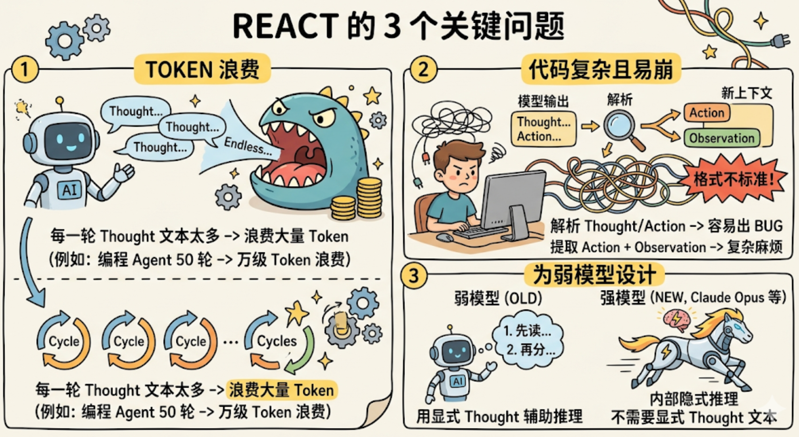
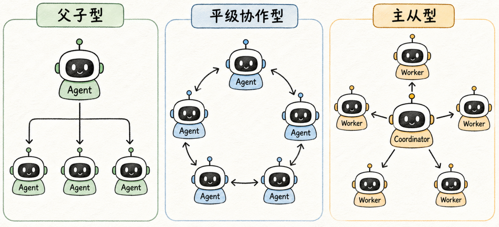
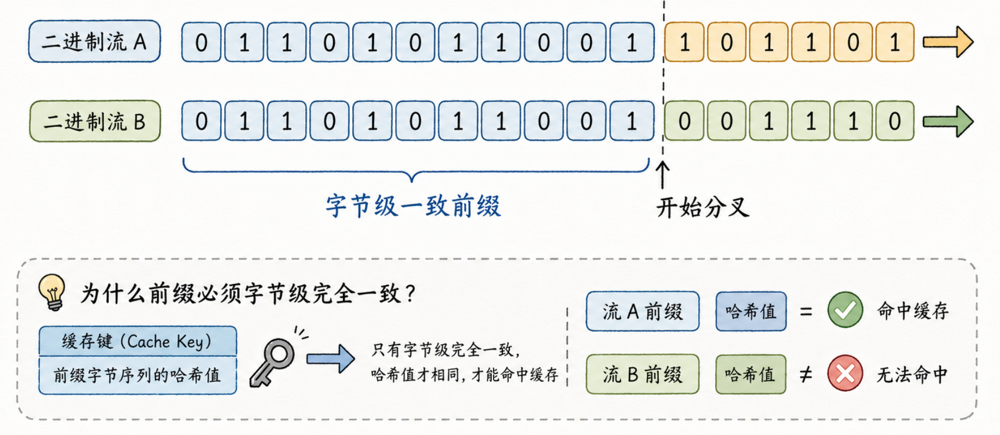
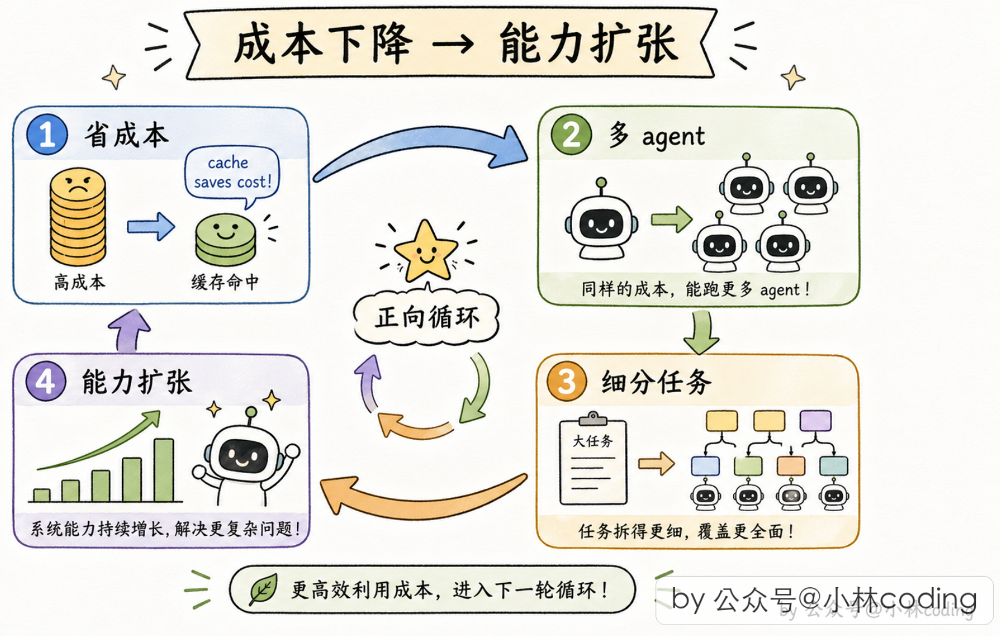
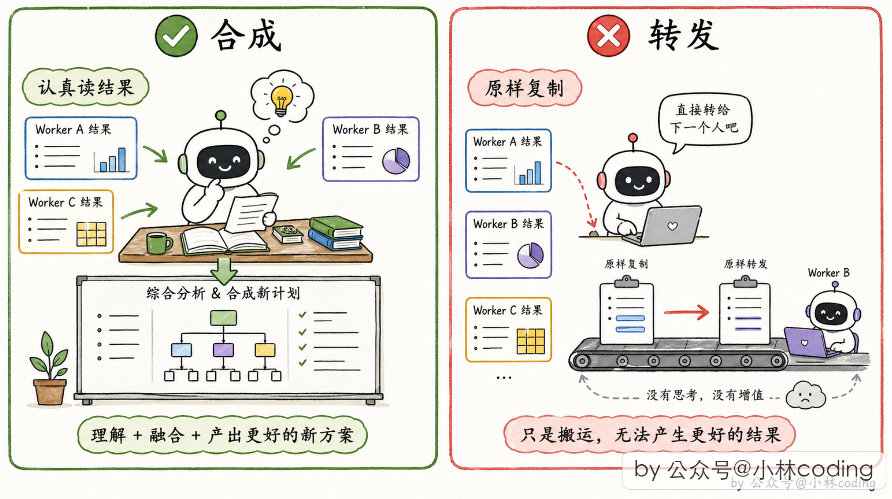

# DeepSeek 
## 总体架构

### 配置组装层
**Bundle（组合包）**  
是一个可分发、可复用的插件集合。它包含一组 Cordis 插件及其默认配置和挂载代码，提供一套基础能力。Bundle 里写的内容都是默认值，随时可以被上层修改、增加或删除。
**Profile（配置文件/预设）**  
是你本地的一个具名配置目录。它包含两部分：
1. **一份清单**：声明要按什么顺序加载哪些 Bundle。
2. **用户自己的 `cordis.patch.yml`**：对加载进来的 Bundle 做最终修改。

运行时流程是：
1. 按 Profile 的清单顺序，逐层叠加各个 Bundle，形成初始插件树。
2. 再应用用户自己的 `cordis.patch.yml`，对插件树进行增、删、改。
3. 最终插件树交给 Cordis 容器实例化并运行。

`dsh.profile` ：`dsh-base` 是每个 profile 的第一层（模型适配器、工具、持久化、沙箱与审批、凭据、遥测，约 90 个插件），`dsh-web-app` 在其上叠加浏览器应用，`dsh-headless` 叠加一个完全不带服务器的一次性 runner。用户自己的补丁在最顶层，可以对插件树进行**最后的**增、删、改。

各层的应用顺序是：profile 列出的每个组合包 → profile 级 `cordis.patch.yml` → home 级 → 任意 `--patch` overlay。一条 patch **按 id 定位某个条目并替换其整个 config**，或插入新条目。

### 运行时上下文层
配置组装完成后，系统会启动 Cordis 容器，根据插件树实例化所有插件。其中一部分插件，专门负责**向 Cordis 容器注册一个服务**，这个服务会挂到 `ctx` 上，供其他插件使用。此时，插件树被“压平”成了 **5 个核心服务入口**（`ctx.sessions`、`ctx.agents`、`ctx.tools`、`ctx.llm`、`ctx.systemPrompt`）。这棵树里所有插件的能力，最终通过这 5 个核心服务入口对外暴露。其他插件不需要知道某个能力来自树里的哪个插件。
### 事件扩展层
插件树被 Cordis 容器实例化后，提供服务的插件把能力注册到 ctx，消费型插件通过 inject 依赖这些 ctx 服务，并在各自监听的事件扩展点上介入，最终共同驱动 Agent Loop 运转。
## Cordis
下面基于5个核心概念来介绍Cordis插件框架
### Context  按名字存取服务的容器
是一个公共容器,每个模块**按名字注册**自己的能力,使用方**按名字取**。Cordis 的 **context**(就是代码里的 `ctx`)就是这个容器。
**注册**
```ts
import { Context, Service} from 'cordis'

abstract class Greeter extends Service{
	constructor(ctx: Context) {
		super(ctx, 'greeter')
	}
	
	abstract greet(name:string):string
}
```
注册的关键是
```ts
super(ctx, 'greeter')
```
它告诉 Cordis，将当前实例以 `'greeter'` 为名字注册到 Context 上（同一作用域重复注册同名服务会直接失败,不会"后写的覆盖先写），然后再补一段类型声明就可以让TypeScipt知道这项能力存在。
```ts
declare module 'cordis'{
	interface Context {
		greeter: Greeter
	}
}
```
但它暂时还是一个空壳，接着需要通过Plugin给它提供具体的能力(通过这样的方式也可以替换能力)
```ts
class EnglishGreeter extends Greeter {
	greet(name: string) {
		return 'Hello, ${name}!'
	}
}

class ChineseGreeter extends Greeter {
	greet(name: string) {
		return '你好,${name}!'
	}
}
```
安装
```ts
let greeterFiber = await ctx.plugin(EnglishGreeter)
app(ctx)
```
替换也是一样的
```ts
await greeterFiber.dispose()
greeterFiber = await ctx.plugin(ChineseGreeter)
app(ctx)
```
使用
```ts
ctx.greeter.greet('Alex')
```

注意:`ctx` 是个 Proxy(代理对象，读写及函数调用可被拦截并执行自定义逻辑),"读属性"这个动作会被拦截并转给服务解析器--所以 `ctx.shell` 不是读某个固定字段,而是"解析当前作用域(这个对象维护的本地服务表)里名为 `shell` 的服务"。这带来一个能力:**同一个名字在不同子作用域可以指向不同实现**(preset 就靠它给不同 agent 配不同能力)。例如：
```ts
const parentCtx = rootCtx.extend()          // 父作用域
const agentACtx = parentCtx.isolate()       // Agent A 的隔离作用域
const agentBCtx = parentCtx.isolate()       // Agent B 的隔离作用域

// 在 A 的作用域里注册 bash 实现
agentACtx.plugin(BashService)   // agentACtx.shell → BashService 实例

// 在 B 的作用域里注册 powershell 实现
agentBCtx.plugin(PowerShellService) // agentBCtx.shell → PowerShellService 实例
```
### fiber 与 effect  注册即副作用
插件 A 注册了工具、监听器、定时器
```ts
// plugin-a.ts
import { Context } from 'cordis'
import { defineTool } from 'dsh-tools'

export const name = 'plugin-a'
export const inject = ['tools']

export function apply(ctx: Context) {
  console.log('[A] apply 开始')

  // ① 事件监听器
  ctx.on('message', () => {
    console.log('[A] 收到 message 事件')
  })

  // ② 工具注册
  ctx.tools.register(defineTool({
    name: 'ping',
    description: 'Ping',
    parameters: {},
    async execute() { return 'pong' },
  }))

  // ③ 定时器（框架管不到，必须用 ctx.effect 显式包裹）
  ctx.effect(() => {
    console.log('[A] 定时器启动')
    const timer = setInterval(() => console.log('[A] tick'), 1000)
    return () => {
      console.log('[A] 定时器清理')
      clearInterval(timer)
    }
  })

  // ④ 子插件
  ctx.plugin(ChildPlugin)

  console.log('[A] apply 结束')
}
```
那么A 被卸载后(配置删了、热重载、依赖消失),谁来收拾?
每次 `ctx.plugin()` 挂载会产生一个 **fiber**——这次挂载的运行时实例
```ts
const fiber = ctx.plugin(pluginA)
```
持有配置、依赖状态和**本次挂载注册的所有 effects**。
```
fiber(plugin-a)
├── config        本次挂载的配置
├── state         ACTIVE
├── effects       [ ①监听器, ②工具, ③定时器, ④子插件 ]
│                  （按注册顺序排列）
└── children      [ fiber(ChildPlugin) ]   ← ④ 子插件的 fiber
```
fiber 卸载时
```ts
await fiber.dispose()
```
清理函数按注册**逆序**执行并被等待。
```
开始卸载 fiber(plugin-a)
  ↓
逆序执行 effects：
  ④ 子插件      → 卸载 ChildPlugin 的 fiber（递归清理它的 effects）
  ③ 定时器      → 调用 clearInterval(timer)
  ② 工具        → 从 Tool Registry 移除 'ping'
  ① 监听器      → 移除 'message' 监听器
  ↓
等待所有 disposer 完成（包括异步）
  ↓
state = DISPOSED
```
这些撤销动作就是框架自动推导并绑定的；只有框架管不到的外部资源（比如上面的定时器），才需要你手动定义。
### 插件的三种形态
**函数插件**
```ts
export const name = 'tool-bash'
export const inject = ['tools', 'shell', 'systemPrompt', 'shellEnv']
export const Config = z.object({ ... })

export function apply(ctx: Context, config: Config): void {
  // 拿 ctx 注册工具、监听事件
}
```
- 适合“消费者”插件：依赖别的服务，注册工具/监听器。
- 框架识别：模块里有 `apply` 函数，就把它当插件入口。
- `name`、`inject`、`Config` 是**命名导出**，与 `apply` 平级，共同描述这个插件。
**Service子类**
```ts
// greeter-service/src/index.ts
export default class GreeterService extends Service {
  constructor(ctx: Context) {
    super(ctx, 'greeter')
  }
  greet(name: string) { return `Hello, ${name}!` }
}
```
- 适合“提供者”插件：向容器注册服务。
- 框架识别：模块的 **default export** 是 `Service` 子类，就把它当插件本体。
- 服务名、依赖等，由类内部 `super(ctx, 'greeter')` 和静态属性决定。
**带apply的对象**
```ts
export default {
  name: 'some-plugin',
  inject: ['tools'],
  apply(ctx: Context) {
    // ...
  },
}
```
- 等价于函数形态，只是把元数据和 `apply` 打包进一个对象。
- 适合需要动态构造插件对象的场景（比如工厂函数返回插件）。

三种形态**功能等价**，框架统一用 `ctx.plugin(plugin, config)` 挂载，返回 fiber。

函数插件和 Service 子类两者都是插件。不过一个是服务提供者（可以给别的插件用，通过名字获取其能力），而另一个仅仅是装配单元/消费者（其他插件在容器里找不到它、用不了它，但它内部封装了装配逻辑和工具能力，是给 Agent（大模型）和 Harness（运行时）用的）。
那Agent和Harness怎么找插件呢？
Harness 启动时，最先被挂载的是 **Loader 插件**，它是整个插件系统的入口。
Loader 的核心工作是读取 `cordis.yml` 配置文件，该文件用 `name` 字段声明要加载的插件模块。
```yaml
- name: '@deepseek-ai/dsh-tools'        # 工具注册表服务
- name: './tool-logger.ts'              # 日志插件
- name: './greet-tool.ts'               # 自定义工具插件
```
Loader 读取 `cordis.yml`，然后根据里面的配置，通过 `ctx.plugin()` 把一个个插件挂载到 `ctx` 上。最终留在 `ctx` 上的是插件实例（及其注册的 effect）。这就是 Harness“找到”插件的方式——**通过配置文件中的模块名（`name`）静态解析**，而不是运行时动态搜索（不同的预设会有不同的cordis.yml配置文件，因此有了不同的能力）。

导出纪律：
- **service 包**:default export 它的 Service 类;
- **函数插件**:只命名导出 `name` / `inject` / `Config` / `apply`,**不写 default export**。
两种形态不能混在一个 module 里——Loader 会把 default export 当成插件本体,同 module 的命名元数据就不再属于它,`inject` 等于丢失。
### Service + Inject  启动顺序不该由人排
依赖关系规定
```ts
export const name = 'consumer-optional'
export const inject = [] // 必须的服务需要写在inject数组里面

export function apply(ctx: Context) {
  // 可选服务用 `ctx.get(name)`,没提供时得到 `undefined`。
  const greeter = ctx.get('greeter')

  if (greeter) {
    console.log(greeter.greet('Optional'))
  } else {
    console.log('greeter 服务未提供，降级处理')
  }
}
```
一个服务可能会依赖其他多个服务，那么它们的启动顺序就应该是依赖的服务先启动，然后再启动它自己，并且依赖消失时它会跟着卸载,依赖恢复时再自动加载。所以这个启动顺序不应该由人来排，而是应该由依赖图（各个服务之间的依赖关系构成的图）来决定。
并且加载依赖服务的时候用的是其注册的名字而非具体实现，这也是支持替换实现的一部分。
```ts
export const name = 'tool-bash'
export const inject = ['tools', 'shell', 'systemPrompt', 'shellEnv']
```
### Event  五种派发方式
event 表达"发布一个扩展点,让未知的零个或多个插件参与"。
插件统一用 `ctx.on(name, listener)`进行监听，再监听到事件后执行自己的逻辑，从而参与进流程;**派发方式是事件契约的一部分**,由事件的拥有者(producer，Agent Loop 或者 Tool Runtime等关键插件，它们可以按指定方式派发事件)选定(监听该事件的插件按派发方式所定逻辑进行配合工作):

| 派发              | 语义                             | 典型用途                                   |
| --------------- | ------------------------------ | -------------------------------------- |
| `emit`          | 同步逐个通知，插件执行自己的逻辑，但忽略返回值        | 纯观察(如 `session/event` 广播)              |
| `parallel`      | 并发跑所有监听者,等全部结束                 | 通知多个互不相干的方                             |
| `serial`        | 各个插件逻辑依序 await执行,遇到首个 bail 值停止 | 顺序决策(如 `agent/turn-stopping`:有一个说不停就停) |
| `bail`          | serial 的同步版（同步顺序执行）            | 同上,无异步需求时                              |
| **`waterfall`** | **中间件/洋葱模型**                   | **拦截、包装、改写**(下文专讲)                     |
派发和监听的配合
```ts
// ① 插件先监听
ctx.on('tools/pre-execute', async (exec, next) => {
  console.log('插件 A 被触发了') // 监听到派发的事件后就执行该插件的逻辑
  return await next()
})

// ② 过了一段时间，Harness 决定派发
await ctx.waterfall('tools/pre-execute', exec, async () => {
  console.log('最内层默认行为')
  return { kind: 'allow' }
})
```
如果在一个扩展点发布了多次事件(派发类型可相同可不同，插件都会按派发类型执行若干次逻辑)。

**waterfall:这个仓库最重要的控制流**

`ctx.waterfall` 就是 Web 框架的 around-middleware。每个监听者收到 `(...args, next)`:

- 调用 `next(...)`:把(可能已被自己改过的)参数交给下一层;`next` 的返回值是内层的结果,可以再加工;
- **不调用 `next()` 直接返回:短路**,后面所有层和最内层的默认行为都不执行。

以 `tools/execute` 为例,洋葱是这样套起来的:最外层可能是 timeout 策略插件,再往里是审批插件,最核心是工具真正的执行器。每个插件包住"剩下的整条链"。

仓库规矩要读准:**"waterfall 监听者必须调用 `next()`"针对的是协作型监听者**(观察、校验、包装);**拥有单一决定权的监听者故意短路是设计的一部分**--比如权限插件拒绝一次工具调用,就是要短路。写和读代码时都要分清这是哪一种。
```ts
async function listenerA(payload, next) {
  console.log('A 进入')
  const inner = await next()      // 把控制权交给 B
  console.log('A 拿到内层结果:', inner)
  return `A 包装了(${inner})`
}
async function listenerB(payload, next) {
  console.log('B 进入')
  const inner = await next()      // 交给 C
  return `B 包装了(${inner})`
}
async function listenerC(payload, next) {
  console.log('C 进入')
  return 'C 的原始结果'           // 最内层
}
```

**Agent Loop中各个扩展点事件发布者(会变更)**

| 事件名称                      | 所属阶段   | 发布者（事件拥有者）                                        | 派发方式                                               | 核心作用简述                                                                                                              |
| ------------------------- | ------ | ------------------------------------------------- | -------------------------------------------------- | ------------------------------------------------------------------------------------------------------------------- |
| **`turn/start`**          | 轮次开始   | **Agent Loop 插件** (`@deepseek-ai/dsh-agent-loop`) | **持久化写入** (非 `emit`)                               | 领取首条输入，打开并初始化一个轮次（Turn），写入 Session 日志[](https://developer.aliyun.com/article/1760581#1)。                            |
| **`agent/pre-step`**      | 步骤预备   | **Agent Loop 插件**                                 | **waterfall**                                      | 拦截即将进入模型的 messages，允许插件改写消息内容，或直接拒绝该次请求（短路）[](https://yuanyou.blog.csdn.net/article/details/164338227#2)。           |
| **`step/start`**          | 步骤开始   | **Agent Loop 插件**                                 | **持久化写入** (非 `emit`)                               | 将 entered messages 追加为 `user/message`，并准备从日志派生模型历史，写入 Session 日志[](https://developer.aliyun.com/article/1760581#1)。 |
| **`agent/request`**       | 模型请求前  | **Agent Loop 插件**                                 | **waterfall**                                      | 拦截即将发往 LLM 的请求参数（如调整 temperature、修改 system prompt、注入 RAG 结果）。                                                       |
| **`llm/stream`**          | 模型推理   | **LLM 适配器插件** (`LlmRuntime`)                      | **waterfall**                                      | 拦截底层的流式请求（如替换模型供应商、添加代理、重试机制）。                                                                                      |
| **`assistant/chunk*`**    | 模型推理   | **LLM 适配器插件**                                     | **持久化写入** (在 0.1.5 后改为 `agent/assistant-stream` 帧) | 实时拦截并改写模型流式输出的每一个数据块（如流式敏感词过滤、实时 TTS 转换）。                                                                           |
| **`assistant/message`**   | 模型推理完成 | **Agent Loop 插件**                                 | **持久化写入**                                          | 模型完整回复生成后，作为持久会话事件写入日志[](https://developer.aliyun.com/article/1760581#1)。                                           |
| **`tools/pre-execute`**   | 工具执行前  | **Tool Runtime 插件** (`@monotonic/dsh-tools`)      | **waterfall**                                      | 权限校验、参数验证、危险操作二次确认，可返回 `deny` 短路后续执行。                                                                               |
| **`tools/execute`**       | 工具执行中  | **Tool Runtime 插件**                               | **waterfall**                                      | 包装工具的真正执行逻辑（如添加超时控制、重试机制、Mock 测试）。                                                                                  |
| **`tools/post-execute`**  | 工具执行后  | **Tool Runtime 插件**                               | **waterfall**                                      | 对工具返回的结果进行清洗、脱敏、格式化，或处理执行异常。                                                                                        |
| **`tool/result*`**        | 工具结果定稿 | **Tool Runtime 插件**                               | **持久化写入** (观察通知为 `emit`)                           | 工具执行结果最终确定，写入会话日志，并准备回传给模型[](https://www.npmjs.com/package/@monotykamary/dsh-tools#1)。                              |
| **`step/end`**            | 步骤结束   | **Agent Loop 插件**                                 | **持久化写入** (非 `emit`)                               | 判断当前步骤是否还有更多工作。若无，则退出本轮循环，写入 Session 日志[](https://developer.aliyun.com/article/1760581#1)。                          |
| **`agent/turn-stopping`** | 轮次停止前  | **Agent Loop 插件**                                 | **serial**                                         | 顺序决策轮次是否应该停止。任何一个插件返回非空值（如 `stop: true`），轮次即结束[](https://yuanyou.blog.csdn.net/article/details/164338227#2)。        |
| **`turn/end`**            | 轮次结束   | **Agent Loop 插件**                                 | **持久化写入** (非 `emit`)                               | 不再欠任何工作时，正式关闭轮次，清理会话级资源，写入 Session 日志[](https://developer.aliyun.com/article/1760581#1)。                            |

### 一个简单但完整的dsh工具插件结构
```ts
// src/index.ts
import type { Context } from '@deepseek-ai/cordis'
import { defineTool } from '@deepseek-ai/dsh-tools'

// ① 插件身份标识
export const name = 'greet-tool'

// ② 依赖声明
export const inject = ['tools']

// ③ 插件入口函数
export function apply(ctx: Context) {
  ctx.tools.register(defineTool({
    // ④ 工具元数据（给模型看的）
    name: 'greet',
    description: 'Greet someone by name.',
    parameters: {
      name: { type: 'string', required: true, description: 'The name to greet' },
    },
    // ⑤ 输出契约
    output: {
      schema: { type: 'string' },
      render: (_args, value) => [{ type: 'text', text: value }],
    },
    // ⑥ 执行逻辑（真正干活的代码）
    async execute(args) {
      return `Hello, ${args.name}!`
    },
  }))
}
```

## Turn and Step
dsh 的最小执行单元定义得非常精确：**一个步骤（step）= 一次模型请求 + 它调用的工具**；**一个轮次（turn）包含零个或多个步骤**，在领取首条输入时打开，不再欠下任何工作时关闭。

实线框是持久会话事件（写进日志），虚线框是 waterfall 实时扩展点（可拦截改写）。右侧回边是循环的关键——只要工具欠一个请求或新输入到达，就领取下一步；`agent/pre-step` 可以改写甚至拒绝已领取的消息。

注意循环的每一拍都会**先写日志再执行**——这个顺序是后面"模型可见即已记录"不变量的根基。

插件就是在Agent Loop中的各个实时扩展点注入自己的影响的（实现自己的功能）。
**预备阶段**
**`agent/pre-step`**
插件可在此拦截即将进入模型的消息，可以拒绝该次请求or改写消息并调用next()函数交给下一层插件进行处理。

**模型推理阶段**
**`agent/request`**
插件可在此拦截即将发往 LLM 的请求参数（如调整 temperature、修改 system prompt、注入 RAG 检索结果）。
**`llm/stream`**
插件可拦截底层的流式请求（例如替换不同的模型供应商、添加代理）。
**`assistant/chunk*`**
在模型流式输出每一个 chunk 时，插件可以实时拦截并改写（例如流式敏感词过滤、实时 TTS 转换、结构化输出解析）。

**工具执行阶段**
**`pre-execute`**
插件可在工具真正执行前拦截。用于权限校验（这个 Agent 是否有权调用该工具）、参数验证、危险操作二次确认、或者参数动态修改。
**`execute`**
工具实际执行的扩展点。插件可在此包装工具执行逻辑（例如添加超时控制、重试机制、Mock 测试）。
**`post-execute`**
工具执行完毕后的拦截点。插件可对工具返回的结果进行清洗、脱敏、格式化，或者处理工具执行抛出的异常。

插件在启动与注册阶段(Harness初始化时)，不仅定义了工具的执行逻辑，还必须向核心Harness提交一份工具元数据(Tool Schema，通常包含工具名称、功能描述和参数结构)。核心Harness会维护一个工具列表(Tool Registry)，当流程走到`agent/pre-step` 和 `agent/request` 时，Harness 会从 Tool Registry 中提取出当前 Agent 被授权使用的工具列表，按大模型指定格式(如OpenAI的tools)全量(工具数量少)或动态按需注入(工具数量非常多，可以先检索再注入相关的)。
到这插件把自己的工具准备好了，那插件是怎么用这些工具协助Agent完成任务的呢。在 **`agent/pre-step`** 或 **`agent/request`** 阶段通过改写 Prompt、注入 Few-shot 示例，甚至强制指定 `tool_choice`，引导大模型在特定场景下产生调用某工具的意图，然后在这个工具执行阶段会找到这个工具所属的插件(还有一些注册了全局拦截逻辑的插件)，Harness让出执行权让这些插件去执行这个工具。其实就是在工具执行阶段，Harness 会根据工具名路由到对应的插件及全局拦截逻辑插件。然后在 `pre-execute`、`execute`、`post-execute` 这些由 Harness 定义的扩展点上，注入并执行自己编写的回调逻辑。最终完成工具的调用，并把结果通过 Harness 写入 `tool/result`。  此时，流程走到 `step/end`。如果判断还有下一步则会继续该Turn。
## Session Log
DSH对会话历史的做法：只 append 不可变事件(`turn/start`、`user/message`、`assistant/chunk`、`tool/call`、`tool/result`、…),任何"当前状态"都是对事件的**投影(projection)**（在不可变事件流上进行处理后的现象，如压缩、改写）。通过这种方法可以实现以下需求：

| 需求   | 解决办法                                                              |
| ---- | ----------------------------------------------------------------- |
| 崩溃恢复 | 重放日志;崩溃留下的未闭合 turn 和 torn tail 由 `dsh-session-persistence` 在加载时修复 |
| 分叉   | 复制日志到边界处,继续各自 append。`ctx.sessions.fork(source, boundary?)`       |
| 压缩   | append 一条"surface 替换"事件，原始事件一个不动                                  |
| 多种读法 | 每个消费者(projector、query、title、telemetry)各自从事件流派生自己的读模型,互不干扰         |
这就是 event sourcing。**事实(发生了什么)和视图(现在看起来怎样)被彻底分开,事实层不可变,视图层随便算/处理。

对话历史在内存中的结构
```ts
// 内存中对话历史的容器，本质上是一个数组
class Session {
  events: SessionEvent[] = [] // 这就是那个有序列表
  
  // 核心方法：只允许追加（append-only）
  append(type: string, data: any) {
    const event = {
      seq: this.events.length, // 分配单调递增的序列号，等于当前数组长度
      type: type,              // 事件类型，如 'user/message'
      data: data,              // 具体数据
      timestamp: Date.now()    // 时间戳
    }
    Object.freeze(event)       // 冻结，不可再变
    this.events.push(event)    // 追加到数组末尾
    // ... 更新 Surface、广播事件等
  }
}
```

**内存对象与磁盘事实**两层的读写路径一图流:
```
调用方 ──session.append(type, data)──▶ 内存事实层
                                       │ 验证、冻结、分配单调递增 seq
                                       │ 更新内存 surface
                                       └─广播 session/event(live)──▶ UI 立刻可见
                                                              │
                                            dsh-session-persistence 监听,批量落盘
                                                              │
调用方 ──await ctx.sessions.flush(session)──▶ session/flush checkpoint,排空批量缓冲
```
两个层次**不是同一个 commit 点**:
- `session.append(type, data)`:在**内存**中验证、冻结、分配单调递增的 `seq`,更新内存 surface,广播 `session/event`。已接受的事件永不再变,`session.events` 是冻结快照。
- 持久化:`dsh-session` **自己不写磁盘**。它只发布 live 事件;`dsh-session-persistence` 监听这些事件,批量落盘。
- 需要"确定已落盘"的调用方,随后 `await ctx.sessions.flush(session)`,触发 `session/flush` durability checkpoint,把批量缓冲排空。
为什么不 append 即写盘?因为 UI 想立刻看到事件(内存 append 立即广播),而磁盘写是批量的(保证性能)。两层各自有明确的语义,谁需要哪种保证就调哪个。

### surface & raw log —— 模型看到的 & 实际发生过的
Session 内部有两层:
- **raw log**:全部历史事件,永久事实层,只增不减。
- **surface**:模型**当前**看到的消息层。普通 append 在 surface 尾部加一条;**compaction(压缩)产生的替换事件可以让旧消息不再进入后续请求**--但 raw 事件仍然都在。

surface层内容：

|事件类型|说明|是否在 Surface 中|
|---|---|---|
|**`system/message`**|系统提示词，定义了 Agent 的角色、能力和行为准则。|✅ **是**|
|**`user/message`**|用户的直接输入或系统注入的上下文信息。|✅ **是**|
|**`assistant/message`**|模型生成的完整回复，可能包含文本内容或工具调用请求。|✅ **是**|
|**`tool/result`**|工具执行完成后返回的结果。|✅ **是**|
|`turn/start`, `step/end`|轮次和步骤的边界标记。|❌ 否|
|`assistant/chunk`|模型输出的原始流式数据块。|❌ 否|
|`tool/call`|模型发起的工具调用请求。|❌ 否|
|重试、审批、压缩等插件事件|由插件扩展的事件。|❌ 否|
compaction 的完整流程(`dsh-compaction` + `compaction-basic`):

```
token 压力触发
  │ 选择一个安全边界(不能拆散 tool-call/result 配对)
  ▼
durable 事务:
  compaction/start
    -> summary 事实
    -> 一条带 surfaceOp: replace 的 user/message 检查点
  compaction/end
  ▼
从此 deriveMessages() 从替换点开始投影:
  模型看到"[总结] + 之后的消息",而不是全部历史
```

1. token 压力触发,选择一个**安全边界**;
2. durable 事务:`compaction/start` -> summary 事实 -> 一条带 `surfaceOp: replace` 的 `user/message` 检查点 -> `compaction/end`;
3. 从此 `deriveMessages()` 从替换点开始投影:模型看到"\[总结\] + 之后的消息",而不是全部历史。

三条配套纪律:

- **compaction 边界不能拆散 tool-call/result 配对**--把一个 tool call 切进总结、result 留在总结外,重建出的历史就是残缺的。
- 自动 compaction 只发生在活动 turn 的安全点;手动 `/compact` 要先获得空闲准入。不是"总在后台随时跑"。
- 人类 transcript、模型历史、UI 投影,**各自声明**自己读 raw 还是读 surface--因为两个答案都合法,但必须明确。

**铁律：任何进入模型请求的内容,必须能从 session log 重建;新增模型可见输入,必须新增 durable 事件。**
为什么必须铁律化?逐个看违反后的裂口:
- 假设某个插件在请求前临时拼了一段 workspace 说明,没落日志。那么日志重建出的"模型看到的内容"和**真实的**模型输入**分叉**了。
- 分叉一旦发生:resume 后模型行为不可复现;fork 出的分支和原会话"看着一样其实不一样";transcript 展示的输入模型根本没看到;调试时你以为的上下文不是实际的上下文

| 分叉的裂口 | 具体后果 |
|---|---|
| resume | 模型行为不可复现 |
| fork | 分支和原会话"看着一样其实不一样" |
| transcript | 展示的输入模型根本没看到 |
| 调试 | 你以为的上下文不是实际的上下文 |

注意精确含义:不是"每个中间步骤都要持久化",而是**最终到达模型的语义必须有 durable owner**。live 的 pre-step 可以随便改消息,但改完的结果会写成 durable `user/message`;prompt 组装的中间过程不必落日志,但组装结果进入了可重建的请求。这条规则有运行时 invariant 持续断言,不是靠自觉。

### 一个 log,五个读者

Session 目录下不只有一个包,而是一群各自独立的**投影消费者**:

| 包 | 从 log 派生出什么 |
|---|---|
| `session-persistence`(+jsonl/sqlite backend) | 磁盘事实 |
| `session-projection` | UI 用的同步一致快照 |
| `session-query` | 检索语料与有界读取(SQLite provider 加索引) |
| `session-title` | 标题(唯一的 title provider seam,辅助模型调用) |
| `session-telemetry` | 遥测投影 |

这就是 event sourcing 的回报:写入方只有一套 durable 事实,五种读法互不干扰、各自演化。新增一种读法 = 新增一个消费者插件,写入方零改动。
### 三个"版本号",三个完全不同的问题
一份 session 日志要能正确读写，需要同时满足三个维度的兼容性——事件语义、数据库表结构、文件字节编码。每个维度都有自己的版本管理方式。

| 版本号                              | 归属         | 管什么                                     | 打个比方           |
| -------------------------------- | ---------- | --------------------------------------- | -------------- |
| `SESSION_FORMAT_VERSION`         | dsh 自己     | **事件的语义格式**：每个事件类型代表什么、字段是什么含义、顺序怎么重建   | 书的**语言和内容版本**  |
| SQLite `SCHEMA_VERSION`          | SQLite 数据库 | **数据库布局**：表、列、索引、应用身份等                  | 书架的**结构和标签**   |
| JSONL backend 的 `compression` 配置 | 文件存储层      | **文件字节编码**：是 Zstandard 压缩帧，还是裸 JSONL 文本 | 书是**印刷版还是电子版** |
配套规则：
- 新增事件类型，不一定要提升 `SESSION_FORMAT_VERSION`。因为 dsh 的 `SessionEventMap` 里的成员默认是 **required-on-read**。意思是：**旧版本的 reader 如果遇到一个它不认识的事件类型，会直接拒绝读整份日志**，而不是悄悄跳过。这听起来很严格，但其实是保护机制——避免旧程序误解新数据。只有当你希望旧 reader 能安全跳过这个新事件时，才在事件信封上标记 ignorable: true。这样旧 reader 才会忽略它，继续读后面的。
- 当**旧 reader 无法保留日志的完整语义**时，才需要提升。比如：改变了已有事件的含义；改变了事件重建的顺序；让旧 reader 即使能读，也会理解错。如果只是添加一个可安全忽略的辅助事件，就不一定需要提升。
- 当前处于预发布阶段(v0):没有兼容承诺,旧格式直接拒绝,不做迁移路径。这是有明确结束条件的仓库策略(首个 tagged release 时移除),不是永久产品决定。
- 如果你把存储格式从 Zstandard 压缩换成裸 JSONL，或者反过来，**不能在同一份数据根目录下悄悄换**。因为旧程序可能按老编码去读，会读出一堆乱码。正确做法：**换编码就用新的 root 目录**，让新旧数据物理隔离。
遇到"数据打不开"时,先判断属于哪一层,再去读对应 owner 的错误信息;不要改版本常量绕过拒绝。
## Capability Seam 能力缝
一个 **capability seam**（能力缝）由三个角色构成，和Cordis框架对照起来看会比较清楚。

|角色|职责|在 Cordis 里的对应|
|---|---|---|
|**Service Definition**|声明接口，拥有 `ctx` 上那个 key|`declare module` 声明类型 + `Service` 基类约定|
|**Service Provider**|往容器里注册一个具体实现|`class XxxService extends Service` + `super(ctx, 'name')`|
|**Consumer**|只按接口取用，不知道背后是谁|`inject = ['name']` + `ctx.name`|

### Service Definition
这是 Seam 的“定义方”。它不提供具体能力，只**声明一个 key 和它的语义**（注册了一个可以供别人查找的名字，并且规定了这个名字应该提供怎么样的能力）。
```ts
// 定义方：声明 ctx 上有个叫 'shell' 的能力，类型是 ShellService
declare module 'cordis' {
  interface Context {
    shell: ShellService
  }
}

interface ShellService {
  exec(cmd: string): Promise<string>
}
```
### Service Provider
这是 Seam 的“实现方”。它把一个具体类挂到 ctx.shell 上。
```ts
class BashService extends Service implements ShellService {
  constructor(ctx: Context) {
    super(ctx, 'shell')  // 注册到 ctx.shell
  }
  async exec(cmd: string) { return await runBash(cmd) }
}

// 挂载
ctx.plugin(BashService)
```
也可以是另一个实现，只要满足 `ShellService` 接口：
```ts
class PowerShellService extends Service implements ShellService {
  constructor(ctx: Context) { super(ctx, 'shell') }
  async exec(cmd: string) { return await runPowerShell(cmd) }
}
```
**切换方式**
假设你正在开发一个 Agent，它需要用到网页搜索能力(web)。你安装了三个搜索 Provider 插件：

|Provider 插件名|注册的 id|需要什么|
|---|---|---|
|`@deepseek-ai/dsh-web-search-deepseek`|`deepseek-official`|`DEEPSEEK_API_KEY`|
|`@ltctfer/dsh-web-search-brave`|`brave-official`|`BRAVE_API_KEY`|
|`@mikasomaka/dsh-web-search`|`chain`|Gemini / Exa / Firecrawl 的 key|

基础包 `dsh-base` 默认把 `web` 这个 Capability Seam 的 `searchProvider` 固定为 `deepseek-official`。所以**默认情况下，你的 Agent 用的是 DeepSeek 官方搜索**。

这个dsh-base本质也是一个cordis.patch.yml
```yaml
- id: web
  config:
    searchProvider: deepseek-official
```

在你想把它换成 Brave 搜索：
在你的 profile 目录（例如 `~/.dsh/profiles/web/`）下，打开或创建 `cordis.patch.yml`，写入：
```yaml
- id: web
  config:
    searchProvider: brave-official
```
**就这么两行。** 注意 `- id: web` 对应的是 `web` 这个 Seam 的行，`config` 是**整块替换**，不是深度合并。所以如果你需要保留其他字段，必须一并重述。重启生效。

### Consumer
这是 Seam 的“消费方”。它只知道自己要用 `shell` 能力，不知道背后是 Bash 还是 PowerShell。
```ts[]()
export const name = 'tool-bash'
export const inject = ['shell']

export function apply(ctx: Context) {
  ctx.tools.register(defineTool({
    name: 'bash',
    async execute(args) {
      return await ctx.shell.exec(args.cmd)  // 只用接口，不关心实现
    },
  }))
}
```
### 为什么这种抽象有用
1. 替换实现不改 Consumer
你把 `BashService` 换成 `PowerShellService`：
- Provider 换了一个插件；
- Consumer 代码不变；
- `inject` 声明不变；
- 只是运行时的解析结果变了。
2. 作用域隔离，同名不同实现
```
const agentACtx = parentCtx.isolate()
const agentBCtx = parentCtx.isolate()

agentACtx.plugin(BashService)        // agentACtx.shell → Bash
agentBCtx.plugin(PowerShellService)  // agentBCtx.shell → PowerShell
```

两个 Agent 的代码都写 `ctx.shell`，但因为作用域不同，拿到的是不同实现。这就是 dsh preset 给不同 agent 配不同能力的核心机制。
### 一个完整的Seam例子
```ts
// ─── Service Definition（接口 + key 所有权）───
declare module 'cordis' {
  interface Context {
    greeter: GreeterService
  }
}
interface GreeterService {
  greet(name: string): string
}

// ─── Service Provider A（英文实现）───
class EnglishGreeter extends Service implements GreeterService {
  constructor(ctx: Context) { super(ctx, 'greeter') }
  greet(name: string) { return `Hello, ${name}!` }
}

// ─── Service Provider B（中文实现）───
class ChineseGreeter extends Service implements GreeterService {
  constructor(ctx: Context) { super(ctx, 'greeter') }
  greet(name: string) { return `你好，${name}！` }
}

// ─── Consumer（只认接口）───
export const name = 'greeting-tool'
export const inject = ['greeter']
export function apply(ctx: Context) {
  ctx.tools.register(defineTool({
    name: 'greet',
    async execute(args) {
      return ctx.greeter.greet(args.name)  // 不知道是英文还是中文实现
    },
  }))
}

// ─── 组装：选择哪个 Provider，就决定 Seam 背后是谁 ───
ctx.plugin(EnglishGreeter)   // 或 ctx.plugin(ChineseGreeter)
ctx.plugin(greetingTool)
```
### Execution World
模型在干活时，会同时用到各种工具：`bash` 跑命令、`read` 读文件、`glob` 扫路径、`LSP` 分析代码。  
如果这些工具各自看向不同的“现实”——比如 `bash` 在远程服务器上创建了文件，`read` 却在本地找——模型就会陷入精神分裂。**为了保证模型认知一致，所有工具必须运行在同一个“执行世界”里。**

这个“世界”由两个底层接缝定义：
- **`fs`（文件系统）**：负责文件的读写、路径解析和文件身份识别。
- **`subprocess`（子进程）**：负责进程的创建与执行，管理进程树。
- **它们的关系**：`shell`、`terminal`、`LSP`、进程型 `search` 等，都是 `subprocess` 的消费者；它们和 `fs` 一起，共同构成了这个世界的“物理法则”。

**切换世界：整体搬家，而不是逐个开分店**
**错误做法**：给每个工具（bash、read、glob...）都加一个 `remote: true` 的参数，让它们各自判断去本地还是远程。
**后果**：每个工具都要重复实现一遍“世界知识”，代码冗余，且极易遗漏（迟早漏掉一个，导致模型看到矛盾）。

**正确做法**：直接**整体替换 `fs` 和 `subprocess` 这两个 Provider**。
**效果**：就像“搬家”一样，把整个执行环境从本地搬到远程。所有上层工具（bash、read、glob 等）无需任何修改，它们会自动在新的远程世界里工作，因为 `ctx.fs` 和 `ctx.subprocess` 都指向了新的实现。

#### 沙箱
**`sandbox` 家族**：解决的是**同一个世界内**的进程约束问题（比如限制文件写入范围、禁止网络访问）。它是在“当前世界”里加规则，而不是换一个世界。

沙箱的核心是一个叫 `ctx.sandbox` 的服务。它包装子进程的启动参数（argv），然后施加一个**文件效果策略（file-effect policy）**。这个策略只有三种模式：
- **`read-only`**：禁止任何写入，除了 `/dev/null` 这类必需的 sink。
- **`workspace-write`**：只允许在工作区根目录及后端定义的临时区域下写入，工作区外一律拒绝。
- **`danger-full-access`**：绕过隔离，直接以原始权限运行。
消费方（比如 `dsh-bash-sandbox`）在启动每条命令时，都会经过这层包装。**命令本身还是在本机跑的，但它的写入能力被限制了。**

**沙箱和权限、审批的分工**
dsh 的安全设计是三层各管一件事：
1. **沙箱**：管“能碰哪些文件”——文件效果的边界。
2. **权限预设**：管“能做什么”——把沙箱模式和审批策略捆成一个命名预设（比如默认的 `workspace-write`+ `ask`）。
3. **审批**：管“危险动作要不要人点头”——只有 `allowed-once` 才放行。

沙箱不负责网络隔离，也不负责进程可见性，它只管控**文件效果**。网络和进程可见性不在它的词汇表里。

**真正的远程隔离环境**：直接整体替换 `fs` 和 `subprocess` 两个 Provider，把执行世界搬到远程，而不是给每个工具加 `remote` 分支。远程环境自带隔离边界（或者由 dsh 为远程环境配上对应的远程沙箱，在远程主机上执行策略），所以不要再在本机套一层本机沙箱——本机沙箱管不到远程进程，反而会造成边界冲突。切换执行世界时，沙箱能力也会跟着切换：如果远程需要沙箱约束，dsh 会使用远程沙箱实现，而不是复用本机沙箱。（沙箱只是文件效果隔离，约束了能操作的文件，执行环境还是一样的）。

|替换目标|正确做法|
|---|---|
|**换远程环境**|一起替换 `fs` + `subprocess` 两个 Provider（整体搬家）|
|**同一世界内的进程约束**|用 `sandbox` 家族，不换世界|
|**真正隔离的远程环境**|直接换 Provider，不再套本机沙箱|
# Claude Code 
## 架构设计
### 架构

- **引擎层**是 Agent 的「大脑」，负责思考和调度。它的关键设计原则是**不包含任何业务逻辑**，它不知道怎么读文件、怎么改代码、怎么搜索，这些全是工具层的事。引擎层只做三件事：第一，协调，把用户输入、系统指令、历史对话拼在一起，发给大模型；第二，分发，大模型说「我要用某个工具」时，找到对应的工具并执行；第三，决策，根据大模型的返回决定是继续循环还是结束对话。这种设计的好处是：**新增能力只需要新增一个工具，引擎层完全不用改**。
- **工具层**是 Agent 的全部「能力」，40 多个工具都在这一层。每个工具就是 Agent 的一个能力：执行 Shell 命令、读写文件、搜索代码、生成子 Agent……这些工具不是随便写的，它们遵循一个统一的规范。这个规范不仅定义了「工具能做什么」，还强制定义了三个安全属性：这个工具是只读的还是会改东西的？它是否具有破坏性需要额外确认？它能不能和其他工具同时执行？这三个属性不是「建议加上」的，而是类型系统强制要求的，漏了任何一个，代码就编译不过。这意味着每一把刀都有刀鞘，从出厂就配好了安全机制。
- **服务层**是所有层共享的「基础设施」。这一层包括三样东西：调大模型 API（不管是谁要调，主循环也好、子 Agent 也好，都走这一层）、上下文压缩（后面会详细讲的五步压缩策略）、MCP 协议（和外部工具服务器通信的标准接口）。你可以把它类比成大楼的水电煤，所有楼层都需要，但谁也不会自己去铺设管道。
- **安全与治理层**有点特殊，它不像其他三层那样各管一块，而是**像一张安全网罩在所有层上面**。权限系统决定哪些操作需要用户确认、哪些可以自动执行；Hook 系统允许在工具执行前后插入自定义行为（比如「每次 git push 前自动跑 lint」）；Bash 安全模块会对 Shell 命令做语法级别的分析，检测命令注入、路径逃逸等危险模式，而不是简单地用正则匹配关键词。
### Agent工作模式
Claude Code 没有采用 ReAct 的 Thought-Action-Observation 三步循环，而是用了一个更简洁的模式，我把它叫做 **Tool-Use Loop**。

ReAct 有几个问题：
- 第一个问题：Token 浪费。 每一轮都要输出一段 Thought 文本，这些文本要作为上下文的一部分发给 API，占用了宝贵的 Token 预算。对于编程 Agent 来说，一次任务可能循环 50 轮，每轮都写一段「我打算先读取……然后分析……」的思考过程，加起来就是好几万 Token 的浪费。
- 第二个问题：应用层代码太复杂。 你需要解析模型的输出，区分「哪部分是 Thought、哪部分是 Action」，然后提取 Action 调用工具，再把 Observation 拼回去。这个解析过程写起来很麻烦，而且很容易出 bug，因为模型输出的格式不一定标准，一崩就全崩了。
- 第三个问题：ReAct 是为「弱模型」设计的。 当大模型的推理能力不够强时，用显式的 Thought 来「强迫」它一步步思考是有意义的。但 Claude Opus 这种级别的模型，推理能力已经足够强了，它完全可以在内部完成推理，不需要在输出里显式写出每一步的思考过程。

**Tool-Use Loop**

模型在内部完成推理（通过 Extended Thinking，这是 Claude Opus 的一个能力，模型在生成回复前会在内部进行一段不可见的深度推理，不占用上下文空间），然后直接返回两种结果之一：
- **tool_use**：「我要用某个工具」，应用层执行工具，把结果拼入消息列表，继续循环
- **end_turn**：「我说完了」，跳出循环，把最终结果返回给用户

这个设计的核心哲学是：**信任模型的推理能力，保持应用层框架尽可能简单。**

来看 query.ts 中的核心循环，它的实际代码长这样（这是一段 TypeScript 代码，其中 yield 的作用是流式输出，你可以理解为一边接收 API 的响应，一边把每个 token 实时传给 UI 显示）：
```ts
async function* queryLoop(
  params: QueryParams,
  consumedCommandUuids: string[],
): AsyncGenerator<StreamEvent | Message, Terminal> {
  let state: State = { messages, toolUseContext, turnCount: 1, ... }

  while (true) {
    // 步骤 1：压缩上下文（五步从轻到重）
    // 步骤 2：调用大模型 API，流式接收
    for await (const event of streamAPI(params)) {
      yield event  // 流式输出每个 token
    }
    // 步骤 3：分析模型返回
    if (response.stopReason === 'end_turn') break  // 完成了，跳出循环

    // 步骤 4：执行工具调用（并发/串行编排）
    const toolResults = await executeToolCalls(toolUseMessages)

    // 步骤 5：更新 state，继续循环
    state = { ...state, messages: updatedMessages, turnCount: turnCount + 1 }
    continue
  }
}
```
注意 break 和 continue，模型说 end_turn 就 break 跳出循环，说 tool_use 就 continue 回到循环开头。整个决策逻辑就这么简单。

**为什么比React更好？**
**第一，Extended Thinking 让推理在「模型内部」完成。** 这段推理发生在模型内部，不占用应用的上下文空间，也不需要应用层去解析。所以 ReAct 的 Thought 步骤在 Claude 的架构里是多余的，模型已经在内部「想好了」，不需要在外部输出中再写一遍。
**第二，API 原生支持 tool_use。** Claude 的 API 原生支持工具调用，模型可以直接返回 tool_use 类型的响应，不需要用正则表达式从文本中提取「Action」。这消除了 ReAct 的格式解析问题，应用层代码变得极其简洁。
**第三，end_turn 作为天然的终止信号。** ReAct 需要一套额外的规则来判断「Agent 是否完成了」，比如检测输出中是否包含「Final Answer」。而 Tool-Use Loop 用模型的 end_turn 信号作为终止条件，这是 API 层面的原语，语义清晰，不需要任何解析。

ReAct 的设计哲学是「帮模型思考」，用显式的 Thought 步骤引导模型一步步推理。这在弱模型时代是必要的。
但 Claude Code 面对的是 Opus 级别的强模型，它的推理能力完全可以在内部完成，不需要应用层去「教」它怎么想。
所以 Claude Code 的 Tool-Use Loop 只做最简单的事：调 API、执行工具、再调 API。推理交给模型，执行交给工具，编排交给最简单的 while(true) 循环。这种「大道至简」的设计，反而是最高效的。

**Plan Mode**
Claude Code 不仅有 Tool-Use Loop 这种「边想边做」模式，还有 Plan Mode，一个更精细的两阶段工作流：先规划、再执行。

Plan Mode 的核心思想是：**复杂任务应该先规划再执行，避免方向跑偏、浪费精力。** 它并不是一个独立的框架，而是在同一个 Tool-Use Loop 中通过 EnterPlanMode 和 ExitPlanMode 两个工具实现的：

整个流程分三步： 
- 第一步：模型自主进入或用户手动触发。 当模型判断「这是一个复杂任务」时，它会调用 EnterPlanMode 工具。对于简单任务（修 typo、加 console.log），则明确不进入。用户也可以通过 Shift+Tab 手动切换。
- 第二步：只读探索 + 设计方案。 进入 Plan Mode 后，权限降为只读，模型只能用 Read、Grep、Glob 这些工具去探索代码库，不能写文件、不能改代码、不能跑命令。探索完后，把计划写入 .claude/plans/ 目录。每 5 轮对话，系统会偷偷给模型塞一张「小纸条」，提醒它「你现在还在 Plan Mode，别手痒改代码」，防止模型在长对话中「走神」。 
- 第三步：用户审批后实施。 模型调用 ExitPlanMode，此时需要用户确认。用户批准后，权限恢复为之前的模式，模型开始自由执行读写操作，按计划实施。 
Plan Mode 最值得学习的设计是**工具即能力**。
对模型来说，Plan Mode 不是一种特殊的「模式切换」，而只是调用了 EnterPlanMode 和 ExitPlanMode 这两个工具。  就像调用 Read 工具读文件一样自然。整个过程不需要引擎层做任何特殊处理，query() 仍然只是一个简单的 while(true) 循环。
## System Prompt
System Prompt 就是 Claude Code 的灵魂，它定义了 Agent 的身份、行为规范、可用工具、安全约束……一切。
但 Claude Code 的 System Prompt 不是一个静态的文本文件。它是**动态组装**的，由十几个 Section 拼接而成，而且在组装过程中做了非常精巧的**缓存优化**。


**角色定义与安全红线**
```
你是一个交互式代理（interactive agent），帮助用户完成软件工程任务。
请使用下面的指令和可用的工具来协助用户。

重要：你绝对不能为用户生成或猜测 URL，除非你确信这些 URL
是为了帮助用户完成编程任务。你可以使用用户在消息或本地文件中
提供的 URL。
```
注意两个关键点。第一，它把自己定位为「interactive agent」，而不是「assistant」或「chatbot」，这从一开始就暗示了模型应该主动采取行动，而不是被动回答。第二，立刻划了安全红线：不能乱编 URL。这看起来是个小事，但对编程 Agent 非常重要，如果模型瞎编一个 npm 包的 URL，用户执行了就可能中招。

紧接着是一段安全约束指令，这段话非常值得每个 Agent 开发者抄作业：
```
重要：允许协助已授权的安全测试、防御性安全研究、CTF 挑战赛
和教育场景。拒绝涉及破坏性技术、DoS 攻击、大规模目标扫描、
供应链攻击或用于恶意目的的检测规避请求。
```
这段 Prompt 没有用「绝对不能做 X」的口吻，而是先说「可以做什么」（授权的安全测试、CTF 挑战），再划定「不能做什么」（DoS、供应链攻击）。

这种「先肯定再约束」的写法，比纯禁止清单效果好得多，它给了模型清晰的判断依据，而不是一堆模糊的红线。

**行为准则**
几条精华部分：
关于修改代码前先阅读：
```
一般来说，不要对你没有阅读过的代码提出修改建议。如果用户
要求你查看或修改某个文件，先读一遍它。在提出修改建议之前，
先理解现有代码。
```
这条看起来简单，但解决了 Agent 的一个常见问题：很多 Agent 会根据用户描述直接生成代码，而不先看看现有代码是什么样的，结果经常和项目风格不一致或者引入重复实现。

关于代码风格：**少即是多**
```
不要在用户要求之外添加功能、重构代码或进行"改进"。修一个 bug
不需要顺手清理周围的代码。一个简单功能不需要额外的可配置性。

不要为一次性操作创建辅助函数、工具类或抽象层。
三行相似的代码比一个过早的抽象更好。
```
这个设计思路太重要了。如果你用过 Agent 写代码，你一定遇到过这种情况：你让它修一个 bug，它顺手把整个文件重构了，加了一堆你没要求的类型标注和错误处理。Claude Code 在 Prompt 里明确禁止了这种行为。

关于失败处理：先诊断再换方案
```
如果某个方案失败了，先诊断原因再决定是否换方案——读报错信息、
检查你的假设、尝试有针对性的修复。不要盲目重试完全相同的操作，
但也不要因为一次失败就放弃一个可行的方案。
```
这条解决了 Agent 的另一个常见问题，「摆烂式重试」或「草率放弃」。Claude Code 要求模型先搞清楚为什么失败了，再决定是修复还是换方案，而不是两个极端。

**操作安全**
Claude Code 对“什么操作需要用户确认” 做了非常详细的规定。
```
仔细考虑操作的可逆性（reversibility）和影响范围（blast radius）。
一般来说，你可以自由执行本地的、可逆的操作，比如编辑文件或
运行测试。但对于难以撤销、影响共享系统或有风险的操作，
请先和用户确认后再执行。

需要用户确认的高风险操作示例：
- 破坏性操作：删除文件/分支、删表、rm -rf
- 难以逆转的操作：force-push、git reset --hard、修改已发布的 commit
- 对他人可见的操作：推送代码、创建/关闭 PR、发送消息
- 上传到第三方工具：内容可能被缓存或索引，即使删除也无法撤回
```
这段的核心思想是用**可逆性**和**影响范围**两个维度来判断风险。读文件、改本地代码是低风险的（可逆、只影响本地），直接放行。git push、发 Slack 消息是高风险的（不可逆、影响他人），必须确认。

然后还有一句非常精妙的补充：
```
用户批准了某个操作（比如 git push）一次，并不意味着他在所有
场景下都批准这个操作。授权仅对指定的范围有效，不能超出范围。
```
这解决了「权限蔓延」的问题，用户同意了一次 push 不代表以后都自动 push，授权是一次性的、有范围的。这个原则在 Agent 权限设计中非常重要。

**工具使用指南**
```
当有专用工具可用时，不要用 Bash 来执行命令。使用专用工具可以
让用户更好地理解和审查你的工作。这一点至关重要：

- 读取文件用 Read 工具，而不是 cat、head、tail 或 sed
- 编辑文件用 Edit 工具，而不是 sed 或 awk
- 创建文件用 Write 工具，而不是 echo 重定向
- 搜索文件用 Glob 工具，而不是 find 或 ls
- 搜索内容用 Grep 工具，而不是 grep 或 rg
```
这条规则的设计动机值得深思。为什么不让模型直接用 cat 读文件、用 sed 改代码？技术上完全可以。

原因是可审查性。当模型调用 Read 工具读文件时，UI 会清晰地展示「Agent 正在读取 src/index.ts」。但如果模型执行 cat src/index.ts，用户看到的只是一条 Bash 命令和一大坨输出，完全不知道 Agent 在干什么。

而且，专用工具有专用的权限检查，Read 工具会检查文件路径是否在允许范围内，而 cat 命令就没有这层保护了。所以「用专用工具而不是 Bash」不仅是体验问题，更是安全问题。

**Git安全协议**
```
Git 安全协议：
- 绝不修改 git config
- 绝不执行破坏性 git 命令（push --force、reset --hard、
  checkout .、clean -f），除非用户明确要求
- 绝不跳过 hooks（--no-verify），除非用户明确要求
- 绝不 force push 到 main/master 分支，如果用户要求则发出警告

关键：始终创建新的 commit（NEW commit），而不是用 --amend 修改。
当 pre-commit hook 失败时，commit 实际上并没有发生——所以
--amend 会修改上一个（不相关的）commit，可能导致代码丢失。
正确做法是：修复问题后创建一个新的 commit。
```
最后一条关于 --amend 的警告特别值得注意。

很多人（包括一些 Agent 实现）在 commit 失败后会习惯性地 git commit --amend。但如果失败原因是 pre-commit hook 拒绝了，那么 commit 实际上没发生！

这时候 --amend 会修改上一个（不相关的）commit，可能导致代码丢失。这种微妙的 bug 很难被发现，Claude Code 直接在 Prompt 里防住了。

**输出风格约束**
```
# 输出效率
直奔重点。先尝试最简单的方案。要极度简洁。
工具调用之间的文字不超过 25 个词。最终回复不超过 100 个词。

先给出答案或行动，而不是推理过程。跳过填充词、开场白和
不必要的过渡句。不要复述用户说过的话——直接做就行。
```
25 个词的限制非常苛刻，这意味着模型在两次工具调用之间，基本只能说一句话。这个设计的目的是避免 Agent 「话痨」，没人想看 Agent 在每次读文件前先写一段「让我来看看这个文件的内容……」的废话。

**环境信息注入**
每次对话开始时，Claude Code会把当前环境信息注入System Prompt：
```
# 环境信息
- 主工作目录：/Users/you/my-project
- 是否为 Git 仓库：是
- 操作系统平台：darwin (macOS)
- Shell 类型：zsh
- 当前模型：Claude Opus 4.6 (1M context)
- 知识截止日期：2025 年 5 月
```
这些信息让模型知道自己「在哪里」，是什么操作系统、什么 Shell、什么项目目录。没有这些信息，模型可能会在 macOS 上执行 apt-get install，或者在 zsh 环境里用 bash 语法。

**分割线与三级缓存**
了解了各个 Section 的内容，我们回到一个很实际的问题：**这些 Section 是怎么组装到一起的？为什么组装方式会影响费用？**

先看一段组装后的 System Prompt 长什么样（简化版）：
```
┌─────────────────────────────────────────────────┐
│  [角色定义] 你是一个交互式代理，帮助用户完成...    │  ← 所有用户完全一样
│  [安全红线] 重要：允许协助已授权的安全测试...       │  ← 所有用户完全一样
│  [行为准则] 一般来说，不要对你没有阅读过的代码...   │  ← 所有用户完全一样
│  [操作安全] 仔细考虑操作的可逆性...               │  ← 所有用户完全一样
│  [工具使用] 当有专用工具可用时...                  │  ← 所有用户完全一样
│  [Git 安全] 绝不修改 git config...               │  ← 所有用户完全一样
│  [输出风格] 直奔重点，要极度简洁...               │  ← 所有用户完全一样
├────── __SYSTEM_PROMPT_DYNAMIC_BOUNDARY__ ────────┤
│  [环境信息] 主工作目录: /Users/you/my-project    │  ← 每个用户不一样
│  [CLAUDE.md] 本项目使用 TypeScript + Jest...      │  ← 每个项目不一样
│  [记忆指令] 你有一个持久记忆系统...               │  ← 每次对话可能不一样
│  [MCP 指令] 你已连接 GitHub MCP server...         │  ← 每个用户不一样
└─────────────────────────────────────────────────┘
```

看到中间那条粗线了吗？那就是 Claude Code 在 System Prompt 中插入的分割标记 __SYSTEM_PROMPT_DYNAMIC_BOUNDARY__。

**分割线之上的内容，对所有用户都完全一样。** 不管你是北京的 Java 工程师还是纽约的 Python 开发者，你看到的「角色定义」「行为准则」「Git 安全协议」这些内容是一模一样的。

**分割线之下的内容，每个用户都不同。** 你的工作目录、你的 CLAUDE.md、你的记忆文件、你连接的 MCP 服务，这些是因人而异的。

为什么要这么分？因为 Claude API 有一个 Prompt Cache 机制：如果两次请求的 Prompt 前缀完全相同，API 会复用上次的计算结果，费用可以降低 90%。对于几万 Token 的 System Prompt 来说，缓存命中与否意味着每次请求几美分和几美元的差距。

分割线之上的内容对所有用户都一样，所以可以全球所有用户共享同一份缓存——你用的和东京的开发者用的是同一份。而分割线之下的内容因人而异，没法共享，只能实时生成。

这就是 Claude Code 的三级缓存体系：全局缓存（分割线之上，跨组织跨用户共享）→ 组织缓存（同一组织内跨会话共享）→ 会话缓存（同一个 Section 在一次会话内只计算一次）。每一级都在帮 API 省钱。（所谓的组织是指Anthropic 的付费企业或团队账号体系）

各级缓存存储的内容

| 缓存级别 | 简单理解            | 存的内容                                           | 共享范围       |
| ---- | --------------- | ---------------------------------------------- | ---------- |
| 全局缓存 | 存所有用户都相同的内容     | 系统提示词里固定不变的部分；内置工具的定义                          | 所有用户和组织都一样 |
| 组织缓存 | 存同一个组织内相同的内容    | 组织统一配置；组织级 CLAUDE.md；组织自定义工具或 MCP 配置；统一规则      | 同一个组织内共享   |
| 会话缓存 | 存同一次会话里会重复发送的内容 | 项目 CLAUDE.md；环境信息；语言偏好；输出风格；MCP 指令；对话历史；工具调用结果 | 同一次会话内共享   |
## Agent Loop
## Context
## 记忆
## Multi-Agent
### 基础知识
**为什么一个agent不够用？**
我们先回到最朴素的 agent 模型：一个 LLM + 一堆工具 + 一个循环。你给它一个任务，它自己决定调什么工具、调几次，直到做完。这就是经典的 agentic loop。

看起来挺强的是吧？但一到真实项目里，问题就出来了。

想象你让一个 agent 去做这么一件事：「调研下 React 18 的新特性，然后在我的项目里实现一个 useTransition 的例子，最后帮我把代码评审一遍」。

这一套下来有三个麻烦：

**第一，上下文会爆炸。** 调研阶段要看大量文档和 StackOverflow 链接，实现阶段要读项目代码，评审阶段又要重新读实现。三个阶段的内容全塞到一个 agent 的上下文里，token 蹭蹭往上涨，后面直接塞不下。

**第二，职责混乱。** 一个 agent 既当研究员又当程序员又当评审员，它自己都不知道现在是什么角色，容易跑偏。比如调研到一半就开始写代码了，代码写到一半又去查文档。

**第三，没法并发。** 一个 agent 一次只能做一件事，它在查文档的时候，项目代码就在那干等着。

这时候 Multi-Agent 的思路就来了。说白了，就像一个老板带团队：

老板不自己一头扎进代码里，而是把任务拆成几块，派给不同的「专家」。研究员去调研，工程师去写代码，评审员去挑错。老板自己只负责看大方向、收结果、做决策。

这样一来：每个专家的上下文是干净的（只装自己领域的信息）；职责也清楚（研究员就好好查资料别去写代码）；多个专家还能同时开工。

这就是 Multi-Agent 的核心思想：**把一个大任务拆给多个职责清晰的 agent 去做，它们之间通过某种方式通信和协作。**

**Multi-Agent的三种常见形态**

第一种，**父子型**。主 agent 处理整个任务，遇到某个子问题时派一个 subagent 出去搞定，拿结果回来接着干。这是最常见的，Claude Code 里的 Task 工具就是这种。

第二种，**平级协作型**。几个 agent 职责对等，通过共享状态或者消息互相协作。不过这种在工程上比较难落地，状态同步很麻烦。

第三种，**主从型（Coordinator-Worker）**。有一个专门的「协调者 agent」，它自己不干活，只负责派 worker、收结果、做合成。worker 之间互不通信，全靠协调者调度。这种是高并发场景的标配。

Claude Code 源码里，常规 Subagent 对应父子型，Coordinator 模式对应主从型，Fork Subagent 是父子型的一个特殊优化版本（跟 cache 有关，后面讲）。

subagent 说白了就是「主 agent 通过一个特定工具派出去的另一个独立 agent 实例」。每一个 subagent 都是一个真实存在的执行单元，有自己的工具池、上下文、生命周期。
### subagent的隔离机制
隔离是最关键的一环。多 agent 系统本质就是「一堆 agent 共处一个进程、共享一个底层运行时」。如果隔离做得不好，一个 subagent 偷偷污染了父 agent 的状态、或者调了不该调的工具，整个系统就会乱成一锅粥。

Claude Code 在 subagent 启动时，把隔离做到了两个维度：**工具隔离**（不给子 agent 它不该有的工具）和 **上下文隔离**（不让子 agent 搅乱父 agent 的运行时状态）。咱们一个一个看。

**第一维度**：给子agent发一个定制工具箱
先说工具隔离。这是 Claude Code 多 agent 设计里最容易被忽略，但又很重要的一环。

什么意思呢？主 agent 拥有一大堆工具（读文件、写文件、执行命令、派 subagent、问用户问题等等几十个），但你不能把这堆工具原封不动地丢给 subagent。为啥？

你想想，如果 subagent 也能调派新 subagent 的工具，那它就能派子子 agent，子子 agent 又派子子子 agent，层层嵌套没完没了，token 消耗直接起飞。

再比如主 agent 用来管理任务列表的工具，是给主 agent 的大脑用的，subagent 跟着瞎写会污染主 agent 的待办状态。

所以 Claude Code 给 subagent 发工具的思路是「**按 agent 身份走三道准入门**」：

**第一道门是「所有 subagent 通用黑名单」**。这道门里被禁的工具有几类：
- **能派新 subagent 的工具**：防止子再派孙、孙再派重孙的递归嵌套
- **能主动问用户问题的工具**：子 agent 不该抢主 agent 的对话权，用户是跟主 agent 说话的
- **能切换规划模式的工具**：规划模式是主 agent 用来跟用户对齐方案的，子 agent 没资格切
- **能停止其他任务的工具**：任务管理是主线程的专属权力，子 agent 乱停会天下大乱

**第二道门是「自定义 agent 多套一层黑名单」**。用户自己写的 agent（比如在项目里自己配的那种 Markdown agent）比内置 agent 要再严一点，因为用户写的没经过官方审核，多防一道更安全。

**第三道门反过来**，是「后台异步 agent 走白名单」。这类 agent 是完全后台跑的，没法跟用户交互，所以只准用事先圈定好的一小批工具（读文件、搜代码、执行命令、编辑文件这些）。白名单的哲学是「默认不准用，明确列出来的才能用」，比黑名单更保险。

三道门走下来，每个 subagent 拿到的都是一份量身定制的工具池，既够它干活，又不会越权。

这个机制在源码里其实就是一个过滤函数：
```ts
// src/tools/AgentTool/agentToolUtils.ts:70
export function filterToolsForAgent({ tools, isBuiltIn, isAsync, permissionMode }): Tools {
  return tools.filter(tool => {
    if (tool.name.startsWith('mcp__')) return true  // MCP 工具全放行
    if (ALL_AGENT_DISALLOWED_TOOLS.has(tool.name)) return false
    if (!isBuiltIn && CUSTOM_AGENT_DISALLOWED_TOOLS.has(tool.name)) return false
    if (isAsync && !ASYNC_AGENT_ALLOWED_TOOLS.has(tool.name)) {
      return false
    }
    return true
  })
}
```
可以看到就是顺着「全局黑名单 → 自定义 agent 加严 → 异步白名单」这三道条件依次判定。最后留下来的，才是这个 subagent 能用的工具。

**不要假设所有 agent 都能用所有工具，按 agent 类型做细粒度的权限控制。**

**第二维度：搭一个隔离的运行环境**
说完工具，再来聊第二维度：**上下文隔离**。这块是 Claude Code 多 agent 设计里最精髓的一块，我觉得全篇文章最值得细读的就是这一节。

先说问题。父 agent 跑起来后有一个庞大的**运行时上下文**，里面装着很多东西：已经读过哪些文件、每个文件读到第几行、全局的 UI 状态、中止信号、权限状态、任务注册表等等。

现在轮到你做设计。要派一个 subagent，这份庞大上下文怎么传给它？

你脑子里很可能蹦出两个直觉方案：**A 完全共享**（父那份直接给子用）、或者 **B 完全新建**（给子一份全新空的）。先别看下面，自己想想哪个对？

…

先说 A 不行，举个具体场景你就懂：父 agent 已经读过 file.ts 的前 100 行，子 agent 拿过去接着读到 200 行。这下父 agent 那边「文件读到哪了」的缓存被刷成 200 了，下次它要读这文件就以为自己已经读过 200 行了，直接跳过。**子的一次操作，把父的视图污染了。**

再说 B 也不行：用户按 Ctrl+C 想中止整个任务，主线程把中止信号广播出去，结果子 agent 因为是全新上下文收不到这个信号，对外面发生啥一无所知，自顾自继续跑。**子 agent 跟世界完全脱节了。**

发现了吧，**两个极端都走不通**。那 Claude Code 怎么办？答案是一个很巧妙的折中思路：**不按「整体」决策，而是按「字段」决策。每一项状态单独判断该克隆、该共享、该屏蔽，还是该新建。**

我把 Claude Code 在这件事上的四个关键决策挑出来，用大白话讲一遍：

**决策一：「读文件的缓存」要复制一份给子 agent**
这个缓存存的是「这个文件读过没、读到第几行」。如果父子共享，子 agent 读了某个文件，父 agent 会误以为自己也读过，下次跳过不读，数据就错了。所以要复制一份独立的给子 agent，子怎么折腾都不影响父的文件视图。

**决策二：「改全局状态」这件事对子 agent 直接关闭**
全局 UI 状态是主线程用 React 在管的。如果异步 subagent 也能改，就会出现「两边同时改同一份状态、抢起来对不上」的问题，界面就花了。所以 Claude Code 干脆把 subagent 的「写全局状态」这个权力完全关闭掉，改成空操作，一了百了。

**决策三：但「注册后台任务」这条通路得保留**
这里有个小细节值得讲。既然子 agent 的写权力关掉了，那它自己起的后台进程（比如在后台跑一条 bash 命令）怎么登记到全局任务表？

Claude Code 专门开了一个小口子：其他写全局的口都堵死，唯独「注册/结束后台任务」这条路留着。不然子 agent 起的后台进程就变成「没爹的孤儿进程」，永远在后台跑没人回收。

**决策四：给每个 subagent 发独立 ID、深度代代 +1**
每派一个 subagent，都给它一个独立的 ID，并且在父 agent 的深度基础上 +1。这样系统能随时知道「当前这个 agent 处于嵌套的第几层」。深度超过阈值（比如 5 层）就报警甚至强制停止，防止意外嵌套失控。

这四个决策其实回答了四类问题：**信息怎么传、状态怎么写、通路怎么留、身份怎么追踪。** 对应源码中的createSubagentContext函数：
```ts
// src/utils/forkedAgent.ts:345
export function createSubagentContext(parentContext, overrides): ToolUseContext {
  return {
    // 决策一：文件读缓存克隆一份
    readFileState: cloneFileStateCache(parentContext.readFileState),
    // 决策二：写全局状态直接设为空操作
    setAppState: () => {},
    // 决策三：但任务注册的通路例外保留
    setAppStateForTasks: parentContext.setAppStateForTasks ?? parentContext.setAppState,
    // 决策四：独立 ID + 深度 +1
    agentId: overrides?.agentId ?? createAgentId(),
    queryTracking: {
      chainId: randomUUID(),
      depth: (parentContext.queryTracking?.depth ?? -1) + 1,
    },
    // ...其他字段略
  }
}
```
**所谓上下文隔离，不是一刀切地「全隔离」或者「不隔离」，而是按每个状态的语义单独决策。**


### 父子Agent是怎么通信的
隔离机制搞定了，但隔离只是开始，真正决定一个多 agent 系统好不好用的，是它们之间怎么通信。

这一章我来讲 Claude Code 的通信方式。但开讲之前，得先立一个分水岭，不然很容易把人带沟里去：**父子之间能怎么通信，取决于你开没开「团队（agent-teams）模式」**。

默认形态和团队形态，是两条很不一样的线：

**默认形态**：subagent 更像一次「重型工具调用」，父 agent 派它出去、它跑完把结果交回来。这条线里，父 agent 没法中途给在跑的子 agent 插话，**消息基本是子→父 单向通知**。
**团队（agent-teams）模式**：开启之后才升级成完整的**双向消息驱动**，父 agent 能往子 agent 的信箱里扔字条，子 agent 也能回话，真正的双向对讲。

下面两条线分开讲。
**默认形态：派出去，跑完把结果交回来**
先看默认这条线。这里先停一下，问你一个问题：父 agent 派一个子 agent 出去调研，在子 agent 埋头跑的这段时间里，它俩还能不能说上话？父能不能临时补一句「顺便也看看权限模块」？

凭直觉你可能觉得「应该可以吧」。但默认形态下的答案是：**不能**。

你跟 Claude Code 说「调研一下认证模块」，它派一个 subagent 出去，这个 subagent 带着独立上下文自己跑，跑完把结果作为一次工具调用的返回值（tool_result）原样交回给父 agent。

注意这条线的关键特征：**父 agent 对正在跑的子 agent 是「只能等」的**，没法中途塞新指令给它。就是一次「派出去，等结果」，跟你平时调一个普通工具没啥两样。

那又冒出一个新问题：如果子任务跑得特别久，父 agent 干等着不就被卡死了吗？Claude Code 这里有个补丁，叫 **auto-background**。

**如果 subagent 很快跑完（比如 30 秒内），父 agent 就在前台阻塞等**，像一次普通工具调用，完事就拿结果继续。**但如果 subagent 跑超过 2 分钟还没完，Claude Code 会自动把它转到后台**，让父 agent 可以先继续干别的。子任务真完成时，再回头通知父 agent。

这个设计本质上是**把同步工具调用自动降级成异步通知的优化**。没有它，长任务会一直占着父 agent 的执行权，用户也没法跟父 agent 继续对话。

那子任务转后台之后，完成时怎么告诉父 agent「我干完了」？

最直觉的做法是：给主线程发一个「工具返回结果」事件。但 Claude Code 玩得更骚气，它的设计是：**把完成通知拼成一段 XML，伪装成一条用户消息，塞给父 agent 的对话历史。**

父 agent 那边看到的就像用户发了一条新消息过来，长这样：

```xml
<task-notification>
<task-id>agent-a1b</task-id>
<output-file>/tmp/xxx.txt</output-file>
<status>completed</status>
<summary>Agent "Investigate auth bug" completed</summary>
<result>Found null pointer in src/auth/validate.ts:42...</result>
<usage>
  <total_tokens>12345</total_tokens>
  <tool_uses>8</tool_uses>
  <duration_ms>34567</duration_ms>
</usage>
</task-notification>
```

**为啥要搞 XML 不用结构化对象？** 这个设计有它的巧妙之处，我特意想明白过。

第一，LLM 对 XML 非常友好。Anthropic 训练 Claude 的时候就强调了 XML 的结构化表达。你把 XML 塞到 prompt 里，LLM 能很自然地解析出语义，不用额外教它。

第二，XML 是纯文本，可以直接塞进对话历史。如果是结构化对象，还得额外走个「工具结果」的字段结构，流程更复杂。

第三，它伪装成用户消息，**天然地复用了 agentic loop 的处理逻辑**。父 agent 不需要额外的状态机去「等通知」，它就像收到一条新的用户输入一样处理。

这种「把系统事件伪装成对话」的设计思路，在 LLM 应用里是非常值得学的一招。

对应到源码里，生成这段XML的代码就是在拼字符串：
```ts
// src/tasks/LocalAgentTask/LocalAgentTask.tsx:197
const message = `<${TASK_NOTIFICATION_TAG}>
<${TASK_ID_TAG}>${taskId}</${TASK_ID_TAG}>
<${OUTPUT_FILE_TAG}>${outputPath}</${OUTPUT_FILE_TAG}>
<${STATUS_TAG}>${status}</${STATUS_TAG}>
<${SUMMARY_TAG}>${summary}</${SUMMARY_TAG}>${resultSection}${usageSection}
</${TASK_NOTIFICATION_TAG}>`;
enqueuePendingNotification({ value: message, mode: 'task-notification' });
```
拼完就扔到主 agent 的待处理消息队列里，等主 agent 下一轮循环时当作一条用户消息来处理。

讲到这里，把默认这条线小结一下：父 agent 派出去、等结果，长任务转后台后子 agent 回头发个完成通知。**这条线里有「消息」的，基本只有子→父这一个方向的通知**，父 agent 没法主动给在跑的子 agent 发新指令。如果你只看默认形态，说「subagent 的消息队列只是用来通知父 agent 的、是单向的」，这个判断是站得住的。

**团队（agent-teams）模式：父子之间才真正双向对讲**
外部用户要显式开启（比如带上 --agent-teams 启动）

为什么要双向对讲？
「调函数等返回」这种同步思路，根本没法支持「一边跑一边对讲」。Claude Code 正是看穿了这一点，才在团队模式里铺了一套完全不一样的底座：**消息驱动**。

想象每个 subagent 是公司里一个带「信箱」的独立员工。父 agent 要给它布置新活，就往它信箱里扔一张字条走人，不站在那里等。subagent 自己干完活了，通过另一条信道把结果送回主 agent 的案头。

这个「信箱 + 字条」的模型，本质上就是**消息队列 + 异步通知**。没有直接的函数返回，没有主线程阻塞，所有沟通都是消息。

先看每个 subagent 的「员工档案」。Claude Code 给每个 subagent 建了一份档案：一个对象，里面记着这个 subagent 的 ID、当前状态（等待中/跑步中/已完成/失败/被停了）、它的信箱（待处理消息数组）、已经产生的结果、进度信息等等。

要说明的是，这份档案本身是通用的，不是团队模式才有，默认形态下那套「转后台、发完成通知」也是靠它来追踪每个子任务的。我们这里要重点盯住的，是里面那个信箱字段，它才是团队模式真正用起来、支撑起「父→子 扔字条」的部分。

所有跟 subagent 有关的读写（父要发消息，子要改状态），都通过全局的 task 表里这份档案来进行。

对应到源码里的类型定义大致长这样：
```ts
// src/tasks/LocalAgentTask/LocalAgentTask.tsx:116
export type LocalAgentTaskState = TaskStateBase & {
  type: 'local_agent';
  agentId: string;               // 子 agent 唯一 ID
  prompt: string;                // 初始任务
  agentType: string;
  status: TaskStatus;            // pending/running/completed/failed/killed
  result?: AgentToolResult;      // 完成后的结果
  progress?: AgentProgress;      // 进度
  isBackgrounded: boolean;       // 是否已转后台
  pendingMessages: string[];     // 信箱：父 agent 扔进来的待处理消息
  messages?: Message[];
};
```
重点关注的是 pendingMessages 数组，它就是我们说的「信箱」，父 agent 往里扔字条，子 agent 自己来捡。

**再看父 → 子怎么扔字条**。父 agent 要给跑着的 subagent 发指令的流程，拆开看就是两步：

**第一步：父往信箱扔字条**。父 agent 在自己的 agentic loop 里调用一个叫 SendMessage 的工具，工具内部做的事情很简单：**往目标 subagent 档案的信箱末尾追加一条消息，然后立刻返回**。父 agent 扔完走人，不等子 agent 看。

这里要点一句关键的：**SendMessage 这个工具本身就是团队模式才启用的**。它的 isEnabled 判断挂的就是「有没有开 agent-teams」这个开关，没开团队模式，主 agent 的工具箱里压根没有 SendMessage，父→子 这条路自然就不存在。这也是前面说「默认形态是单向」的根本原因。

**第二步：子在循环边界自己捡字条**。subagent 自己的 agentic loop 在每一轮工具调用结束后，都会去瞄一眼自己的信箱。如果有新字条，就**把这些字条作为「用户消息」注入自己的对话历史**，然后带着新消息进入下一轮 LLM 调用。

这里还有个细节设计特别巧：如果子 agent 已经干完活停下来了（completed 或者被手动停了），父 agent 发 SendMessage 会怎样？

Claude Code 的做法是：自动把它唤醒。从磁盘上那份已经保存的对话 transcript 里，把子 agent 的完整对话历史恢复出来，拼上新消息，重新跑起来。这个唤醒机制很妙，意味着 subagent 即使完成了也不是「死了」，父 agent 随时可以叫醒它继续干。


子→父 那条信道，复用的就是默认形态里讲过的那套 task-notification（伪装成用户消息）。两个方向凑齐，团队模式下的父子通信才算真正双向。

不管走哪条线，这套「不阻塞」的底子都带来一个特别大的好处：天然支持多 subagent 并发。只要父 agent 不傻等着某个子agent跑完，它就能同时派 5 个 subagent 出去，谁先完成谁先给它发通知，父 agent 按到达顺序处理就行。并发不是团队模式的专利，默认形态配合 auto-background 也能并发，后面要讲的 Coordinator 模式更是把并发拉到极致。
### Fork Subagent：省钱又省延迟的隐藏大招
Claude Code 还有一个更精妙的机制，叫 Fork Subagent。这个机制有点隐蔽，用起来是透明的，但对成本和延迟的优化非常显著。
**subagent的隐藏成本**
Claude Code 的 system prompt 长度是**上万 token**，里面塞了大量的工具说明、规范约定、用户上下文。

而每派一个 subagent，如果它有独立的 system prompt（内置的 Explore、Plan 这些都有独立的），LLM API 那边就得**对这一万多 token 重新从头算一遍**，就跟没见过似的。

这有两个代价：**钱**（input token 重新算钱）和**延迟**（首 token 等更久）。在生产环境里，subagent 派得越频繁，这个开销线性放大，是个很可怕的成本黑洞。

Anthropic 有个 **prompt 缓存**机制可以缓解这事。简单说：**API 请求里如果前缀跟之前某次请求一样，这段前缀可以不重新算，直接走缓存，价钱只要原来的 10%，延迟也大幅降低。**

到这儿我再问你一个关键的：**prompt 缓存命中的条件是「内容大致相同」就行，还是「字符级别相同」，还是「字节级别完全相同」**？再猜一下。

公布：**是最严格的那个，字节级别完全相同**。系统 prompt 一个字不一样、工具列表顺序不一样、甚至空格位置不一样，都会直接没命中缓存。（字符：a  字节：0001 这样，不同的字符集下，不同字符对应的字节其实是不同的，不过这个用Azure的 OpenAI 接口测试了一下，不同字符集还是可以命中缓存，可能服务器内部做了转写？或者序列化/转字节 是对方根据字符统一做的）

是不是比你想的严格多了？

那既然这么严，能不能设计一种 subagent，它的 system prompt 和工具池跟父 agent **完全一样**，这样就能复用父的缓存了？这就是 Fork Subagent 的起点。

**Fork的核心思路：派一个字节级相同的分身**
Fork Subagent 的直觉是这样的：**派一个子 agent 出去干活，但这个子 agent 的 API 请求前缀跟父 agent 一模一样，让 Anthropic 那边一看：「哦这个前缀我认识」，走缓存。**

这里的「一模一样」要做到什么程度？**字节级**。一个字节不对都不行。

具体要对齐哪些东西呢？有五样必须跟父 agent 完全一致：

1. **系统 prompt 的内容**（最核心的，对齐第一位）
2. **用户上下文**（拼在消息前的那部分动态内容，比如当前项目的 CLAUDE.md 内容）
3. **系统上下文**（拼在 system prompt 后的环境信息）
4. **工具池的顺序和定义**（工具的字段结构会被序列化进 API 请求，顺序都不能变）
5. **对话历史的前缀**（决定了 user/assistant 消息序列中「从哪里开始分叉」）
这五样只要有一样跟父 agent 字节不一致，缓存就直接没了。

对应到源码里，Claude Code 专门定义了一个类型（CacheSafeParams），把这五项打包：
```ts
// src/utils/forkedAgent.ts:57
export type CacheSafeParams = {
  /** System prompt - 必须跟父完全一致 */
  systemPrompt: SystemPrompt
  /** User context - 拼接在消息前，影响缓存 */
  userContext: { [k: string]: string }
  /** System context - 拼接在 system prompt 后，影响缓存 */
  systemContext: { [k: string]: string }
  /** 工具池、模型等所在的上下文 */
  toolUseContext: ToolUseContext
  /** 父 agent 的消息前缀，用于缓存共享 */
  forkContextMessages: Message[]
}
```
这个类型的意思很明显：**凡是会影响缓存命中的字段，我全列在这儿，你 Fork 的时候严格按这份清单跟父 agent 对齐。**

**一个有意思的细节：system prompt 不重新生成**
Fork Subagent 的合成定义里有个有意思的细节，值得单独说。

正常一个 subagent 有个生成 system prompt 的函数，跑的时候现生成一段 prompt 文本。但 Fork 机制用的那个 subagent 的生成函数**直接返回空字符串**：
```ts
// src/tools/AgentTool/forkSubagent.ts:60
export const FORK_AGENT = {
  agentType: FORK_SUBAGENT_TYPE,
  tools: ['*'],             // 用父的完整工具池
  maxTurns: 200,
  model: 'inherit',          // 继承父的模型
  permissionMode: 'bubble',  // 权限弹窗浮到父终端
  source: 'built-in',
  getSystemPrompt: () => '', // 返回空串！
} satisfies BuiltInAgentDefinition
```
这不是偷懒，而是精心设计的。

为啥要返回空串？因为 Fork subagent 的 system prompt **根本不走这个函数生成**，而是**直接用父 agent 已经渲染好的那份字节**。

原因很简单：如果重新调一次生成函数，里面可能有些小差异（比如某个功能开关的缓存状态变了、某个动态字段的值变了），生成出来的 prompt 跟父 agent 就可能差一个字符，缓存就没了。

最稳的办法是：**把父 agent 那边已经渲染出来的 prompt，作为字节原样拿过来用，一个字节都不动。**

**什么时候用Fork，什么时候用常规subagent？**
Fork 机制不是万能的，它的**适用场景很特定**：你希望子 agent 完全继承父 agent 的整个上下文（对话历史、system prompt、工具池），只是「派个分身去试试另一条路」。

比如「Ctrl+F 生成 PR 描述」「运行 /btw 命令做 post-turn 总结」，这些任务需要父 agent 的完整上下文，但又不希望污染父 agent 的主循环。

相反，如果你的任务有明确的专业分工（比如派一个专门搜代码的 agent、派一个专门做规划的 agent），那就用常规 subagent，它们的 system prompt 是定制的，Fork 机制反而不适用。

还有一个关键点：**Fork 机制和 Coordinator 模式是互斥的**。Coordinator 模式下主 agent 已经是个纯协调者了，它派的 worker 本来就是异步的，不需要 Fork 这种「轻量分身」机制。两个机制职责重叠，就只留一个。

**Fork的工程启示**
Fork 机制我想单独说下它对我们的启示。

很多人做 agent 系统只关心「能不能跑起来」，不关心「跑起来要花多少钱」。但在生产环境，这两个是一回事。Claude Code 靠 Fork 机制，在缓存友好的场景下能把 subagent 的成本降到原来的**10%** 左右。

这意味着什么？意味着你的 subagent 可以调得**更频繁**。原本成本考虑不敢派的活，现在都能派了，这反过来又让整个 agent 系统的能力边界扩大了。

所以**成本优化本身就是能力的一部分**。这个思路我觉得对自建 agent 系统的朋友特别重要。

### Coordinator模式：真正的多Agent并行协作
前面讲的 subagent（不管是常规的还是 Fork 的），本质都是**父子结构**：父 agent 派一个子，自己该干啥干啥，子完成了通知一声。

但如果你的任务量很大，需要**一堆 agent 同时开工呢**？比如一个大的代码迁移，要并行调研 10 个模块。这时候父子结构就显得单薄了。（说实话子agent也可以同时开工，但是问题是子agent的能力不足吧，prompt不够完善，工具不够齐全，不能够高效的完成任务，比如子agent就开不了自己的子子agent）

Claude Code 为此设计了一个专门的模式：**Coordinator 模式**。这是 Claude Code 多 agent 设计里最「多 agent」的部分，也是最能打的地方。

这个模式不是默认开的，要显式打开。需要同时满足两个条件：**编译时的功能开关和运行时的环境变量 CLAUDE_CODE_COORDINATOR_MODE=1**。

**核心设计：主Agent退化成纯协调者**
常规模式下，主 agent 是「全能型选手」：它读代码、写代码、跑测试、做规划全都干，只在需要时才派 subagent 帮一把。

Coordinator 模式下，主 agent 不干实际工作了，它只做三件事：**派 worker、收结果、合成答案。**

这个角色转换是通过主 agent 的 system prompt 强制约束出来的。打开源码里那段 prompt，开头就写得很明白：
```
You are Claude Code, an AI assistant that orchestrates software engineering 
tasks across multiple workers.

## 1. Your Role
You are a **coordinator**. Your job is to:
- Help the user achieve their goal
- Direct workers to research, implement and verify code changes
- Synthesize results and communicate with the user
- Answer questions directly when possible, don't delegate work 
  that you can handle without tools
```
翻译一下：**你的身份是协调者，你的工作是指挥 worker 去做研究、实现、验证，然后自己合成结果跟用户交流。能自己回答的问题不要派人去做。**


**三大内部工具**
然主 agent 要协调，就得有专门的协调工具。Coordinator 模式下，主 agent 多了一套「团队管理」工具箱：

- **派 worker 的工具**：派一个新 worker 出去干某件具体的活，派完立刻返回 worker 的 ID。
- **创建/解散团队的工具**：批量管理 worker 组。
- **给 worker 发消息的工具**：给已经派出去的 worker 发后续指令（也就是前面讲的 SendMessage），因为 worker 的上下文还在，续命比重新派一个更省钱。
- **合成最终输出的工具**：协调者合成完答案后，通过这个工具把最终回复交给用户。
- **停止 worker 的工具**：当协调者意识到某个 worker 跑错方向时，把它停掉省 token。

这套工具放在一起，协调者就有了一整套指挥团队的 API。

对应到源码里，有这么一组常量把这几样工具圈在一起：
```ts
// src/coordinator/coordinatorMode.ts:29
const INTERNAL_WORKER_TOOLS = new Set([
  TEAM_CREATE_TOOL_NAME,       // 创建 worker 团队
  TEAM_DELETE_TOOL_NAME,       // 解散团队
  SEND_MESSAGE_TOOL_NAME,      // 给 worker 发消息
  SYNTHETIC_OUTPUT_TOOL_NAME,  // 合成最终输出给用户
])
```
这里得说清楚它的真实用途，免得误会：这组常量其实是一张**给 worker 用的「黑名单」**。Coordinator 模式下，系统会把这几样工具从 worker 的工具池里**摘掉**，让 worker 只管干活、没法反过来去创建团队、给别人发消息、调度别人。所以它不是「只有协调者才有这些工具」，而是「这些协调专用的工具，不发给 worker」。特别是 SendMessage，它本身并不是 Coordinator 模式专属的东西，前面第三章讲的团队（agent-teams）模式里，父 agent 用的就是它。

顺带厘清一个容易混的点：**agent-teams（团队/队友）模式和 Coordinator 模式是两个独立的开关**。前者管的是「父子之间双向发消息、派队友」，后者是更进一步的「主 agent 退化成纯协调者」的编排模式，别把两者当成一回事。

**并行才是真本事**
Coordinator 模式的 prompt 里有一句：
```
Parallelism is your superpower. Workers are async. Launch independent workers concurrently whenever possible, don't serialize work that can run simultaneously and look for opportunities to fan out.
```

并行是你的超能力，worker 全是异步的，能并行的绝不串行，多找机会一口气派一堆出去。

**协调者的任务流水线**
Coordinator 模式下，一个典型的任务流程被切成四个阶段：

注意中间的「合成」阶段是协调者**亲自做**，这是协调者存在的意义：**理解全局，做决策**。prompt 里反复强调：不要偷懒让 worker「based on your findings, implement the fix」，而是自己把 findings 读懂、写成具体的规格再派下去。

这是一个非常重要的 multi-agent 设计哲学：协调者必须「理解」而不能「转发」。如果协调者只是转发，它就没有存在价值，worker 直接跟用户对话就行了。
**Continue vs Spawn：老worker还是新worker？**
协调者要持续派活，遇到一个新任务，**是给老 worker 发消息续命，还是派个新 worker 从头开始**？这是个有经验才能做好的决策。

Claude Code 的 prompt 里给出了一张决策表，我总结一下核心逻辑：

- 如果新任务跟 worker 现有上下文高度相关（比如刚查的文件现在要改），续命老 worker，因为它已经「知道」那些文件了。
- 如果新任务跟 worker 现有上下文没关系，或者之前 worker 的工作走偏了，派新 worker，避免旧上下文干扰判断。
- 验证这种需要「新鲜眼光」的工作，永远派新 worker，不能让刚写完代码的 worker 自己验自己。

**Worker的工具限制**
Coordinator 模式下，worker 拿到的工具有什么不同？关键在于：**协调者专属的那套内部工具（创建团队、发消息、合成输出等等），不给 worker 用**。worker 不需要再去协调别人，它的活是干事情。

这其实是一个**递归防护**：如果 worker 也能派 worker，整个系统就变成递归树了，没完没了。通过工具白名单把 worker 的「派人权」收回，让系统结构保持「一个协调者 + 一堆 worker」的扁平形态。

**跟常规subagent对比**


**Coordinator 模式的工程启示**
**第一，角色分离**。协调和干活是两件事，不要让同一个 agent 身兼二职。角色清晰的系统更稳定。

**第二，并发优先**。异步 + 消息队列是并发的基础，有了这套基础，多 agent 才能真正发挥威力。

**第三，合成不转发**。协调者要理解中间结果，不能把它当传话筒。这是 Multi-Agent 系统里最容易踩坑的一点。

**第四，扁平不递归**。通过工具权限把层级限制在两层（协调者 + worker），避免失控的递归嵌套。

### 5条Multi-Agent设计原则

**原则1：上下文隔离要按字段粒度做**
这是我最想强调的一条。很多 agent 框架的「隔离」就是粗暴地给 subagent 一个空 context，结果缺这缺那一堆 bug。

Claude Code 的做法是：**每个状态单独决策**。读文件缓存克隆（避免污染），写全局状态关掉（避免两边抢），任务注册通路保留（不然孤儿进程没人回收），深度计数 +1（可追踪，防失控嵌套）。

做多 agent 系统时，对着父 agent 的每项状态问一句：「子 agent 拿这个状态干啥？会不会影响父？」，就能避开大部分坑。

**原则2：通信走消息，不走函数调用**
**父 → 子**：写入子 agent 的消息队列，子 agent 下一轮循环自己读取。

**子 → 父**：把完成通知包装成 XML 消息，伪装成用户消息注入父 agent 对话。

这套模型的好处：天然异步、天然支持并发、天然兼容 agentic loop、天然持久化（消息都能落盘）。

要补一句严谨的：上面这套完整的**双向**消息驱动，是 Claude Code 团队（agent-teams）模式打开后的形态。默认的常规 subagent 更接近「同步派发 + 子→父 完成通知」，父→子 这条主动发消息的路是团队模式才接通的。面试时把这个边界讲清楚，比笼统说「双向」更显你真读过源码。

如果你问面试官「你们的多 agent 之间怎么通信」，把这套答出来，基本就到位了。

**原则3：工具权限要分级管控**
**全局黑名单**（防递归、防乱问用户），**类型黑名单**（自定义 agent 更严），**异步白名单**（后台 agent 只能用子集）。

每种 agent 按自己的场景配工具，不要一刀切。

**原则4：缓存友好是一种架构能力**
API 成本和延迟对生产环境 agent 来说是**能力的一部分**。设计 subagent 的时候，考虑它的 prompt 前缀能不能复用父 agent 的缓存，能省 80-90% 的成本。

Claude Code 那套「严格锁定缓存前缀 + 复用父 agent 已渲染字节」的思路，是这方面的教科书式实现。

**原则5:并行优先+协调者合成**
真正的多 agent 系统威力在**并发**。通过异步消息和消息队列做基础，通过协调者做合成，避免「大 agent 大循环什么都自己扛」的窘境。

并且协调者要**亲自合成**，不能当传话筒。

这 5 条原则背后，其实都能看到 Claude Code 源码里的清晰落点。我建议你别光记这些原则，下次看到 Multi-Agent 相关的东西，都拿这 5 条去对照，会迅速看出对方系统的深浅。
## Skill
## 代码检索
# Codex
# DeerFlow 
