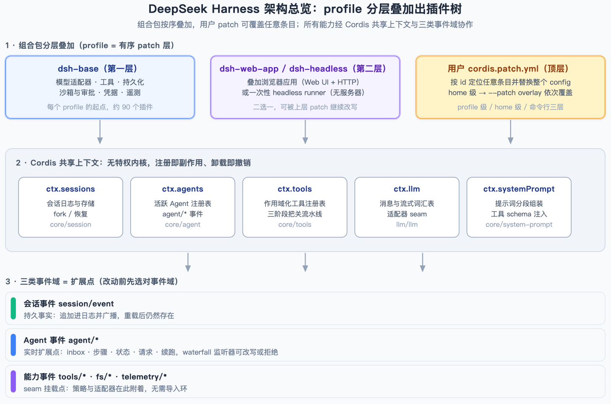
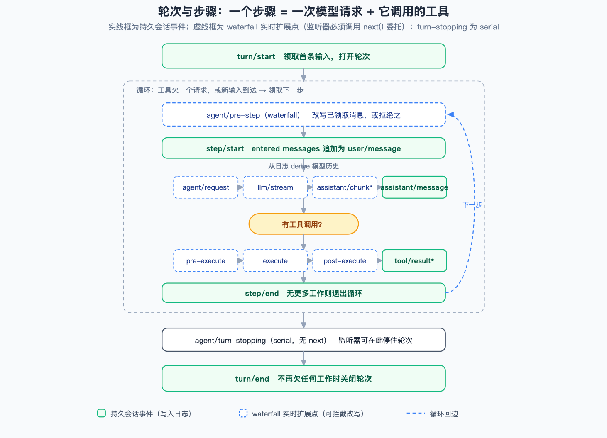

# DeepSeek Harness
## 总体架构

### 配置组装层
**Bundle（组合包）**  
是一个可分发、可复用的插件集合。它包含一组 Cordis 插件及其默认配置和挂载代码，提供一套基础能力。Bundle 里写的内容都是默认值，随时可以被上层修改、增加或删除。
**Profile（配置文件/预设）**  
是你本地的一个具名配置目录。它包含两部分：
1. **一份清单**：声明要按什么顺序加载哪些 Bundle。
2. **用户自己的 `cordis.patch.yml`**：对加载进来的 Bundle 做最终修改。

运行时流程是：
1. 按 Profile 的清单顺序，逐层叠加各个 Bundle，形成初始插件树。
2. 再应用用户自己的 `cordis.patch.yml`，对插件树进行增、删、改。
3. 最终插件树交给 Cordis 容器实例化并运行。

`dsh.profile` ：`dsh-base` 是每个 profile 的第一层（模型适配器、工具、持久化、沙箱与审批、凭据、遥测，约 90 个插件），`dsh-web-app` 在其上叠加浏览器应用，`dsh-headless` 叠加一个完全不带服务器的一次性 runner。用户自己的补丁在最顶层，可以对插件树进行**最后的**增、删、改。

各层的应用顺序是：profile 列出的每个组合包 → profile 级 `cordis.patch.yml` → home 级 → 任意 `--patch` overlay。一条 patch **按 id 定位某个条目并替换其整个 config**，或插入新条目。

### 运行时上下文层
配置组装完成后，系统会启动 Cordis 容器，根据插件树实例化所有插件。其中一部分插件，专门负责**向 Cordis 容器注册一个服务**，这个服务会挂到 `ctx` 上，供其他插件使用。此时，插件树被“压平”成了 **5 个核心服务入口**（`ctx.sessions`、`ctx.agents`、`ctx.tools`、`ctx.llm`、`ctx.systemPrompt`）。这棵树里所有插件的能力，最终通过这 5 个核心服务入口对外暴露。其他插件不需要知道某个能力来自树里的哪个插件。
### 事件扩展层
插件树被 Cordis 容器实例化后，提供服务的插件把能力注册到 ctx，消费型插件通过 inject 依赖这些 ctx 服务，并在各自监听的事件扩展点上介入，最终共同驱动 Agent Loop 运转。
## Cordis
下面基于5个核心概念来介绍Cordis插件框架
### Context  按名字存取服务的容器
是一个公共容器,每个模块**按名字注册**自己的能力,使用方**按名字取**。Cordis 的 **context**(就是代码里的 `ctx`)就是这个容器。
**注册**
```ts
import { Context, Service} from 'cordis'

abstract class Greeter extends Service{
	constructor(ctx: Context) {
		super(ctx, 'greeter')
	}
	
	abstract greet(name:string):string
}
```
注册的关键是
```ts
super(ctx, 'greeter')
```
它告诉 Cordis，将当前实例以 `'greeter'` 为名字注册到 Context 上（同一作用域重复注册同名服务会直接失败,不会"后写的覆盖先写），然后再补一段类型声明就可以让TypeScipt知道这项能力存在。
```ts
declare module 'cordis'{
	interface Context {
		greeter: Greeter
	}
}
```
但它暂时还是一个空壳，接着需要通过Plugin给它提供具体的能力(通过这样的方式也可以替换能力)
```ts
class EnglishGreeter extends Greeter {
	greet(name: string) {
		return 'Hello, ${name}!'
	}
}

class ChineseGreeter extends Greeter {
	greet(name: string) {
		return '你好,${name}!'
	}
}
```
安装
```ts
let greeterFiber = await ctx.plugin(EnglishGreeter)
app(ctx)
```
替换也是一样的
```ts
await greeterFiber.dispose()
greeterFiber = await ctx.plugin(ChineseGreeter)
app(ctx)
```
使用
```ts
ctx.greeter.greet('Alex')
```

注意:`ctx` 是个 Proxy(代理对象，读写及函数调用可被拦截并执行自定义逻辑),"读属性"这个动作会被拦截并转给服务解析器--所以 `ctx.shell` 不是读某个固定字段,而是"解析当前作用域(这个对象维护的本地服务表)里名为 `shell` 的服务"。这带来一个能力:**同一个名字在不同子作用域可以指向不同实现**(preset 就靠它给不同 agent 配不同能力)。例如：
```ts
const parentCtx = rootCtx.extend()          // 父作用域
const agentACtx = parentCtx.isolate()       // Agent A 的隔离作用域
const agentBCtx = parentCtx.isolate()       // Agent B 的隔离作用域

// 在 A 的作用域里注册 bash 实现
agentACtx.plugin(BashService)   // agentACtx.shell → BashService 实例

// 在 B 的作用域里注册 powershell 实现
agentBCtx.plugin(PowerShellService) // agentBCtx.shell → PowerShellService 实例
```
### fiber 与 effect  注册即副作用
插件 A 注册了工具、监听器、定时器
```ts
// plugin-a.ts
import { Context } from 'cordis'
import { defineTool } from 'dsh-tools'

export const name = 'plugin-a'
export const inject = ['tools']

export function apply(ctx: Context) {
  console.log('[A] apply 开始')

  // ① 事件监听器
  ctx.on('message', () => {
    console.log('[A] 收到 message 事件')
  })

  // ② 工具注册
  ctx.tools.register(defineTool({
    name: 'ping',
    description: 'Ping',
    parameters: {},
    async execute() { return 'pong' },
  }))

  // ③ 定时器（框架管不到，必须用 ctx.effect 显式包裹）
  ctx.effect(() => {
    console.log('[A] 定时器启动')
    const timer = setInterval(() => console.log('[A] tick'), 1000)
    return () => {
      console.log('[A] 定时器清理')
      clearInterval(timer)
    }
  })

  // ④ 子插件
  ctx.plugin(ChildPlugin)

  console.log('[A] apply 结束')
}
```
那么A 被卸载后(配置删了、热重载、依赖消失),谁来收拾?
每次 `ctx.plugin()` 挂载会产生一个 **fiber**——这次挂载的运行时实例
```ts
const fiber = ctx.plugin(pluginA)
```
持有配置、依赖状态和**本次挂载注册的所有 effects**。
```
fiber(plugin-a)
├── config        本次挂载的配置
├── state         ACTIVE
├── effects       [ ①监听器, ②工具, ③定时器, ④子插件 ]
│                  （按注册顺序排列）
└── children      [ fiber(ChildPlugin) ]   ← ④ 子插件的 fiber
```
fiber 卸载时
```ts
await fiber.dispose()
```
清理函数按注册**逆序**执行并被等待。
```
开始卸载 fiber(plugin-a)
  ↓
逆序执行 effects：
  ④ 子插件      → 卸载 ChildPlugin 的 fiber（递归清理它的 effects）
  ③ 定时器      → 调用 clearInterval(timer)
  ② 工具        → 从 Tool Registry 移除 'ping'
  ① 监听器      → 移除 'message' 监听器
  ↓
等待所有 disposer 完成（包括异步）
  ↓
state = DISPOSED
```
这些撤销动作就是框架自动推导并绑定的；只有框架管不到的外部资源（比如上面的定时器），才需要你手动定义。
### 插件的三种形态
**函数插件**
```ts
export const name = 'tool-bash'
export const inject = ['tools', 'shell', 'systemPrompt', 'shellEnv']
export const Config = z.object({ ... })

export function apply(ctx: Context, config: Config): void {
  // 拿 ctx 注册工具、监听事件
}
```
- 适合“消费者”插件：依赖别的服务，注册工具/监听器。
- 框架识别：模块里有 `apply` 函数，就把它当插件入口。
- `name`、`inject`、`Config` 是**命名导出**，与 `apply` 平级，共同描述这个插件。
**Service子类**
```ts
// greeter-service/src/index.ts
export default class GreeterService extends Service {
  constructor(ctx: Context) {
    super(ctx, 'greeter')
  }
  greet(name: string) { return `Hello, ${name}!` }
}
```
- 适合“提供者”插件：向容器注册服务。
- 框架识别：模块的 **default export** 是 `Service` 子类，就把它当插件本体。
- 服务名、依赖等，由类内部 `super(ctx, 'greeter')` 和静态属性决定。
**带apply的对象**
```ts
export default {
  name: 'some-plugin',
  inject: ['tools'],
  apply(ctx: Context) {
    // ...
  },
}
```
- 等价于函数形态，只是把元数据和 `apply` 打包进一个对象。
- 适合需要动态构造插件对象的场景（比如工厂函数返回插件）。

三种形态**功能等价**，框架统一用 `ctx.plugin(plugin, config)` 挂载，返回 fiber。

函数插件和 Service 子类两者都是插件。不过一个是服务提供者（可以给别的插件用，通过名字获取其能力），而另一个仅仅是装配单元/消费者（其他插件在容器里找不到它、用不了它，但它内部封装了装配逻辑和工具能力，是给 Agent（大模型）和 Harness（运行时）用的）。
那Agent和Harness怎么找插件呢？
Harness 启动时，最先被挂载的是 **Loader 插件**，它是整个插件系统的入口。
Loader 的核心工作是读取 `cordis.yml` 配置文件，该文件用 `name` 字段声明要加载的插件模块。
```yaml
- name: '@deepseek-ai/dsh-tools'        # 工具注册表服务
- name: './tool-logger.ts'              # 日志插件
- name: './greet-tool.ts'               # 自定义工具插件
```
Loader 读取 `cordis.yml`，然后根据里面的配置，通过 `ctx.plugin()` 把一个个插件挂载到 `ctx` 上。最终留在 `ctx` 上的是插件实例（及其注册的 effect）。这就是 Harness“找到”插件的方式——**通过配置文件中的模块名（`name`）静态解析**，而不是运行时动态搜索（不同的预设会有不同的cordis.yml配置文件，因此有了不同的能力）。

导出纪律：
- **service 包**:default export 它的 Service 类;
- **函数插件**:只命名导出 `name` / `inject` / `Config` / `apply`,**不写 default export**。
两种形态不能混在一个 module 里——Loader 会把 default export 当成插件本体,同 module 的命名元数据就不再属于它,`inject` 等于丢失。
### Service + Inject  启动顺序不该由人排
依赖关系规定
```ts
export const name = 'consumer-optional'
export const inject = [] // 必须的服务需要写在inject数组里面

export function apply(ctx: Context) {
  // 可选服务用 `ctx.get(name)`,没提供时得到 `undefined`。
  const greeter = ctx.get('greeter')

  if (greeter) {
    console.log(greeter.greet('Optional'))
  } else {
    console.log('greeter 服务未提供，降级处理')
  }
}
```
一个服务可能会依赖其他多个服务，那么它们的启动顺序就应该是依赖的服务先启动，然后再启动它自己，并且依赖消失时它会跟着卸载,依赖恢复时再自动加载。所以这个启动顺序不应该由人来排，而是应该由依赖图（各个服务之间的依赖关系构成的图）来决定。
并且加载依赖服务的时候用的是其注册的名字而非具体实现，这也是支持替换实现的一部分。
```ts
export const name = 'tool-bash'
export const inject = ['tools', 'shell', 'systemPrompt', 'shellEnv']
```
### Event  五种派发方式
event 表达"发布一个扩展点,让未知的零个或多个插件参与"。
插件统一用 `ctx.on(name, listener)`进行监听，再监听到事件后执行自己的逻辑，从而参与进流程;**派发方式是事件契约的一部分**,由事件的拥有者(producer，Agent Loop 或者 Tool Runtime等关键插件，它们可以按指定方式派发事件)选定(监听该事件的插件按派发方式所定逻辑进行配合工作):

| 派发              | 语义                             | 典型用途                                   |
| --------------- | ------------------------------ | -------------------------------------- |
| `emit`          | 同步逐个通知，插件执行自己的逻辑，但忽略返回值        | 纯观察(如 `session/event` 广播)              |
| `parallel`      | 并发跑所有监听者,等全部结束                 | 通知多个互不相干的方                             |
| `serial`        | 各个插件逻辑依序 await执行,遇到首个 bail 值停止 | 顺序决策(如 `agent/turn-stopping`:有一个说不停就停) |
| `bail`          | serial 的同步版（同步顺序执行）            | 同上,无异步需求时                              |
| **`waterfall`** | **中间件/洋葱模型**                   | **拦截、包装、改写**(下文专讲)                     |
派发和监听的配合
```ts
// ① 插件先监听
ctx.on('tools/pre-execute', async (exec, next) => {
  console.log('插件 A 被触发了') // 监听到派发的事件后就执行该插件的逻辑
  return await next()
})

// ② 过了一段时间，Harness 决定派发
await ctx.waterfall('tools/pre-execute', exec, async () => {
  console.log('最内层默认行为')
  return { kind: 'allow' }
})
```
如果在一个扩展点发布了多次事件(派发类型可相同可不同，插件都会按派发类型执行若干次逻辑)。

**waterfall:这个仓库最重要的控制流**

`ctx.waterfall` 就是 Web 框架的 around-middleware。每个监听者收到 `(...args, next)`:

- 调用 `next(...)`:把(可能已被自己改过的)参数交给下一层;`next` 的返回值是内层的结果,可以再加工;
- **不调用 `next()` 直接返回:短路**,后面所有层和最内层的默认行为都不执行。

以 `tools/execute` 为例,洋葱是这样套起来的:最外层可能是 timeout 策略插件,再往里是审批插件,最核心是工具真正的执行器。每个插件包住"剩下的整条链"。

仓库规矩要读准:**"waterfall 监听者必须调用 `next()`"针对的是协作型监听者**(观察、校验、包装);**拥有单一决定权的监听者故意短路是设计的一部分**--比如权限插件拒绝一次工具调用,就是要短路。写和读代码时都要分清这是哪一种。
```ts
async function listenerA(payload, next) {
  console.log('A 进入')
  const inner = await next()      // 把控制权交给 B
  console.log('A 拿到内层结果:', inner)
  return `A 包装了(${inner})`
}
async function listenerB(payload, next) {
  console.log('B 进入')
  const inner = await next()      // 交给 C
  return `B 包装了(${inner})`
}
async function listenerC(payload, next) {
  console.log('C 进入')
  return 'C 的原始结果'           // 最内层
}
```

**Agent Loop中各个扩展点事件发布者(会变更)**

| 事件名称                      | 所属阶段   | 发布者（事件拥有者）                                        | 派发方式                                               | 核心作用简述                                                                                                              |
| ------------------------- | ------ | ------------------------------------------------- | -------------------------------------------------- | ------------------------------------------------------------------------------------------------------------------- |
| **`turn/start`**          | 轮次开始   | **Agent Loop 插件** (`@deepseek-ai/dsh-agent-loop`) | **持久化写入** (非 `emit`)                               | 领取首条输入，打开并初始化一个轮次（Turn），写入 Session 日志[](https://developer.aliyun.com/article/1760581#1)。                            |
| **`agent/pre-step`**      | 步骤预备   | **Agent Loop 插件**                                 | **waterfall**                                      | 拦截即将进入模型的 messages，允许插件改写消息内容，或直接拒绝该次请求（短路）[](https://yuanyou.blog.csdn.net/article/details/164338227#2)。           |
| **`step/start`**          | 步骤开始   | **Agent Loop 插件**                                 | **持久化写入** (非 `emit`)                               | 将 entered messages 追加为 `user/message`，并准备从日志派生模型历史，写入 Session 日志[](https://developer.aliyun.com/article/1760581#1)。 |
| **`agent/request`**       | 模型请求前  | **Agent Loop 插件**                                 | **waterfall**                                      | 拦截即将发往 LLM 的请求参数（如调整 temperature、修改 system prompt、注入 RAG 结果）。                                                       |
| **`llm/stream`**          | 模型推理   | **LLM 适配器插件** (`LlmRuntime`)                      | **waterfall**                                      | 拦截底层的流式请求（如替换模型供应商、添加代理、重试机制）。                                                                                      |
| **`assistant/chunk*`**    | 模型推理   | **LLM 适配器插件**                                     | **持久化写入** (在 0.1.5 后改为 `agent/assistant-stream` 帧) | 实时拦截并改写模型流式输出的每一个数据块（如流式敏感词过滤、实时 TTS 转换）。                                                                           |
| **`assistant/message`**   | 模型推理完成 | **Agent Loop 插件**                                 | **持久化写入**                                          | 模型完整回复生成后，作为持久会话事件写入日志[](https://developer.aliyun.com/article/1760581#1)。                                           |
| **`tools/pre-execute`**   | 工具执行前  | **Tool Runtime 插件** (`@monotonic/dsh-tools`)      | **waterfall**                                      | 权限校验、参数验证、危险操作二次确认，可返回 `deny` 短路后续执行。                                                                               |
| **`tools/execute`**       | 工具执行中  | **Tool Runtime 插件**                               | **waterfall**                                      | 包装工具的真正执行逻辑（如添加超时控制、重试机制、Mock 测试）。                                                                                  |
| **`tools/post-execute`**  | 工具执行后  | **Tool Runtime 插件**                               | **waterfall**                                      | 对工具返回的结果进行清洗、脱敏、格式化，或处理执行异常。                                                                                        |
| **`tool/result*`**        | 工具结果定稿 | **Tool Runtime 插件**                               | **持久化写入** (观察通知为 `emit`)                           | 工具执行结果最终确定，写入会话日志，并准备回传给模型[](https://www.npmjs.com/package/@monotykamary/dsh-tools#1)。                              |
| **`step/end`**            | 步骤结束   | **Agent Loop 插件**                                 | **持久化写入** (非 `emit`)                               | 判断当前步骤是否还有更多工作。若无，则退出本轮循环，写入 Session 日志[](https://developer.aliyun.com/article/1760581#1)。                          |
| **`agent/turn-stopping`** | 轮次停止前  | **Agent Loop 插件**                                 | **serial**                                         | 顺序决策轮次是否应该停止。任何一个插件返回非空值（如 `stop: true`），轮次即结束[](https://yuanyou.blog.csdn.net/article/details/164338227#2)。        |
| **`turn/end`**            | 轮次结束   | **Agent Loop 插件**                                 | **持久化写入** (非 `emit`)                               | 不再欠任何工作时，正式关闭轮次，清理会话级资源，写入 Session 日志[](https://developer.aliyun.com/article/1760581#1)。                            |

### 一个简单但完整的dsh工具插件结构
```ts
// src/index.ts
import type { Context } from '@deepseek-ai/cordis'
import { defineTool } from '@deepseek-ai/dsh-tools'

// ① 插件身份标识
export const name = 'greet-tool'

// ② 依赖声明
export const inject = ['tools']

// ③ 插件入口函数
export function apply(ctx: Context) {
  ctx.tools.register(defineTool({
    // ④ 工具元数据（给模型看的）
    name: 'greet',
    description: 'Greet someone by name.',
    parameters: {
      name: { type: 'string', required: true, description: 'The name to greet' },
    },
    // ⑤ 输出契约
    output: {
      schema: { type: 'string' },
      render: (_args, value) => [{ type: 'text', text: value }],
    },
    // ⑥ 执行逻辑（真正干活的代码）
    async execute(args) {
      return `Hello, ${args.name}!`
    },
  }))
}
```

## Turn and Step
dsh 的最小执行单元定义得非常精确：**一个步骤（step）= 一次模型请求 + 它调用的工具**；**一个轮次（turn）包含零个或多个步骤**，在领取首条输入时打开，不再欠下任何工作时关闭。

实线框是持久会话事件（写进日志），虚线框是 waterfall 实时扩展点（可拦截改写）。右侧回边是循环的关键——只要工具欠一个请求或新输入到达，就领取下一步；`agent/pre-step` 可以改写甚至拒绝已领取的消息。

注意循环的每一拍都会**先写日志再执行**——这个顺序是后面"模型可见即已记录"不变量的根基。

插件就是在Agent Loop中的各个实时扩展点注入自己的影响的（实现自己的功能）。
**预备阶段**
**`agent/pre-step`**
插件可在此拦截即将进入模型的消息，可以拒绝该次请求or改写消息并调用next()函数交给下一层插件进行处理。

**模型推理阶段**
**`agent/request`**
插件可在此拦截即将发往 LLM 的请求参数（如调整 temperature、修改 system prompt、注入 RAG 检索结果）。
**`llm/stream`**
插件可拦截底层的流式请求（例如替换不同的模型供应商、添加代理）。
**`assistant/chunk*`**
在模型流式输出每一个 chunk 时，插件可以实时拦截并改写（例如流式敏感词过滤、实时 TTS 转换、结构化输出解析）。

**工具执行阶段**
**`pre-execute`**
插件可在工具真正执行前拦截。用于权限校验（这个 Agent 是否有权调用该工具）、参数验证、危险操作二次确认、或者参数动态修改。
**`execute`**
工具实际执行的扩展点。插件可在此包装工具执行逻辑（例如添加超时控制、重试机制、Mock 测试）。
**`post-execute`**
工具执行完毕后的拦截点。插件可对工具返回的结果进行清洗、脱敏、格式化，或者处理工具执行抛出的异常。

插件在启动与注册阶段(Harness初始化时)，不仅定义了工具的执行逻辑，还必须向核心Harness提交一份工具元数据(Tool Schema，通常包含工具名称、功能描述和参数结构)。核心Harness会维护一个工具列表(Tool Registry)，当流程走到`agent/pre-step` 和 `agent/request` 时，Harness 会从 Tool Registry 中提取出当前 Agent 被授权使用的工具列表，按大模型指定格式(如OpenAI的tools)全量(工具数量少)或动态按需注入(工具数量非常多，可以先检索再注入相关的)。
到这插件把自己的工具准备好了，那插件是怎么用这些工具协助Agent完成任务的呢。在 **`agent/pre-step`** 或 **`agent/request`** 阶段通过改写 Prompt、注入 Few-shot 示例，甚至强制指定 `tool_choice`，引导大模型在特定场景下产生调用某工具的意图，然后在这个工具执行阶段会找到这个工具所属的插件(还有一些注册了全局拦截逻辑的插件)，Harness让出执行权让这些插件去执行这个工具。其实就是在工具执行阶段，Harness 会根据工具名路由到对应的插件及全局拦截逻辑插件。然后在 `pre-execute`、`execute`、`post-execute` 这些由 Harness 定义的扩展点上，注入并执行自己编写的回调逻辑。最终完成工具的调用，并把结果通过 Harness 写入 `tool/result`。  此时，流程走到 `step/end`。如果判断还有下一步则会继续该Turn。
## Session Log
DSH对会话历史的做法：只 append 不可变事件(`turn/start`、`user/message`、`assistant/chunk`、`tool/call`、`tool/result`、…),任何"当前状态"都是对事件的**投影(projection)**（在不可变事件流上进行处理后的现象，如压缩、改写）。通过这种方法可以实现以下需求：

| 需求   | 解决办法                                                              |
| ---- | ----------------------------------------------------------------- |
| 崩溃恢复 | 重放日志;崩溃留下的未闭合 turn 和 torn tail 由 `dsh-session-persistence` 在加载时修复 |
| 分叉   | 复制日志到边界处,继续各自 append。`ctx.sessions.fork(source, boundary?)`       |
| 压缩   | append 一条"surface 替换"事件，原始事件一个不动                                  |
| 多种读法 | 每个消费者(projector、query、title、telemetry)各自从事件流派生自己的读模型,互不干扰         |
这就是 event sourcing。**事实(发生了什么)和视图(现在看起来怎样)被彻底分开,事实层不可变,视图层随便算/处理。

对话历史在内存中的结构
```ts
// 内存中对话历史的容器，本质上是一个数组
class Session {
  events: SessionEvent[] = [] // 这就是那个有序列表
  
  // 核心方法：只允许追加（append-only）
  append(type: string, data: any) {
    const event = {
      seq: this.events.length, // 分配单调递增的序列号，等于当前数组长度
      type: type,              // 事件类型，如 'user/message'
      data: data,              // 具体数据
      timestamp: Date.now()    // 时间戳
    }
    Object.freeze(event)       // 冻结，不可再变
    this.events.push(event)    // 追加到数组末尾
    // ... 更新 Surface、广播事件等
  }
}
```

**内存对象与磁盘事实**两层的读写路径一图流:
```
调用方 ──session.append(type, data)──▶ 内存事实层
                                       │ 验证、冻结、分配单调递增 seq
                                       │ 更新内存 surface
                                       └─广播 session/event(live)──▶ UI 立刻可见
                                                              │
                                            dsh-session-persistence 监听,批量落盘
                                                              │
调用方 ──await ctx.sessions.flush(session)──▶ session/flush checkpoint,排空批量缓冲
```
两个层次**不是同一个 commit 点**:
- `session.append(type, data)`:在**内存**中验证、冻结、分配单调递增的 `seq`,更新内存 surface,广播 `session/event`。已接受的事件永不再变,`session.events` 是冻结快照。
- 持久化:`dsh-session` **自己不写磁盘**。它只发布 live 事件;`dsh-session-persistence` 监听这些事件,批量落盘。
- 需要"确定已落盘"的调用方,随后 `await ctx.sessions.flush(session)`,触发 `session/flush` durability checkpoint,把批量缓冲排空。
为什么不 append 即写盘?因为 UI 想立刻看到事件(内存 append 立即广播),而磁盘写是批量的(保证性能)。两层各自有明确的语义,谁需要哪种保证就调哪个。

### surface & raw log —— 模型看到的 & 实际发生过的
Session 内部有两层:
- **raw log**:全部历史事件,永久事实层,只增不减。
- **surface**:模型**当前**看到的消息层。普通 append 在 surface 尾部加一条;**compaction(压缩)产生的替换事件可以让旧消息不再进入后续请求**--但 raw 事件仍然都在。

surface层内容：

|事件类型|说明|是否在 Surface 中|
|---|---|---|
|**`system/message`**|系统提示词，定义了 Agent 的角色、能力和行为准则。|✅ **是**|
|**`user/message`**|用户的直接输入或系统注入的上下文信息。|✅ **是**|
|**`assistant/message`**|模型生成的完整回复，可能包含文本内容或工具调用请求。|✅ **是**|
|**`tool/result`**|工具执行完成后返回的结果。|✅ **是**|
|`turn/start`, `step/end`|轮次和步骤的边界标记。|❌ 否|
|`assistant/chunk`|模型输出的原始流式数据块。|❌ 否|
|`tool/call`|模型发起的工具调用请求。|❌ 否|
|重试、审批、压缩等插件事件|由插件扩展的事件。|❌ 否|
compaction 的完整流程(`dsh-compaction` + `compaction-basic`):

```
token 压力触发
  │ 选择一个安全边界(不能拆散 tool-call/result 配对)
  ▼
durable 事务:
  compaction/start
    -> summary 事实
    -> 一条带 surfaceOp: replace 的 user/message 检查点
  compaction/end
  ▼
从此 deriveMessages() 从替换点开始投影:
  模型看到"[总结] + 之后的消息",而不是全部历史
```

1. token 压力触发,选择一个**安全边界**;
2. durable 事务:`compaction/start` -> summary 事实 -> 一条带 `surfaceOp: replace` 的 `user/message` 检查点 -> `compaction/end`;
3. 从此 `deriveMessages()` 从替换点开始投影:模型看到"\[总结\] + 之后的消息",而不是全部历史。

三条配套纪律:

- **compaction 边界不能拆散 tool-call/result 配对**--把一个 tool call 切进总结、result 留在总结外,重建出的历史就是残缺的。
- 自动 compaction 只发生在活动 turn 的安全点;手动 `/compact` 要先获得空闲准入。不是"总在后台随时跑"。
- 人类 transcript、模型历史、UI 投影,**各自声明**自己读 raw 还是读 surface--因为两个答案都合法,但必须明确。

**铁律：任何进入模型请求的内容,必须能从 session log 重建;新增模型可见输入,必须新增 durable 事件。**
为什么必须铁律化?逐个看违反后的裂口:
- 假设某个插件在请求前临时拼了一段 workspace 说明,没落日志。那么日志重建出的"模型看到的内容"和**真实的**模型输入**分叉**了。
- 分叉一旦发生:resume 后模型行为不可复现;fork 出的分支和原会话"看着一样其实不一样";transcript 展示的输入模型根本没看到;调试时你以为的上下文不是实际的上下文

| 分叉的裂口 | 具体后果 |
|---|---|
| resume | 模型行为不可复现 |
| fork | 分支和原会话"看着一样其实不一样" |
| transcript | 展示的输入模型根本没看到 |
| 调试 | 你以为的上下文不是实际的上下文 |

注意精确含义:不是"每个中间步骤都要持久化",而是**最终到达模型的语义必须有 durable owner**。live 的 pre-step 可以随便改消息,但改完的结果会写成 durable `user/message`;prompt 组装的中间过程不必落日志,但组装结果进入了可重建的请求。这条规则有运行时 invariant 持续断言,不是靠自觉。

### 一个 log,五个读者

Session 目录下不只有一个包,而是一群各自独立的**投影消费者**:

| 包 | 从 log 派生出什么 |
|---|---|
| `session-persistence`(+jsonl/sqlite backend) | 磁盘事实 |
| `session-projection` | UI 用的同步一致快照 |
| `session-query` | 检索语料与有界读取(SQLite provider 加索引) |
| `session-title` | 标题(唯一的 title provider seam,辅助模型调用) |
| `session-telemetry` | 遥测投影 |

这就是 event sourcing 的回报:写入方只有一套 durable 事实,五种读法互不干扰、各自演化。新增一种读法 = 新增一个消费者插件,写入方零改动。
### 三个"版本号",三个完全不同的问题
一份 session 日志要能正确读写，需要同时满足三个维度的兼容性——事件语义、数据库表结构、文件字节编码。每个维度都有自己的版本管理方式。

| 版本号                              | 归属         | 管什么                                     | 打个比方           |
| -------------------------------- | ---------- | --------------------------------------- | -------------- |
| `SESSION_FORMAT_VERSION`         | dsh 自己     | **事件的语义格式**：每个事件类型代表什么、字段是什么含义、顺序怎么重建   | 书的**语言和内容版本**  |
| SQLite `SCHEMA_VERSION`          | SQLite 数据库 | **数据库布局**：表、列、索引、应用身份等                  | 书架的**结构和标签**   |
| JSONL backend 的 `compression` 配置 | 文件存储层      | **文件字节编码**：是 Zstandard 压缩帧，还是裸 JSONL 文本 | 书是**印刷版还是电子版** |
配套规则：
- 新增事件类型，不一定要提升 `SESSION_FORMAT_VERSION`。因为 dsh 的 `SessionEventMap` 里的成员默认是 **required-on-read**。意思是：**旧版本的 reader 如果遇到一个它不认识的事件类型，会直接拒绝读整份日志**，而不是悄悄跳过。这听起来很严格，但其实是保护机制——避免旧程序误解新数据。只有当你希望旧 reader 能安全跳过这个新事件时，才在事件信封上标记 ignorable: true。这样旧 reader 才会忽略它，继续读后面的。
- 当**旧 reader 无法保留日志的完整语义**时，才需要提升。比如：改变了已有事件的含义；改变了事件重建的顺序；让旧 reader 即使能读，也会理解错。如果只是添加一个可安全忽略的辅助事件，就不一定需要提升。
- 当前处于预发布阶段(v0):没有兼容承诺,旧格式直接拒绝,不做迁移路径。这是有明确结束条件的仓库策略(首个 tagged release 时移除),不是永久产品决定。
- 如果你把存储格式从 Zstandard 压缩换成裸 JSONL，或者反过来，**不能在同一份数据根目录下悄悄换**。因为旧程序可能按老编码去读，会读出一堆乱码。正确做法：**换编码就用新的 root 目录**，让新旧数据物理隔离。
遇到"数据打不开"时,先判断属于哪一层,再去读对应 owner 的错误信息;不要改版本常量绕过拒绝。
## Capability Seam 能力缝
一个 **capability seam**（能力缝）由三个角色构成，和Cordis框架对照起来看会比较清楚。

|角色|职责|在 Cordis 里的对应|
|---|---|---|
|**Service Definition**|声明接口，拥有 `ctx` 上那个 key|`declare module` 声明类型 + `Service` 基类约定|
|**Service Provider**|往容器里注册一个具体实现|`class XxxService extends Service` + `super(ctx, 'name')`|
|**Consumer**|只按接口取用，不知道背后是谁|`inject = ['name']` + `ctx.name`|

### Service Definition
这是 Seam 的“定义方”。它不提供具体能力，只**声明一个 key 和它的语义**（注册了一个可以供别人查找的名字，并且规定了这个名字应该提供怎么样的能力）。
```ts
// 定义方：声明 ctx 上有个叫 'shell' 的能力，类型是 ShellService
declare module 'cordis' {
  interface Context {
    shell: ShellService
  }
}

interface ShellService {
  exec(cmd: string): Promise<string>
}
```
### Service Provider
这是 Seam 的“实现方”。它把一个具体类挂到 ctx.shell 上。
```ts
class BashService extends Service implements ShellService {
  constructor(ctx: Context) {
    super(ctx, 'shell')  // 注册到 ctx.shell
  }
  async exec(cmd: string) { return await runBash(cmd) }
}

// 挂载
ctx.plugin(BashService)
```
也可以是另一个实现，只要满足 `ShellService` 接口：
```ts
class PowerShellService extends Service implements ShellService {
  constructor(ctx: Context) { super(ctx, 'shell') }
  async exec(cmd: string) { return await runPowerShell(cmd) }
}
```
**切换方式**
假设你正在开发一个 Agent，它需要用到网页搜索能力(web)。你安装了三个搜索 Provider 插件：

|Provider 插件名|注册的 id|需要什么|
|---|---|---|
|`@deepseek-ai/dsh-web-search-deepseek`|`deepseek-official`|`DEEPSEEK_API_KEY`|
|`@ltctfer/dsh-web-search-brave`|`brave-official`|`BRAVE_API_KEY`|
|`@mikasomaka/dsh-web-search`|`chain`|Gemini / Exa / Firecrawl 的 key|

基础包 `dsh-base` 默认把 `web` 这个 Capability Seam 的 `searchProvider` 固定为 `deepseek-official`。所以**默认情况下，你的 Agent 用的是 DeepSeek 官方搜索**。

这个dsh-base本质也是一个cordis.patch.yml
```yaml
- id: web
  config:
    searchProvider: deepseek-official
```

在你想把它换成 Brave 搜索：
在你的 profile 目录（例如 `~/.dsh/profiles/web/`）下，打开或创建 `cordis.patch.yml`，写入：
```yaml
- id: web
  config:
    searchProvider: brave-official
```
**就这么两行。** 注意 `- id: web` 对应的是 `web` 这个 Seam 的行，`config` 是**整块替换**，不是深度合并。所以如果你需要保留其他字段，必须一并重述。重启生效。

### Consumer
这是 Seam 的“消费方”。它只知道自己要用 `shell` 能力，不知道背后是 Bash 还是 PowerShell。
```ts[]()
export const name = 'tool-bash'
export const inject = ['shell']

export function apply(ctx: Context) {
  ctx.tools.register(defineTool({
    name: 'bash',
    async execute(args) {
      return await ctx.shell.exec(args.cmd)  // 只用接口，不关心实现
    },
  }))
}
```
### 为什么这种抽象有用
1. 替换实现不改 Consumer
你把 `BashService` 换成 `PowerShellService`：
- Provider 换了一个插件；
- Consumer 代码不变；
- `inject` 声明不变；
- 只是运行时的解析结果变了。
2. 作用域隔离，同名不同实现
```
const agentACtx = parentCtx.isolate()
const agentBCtx = parentCtx.isolate()

agentACtx.plugin(BashService)        // agentACtx.shell → Bash
agentBCtx.plugin(PowerShellService)  // agentBCtx.shell → PowerShell
```

两个 Agent 的代码都写 `ctx.shell`，但因为作用域不同，拿到的是不同实现。这就是 dsh preset 给不同 agent 配不同能力的核心机制。
### 一个完整的Seam例子
```ts
// ─── Service Definition（接口 + key 所有权）───
declare module 'cordis' {
  interface Context {
    greeter: GreeterService
  }
}
interface GreeterService {
  greet(name: string): string
}

// ─── Service Provider A（英文实现）───
class EnglishGreeter extends Service implements GreeterService {
  constructor(ctx: Context) { super(ctx, 'greeter') }
  greet(name: string) { return `Hello, ${name}!` }
}

// ─── Service Provider B（中文实现）───
class ChineseGreeter extends Service implements GreeterService {
  constructor(ctx: Context) { super(ctx, 'greeter') }
  greet(name: string) { return `你好，${name}！` }
}

// ─── Consumer（只认接口）───
export const name = 'greeting-tool'
export const inject = ['greeter']
export function apply(ctx: Context) {
  ctx.tools.register(defineTool({
    name: 'greet',
    async execute(args) {
      return ctx.greeter.greet(args.name)  // 不知道是英文还是中文实现
    },
  }))
}

// ─── 组装：选择哪个 Provider，就决定 Seam 背后是谁 ───
ctx.plugin(EnglishGreeter)   // 或 ctx.plugin(ChineseGreeter)
ctx.plugin(greetingTool)
```
### Execution World
模型在干活时，会同时用到各种工具：`bash` 跑命令、`read` 读文件、`glob` 扫路径、`LSP` 分析代码。  
如果这些工具各自看向不同的“现实”——比如 `bash` 在远程服务器上创建了文件，`read` 却在本地找——模型就会陷入精神分裂。**为了保证模型认知一致，所有工具必须运行在同一个“执行世界”里。**

这个“世界”由两个底层接缝定义：
- **`fs`（文件系统）**：负责文件的读写、路径解析和文件身份识别。
- **`subprocess`（子进程）**：负责进程的创建与执行，管理进程树。
- **它们的关系**：`shell`、`terminal`、`LSP`、进程型 `search` 等，都是 `subprocess` 的消费者；它们和 `fs` 一起，共同构成了这个世界的“物理法则”。

**切换世界：整体搬家，而不是逐个开分店**
**错误做法**：给每个工具（bash、read、glob...）都加一个 `remote: true` 的参数，让它们各自判断去本地还是远程。
**后果**：每个工具都要重复实现一遍“世界知识”，代码冗余，且极易遗漏（迟早漏掉一个，导致模型看到矛盾）。

**正确做法**：直接**整体替换 `fs` 和 `subprocess` 这两个 Provider**。
**效果**：就像“搬家”一样，把整个执行环境从本地搬到远程。所有上层工具（bash、read、glob 等）无需任何修改，它们会自动在新的远程世界里工作，因为 `ctx.fs` 和 `ctx.subprocess` 都指向了新的实现。

#### 沙箱
**`sandbox` 家族**：解决的是**同一个世界内**的进程约束问题（比如限制文件写入范围、禁止网络访问）。它是在“当前世界”里加规则，而不是换一个世界。

沙箱的核心是一个叫 `ctx.sandbox` 的服务。它包装子进程的启动参数（argv），然后施加一个**文件效果策略（file-effect policy）**。这个策略只有三种模式：
- **`read-only`**：禁止任何写入，除了 `/dev/null` 这类必需的 sink。
- **`workspace-write`**：只允许在工作区根目录及后端定义的临时区域下写入，工作区外一律拒绝。
- **`danger-full-access`**：绕过隔离，直接以原始权限运行。
消费方（比如 `dsh-bash-sandbox`）在启动每条命令时，都会经过这层包装。**命令本身还是在本机跑的，但它的写入能力被限制了。**

**沙箱和权限、审批的分工**
dsh 的安全设计是三层各管一件事：
1. **沙箱**：管“能碰哪些文件”——文件效果的边界。
2. **权限预设**：管“能做什么”——把沙箱模式和审批策略捆成一个命名预设（比如默认的 `workspace-write`+ `ask`）。
3. **审批**：管“危险动作要不要人点头”——只有 `allowed-once` 才放行。

沙箱不负责网络隔离，也不负责进程可见性，它只管控**文件效果**。网络和进程可见性不在它的词汇表里。

**真正的远程隔离环境**：直接整体替换 `fs` 和 `subprocess` 两个 Provider，把执行世界搬到远程，而不是给每个工具加 `remote` 分支。远程环境自带隔离边界（或者由 dsh 为远程环境配上对应的远程沙箱，在远程主机上执行策略），所以不要再在本机套一层本机沙箱——本机沙箱管不到远程进程，反而会造成边界冲突。切换执行世界时，沙箱能力也会跟着切换：如果远程需要沙箱约束，dsh 会使用远程沙箱实现，而不是复用本机沙箱。（沙箱只是文件效果隔离，约束了能操作的文件，执行环境还是一样的）。

|替换目标|正确做法|
|---|---|
|**换远程环境**|一起替换 `fs` + `subprocess` 两个 Provider（整体搬家）|
|**同一世界内的进程约束**|用 `sandbox` 家族，不换世界|
|**真正隔离的远程环境**|直接换 Provider，不再套本机沙箱|
# Claude Code Harness 
