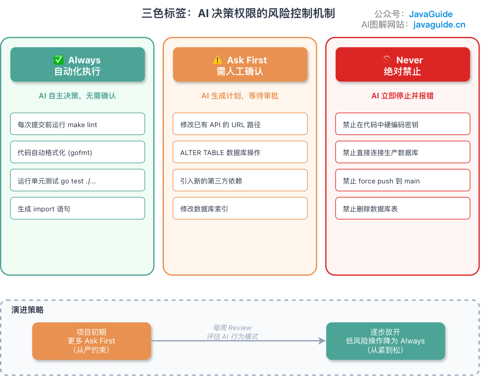
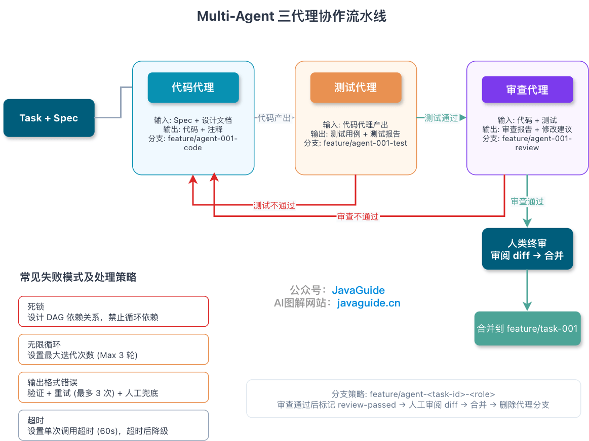

# Spec Coding
## Spec Coding 是什么
Spec Coding，直译过来叫规范驱动编程。简单来说就是：先把规范写清楚，再让 AI 干活。

平时让 AI 写代码，很多人会直接丢一句：

> 帮我做一个用户系统。

AI 当然能写，而且看起来还挺像那么回事。但问题也在这里：你没告诉它用户系统到底长什么样，它就只能自己猜。

用户怎么注册？邮箱能不能重复？密码怎么存？接口失败时返回什么格式？哪些功能这期不做？管理员有没有禁用用户的能力？这些东西如果一开始没写清楚，AI 不会停下来反问你，它大概率会先补一套自己觉得合理的方案。

Spec Coding 做的事情，就是把这些规则提前写下来。

这里的 Spec 不是随便写两句需求，而是一份 AI 能照着执行的技术约定。接口、数据结构、错误码、边界条件、安全要求、技术栈限制，甚至哪些操作不允许碰，都要写在里面。

它和 Vibe Coding 的差别，也就在这。

Vibe Coding 更像是你给 AI 一个大方向，然后让它自由发挥。代码生成出来以后，你再去验收、改 bug、补细节。短平快的小脚本这么干没啥问题，甚至很爽。

但项目稍微复杂一点，就容易出事。等你发现 AI 理解错了，代码已经写了一堆。你回头查，也很难说清楚到底是需求没讲明白，还是 AI 自己乱发挥。

简单总结下 Spec Coding 和 Vibe Coding 的差别：**AI 的行为是由你定义的，还是由它猜的？**
## 一种四步落地方式
本文采用 GitHub [Spec Kit](https://github.github.com/spec-kit/index.html) 示例中的 Specify、Plan、Tasks、Implement 四步来说明。它是一种可操作的工作流，不是所有 Spec Coding 工具统一遵循的标准；有的团队会合并设计与任务阶段，有的工具还会增加澄清、验证或变更管理阶段。

| 阶段            | 干什么   | 产出                | 关键动作              |
| ------------- | ----- | ----------------- | ----------------- |
| **Specify**   | 产品定义  | `requirements.md` | 明确功能、用户、痛点，定“做什么” |
| **Plan**      | 技术规划  | `design.md`       | 定技术栈、架构、契约，定“怎么做” |
| **Tasks**     | 任务拆解  | `tasks.md`        | 拆成原子任务，写验收标准      |
| **Implement** | AI 执行 | -                 | AI 按 Spec 干活，人验收  |

理解起来其实很简单，核心就是**先写清楚要做什么，再写清楚怎么做，然后拆任务，最后交给 AI 执行**。

### Specify：先搞清楚做什么
第一步是 `Specify`，产出一般是 `requirements.md`，或者叫 `spec.md`。

这一步有点像写 PRD，但面向的使用者是 AI。

所以，它不能只写方向，得把边界也写出来。

比如你写一句：

> 做一个用户系统。

人看着没问题，AI 看了就开始猜了：用户怎么注册？邮箱能不能重复？密码有啥要求？第三方登录做不做？管理员能不能禁人？被禁了数据怎么办？

你不写，它就自己定。

更稳一点的写法是：

> 支持邮箱注册和登录；邮箱必须唯一；单因素密码至少 15 个字符；暂不支持第三方登录；管理员可以禁用用户；用户被禁用后不能登录，但历史数据保留。

这句话让 AI 知道哪些能做，哪些不能做，哪些边界不能碰。
### Plan：敲定技术方案
第二步是 `Plan`，一般会落到 `design.md` 或 `plan.md` 里。

这一步很多人会跳过，觉得反正 AI 会写代码，让它自己发挥就行。

然后问题就来了。

你没说用哪个 Java 版本，它可能给你写 Java 8 的代码；你没说 Spring Boot 版本，它可能按旧写法来；你没说错误码格式，它就每个接口返回一套；你没说分层方式，它可能 Controller 里直接写业务逻辑；你没说表字段怎么命名，它也会按自己的习惯来。

所以 `design.md` 不用写得特别重，但几个关键约束得先定下来。

比如先写成这样就够用：

```
## 技术栈

- 语言: Java 21 (LTS)
- 框架: Spring Boot 3.2.x（现有旧项目快照；新项目按当时的支持矩阵选版本）
- 数据库: PostgreSQL 16
- 缓存: Redis 7.x

## 架构设计

- 分层: Controller → Service → Repository
- 通信: REST API + gRPC（内部服务）
- 部署: Docker + Kubernetes

## 接口约定

- API 规范: OpenAPI 3.0
- 错误码: 统一格式 {"code": "USER_NOT_FOUND", "message": "..."}
- 日志格式: JSON，必须包含 trace_id
```

你可能会想：这不就是设计文档吗？

确实有点像。

但区别在于，传统设计文档主要是给人看的。人看完知道大方向，剩下很多细节可以靠团队习惯补上。比如密码不能明文存、错误码要统一、日志里要带 trace_id，这些东西在成熟团队里通常不用反复强调。

AI 不一样。

你没写，它就猜。猜对了还好，猜错了就得你回来返工。

拿密码存储举个例子。你只写一句“登录要安全”，范围太宽，模型可能选择已经过期或不适合当前系统的方案。

新系统可以把规则写成下面这样，再根据服务器基准测试确定参数：

```text
密码使用 Argon2id 哈希存储，参数通过目标服务器基准测试确定，并记录算法版本以便后续迁移。
如果现有系统必须兼容 bcrypt，保留旧哈希校验，并在用户成功登录后逐步迁移到 Argon2id。
数据库只保存带盐哈希，不保存明文密码；使用经过维护的密码库生成随机盐。
单因素密码最少 15 个字符，最大长度至少支持 64 个字符，不强制大小写、数字或特殊字符组合。
注册和改密时检查泄露密码 Blocklist，登录接口设置速率限制。
```

错误处理也一样。别写“接口失败时返回友好提示”，这句话基本没约束力。AI 可能这个接口返回 `error`，那个接口返回 `message`，还有的地方直接抛异常。

直接写清楚：

```json
{
  "code": "USER_NOT_FOUND",
  "message": "用户不存在",
  "trace_id": "xxx"
}
```

再补一段状态码约定：

```text
参数错误返回 400。
未登录返回 401。
无权限返回 403。
资源不存在返回 404。
邮箱重复、用户名重复这类冲突返回 409。
```

这样 AI 至少知道该往哪个方向写。

说到底，`design.md` 主要是为了减少 AI 自己补设定。你把技术栈、接口格式、错误码、日志、并发、安全这些规则提前写好，后面让 AI 写代码时，它就不太容易跑偏。
### Tasks：任务要小到能验收
第三步是 `Tasks`，一般会写到 `tasks.md` 里。

这里不要一上来就让 AI “完成用户模块”。这个范围太大了。注册、登录、查询、禁用、权限、参数校验、异常处理、单元测试，全都塞在一个任务里，AI 很容易写着写着漏东西。最后你看代码时，还得一项一项往回补。

但也别拆得太碎。创建 UserDTO、添加 email 字段、写一个空的 Service 方法——这种任务看起来很细，实际会把人折腾死。你维护任务列表的时间，可能比让 AI 写代码还长。

我比较喜欢的粒度是：一个 Task 对应一个 API、一张表的核心操作，或者一个能独立验收的小功能。

比如用户注册接口，可以这么写：

```
### Task-001: 用户注册接口

描述：实现用户注册，包含参数校验、密码哈希和用户入库。

验收标准：

- [ ] POST /api/v1/users 成功时返回 201
- [ ] 新密码使用经过基准测试的 Argon2id 参数哈希后存储
- [ ] 单因素密码至少 15 个字符，最大长度支持至少 64 个字符，并检查泄露密码 Blocklist
- [ ] 登录与注册相关接口有速率限制
- [ ] 邮箱唯一，重复注册返回 409
- [ ] 返回体必须包含 user_id、email、created_at
- [ ] 分支覆盖率达到项目约定基线（本示例为 80%），且关键安全分支均有断言

预估工时：2h
```

这里真正值钱的是验收标准。“保证安全”“代码优雅”“性能要好”——这种话写了跟没写差不多，AI 不知道你心里的安全到底指什么，优雅要优雅到什么程度。

但密码使用经过基准测试的 Argon2id 参数、重复邮箱返回 `409`、返回体包含 `user_id`、`email`、`created_at`，以及关键分支有测试——这些东西都能验证，不用靠感觉。

覆盖率阈值别机械套。团队应根据模块风险、历史缺陷和测试类型确定基线；比单个百分比更重要的是权限、金额、状态迁移、重试和异常补偿等关键分支有没有有效断言。
### Implement：让AI干活
提示词不用搞得很玄学，直接把相关 Spec 塞进去就行：

```text
请根据以下 Spec 实现 Task-001。

需求说明：
[粘贴 requirements.md 相关段落]

技术约束：
[粘贴 design.md 相关段落]

任务验收标准：
[粘贴 tasks.md 里的 Task-001]
```

这里有个坑：不要把所有 Spec 一股脑塞进上下文。

单次会话里，我会优先放三类内容：

- 全局约束，比如代码风格、错误码格式、日志规范；
- 当前任务的需求说明；
- 当前任务的验收标准。

其他内容按需补，不要为了“完整”把所有文档都贴进去。

单次应该放多少 Token，没有跨模型和跨任务通用的 3000–8000 阈值。更实用的做法是先放全局硬约束、当前任务和验收标准，再通过索引或文件路径按需读取证据；当无关材料开始干扰判断，或任务可以独立拆分时再拆会话。

别指望模型在一个特别长的上下文里什么都顾得上。上下文越长，关键信息越可能被淹在中间，最后反而漏掉最重要的约束。

我自己会遵守三条原则：

第一，约定写进文档，不要只写在聊天里。聊天记录下次很可能接不上，文档才是可以复用的上下文。

第二，验收标准能量化就量化。“高性能”没法验收，`QPS > 1000`、`P95 < 200 ms`、`branch coverage >= 80%` 才能验收。

第三，Spec 要进 Git，跟代码一起走。代码变了，Spec 也要改。不然后面继续让 AI 开发，它拿到的就是一份过期说明。

这一步走通后，AI 不会突然变聪明，但乱猜的空间会小很多。

接下来还有个很现实的问题：这些 Spec 到底放哪里，怎么让工具每次都读到？

主流工具都有自己的规范文件机制，其他则需要让agent主动读docs/spec文件夹了，太多的话可以维护一个索引，借鉴渐进式披露的思想给Agent一个好查的文档库。

知道放哪之后，还有一个问题：**哪些 Spec 每次都注入，哪些按需带上？**

实际操作中，我一般分成两层。

**几乎每个会话都要带上的（必须注入）：**

- **技术栈**：版本和关键库写明，比如 Go 1.21 + Gin + GORM + PostgreSQL 14。别让 AI 自己猜版本号。
- **代码风格**：给出少量“金标准”文件路径或短代码片段，展示命名、错误处理和返回格式。不要把 150–200 行代码固定塞进 every-session 上下文。
- **边界条件**：用三色标签（后面会说）划清楚什么能做、什么要问、什么绝不能碰。

这些放工具的 always-on 规则文件里，每次会话自动注入。

**当前任务相关时才带的（按需注入）：**

- **项目愿景**：一两句话说清为啥做这个项目，比如“把用户服务从单体拆出来，用 Go 重写，API 兼容”。新任务开始时带一次就行。
- **命令清单**：列出 build、test、run 命令，比如 `make build`、`go test ./...`。有执行任务时带上。
- **目录结构**：树状图说清代码、测试、文档分别放哪。涉及新增文件时才需要。
- **Git 规范**：分支名、commit message、PR 要求。涉及 Git 操作时带上。

这么分看的是使用频率：全局约束几乎每次都要遵守，值得常驻。其他的按任务加，避免上下文里堆太多不相关的内容。Spec 塞越多，AI 反而越容易漏掉真正重要的那几条。

如果只是实现一个小功能，写下面这样的一个轻量的Spec就好：
```
## 任务目标

实现一个订单导出接口，支持按时间范围导出 CSV。

## 关键约束

- 单次导出最多 5000 条
- 时间范围不能超过 31 天
- 必须校验用户权限，只能导出当前租户的数据
- 查询必须命中 order_tenant_time_idx 联合索引
- 导出失败要记录失败原因，不能只返回 unknown error

## 验收标准

- 正常导出 CSV，字段顺序符合产品约定
- 超过 5000 条时返回明确错误
- 越权租户数据不能被导出
- 单元测试覆盖空时间、越界时间、无权限、无数据四种场景
```
## 三色标签：AI能干什么、不能干什么
AI 遇到拿不准的操作时，到底该自己决定还是停下来问你？

三种颜色，三种权限。

- ✅ **Always（自动执行）**：代码检查、测试、格式化这些，AI 自己拍板就行。比如提交前自动跑 `make lint`。
- ⚠️ **Ask first（需确认）**：可能影响其他模块的变更，AI 出方案等你审。改数据库索引、改 API 路由这种就属于这类。
- 🚫 **Never（绝对禁止）**：直连生产库、提交密钥、删线上数据。AI 碰到就必须停，报错。

落地的时候有几件事容易忽略。

**刚开始宁严勿松。** Ask First 多放点，跑一周后看哪些操作 AI 每次都做对了，再放到 Always。

**规则必须写具体。** “重要变更需确认”这句话 AI 没法执行，它不知道什么算“重要”。得写成“修改已有 API 的 URL 路径需确认”。“小心操作数据库”也不行，要写“ALTER TABLE 操作需确认”。

**Never 规则不能只靠 AI 自觉。** 只在文档里写“禁止直连生产库”，并不能真的拦住它。AI 不会主动检查自己的输出是否违规。Never 规则需要多层防线：

1. **Spec 声明**：影响 AI 生成倾向，但拦不住
2. **配置模板**：`.env.example` 里不放真实密钥，AI 就没东西可复制
3. **Pre-commit hook**：正则扫密钥硬编码、生产环境连接串，提交时自动拦截
4. **AI IDE 配置**：用权限规则和沙箱限制读取范围；`.cursorignore` 可减少索引和上下文访问，但不是完整安全边界
5. **密钥隔离**：生产凭据不落在 Agent 可访问的工作区，使用短期、最小权限凭据

越重要的 Never 规则，越要推进到 CI 层做硬性检查。停在“文档里有写”这一步，迟早出事。

**每周回头看一次**。AI 是不是动不动就停下来问？那 Ask First 里有些操作可以放行了。AI 有没有偷偷干不该干的事？有就补 Never。项目里有没有冒出新的敏感操作？加进去。
## 项目大了，Spec怎么管
小项目 Spec 少，手动往上下文里丢就行。模块多了之后全塞上下文就废了，AI 看着一堆和当前任务无关的约束，反而更容易跑偏。

按规模选策略。

### 规则不多时：分文件存储
按领域拆就行：
```text
specs/
├── global/              # 全局约束
│   ├── conventions.md   # 代码规范
│   └── architecture.md  # 架构概览
├── backend/             # 后端规格
│   ├── api/
│   ├── service/
│   └── persistence/
├── frontend/            # 前端规格
└── shared/              # 共享契约
    └── dto.md
```
每次只把当前任务相关的两三个文件丢进去，别贪多。
### 人工选择开始吃力时：摘要索引
手动挑文件开始累了，就让 AI 先生成一份目录加关键词索引：

```
## Spec 索引

- [数据库设计](specs/db/schema.md) - 关键词: PostgreSQL, 索引优化
- [用户 API](specs/backend/api/user.md) - 关键词: REST, JWT, 鉴权
- [订单服务](specs/backend/service/order.md) - 关键词: 事务, 幂等
```

需要细节时让 AI 主动来要，不用全量灌进去。
### 关键词索引频繁漏召回时：评估RAG
模块数不能直接决定是否要上 RAG。先观察几个信号：同一概念分散在大量文档中、关键词检索经常漏掉同义表达、人工选择上下文已经影响交付，而且团队能够维护权限、索引更新和评测集。满足这些条件后，再评估全文检索、向量检索或两者混合。

Chunk 大小、Top-K 和相似度阈值都要根据 Embedding 模型、文档结构与任务评测调优。不同模型的相似度分布不同，`Top-K 3–5`、`> 0.7` 不能跨模型直接复用。上线前至少准备一组真实问题，评估召回率、误召回、延迟和成本，并确保权限过滤发生在结果进入模型之前。
### 不管规模都适用的一条：单会话单任务
```text
Session 1: 数据库设计
├── 输入: global/conventions.md + backend/db/
├── 输出: 完成实体设计
└── 关闭会话

Session 2: API 实现
├── 输入: Session 1 产出 + backend/api/
├── 输出: 完成 Controller
└── 关闭会话
```

上下文干净，AI 就不会被前面任务的边角料带跑。这条比什么花哨的检索策略都管用。
## 领域知识为什么这么重要
AI 训练数据再多，也不知道你项目里那些特定的规则，你得主动告诉它。

举个例子：你做了一个商城项目，其中有一个规则是优惠券和秒杀不能叠加。这个规则你不写进 Spec，AI 很可能就把两个折扣都算上了。代码能跑，测试也可能过，但业务直接错了。

这类知识一般可以分成几种：

- **业务规则**：优惠券和秒杀不能叠加，同一用户每天只能领取一次奖励
- **技术约束**：订单分页必须走指定联合索引；深分页（> 100 页）改用游标，禁止全表扫描
- **历史债务**：第三方上传接口只支持 5 MB，超过就会报错，所以代码里要提前校验
- **性能基线**：单表查询控制在 50 ms 内；关键接口超过 200 ms 要考虑降级或兜底

这些东西是 AI 写代码时的边界。

现在很多 Spec-Driven Development 的思路就是把 Spec 从“写给人看的文档”变成“约束 AI 生成代码的规则”。

不要认为 Spec 只是前期用用，后续实现、校验和维护时都需要。

不过，只把规则写进去还不够，最好再加一段自检清单。因为 AI 很容易写完功能就结束，不会主动回头确认这些隐含约束。
## 完成自检清单
任务写完之后，不要让 AI 直接说一句“已完成”。

至少让它按清单自己过一遍。比如完成 `Task-001` 后，必须逐项确认：

- [ ]  所有 API 错误返回都符合统一格式
- [ ]  数据库查询命中了指定联合索引
- [ ]  优惠券和秒杀的互斥逻辑已正确实现
- [ ]  单元测试覆盖了空值、越界、并发等边界场景
- [ ]  分支覆盖率达到项目约定基线，关键边界分支均有断言
- [ ]  圈复杂度未超过项目静态检查阈值；例外有评审记录

如果有哪一项没法确认，不能糊弄过去，要把原因写出来。

AI 很容易把代码写完当成任务完成。可真实项目里，功能能跑只是第一步，错误格式、索引命中、边界测试、复杂度控制，这些才是后面少背锅的地方。
## 多代理协作的坑
有人会问：一个 AI 不够用，多搞几个行不行？

可以，但坑比你想的多。

三代理协作的思路是代码、测试、审查各管一段，流水线推进。代码代理接到 Task 写功能，写完交给测试代理出用例跑测试，通过后再交给审查代理看代码质量，最后人类终审合并。

有个坑必须提前说清：测试代理在自己的分支上写测试，但被测代码在代码代理的分支上。这两个分支是平行的，测试代理要么先 merge 代码分支，要么根本跑不起来。

两种能跑通的模式：

**串行同分支（推荐起步）。** 三个代理在同一个 feature 分支上按顺序 commit，用 commit message 前缀区分角色。简单，没有合并冲突，适合大多数项目。

```bash
git commit -m "[code] implement user registration API"
git commit -m "[test] add unit tests for user registration"
git commit -m "[review] fix null check in email validation"
```

**链式继承（代理能力已验证后）。** 测试代理从代码分支 checkout，审查代理从测试分支 checkout，最后从审查分支 merge 回主线。分支之间是继承关系而不是平行关系，每个代理都能看到前一个代理的产出。

多代理翻车的场景不少：死锁（A 等 B、B 等 A，设计时确保依赖是 DAG）、无限循环（代理自我迭代停不下来，设最大轮次 Max 3）、输出格式错误（JSON 解析失败，加校验和重试，最多 3 次）。提前设好这些兜底，能避开大部分问题。

老实说，多代理这块我自己也还在摸索，目前的经验是串行同分支模式能覆盖八成场景，复杂编排除非团队有人专门维护，否则翻车概率不低。
## Spec 不是写完就扔的
跑了几个项目后，有几个习惯固定下来了。

**渐进细化。** 别想着一口气写出完美 Spec。先写高层大纲，让 AI 把骨架跑起来，再一个模块一个模块补细节。

**模块化组织。** API、数据库、样式规范、错误码、权限规则各一个文件。每次只给 AI 当前任务用得到的上下文。

**持续迭代。** 每次 Code Review 发现问题，或者 AI 又把同一个坑踩了一遍，回去改 Spec。只改代码不改规范，下次照样犯。

这里有个高频翻车场景值得特别说一下：Task-001 完成时 Spec 规定错误格式是 `{"code": "USER_NOT_FOUND", "message": "..."}`，两周后 Spec 更新加了 `trace_id` 字段，但 Task-001 的代码已经没人管了。规范和实现就这么悄悄跑偏了。

应对办法：Spec 变更时做影响范围评估。可以在每个 Spec 文件里维护一个“依赖此文件的模块”列表，Spec 更新时主动触发受影响模块的回归测试。CI 流水线里加一条判断：Spec 文件有变动，自动跑相关模块的测试。
## 几套Spec 模版
我常用的就这三种，按场景选一个就行。

**模板一：OpenAPI 风格，适合 API 开发**

```
## API：POST /api/v1/users

### 基本信息

- **端点**：`/api/v1/users`
- **方法**：POST

### 请求参数

| 字段     | 类型   | 必填 | 约束                                                         | 示例             |
| -------- | ------ | ---- | ------------------------------------------------------------ | ---------------- |
| email    | string | 是   | 邮箱格式                                                     | user@example.com |
| password | string | 是   | 单因素密码至少 15 字符，最大支持至少 64 字符；不强制字符组合 | -                |

### 响应格式

- **201 Created**：用户创建成功

  ```json
  { "id": "uuid", "email": "user@example.com", "created_at": "..." }
  ```

- **409 Conflict**：邮箱已存在
  ```json
  { "code": "EMAIL_ALREADY_EXISTS", "message": "Email already exists" }
  ```

### 验收标准

- [ ] 新密码使用经过目标服务器基准测试的 Argon2id 参数
- [ ] 密码经过泄露密码 Blocklist 检查，注册和登录接口有速率限制
- [ ] 邮箱唯一性由数据库唯一索引保证
- [ ] 分支覆盖率达到项目约定基线（示例：80%），且关键安全分支有断言
```

**模板二：Gherkin 风格，适合 BDD**

```gherkin
Feature: 用户登录

  Scenario: 使用有效凭据登录
    Given 用户已注册邮箱 "test@example.com" 和密码 "CorrectHorse123!"
    When 用户提交登录请求
    Then 返回 200 状态码和 JWT token
    And token 有效期 24 小时

  Scenario: 使用无效密码登录
    Given 用户已注册邮箱 "test@example.com"
    When 用户用错误密码提交登录
    Then 返回 401
    And 错误信息为 "Invalid credentials"
    And 不暴露具体是邮箱还是密码错
```

**模板三：Checklist 风格，适合代码审查**

```
## Code Review Checklist

### 功能性

- [ ] 实现符合 Spec 描述
- [ ] 边界条件已处理：空值、越界、并发
- [ ] 错误处理完善

### 质量

- [ ] 函数长度 <= 50 行
- [ ] 圈复杂度符合项目静态检查阈值，例外有评审记录
- [ ] 无重复代码（DRY）

### 安全

- [ ] 无敏感信息硬编码
- [ ] 输入已验证/转义
- [ ] 权限检查已加
```
## 踩过的坑
说几个我自己踩过的。

约束写太死了，AI 连正常的灵活性都没有。比如你把 Service 层每个方法签名都定好，AI 连个参数名都不敢改。Spec 定的是边界，不是逐行伪代码。

反过来，约束写少了更常见。关键边界没定义，AI 就自己猜。猜对了算运气，猜错了算日常。我有一个项目，AI 用了 MD5 存密码，就是因为 Spec 里没写用什么加密算法。

Spec 改了没同步，这个最隐蔽。代码和文档慢慢就跑偏了，AI 下次拿到的还是旧版规范，写出来的代码自然也对不上。

还有一个：只写不验。Spec 写了一大堆，但没接到 CI 里，最后变成形式主义。写完没人检查，跟没写差不多。

那个合并按钮，永远应该握在你自己手里。
## 可参考的文档组织结构
### No.1
#### 目录结构
```
期次-2026-07-月报功能/                     # 项目根目录
├── 00-项目总览/                           # 📋 全局资产（所有Feature共享）
│   ├── CONSTITUTION.md                   # 全局宪法（技术栈、命名、异常码）
│   ├── PROJECT_GRAPH.md                  # 依赖图谱与状态看板
│   ├── PATTERNS/                         # 🧠 经验模式库（只增不减）
│   │   ├── README.md                     # 模式索引
│   │   └── auth-pattern.md               # 用户认证模式（含踩坑记录）
│   └── RULES/
│       └── conflict-resolution.md        # 代码与Spec冲突裁决规则
│
└── Feature-001-用户登录/                  # 🎯 第一个功能特性
    ├── _shared/                          # 🔗 前后端共享资产
    │   ├── API_CONTRACT.yaml             # OpenAPI 契约（唯一事实源）
    │   └── business-rules.md             # 通用业务规则
    ├── backend/                          # 🟦 后端专属目录
    │   ├── REQ.md                        # 后端需求
    │   ├── prototypes/                   # 后端逻辑图
    │   │   ├── sequence-login.png
    │   │   └── db-schema.png
    │   └── TASK.md                       # 原子任务（流程、产出、验收）
    └── frontend/                         # 🟩 前端专属目录
        ├── REQ.md                        # 前端需求
        ├── prototypes/                   # UI设计稿
        │   ├── ui-login.png
        │   └── ui-error-state.png
        └── TASK.md                       # 原子任务（流程、产出、验收）
```
#### 核心文件示例
全局宪法：`CONSTITUTION.md`
```
# 项目全局宪法

## 1. 技术栈强制规范
- **后端框架**: Spring Boot 3.2.5 (Java 17)
- **ORM**: MyBatis-Plus 3.5.5
- **数据库**: MySQL 8.0，字符集 utf8mb4
- **缓存**: Redis 7.0
- **JWT**: jjwt-api 0.11.5
- **前端框架**: Vue 3.4 + TypeScript + Vite
- **UI组件库**: Element Plus

## 2. 命名铁律
- **Java类**: 驼峰命名 (如 `UserController`)
- **数据库表**: 小写+下划线 (如 `sys_user`)
- **接口路径**: 复数名词，如 `/api/v1/users`

## 3. 异常码区间
| 区间 | 含义 |
| :--- | :--- |
| 1000-1999 | 参数校验错误 |
| 2000-2999 | 认证授权错误 |
| 3000-3999 | 业务逻辑冲突 |
| 5000-5999 | 系统内部错误 |

## 4. 强制约束
- 所有后端接口必须包含 Swagger 注解
- 所有写操作必须加 `@Transactional`
- **本宪法优先级高于任何口头约定**
```

接口契约：`API_CONTRACT.yaml`
```
openapi: 3.0.3
info:
  title: 用户认证API
  version: 1.0.0
paths:
  /api/v1/auth/login:
    post:
      summary: 用户登录
      requestBody:
        required: true
        content:
          application/json:
            schema:
              type: object
              required:
                - phone
                - password
              properties:
                phone:
                  type: string
                  pattern: '^1[3-9]\d{9}$'
                  description: 手机号（11位）
                password:
                  type: string
                  minLength: 6
                  maxLength: 20
      responses:
        '200':
          description: 登录成功
          content:
            application/json:
              schema:
                type: object
                properties:
                  code:
                    type: integer
                    example: 0
                  data:
                    type: object
                    properties:
                      accessToken:
                        type: string
                      userId:
                        type: integer
```

 后端原子任务：`backend/TASK.md`
```
# 原子任务：后端 - 用户登录接口

## 📝 变更履历
| 日期 | 版本 | 变更摘要 | 作者 |
| :--- | :--- | :--- | :--- |
| 2026-06-29 | v1.0 | 初始创建 | 架构师 |

## 1. 上下文加载清单（AI开发前必须逐项读取）
- [ ] `../../00-项目总览/CONSTITUTION.md`
- [ ] `../../00-项目总览/PROJECT_GRAPH.md`
- [ ] `../_shared/API_CONTRACT.yaml`（最高优先级）
- [ ] `../_shared/business-rules.md`
- [ ] `./REQ.md`

## 2. 产出物清单（AI完成后填写）
| 类型 | 预期路径 | 实际生成路径 | 状态 |
| :--- | :--- | :--- | :--- |
| Controller | `src/.../AuthController.java` | ___________ | ⬜ |
| Service | `src/.../AuthService.java` | ___________ | ⬜ |
| ServiceImpl | `src/.../AuthServiceImpl.java` | ___________ | ⬜ |
| DTO | `src/.../LoginReq.java` | ___________ | ⬜ |
| 单元测试 | `src/test/.../AuthControllerTest.java` | ___________ | ⬜ |

## 3. 验收标准（AC）
- [ ] AC-01: 接口响应时间 < 200ms
- [ ] AC-02: 单元测试覆盖率 ≥ 90%
- [ ] AC-03: 集成测试通过（含Redis模拟）

## 4. 开发完成签名
> **签名**: __________ | **日期**: __________

```

经验模式沉淀：`PATTERNS/auth-pattern.md`
```
# P-001: 用户认证与JWT生成模式

## 1. 适用场景
- 新项目需要用户登录功能
- 需要生成包含用户信息的Token

## 2. 技术栈锁定
- Spring Boot 3.2 + jjwt-api 0.11.5
- 密钥存储于环境变量 `JWT_SECRET`

## 3. 核心实现片段
```java
public String generateToken(Long userId, String role) {
    return Jwts.builder()
        .setSubject(userId.toString())
        .claim("role", role)
        .setIssuedAt(new Date())
        .setExpiration(new Date(System.currentTimeMillis() + 7200000))
        .signWith(getSignKey(), SignatureAlgorithm.HS256)
        .compact();
}
```

# Test-Driven Development(TDD)
在现代软件开发中，测试驱动开发（Test-Driven Development，简称TDD）已成为一种广受欢迎的开发方法。它通过先编写测试用例来驱动代码的开发，确保了代码的正确性和可维护性。本文将从TDD的理论基础出发，探讨其在实际项目中的应用和技巧。

一、TDD的理论基础

TDD是一种基于测试的开发方法，它的核心思想是“先测试，后开发”。在TDD中，开发人员首先编写测试用例，这些测试用例描述了代码应该具备的功能和行为。然后，开发人员根据这些测试用例来编写实现代码，确保代码能够满足测试要求。最后，开发人员再次运行测试用例，验证代码的正确性。

TDD的主要优点包括：

1. **提高代码质量**：通过先编写测试用例，开发人员可以在开发过程中不断验证代码的正确性，从而及时发现和修复错误。
2. **促进设计思考**：在编写测试用例时，开发人员需要仔细思考代码的功能和行为，这有助于促进设计思考，提高代码的可读性和可维护性。
3. **增强代码的可测试性**：TDD要求开发人员编写可测试的代码，这有助于增强代码的可测试性，降低测试难度和成本。

二、TDD实战：步骤与技巧

下面将介绍TDD的实战步骤和一些实用的技巧：

1. **步骤一：编写测试用例**

在TDD中，测试用例是开发的起点。开发人员需要根据需求文档或用户故事，编写出能够验证代码功能的测试用例。这些测试用例应该具有明确的输入、输出和预期结果，以便验证代码的正确性。

在编写测试用例时，可以遵循以下原则：

- 保持简洁明了：测试用例应该尽量简洁明了，只关注一个特定的功能点。
- 独立性：每个测试用例都应该能够独立运行，不依赖于其他测试用例的执行结果。
- 可重复性：测试用例应该具有可重复性，即在不同的环境或条件下，执行结果应该保持一致。

1. **步骤二：编写实现代码**

在编写实现代码时，开发人员应该根据测试用例的描述，逐步编写出满足测试要求的代码。在这个过程中，开发人员需要注意以下几点：

- 遵循最小可用原则：只编写满足测试要求的代码，避免过度设计和复杂化。
- 保持代码的可读性：注意代码的结构和命名规范，确保代码易于阅读和理解。
- 编写可测试的代码：尽量将代码拆分成可测试的小模块或函数，以便进行单元测试或集成测试。

1. **步骤三：运行测试用例并验证结果**

在编写完实现代码后，开发人员需要运行测试用例并验证结果。如果测试用例全部通过，则说明代码满足测试要求；如果有测试用例失败，则说明代码存在错误或缺陷，需要进行修复。

在验证结果时，开发人员需要注意以下几点：

- 仔细分析失败原因：对于失败的测试用例，开发人员需要仔细分析失败原因，找出问题的根源。
- 修复错误并重新验证：在修复错误后，开发人员需要重新运行测试用例并验证结果，确保问题得到解决。

1. **步骤四：重构和优化代码**

在验证结果通过后，开发人员可以对代码进行重构和优化，以提高代码的质量和性能。这包括删除冗余代码、优化算法和数据结构、提高代码的可读性和可维护性等。

在重构和优化代码时，开发人员需要注意以下几点：

- 保持代码的简洁性：避免过度设计和复杂化，只保留必要的代码和功能。
- 遵循设计原则：在重构和优化过程中，可以遵循一些设计原则（如SOLID原则）来提高代码的质量和可维护性。
- 不断学习和实践：重构和优化是一个不断学习和实践的过程，开发人员需要不断积累经验和技术，提高自己的编程能力。

三、总结

测试驱动开发（TDD）是一种基于测试的开发方法，它通过先编写测试用例来驱动代码的开发，确保了代码的正确性和可维护性。在实际项目中应用TDD时，开发人员需要遵循先测试后开发的原则，逐步编写出满足测试要求的代码，并通过运行测试用例来验证结果的正确性。通过不断实践和学习，开发人员可以提高自己的编程能力和代码质量，为项目的成功做出贡献。

# Vibe Coding 实用技巧推荐
## 先把Git准备好
如果只选一个最重要的 Vibe Coding 技巧，小 G 会选 Git。

原因很简单：AI 写错一行代码不可怕，可怕的是它一口气改了 20 个文件，等你发现方向不对，已经不知道哪一块该留、哪一块该扔。Git 不是写完代码之后再补的仪式，它应该站在 AI 动手之前。

让 Agent 改代码前，先看工作区：

```bash
git status --short
```

如果当前目录里已经有改动，先弄清楚这些改动是谁的、要不要保留。多人协作或多 Agent 并行时，这一步尤其重要。不要让 AI 回滚它没写的东西，也不要把别人的半成品混进自己的任务里。

确认干净后，再给当前任务单独开分支：

```bash
git switch -c feat/order-export
```

任务很小也建议开分支。主分支上裸跑 Vibe Coding，心理负担会越来越大；分支隔离之后，AI 就算写歪了，也只是当前任务分支的问题。

AI 改完后，别急着看它的总结，先看仓库自己怎么说：

```bash
git diff --stat
git diff
```

`git diff --stat` 看影响面，`git diff` 看细节。确认没问题之后，再分块暂存和提交：

```bash
git add -p
git commit -m "feat: add order export"
```

一个提交只做一件事。能分块提交就分块提交，后面 Review、回滚、定位问题都会轻很多。AI 说“我只改了导出逻辑”，不如 diff 可信。

改坏了也尽量用可控回滚：

```bash
# 丢弃某个未提交文件的修改
git restore path/to/file

# 撤销已经暂存的文件
git restore --staged path/to/file

# 已经提交并推送过，优先生成反向提交
git revert <commit>
```

`git reset --hard` 不是什么禁术，但别随手交给 Agent。除非当前分支就是一次性实验分支，否则它很容易把没保存好的改动一起抹掉。

并行任务可以用 `git worktree` 隔离：

```bash
git worktree add ../project-order-export -b feat/order-export
git worktree add ../project-refactor-user -b feat/refactor-user
```

一个 Agent 一个目录、一个分支、一个任务。这样它们即使乱改，也只会乱在自己的工作区里。
## 开工前先把范围写窄
你需要让 AI 做什么，尽量说得具体一些，不要让它自己猜。

以订单场景为例，你说一句：帮我实现导出订单功能。

这句话太宽泛了，AI 不知道每次导出几条，导出什么格式，导出哪些字段，字段顺序是怎样的。

信息没给够，它就会自己猜。猜出来的结果能跑，但未必是你想要的。

不如在开工前花几分钟写轻量 Spec，通常比后面返工便宜得多：

```
## 目标

实现订单导出接口，支持按时间范围导出 CSV。

## 约束

- 单次最多导出 5000 条
- 时间范围不能超过 31 天
- 只能导出当前租户的数据
- 查询必须走 order_tenant_time_idx
- 导出失败要记录失败原因，不能只返回 unknown error

## 验收

- 正常导出 CSV，字段顺序为 order_no、amount、status、created_at
- 超过 5000 条返回明确错误
- 越权租户数据不能被导出
- 单元测试覆盖无数据、越权、超过条数、超过时间范围 4 种情况
```

这份东西不用写得像方案评审文档。

小任务写清楚目标、约束和验收就够了；中等任务再补接口格式、错误码、表结构；大一点的需求，再拆成 `requirements.md`、`design.md`、`tasks.md`。没必要一上来就把流程拉满，不然你会先被文档劝退。

还有一招，比抽象规范更管用：给 AI 看项目里写得好的代码。

```text
先阅读 UserController、UserService、UserRepository 和对应测试。参考它们的分层方式、异常处理、返回体包装、日志风格和测试写法。然后实现 OrderExportController。

不要引入新的响应格式。
不要新增全局异常处理器。
不要绕过现有权限校验逻辑。
```

“代码要优雅、可维护、符合最佳实践”这种话，放在 Prompt 里看着很认真，实际约束力很弱。

模型更擅长模仿具体样板。你让它看一段项目里真正合格的代码，它反而更容易写出同一套风格。
## 把项目坑点写进规则文件
长期项目可以把这些规则放到 AI 工具能稳定读取的位置。比如：

- Claude Code：`CLAUDE.md`
- Codex：`AGENTS.md`
- Cursor：Project Rules、`.cursor/rules/*.mdc`，也可以配合 `AGENTS.md`
- GitHub Copilot / VS Code：仓库级 `.github/copilot-instructions.md`、路径级 `.github/instructions/*.instructions.md`，也支持 `AGENTS.md`

千万别写成项目说明书！应该写 Claude 容易猜错、代码里读不出来、团队又必须遵守的规则。重点放技术栈版本、常用命令、架构取舍、团队约定和项目坑点；别塞空话、默认行为和大段文档。

判断标准很简单：这行删掉后，Claude 会不会更容易犯错？
每次 AI 犯了重复错误，也别只在聊天里训它一句。

聊天记录会散，规则文件会跟着仓库走。你把坑补进规则里，下一次它才更可能绕过去。
## 善用Skill，把套路沉淀下来
规则文件和 Skill 解决的问题不太一样。

规则文件更适合放这个项目一直要遵守什么，比如：技术栈版本、启动命令、目录结构、错误码格式、哪些文件不能碰。

Skill 更适合放遇到某类任务时应该怎么做。比如做代码审查、写测试、改前端页面、网页调研、写技术文章，这些任务每次流程都差不多，就没必要每次都在聊天里重新提醒一遍。

比如这些事情，就很适合沉淀成 Skill：

- 写功能前走 TDD：先写失败测试，再写实现。
- 做代码审查时固定检查安全、事务、性能、边界条件和项目约定。
- 写前端页面时固定检查响应式、hover 状态、可访问性和设计系统。
- 做网页调研时固定选择搜索、抓取、浏览器自动化这些工具的顺序。
- 写技术文章时固定检查事实来源、引用、标题层级和 AI 味。

**为什么要用 Skill？** 因为这些流程每次靠聊天提醒都很烦。你今天提醒它先写测试，明天换个会话它又忘了；你这次让它 Review 权限风险，下次它可能只看命名和格式。Skill 的价值就在这里：把重复提醒变成可复用的工作手册。

不过，Skill 也别写成 README。

README 是给人看的，可以讲背景、原理和安装说明；Skill 是给 Agent 执行任务时看的，重点是：什么时候用、按什么顺序做、哪些情况别做、失败了怎么兜底。

正文越长，越容易占上下文。写 Skill 时可以问自己一句：这段话会不会直接影响 Agent 下一步怎么做？不会，就别塞进去。

现成 Skill 也可以直接用，比如 Superpowers 把 TDD、Code Review、Spec-Driven、Git Worktree、子 Agent 协作这些流程封装好了。

但第三方 Skill 不要拿来就跑。`SKILL.md` 也是指令，里面如果带了危险命令、奇怪脚本、过宽权限，Agent 会照着做。装之前至少看一眼正文、`scripts/` 和 `references/`，确认它没有越权操作。
## 贵模型别拿来搬砖
不要什么事都丢给最贵的模型。

这就像请了一个资深架构师，结果天天让他改字段名、补 getter、调 CSS，钱花了，价值没用出来。反过来也一样，为了省钱把系统设计、安全边界、复杂重构全交给便宜模型硬扛，最后返工成本可能更高。

小 G 更常用的是“强推理模型把方向定清楚，低成本模型去干边界明确的活，最后再用独立模型验一遍”。

```
第一步，让推理和代码审查能力较强的模型读需求和代码库。
只让它做方案、列风险、拆任务，不让它急着写代码。

第二步，方案确认后，把一个个 Task 交给成本和延迟更合适的实现模型。
让它按任务编码、补测试、跑命令，做完之后给出 diff 摘要。

第三步，把 git diff 交给独立的审查模型。
这次只让它 Review：Bug、越权风险、事务边界、性能问题、测试缺口。
```

实际选择还要看账户可用性、任务实测、价格、上下文限制和工具兼容性。

代码审计也可以这么干。先让便宜模型扫一遍项目，把疑似问题列出来；再让强模型复核这些问题到底成不成立。直接让高价模型全量扫，当然也不是不行，就是钱烧得快，收益未必成比例。
## 别听它说修好了，看证据
AI 最爱说“已修复”“已优化”“没问题”。

听听就行，别直接信。

小 G 更愿意看三样东西：测试、命令输出、diff。

比如你让它修一个订单导出 Bug，不要只问“修好了吗？”。可以直接这样要求：

```text
先不要改实现。
先根据 Spec 补测试，覆盖正常路径、参数非法、权限不足、无数据、并发重复请求。
测试一开始应该失败。
我确认测试合理之后，你再改实现，直到测试通过。
```

这个做法有点像 TDD，但不用搞得很教条。重点是别让 AI 一边改代码、一边补一个永远会通过的测试。先让测试失败，再让实现通过，心里会踏实很多。

不想完整 TDD，至少也要让它列清楚验收项：

```
- [ ] 新增接口有权限校验
- [ ] 错误返回符合统一格式
- [ ] 数据库查询命中指定索引
- [ ] 空值、越界、重复请求都有测试
- [ ] 日志不打印 token、password、api key
- [ ] 所有测试通过
```

还要让它贴运行过的命令和结果：

```bash
mvn test
npm test
go test ./...
pnpm lint
```

没跑就写“未运行”，并说明原因。比如依赖没装、数据库没起、测试环境缺配置，都可以接受；最怕的是它没跑，但写一句“已验证”糊弄过去。

性能优化更不能只听它说。它说“速度提升明显”，你就让它把证据贴出来：优化前后的 SQL、`EXPLAIN`、测试数据量、P95/P99 或接口耗时。没有真实压测结果，就只写预期收益和待验证项，别让它编数字。
## 上下文别越堆越乱
**上下文窗口大不等于效果好——窗口能装更多东西，但模型能不能稳定找到重点，是另一回事。**

一个会话里先写登录，再改支付，再重构缓存，最后又问为什么测试挂了，模型迟早把旧约束、失败尝试和废弃方案混在一起。你以为自己给了它完整历史，它拿到的可能是一堆噪声。

Vibe Coding 里，上下文要管三件事。

**第一，别把仓库一股脑塞进去。** 当前任务只需要 Spec、相关文件、报错日志、验收命令和少量参考实现。其他内容先用路径、文件名、目录结构挂着，等需要时再让 Agent 去读。Claude Code 分析大仓库时也是这种思路：先用搜索和目录定位，再逐步读具体文件，而不是上来吞全量代码。

**第二，长任务要及时压缩。** Claude Code 可以用 `/compact` 压缩上下文，用 `/clear` 清空上下文；Codex 或其他 Agent 也有类似的摘要、压缩、重开机制。压缩是为了保留重点（如：架构决策、已改文件、未解决问题、失败命令和下一步任务），丢掉重复对话和已经消化过的工具输出。

**第三，关键进展要落到文件里。** 比如让 Agent 在长任务中维护一份 `NOTES.md` 或任务 handoff，记录：
```
## 已完成

- 修改了哪些文件
- 哪些测试已经跑过
- 哪些问题已经确认不是 Bug

## 剩余任务

- 还没修的失败用例
- 还没确认的边界场景
- 下一个 Agent 需要先读哪些文件
```
这样就算开新会话，也不用重新解释半天。聊天记录会变长、变乱、变旧，结构化笔记反而更稳定。

小 G 的习惯是：一个会话只处理一个任务；超过两次纠正还不对，就开新会话；新会话只带当前 Spec、相关文件、失败日志、验收命令和上一轮 handoff。上下文包该多大没有通用阈值，应以模型能否稳定找到约束、完成任务并通过验收为准；可以从最少必要材料开始，不够再补。

上下文包可以写得很简单：
```
## 当前任务

实现订单导出接口。

## 必读文件

- src/main/java/.../UserController.java
- src/main/java/.../OrderRepository.java
- docs/spec/order-export.md

## 禁止修改

- 数据库已有字段名
- 全局异常格式
- 登录鉴权逻辑

## 验收命令

- mvn test
- mvn -Dtest=OrderExportServiceTest test
```
文档也可以当上下文用。AI 改了多个模块后，让它补一份变更说明：新增了什么接口，改了哪些表或索引，关键业务规则是什么，如何验证，如何回滚。这样就可以下次继续开发时能直接喂给 AI。

历史包袱多的项目里，哪个字段不能改、哪个接口兼容老客户端、哪个枚举值被外部系统写死，这些口口相传的规则都该进文档。
## 多Agent 先串行再并行
多 Agent 分工协作的玩法，确实很香，但真心不建议大家上来就尝试多 Agent 并行（例如，一个写代码，一个补测试，一个做 Review，一个写文档），很容易把项目搞乱。

你刚开始就串行着跑就好了：

1. Plan Agent 只读代码，输出方案和任务拆分；
2. Code Agent 只负责一个 Task，不碰其他任务；
3. Test Agent 补测试并运行验证；
4. Review Agent 只看 diff，找问题，不直接大改。

一定不要一上来就让多个 Agent 同时改代码，让们在同一个 feature 分支上按顺序提交：

```bash
git commit -m "[plan] add order export design"
git commit -m "[code] implement order export api"
git commit -m "[test] add order export tests"
git commit -m "[review] fix tenant permission check"
```

等流程跑顺以后，也比较熟练之后，再考虑 **worktree 并行、Agent View** 这类玩法。

并行最怕的不是 Git 冲突，那种至少能看到。真正麻烦的是不冲突——两个 Agent 同时改同一个公共 DTO，一个为了导出加字段，一个为了查询删字段，合并时看起来没问题，但接口语义、序列化结果、前端依赖可能已经变了。

所以多 Agent 不能靠运气，要靠任务边界、分支隔离和验收项管住。哪些文件能改、哪些模块不能碰、改完要跑哪些测试、哪些 diff 必须人工看，都要提前写清楚。
## subagent适合做专项任务
这里也可以顺手提一下 subagent。

以 Claude Code 为例，subagent 可以理解成一个“专门干某类活的小助手”。它有自己的上下文、系统提示词和工具权限，适合处理边界比较清楚的任务，比如代码审查、测试补齐、日志分析、文档整理。官方文档里也提到，subagent 可以在独立上下文中运行，减少主会话的上下文压力，并且可以为不同任务配置不同的工具访问权限。

它和前面说的多 Agent 并行不是一回事。多 Agent 更偏协作方式，subagent 更偏任务委派。比如主会话正在实现订单导出功能，你可以把“检查这次 diff 有没有权限绕过风险”交给 Review subagent，把“根据当前代码补单元测试”交给 Test subagent。它们各自做完后，把结论返回给主会话。

但 subagent 也别滥用。任务太小、边界不清、代码还在剧烈变化时，拆出去反而容易增加沟通成本。比较稳的用法是：主 Agent 负责整体上下文和决策，subagent 负责局部、明确、可验收的任务。
## 权限控制很重要
AI Coding 不能只靠 Prompt 里写一句：“请你谨慎一点，别做危险操作”。

Claude Code 这类工具已经不只是回答问题了，它会读文件、改代码、执行命令，也可能通过 MCP 调内部工具或外部服务。风险自然也不再只是代码写错，更严重的问题可能误删文件、改坏配置、跑错迁移、推送到远程，甚至碰到密钥、证书、生产配置这类敏感信息。

所以权限要提前收住。

`.env.production`、密钥、证书这类文件，默认就不应该让 AI 读取或修改；删除文件、数据库迁移、推送远程、改 CI 配置这类操作，必须人工确认；登录、支付、权限、上传、Webhook 这类模块，改完要单独做安全 Review。

Claude Code 官方其实也提供了对应的权限机制。比如可以用 `/permissions` 查看和管理工具权限；权限规则里可以配置 `allow`、`ask`、`deny`，分别表示允许执行、执行前询问、直接拒绝。像 `git diff`、跑单测这类低风险命令，可以放得宽一点；`git push`、删除文件、读取 `.env`、访问 `secrets/**` 这类操作，就应该放到 `ask` 或 `deny` 里。

如果只是配置权限规则还不放心，可以继续加 Hooks 和 Sandbox。Hooks 可以在工具调用前后执行自定义检查，比如拦截危险命令、检查是否改了敏感路径、在提交前跑格式化和测试；Sandbox 则更偏执行环境隔离，用来限制 Bash 命令能访问的文件系统和网络范围。

举个例子，假设 Claude Code 准备执行：

```bash
rm -rf /tmp/build
```

`PreToolUse` Hook 会先拿到这次 Bash 调用，判断它是不是危险命令；如果命中规则，就返回 `deny`，Claude Code 会取消这次工具调用，并把拒绝原因反馈给 Claude。

下面这张图展示了整个过程，图源 Claude Code 官方文档对 Hooks 的介绍。


更稳的做法，是把这些规则固化到工程里：

- 哪些命令可以自动执行；
- 哪些命令必须人工确认；
- 哪些路径禁止读取或修改；
- 哪些 MCP 工具不能随便调用；
- 哪些 CI 任务必须人工审批；
- 哪些测试不过就不能合并。

这里还有一个容易忽略的点：权限规则不是万能的。比如你只拦了 `rm *`，不代表一定拦得住 `/bin/rm`、`find -delete` 这类变体。所以高风险操作不能只靠一条命令黑名单兜底，最好结合路径限制、Hooks、Sandbox、CI 和人工 Review 一起管。

工程上的谨慎，肯定不能写在 Prompt 里，要落到命令、脚本、权限、测试、CI 和审批流程里。
## JavaGuide常用的一套流程
日常写需求时，小 G 一般按这个节奏走：

1. 新建分支，先确认工作区是干净的。
2. 写一份轻量 Spec，把目标、约束、验收标准说清楚。
3. 看看有没有合适的 Skill，比如 TDD、Code Review、前端设计、网页调研。
4. 先让能力较强的模型出方案，只讨论方案，不急着写代码。
5. 方案确认后，再让低价模型按 Task 一步步实现。
6. 每完成一个 Task，就跑测试、看 diff，然后小步提交。
7. 当前 diff 稳住后，再让独立模型做一次 Review。
8. 修掉 Review 里合理的问题，再跑一遍测试。
9. 合并前，人工看关键 diff。涉及数据、权限、支付、定时任务这类改动时，再补一下文档、回滚方案或者灰度说明。

这个流程比“一句话生成代码”慢一点。

但慢的这点时间，通常会在后面赚回来。至少能少很多返工、回滚和线上排雷。

短期原型可以大胆 Vibe，先把东西跑起来再说；但只要代码要长期维护，还是得回到工程流程里。GitHub Flow 本身也是围绕分支、Pull Request、Review 和合并来组织协作，不是让人直接往主分支怼代码。Codex 这类工具也支持通过 `AGENTS.md` 放项目级规则，让 AI 按仓库里的约定做事，而不是每次都靠聊天临时提醒。

说白了，AI 写代码越快，Git、测试、Review、Spec 这些老东西越不能丢。

以前它们是为了约束人，现在还得顺手约束 AI。
## 编程Skill推荐
superpowers
mattpocock-skills
# 个人喜欢的Vibe Coding流程
## Version - 2026.10.28
### 整体流程
#### 下载与安装-Codex
openspec
```bash
npm install -g @fission-ai/openspec@latest
```
mattpocock-skills
```
codex plugin marketplace add mattpocock/skills  
codex plugin add mattpocock-skills@mattpocock
```
发给codex让codex装就行
#### 涉及到的几个主要skill
Openspec :
Explore   项目核心功能设计阶段聊设计
Propose   把设计整理成SDD文档
Update Change   更新设计后更新SDD文档

mattpocock-skills：
Grill with Docs   基于SDD文档内容进行提问和修改
TDD   基于TDD的思想实现功能
Code Review   code review
#### 详细步骤
主要用openspec和mattpocock-skills
绿地项目
1. 初始化Git仓库
```bash
cd 对应文件夹路径
git init
```
2. 初始化openspec
```bash
openspec init
```
3. 打开codex进入对应该项目
4. 为项目初步定调-openspec-explore & grill-me
先grill-me询问细节再基于此openspec-propose感觉可以，openspec-explore探索的没有很细
5. 生成SDD结构化文档-openspec-propose
6. 继续追问细节并完善文档-grill-with-docs & openspec-update-change 
7. 基于TDD完成各项Task-openspec-apply & TDD
8. code revicw - Code Review
9. 人工验收（前后端联调测试 + 看git diff）
10. commit 、push and merge

已有项目后续维护（稍微复杂一点的功能）
1. 创建新分支
2. 生成SDD文档-openspec-propose
3. 探讨new feature细节-grill-with-docs & openspec-update-change 
4. 基于TDD完成各项Task-TDD
5. code revicw - Code Review
6. 人工验收（前后端联调测试 + 看git diff）
7. commit 、push and merge

简单修改，一份简易的spec就行
```
## 任务目标

实现一个订单导出接口，支持按时间范围导出 CSV。

## 关键约束

- 单次导出最多 5000 条
- 时间范围不能超过 31 天
- 必须校验用户权限，只能导出当前租户的数据
- 查询必须命中 order_tenant_time_idx 联合索引
- 导出失败要记录失败原因，不能只返回 unknown error

## 验收标准

- 正常导出 CSV，字段顺序符合产品约定
- 超过 5000 条时返回明确错误
- 越权租户数据不能被导出
- 单元测试覆盖空时间、越界时间、无权限、无数据四种场景
```
### 简单实践
#### 主题
一个用于记录实习/秋招投递情况及结果（可以记录一下offer的一些情况，比如工资、所在地区、组里氛围啥的）的纯前端，点开即用的web，其他细节目前也未知，利用skill完善想法并实现吧～
#### 4. 为项目初步定调-openspec-explore  & grill-me
##### 体验
整个过程其实并没有很详细，很多细节都没有讨论到（相比于grill-me 这个skill），此外关于技术栈这些其实是直接指定的，也没有详细的探讨，在后续应该加上技术栈方面讨论的prompt（当然也可能是这个项目比较简单？）后面在这个环节引入grill-me。
##### 具体对话过程
**me**：
$openspec-explore 我想做一个用于记录实习/秋招投递情况及结果（可以记录一下offer的一些情况，比如工资、所在地区、组里氛围啥的）的纯前端，点开即用的web

**codex**：
我建议把它做成一个**个人求职记录本**：打开就能记投递进度，拿到 offer 后还能放在一起比较。当前项目只有 OpenSpec 初始化配置，没有现成页面或功能，可以从使用习惯开始设计。

第一版可以围绕这三块展开：

|区域|主要记录什么|解决的问题|
|---|---|---|
|投递总览|公司、岗位、实习/秋招、城市、投递日期、渠道、当前状态|我投了哪些，分别走到哪了|
|跟进记录|笔试/各轮面试时间、面试反馈、下一步安排、备注|接下来要做什么，上次聊了什么|
|Offer 对比|薪资、地点、部门/组、工作内容、氛围、加班情况、回复期限|哪个机会更适合我|

有几个细节，我觉得值得一开始就考虑：

- **一条记录对应一次岗位投递。** 同一家公司可能投不同岗位，实习和秋招也可能重复投，不能只按公司记一条。
- **当前状态和历史过程分开。** 列表显示“二面中”，点进去能看到一面时间和反馈；也允许直接改状态，方便补录。
- **实习和正式 offer 的薪资口径不同。** 实习常见日薪/月薪、每周出勤天数和转正机会；秋招则是月薪 × 薪数、奖金、补贴、股票等。浮动部分单独列，避免年包看起来一样、实际差很多。
- **氛围这类信息保留文字和来源。** 比如“面试感觉沟通舒服”“在职同学说加班较多”，比一个孤立的五星评分更有用。

页面上，我倾向于**投递列表作为首页，点击一条展开详情，另设 offer 对比页**。首页顺手展示近期面试和即将到期的 offer，不必先做复杂仪表盘。

纯前端也能自动保存记录，不过数据默认留在当前浏览器里，所以我建议第一版就有 **JSON 导出/导入备份**；换设备时也能手动迁移。

先确定一个会影响整个方案的问题：你说的 **“点开即用”**，更接近哪一种？

- **打开一个网址就能用（推荐）**：无需登录、无需安装，部署成静态网站，数据保存在本机浏览器。
- **下载一个 HTML 文件，双击就能用**：完全离线打开，但本地文件下的浏览器存储行为需要额外处理。

**me**：
关于点开即用，我倾向于：打开一个网址就能用

**codex**：
那访问方式就确定为：**打开网址直接使用，无需安装**，可以部署在静态网站托管平台上，符合纯前端的方向。

接下来需要确定数据放在哪里。**同一个网址，在电脑和手机上打开，并不会自动共享浏览器里保存的记录。** 这会影响是否需要引入同步服务。

我建议第一版采用：**无需登录、本机自动保存、支持导出和导入备份**。这样维护简单，也适合记录薪资、面试评价这类个人信息。

你平时更接近哪种使用方式？

- **主要在一台电脑上记录**，偶尔手动备份、迁移就够了。
- **经常在电脑和手机之间切换**，需要自动同步最新记录。

**me**：
接近于：**主要在一台电脑上记录**，偶尔手动备份、迁移就够了。

**codex**：
那基础方案就明确了：**网址访问、无需登录、数据保存在当前浏览器，支持手动导出和导入备份。** 换电脑时导入备份即可；清理浏览器数据可能删除记录，所以备份入口要放在容易找到的位置。

接下来我觉得最影响使用体验的是：**每次记录投递，需要填多少东西。** 投递密集的时候，如果新增一条就得填十几个字段，很容易坚持不下去。

我倾向于采用“先快速记下，再逐步补充”的方式：

- **刚投递时**：只要求公司、岗位；日期默认今天，状态默认“已投递”。城市、渠道、岗位链接可以后补。
- **有进展时**：直接更新状态，需要时再补面试时间、面试题和反馈。
- **收到 offer 后**：补薪资、地点、团队氛围、回复期限等，进入对比列表。

你希望它更偏向 **轻量台账，快速记录和更新状态**，还是 **完整求职档案，每轮面试都方便写详细复盘**？也可以采用我更推荐的折中：**日常操作轻量，点开详情后能记完整信息。**

**me**：
一开始可以简单的创建记录，保存重要的一些信息就好了，后续让用户有需要在记完整信息，并且有时候用户要记的可能不是我们能预先考虑到的，可以搞一个自定义的字段记录，关于这块你也可以设计一下。

**codex**：
可以，采用 **“快速创建 → 按需补充 → 自定义字段兜底”**。新增记录时尽量省事，后续也能装下我们没预想到的信息。

**创建时只露出少量字段：**

|字段|建议|
|---|---|
|公司、岗位|必填，用于识别这次投递|
|求职类型|实习 / 秋招 / 其他，默认沿用上次选择|
|当前状态|默认“已投递”，也能直接选“面试中”“已获 offer”等，方便补录|
|投递日期|默认今天，可修改或清空|
|一句话备注|选填，随手记最重要的信息|

城市、岗位链接、面试过程、offer 信息等放在详情里，按需展开。创建时不必填完一张长表。

**自定义字段建议直接放在详情页，点击「＋ 添加字段」即可。**

例如用户可以自己添加：

|字段名称|类型|示例|
|---|---|---|
|是否提供住宿|是 / 否|是|
|通勤时间|数字＋可选单位|40 分钟|
|转正名额情况|文本|导师说今年组里有两个名额，尚未确认|
|技术栈|多选标签|React、TypeScript|
|补充材料截止日|日期|2026-11-05|

第一版支持 **文本、数字、日期、单选、多选、是/否** 就够了，默认选文本。文本支持多行，用户不需要为了写一句备注先理解字段类型。

这里最关键的是区分 **“这条记录独有的信息”** 和 **“以后都想记录的信息”**：

- 默认只添加到当前记录，比如某个组特有的转正条件。
- 提供一个可选操作「保存为常用字段」。以后在其他记录里可以直接选用，不必反复输入字段名和选项。
- 常用字段不会自动铺满所有记录。需要时再添加，保持详情页简洁。

例如，你给 A 公司添加了「通勤时间」，并保存为常用字段；到了 B 公司，点「添加字段」就能选到它，分别填写各自的值。后续做 offer 对比时，也可以把这个共同字段作为一行展示，未填写的显示“未记录”，不会被误当成 0 或“否”。

另外，**自定义字段不能代替自由备注**。像“面试官很耐心，但业务方向还没聊清楚”这种内容，直接写备注更自然，不需要每句话都变成字段。

我建议第一版就按这个范围做：**内置常用信息 + 每条记录的自定义字段 + 可复用的常用字段**。暂时不引入公式和复杂模板管理。导出备份时，把字段定义、选项和填写内容一起保存，迁移后仍能完整使用。
**me**：
我觉得这样可以

**codex**：
那就确定为：**轻量创建、详情按需补充、自定义字段可保存为常用字段**，备份时完整保留这些信息。

首页我建议用**投递表格作为主视图**，比较适合在电脑上集中管理：

|公司 / 岗位|类型|当前进度|下一步 / 时间|城市|最近更新|
|---|---|---|---|---|---|
|A 公司 · 前端开发|实习|二面中|三面 · 11 月 2 日|上海|今天|
|B 公司 · 开发工程师|秋招|已获 offer|回复期限 · 11 月 5 日|杭州|昨天|

日常操作尽量在首页完成：

- 顶部快速新增，支持搜索公司、岗位，按求职类型和状态筛选。
- 直接修改当前进度；点击记录后，从右侧展开详情，方便补信息。
- 近期面试、offer 回复期限放在顶部一个小区域，日期由用户按需填写。
- Offer 对比单独进入，选择几个机会并排查看薪资、城市、团队情况及共同的自定义字段。

流程也保持宽松：可以直接补录“已获 offer”，面试轮次按实际添加，不强制走完固定步骤。

**这种“表格为主、侧边展开详情”的方式符合你的习惯吗？** 还是你更喜欢按“已投递、面试中、已获 offer”等状态分列的看板，拖动卡片更新进度？

**me**：
不需要在右侧展开详情，感觉会比较多的内容，搞一个在中间的详情弹窗（窗口可以大一点，能容纳足够的信息，窗口大小不够时通过横向/纵向滑动条来解决）会不会比较好？

**codex**：
可以，**大尺寸居中详情弹窗更适合这里**：打开后集中查看某次投递，关闭后回到原来的列表位置。我们把右侧详情改成这个方案。

我建议这样设计：

- **窗口尺寸**：电脑上占屏幕宽度约 85%～90%、高度约 90%，留一点背景边缘；小屏幕上接近全屏。
- **顶部固定**：显示公司、岗位、当前状态和关闭按钮，滚动时仍能知道正在看哪条记录。
- **内容分区**：基本信息、跟进记录、Offer 信息、自定义字段与备注。顶部提供分区导航，点击后滚动到对应位置；没有填写的非必要区域保持精简。
- **底部固定保存提示**：修改自动保存，显示“已保存”；输入过程中关闭弹窗也要确保内容保存完成。

滚动条可以支持，不过我建议**纵向滚动作为主要方式，横向滚动只用于确实需要的宽内容**，例如多列表格。普通字段自动换行，长备注随内容增高，这样阅读时不用一边向下、一边左右拖动。

还有一个容易影响体验的细节：**尽量只让弹窗正文有一条纵向滚动条**，避免每个分区里面再套一个滚动区域。弹窗打开时，背景列表停止滚动；关闭后保留原来的筛选条件和浏览位置。

这样既能容纳完整信息，也能继续保持“刚开始只填一点，后续慢慢补”的使用方式。

**me**：
可以的，还有什么细节需要确定的嘛

**codex**：
核心方向已经比较清楚了，不需要把每个细节都提前定死。还有 **5 个会影响日常使用的规则**，我建议这样处理：

|细节|建议的第一版方案|
|---|---|
|**投递状态**|内置“待投递、已投递、笔试中、面试中、已获 offer、未通过、已撤回、已结束”。允许直接切换；面试轮次放在跟进记录里，不要求按固定流程走。|
|**跟进记录**|每次可以添加日期、事件和备注，例如“一面完成”“HR 沟通薪资”。更新状态时自动留一条历史，详细复盘选填。|
|**时间提醒**|记录下一次笔试/面试时间、offer 回复期限，首页展示近期安排和已过期事项。第一版只在打开网页时提示。|
|**删除与误操作**|删除投递先移入回收站，支持恢复；修改内容自动保存。自动保存不等于备份，首页显示最近一次导出备份的时间。|
|**备份与恢复**|JSON 完整导出，包含投递、跟进记录和自定义字段。导入前展示记录数量及处理方式；第一版支持“合并导入”和“替换全部”，替换前先提供现有数据备份。|

**Offer 对比还有一个值得定下来的原则：客观信息和个人感受都保留，不默认算一个“综合分”。**

例如薪资、工作城市、补贴直接并排比较；团队氛围、成长空间、业务兴趣保留标签和文字。薪资中的固定收入、浮动奖金、股票分开记录，实习日薪也不直接和正式工作的年包混在一起比较。用户可以标记“优先考虑、待定、已接受、已拒绝”，方便记录自己的决定。

视觉上，我建议默认做成 **中文、浅色、简洁的工具界面**：表格紧凑但不拥挤，用少量颜色区分进度，大弹窗里留出充足的阅读和填写空间。

你可以只指出上面不符合习惯的地方。**如果这些默认方案都合适，需求就足够进入正式提案了**，其余按钮位置、间距等细节可以在实际页面中调整。
#### 5. 生成SDD结构化文档-openspec-propose
##### 具体对话过程
**me**：
$openspec-propose 我觉得以上的方案没有问题，请你基于我们讨论的内容生成文档吧。

直接用这个skill其实有点不好，应该把后面要用TDD开发也带上，这样写文档的验收部分的时候会考虑进TDD：
```
请使用 OpenSpec 为以下需求生成或更新规划文档：
[填写需求或变更名称]

请将后续采用 TDD 开发纳入规划，保持方案简洁、可执行：

1. specs 描述可观察的行为和验收场景，包含必要的异常与边界情况；
   不把测试框架、私有函数或 mock 细节写成产品需求。

2. 在 design 中增加“测试与验收策略”，区分：
   - 适合 TDD 的业务规则和状态变化；
   - 需要组件、集成或端到端测试验证的交互；
   - 需要真实环境、computer use 或人工验证的能力。
   说明各类验证负责什么，避免在多个层次重复测试同一规则。

3. 提出少量关键测试边界，即通过哪些公开操作观察哪些结果。
   优先覆盖核心流程、数据完整性和失败恢复，
   不为私有实现、简单配置或纯样式变化强行设计单元测试。

4. tasks 按可交付的行为拆分，每项同时包含实现内容和完成验证方式。
   对适合 TDD 的任务注明先失败测试、再最小实现；
   不把全部测试和全部实现拆成两个先后执行的大阶段。

5. 真实浏览器权限、操作系统交互、外部服务和视觉体验等，
   明确实际验收环境、步骤、预期结果与必要证据。
   模拟测试通过不能替代真实环境验证；
   只有确实无法由代理完成的步骤才交给用户。

不要机械地将每个 Scenario 转成一条测试，也不要追求无意义的覆盖率。
本次只生成或更新规划文档，不开始实现。
```
后面的apply也可以配合TDD使用

**codex**：
回复生成文档的一些内容···
##### 产物解析
过程中生成了
```
/openspec
	/changes
		/build-job-application-tracker
			/specs
				/application-detail
					spec.md
				/application-tracking
					spec.md
				/custom-fields
					spec.md
				/follow-up-scheduling
					spec.md
				/offer-comparison
					spec.md
				/local-data-management
					spec.md
			.openspec.yaml
			design.md
			proposal.md
			tasks.md
			
```
这些文件分别回答了不同的问题：

|文件|回答的问题|主要用途|
|---|---|---|
|`proposal.md`|为什么做？这次做哪些功能？|确认产品目标和范围|
|各个 `spec.md`|功能具体应该怎样表现？|定义需求与验收标准|
|`design.md`|技术上怎么实现？为什么这样选？|指导架构与实现|
|`tasks.md`|按什么顺序做？怎样判断完成？|拆解和跟踪开发工作|
|`.openspec.yaml`|这次变更使用什么工作流？|供 OpenSpec 识别和管理|
这里的specs需要和项目根层`openspec/specs`区分开来，它们一个是这次开发准备新增或修改的功能要求，一个是经过同步后维护的项目长期功能规格

下面是各个文件比较详细的介绍：
**proposal.md：项目提案**
它负责让人快速理解：**要做什么产品，以及第一版做到哪里。**

当前主要写了四部分：

- **Why：为什么做。** 实习和秋招信息分散，需要集中管理投递、面试和 offer，同时保持录入轻量。
- **What Changes：这次新增什么。** 单 HTML、桌面 Edge、独立 JSON 自动保存、投递表格、居中详情弹窗、自定义字段、跟进提醒和 offer 对比等。
- **Capabilities：涉及哪些能力。** 列出六项能力，对应下面六个规格目录。
- **Impact：对工程有什么影响。** 最终交付自包含 HTML，数据独立保存在 JSON，文件访问需要授权，其他浏览器不保证同等体验。

它也明确了第一版不包含账号、服务端、云同步、招聘抓取等内容，防止开发过程中不断扩大范围。

你审阅这个文件时，最适合检查的是：**“这还是不是我想要的产品？有没有漏掉重要功能，或者加了我不需要的东西？”**

**specs：把功能写成可以验证的行为**
这六份文件按“能力”拆分，**不代表必须做六个页面，也不要求代码恰好分成六个文件**。例如，详情弹窗会同时使用跟进、自定义字段、offer 和存储能力。

每份规格采用类似结构：

```
Purpose                 这项能力解决什么问题
ADDED Requirements      本次新增的要求
  Requirement           一项具体规则
    Scenario            一个具体场景
      WHEN              在什么条件下、发生什么操作
      THEN              应该出现什么结果
```

文中的 `SHALL` 表示“必须满足”。因为目前是在定义第一版新增能力，所以使用 `ADDED Requirements`；以后修改已有规格时，也可以表达修改、删除等变化。

例如，“切换文件不能丢数据”比较笼统，规格会进一步写成：

> 当 A 文件仍有未保存修改且保存失败，用户希望切换时，不自动切换；保留草稿，允许重试、另存或明确放弃。

这样实现者就知道失败时该做什么，验收者也能照着操作检查。

**design.md：技术设计**
前面的规格确定行为，这份文档说明**采用什么技术和内部结构来实现这些行为**。

当前主要包括：

|设计内容|已写入的方案|
|---|---|
|工程和交付|React + TypeScript + Vite，最终打包成自包含 HTML|
|文件访问|使用 Edge 的文件选择、权限及读写接口|
|数据模型|投递、跟进、offer、字段实例、常用字段、JSON 文档及文件会话|
|页面结构|投递表格、大详情弹窗、offer 对比、回收站和数据管理|
|保存机制|完整文档快照、串行写入、连续输入短暂防抖、写后核实|
|文件切换|保存旧文件，验证新文件，成功后替换当前会话|
|异常处理|权限失效、外部修改、文件不可访问、保存结果不确定|
|备份和导入|预览、冲突选择、字段身份映射、明确写回目标|
|验证与升级|实际 Edge 本地文件验收、格式版本兼容、应用升级及回滚|

用“自动保存”举例，三个层次分别是：

- **提案**：这个产品需要自动保存。
- **规格**：修改后自动写回当前 JSON，失败保留输入。
- **设计**：用完整快照和串行队列写入，文件提交并核实成功后更新保存提示。

React、500ms 防抖等属于实现方案；以后可以调整，但仍需满足规格中的用户行为。

**tasks.md：实施任务清单**
它把上述要求拆成可执行的开发步骤。当前有 **40 项任务**，分为九组：

1. 单 HTML 工程与 Edge 能力验证。
2. 文档模型与文件会话。
3. 快速创建与投递首页。
4. 居中详情与自动保存。
5. 自定义字段与复用。
6. 跟进记录与时间安排。
7. Offer 记录与比较。
8. 独立备份与导入当前文件。
9. 真实文件全流程与交付检查。

每项任务同时写了**实现内容和验证方式**。例如文件切换任务要求用 A、B 两份文件测试，确认旧文件的异步保存不会写到新文件里。

任务前的标记用于跟踪进度：

```
- [ ] 尚未完成
- [x] 已完成
```

目前全部尚未勾选，表示实现还未开始。文档写完、格式校验通过，不代表这些功能已经实现或测试通过。

你现在审阅时，建议先看 **proposal 确认范围，再看六份 specs 确认行为**；对文件保存或技术方案有疑问时看 design，想了解开发顺序和进度时看 tasks。
#### 6. 继续追问细节并完善文档-grill-with-docs & openspec-update-change 
##### 感受
grill-with-docs的追问过程十分详细（但不涉及具体的实现技术栈、实现算法，可能是当前项目比较简单，后续核心接口应该在使用这个skill时考虑上这方面，并以详细的指标作为验收指标），但是感觉这个过程应该在项目定调时也用一下？开始的需求询问相比起来有点少了。
##### 具体对话
**me**：
/grill-with-docs 请你阅读 @build-job-application-tracker 文件夹下的内容，这是基于SDD 思想书写的关于这个项目目前的需求、功能、技术栈、验收等的设计。针对我的计划，反复追问每一个细节，直到我们形成共同理解。

**codex**：
我已阅读提案、设计、六份功能规格和任务清单。**目前最需要检验的是：文档虽然很详细，但部分业务概念尚未定义清楚，技术方案已经替它们作了决定。**

例如，“实习”和“秋招”被当作互斥类型，但秋招也可能投实习；“已获 offer”“已接受”“已结束”分别属于不同状态，却共同影响提醒；自动保存保护了写入失败，却还没定义用户改错后如何恢复。

我们按轮次推进。本轮先确定六个基础问题，你的回答将决定后续分支。已明确的 Edge、独立 JSON、大弹窗等不重复询问。浏览器文件接口的事实问题，我已安排子代理核查，不需要你代查；确定的领域术语会逐步整理进词汇表。

❓ **Q1 — 第一版服务谁？**

目前文档同时有“个人自用工具”和“别人下载后也能独立使用的产品”两种倾向。它会影响首次引导、错误提示、兼容测试和交付标准。

**是否按“你先使用，但其他求职者拿到 HTML 后，也能不找开发者帮忙完成首次使用”作为第一版目标？**

➡️ 推荐如此：以个人使用为核心，但新建数据文件、授权、重新打开和备份都有清楚引导。

---

❓ **Q2 — 一个 JSON 是一本独立的求职记录本吗？**

例如，你可以把所有投递放在 `我的求职.json`，也可以分别建立 `2027秋招.json` 和 `日常实习.json`。

当前设计意味着：切换文件后，投递、常用字段、偏好全部隔离；**无法直接把两个文件中的 offer 放在一起比较。**

**是否接受“一份 JSON 就是一本独立记录本”，第一版搜索、筛选和对比都只针对当前记录本？**

➡️ 推荐接受。默认引导把自己的投递放在同一本里，通过分类管理；拆文件由用户主动选择。

---

❓ **Q3 — “实习”和“秋招”是否应该拆成两个维度？**

现在只能从“实习 / 秋招 / 其他”里选一个。这无法准确表达“秋招期间投的实习岗位”，也不方便以后记录春招。

**是否改为“岗位性质”和“招聘批次”两个概念？**

➡️ 推荐：岗位性质为“实习 / 正式 / 未确定”；招聘批次为选填标签，例如“2027届秋招”“2027届春招”“日常实习”。快速创建只显示岗位性质，批次可以后补，不增加初次录入负担。

---

❓ **Q4 — 公司把你转给另一个组，算同一次投递吗？**

例如，你投 A 公司的前端岗，二面后被推荐到 B 组，接着参加 B 组面试。直接改原记录的部门，会掩盖此前过程；每次转组都强制新建，也可能过于繁琐。

**是否以“能够独立推进、独立得到结果的一条招聘流程”作为一条投递记录的边界？**

➡️ 推荐：原流程停止、整体转交另一组时，保留原记录并记下转组过程；如果两个组开始并行面试、可能分别给结果，就分成两条记录。第一版可提供“复制为新投递”，不复制旧流程的状态和面试历史。

---

❓ **Q5 — Offer 谈薪后的新报价，要保留旧报价吗？**

目前一条投递只有一份可修改的 offer。例如从“20k × 14”谈到“22k × 14”，按现在的设计，旧值会被覆盖。

**是否采用“一条投递有一份当前 offer，重要报价变化可手动留档”的方式？**

➡️ 推荐：普通修正直接编辑；正式收到新报价时，可将当前条件保存为一条报价历史，再填写新条件。对比页默认使用当前报价，避免每次改错别字都产生一个版本。

---

❓ **Q6 — 自动保存后，误改的数据需要恢复到什么程度？**

例如你把一段面试复盘全选删掉，停顿半秒后已经写入 JSON。回收站只能恢复整条投递，无法恢复被清空的某个字段。

**是否要求第一版支持“本次打开详情期间的编辑撤销”，但暂不支持关闭后查看任意历史版本？**

➡️ 推荐如此：明确操作可以撤销；撤销后的内容也自动写回文件。重新打开后的历史恢复依靠手动备份，暂不引入完整版本管理。这里的“关闭”仍表示保存并离开，不能让用户误以为关闭弹窗就会取消刚才的修改。

你可以按 **Q1～Q6** 回答；认可某项推荐直接写“是”，有不同想法就举一个你希望支持的实际场景。

**me**：
Q1:希望别人拿到这个html也能用
Q2:一个json就是独立的一个记录，它们之间不需要有交集
Q3:秋招和实习已经能区分了，不需要继续细分，保持现状即可
Q4:倒是不用考虑这么细致，如果转组了让用户新建一条记录吧
Q5:报价等offer相关信息应该设计为可修改
Q6:按你推荐的来

**codex**：
你的回答说明，**第一版应保持简单：用户直接维护记录，少做流程推断和复杂历史管理。** 已确认的术语已写入 [GLOSSARY.md](/Users/Admin/Documents/record web for job seeker/GLOSSARY.md)。

另外，技术核查发现我之前的文件方案有一处承诺过早：**保存选择器可能在返回给页面前就清空用户选中的已有文件**，因此“选完再检查，防止覆盖”不能直接作为可靠保证。[规范依据](https://wicg.github.io/file-system-access/#api-showsavefilepicker) Edge 下 `file://` 实际调用文件接口也仍需实测。这些由我继续核实，不需要你判断浏览器技术事实。

本轮继续确定六个相互独立的行为边界。

---

❓ **Q7 — 第一版是否同时支持 Windows 和 macOS 的桌面 Edge？**

“别人拿到 HTML 也能用”需要明确支持范围，否则只在一个系统测试，却可能被理解为两边都能用。

➡️ **推荐两个系统都作为目标**，分别验收文件创建、保存、重开和授权；未实测的平台明确标注。手机暂不作为正式使用目标。

---

❓ **Q8 — 既然不同 JSON 不需要交集，是否取消“合并导入”？**

现有文档还保留了跨文件合并、重复记录判断、字段冲突处理。这与“每个 JSON 独立”相比，多出了一套复杂功能。

➡️ **推荐第一版只保留新建、打开/切换和另存备份，取消合并及替换导入。** 恢复备份时直接打开那份备份即可。旧文件继续保留，用户也不用理解源文件与目标文件的覆盖关系。

---

❓ **Q9 — 撤销是否按操作逐步进行，并支持重做？**

例如你依次改了城市、工资、团队备注，点击一次撤销应只恢复团队备注，再点一次才恢复工资。它与“一次恢复到打开详情时的全部内容”不同。

➡️ **推荐逐步撤销，并提供重做。** 同一字段的一段连续输入合为一步，不需要一个字一个字撤销；撤销结果也自动保存，关闭详情后清空这次撤销历史。

---

❓ **Q10 — 一个字段填错，其他正确修改是否仍应保存？**

例如你已补充面试复盘，但工资框里暂时输入了不合法的内容。当前文档没有明确：这是否会阻止整个详情保存。

➡️ **推荐独立保存其他合法修改。** 错误字段保留原输入并就地提示，磁盘中保留它上次的合法值；页面显示“部分内容未保存”，关闭时只要求处理剩余错误，避免一处错误拖住整篇复盘。

---

❓ **Q11 — 面试安排和面试复盘是否放在同一条跟进记录中？**

例如先记录“周五下午二面”，面完后直接把这条标记完成，再补反馈。另一种方式是安排一条、复盘再新建一条。

➡️ **推荐同一条记录贯穿安排和复盘。** 可以修改时间、标记完成、补面试题与反馈；已经面完的事情，也能直接新增为“已完成”，不必先创建待办再完成一次。

---

❓ **Q12 — “已结束”是否表示这条投递不再需要任何提醒？**

假设一条投递已经拿到 offer、还没回复，但用户手动选择了“已结束”。现有设计会隐藏它的回复期限，容易导致用户漏掉事项。

➡️ **推荐保留“已结束就停止提醒”的规则，但在仍有待办时明确提示。** 用户确认后停止提醒，日期和记录仍保留；以后改回进行中的状态，未完成事项重新参与提醒。

可以继续按 **Q7～Q12** 回答；认可推荐写“是”即可。

**me**：
Q7:两个系统都需要支持
Q8:可以取消合并导入
Q9:不要这个撤销操作，能编辑就行了
Q10:输入不合法提示错误，不触发保存，但是用户已经修改的字段要暂存着，关闭窗口才能丢
Q11:同一条记录贯穿安排和复盘吧
Q12:已结束则不需要任何提醒

**codex**：
已记下，这轮明确取消了**专门的撤销/重做**，后续直接编辑修正即可；“已结束”也明确停止所有提醒。词汇表已同步，正式规格中的变化会在访谈收敛后统一整理。

继续确认六处实际操作。尤其 Q13，需要把你说的“暂存”转成不会误解的行为。

---

❓ **Q13 — 出现无效输入后，是否暂停保存整条详情？**

例如：工资填成了 `abc`，随后又修改了城市和面试备注。

➡️ **推荐这样理解你的要求：** 工资报错，此后整条详情的修改都暂存在窗口里，不写入 JSON；工资修正后一起自动保存。关闭时提示“有未保存修改”，选择继续编辑或放弃并关闭。放弃只丢掉尚未保存的修改，之前自动保存成功的内容仍保留。是否符合你的意思？

---

❓ **Q14 — 是否也取消“替换导入”？**

你已经同意取消合并导入。当前文档还剩“用 B 文件内容覆盖 A 文件”的替换导入；但用户其实可以直接打开 B 使用。

➡️ **推荐一并取消替换导入。** 只保留新建、打开/切换、保存备份副本；恢复时直接打开备份，减少覆盖错文件的可能。

---

❓ **Q15 — 快速创建成功后，是否回到列表，不自动打开详情？**

当前设计写了“创建后再进入完整编辑流程”，但没有明确是否立即弹出详情。对连续录入多家公司的人，这个区别很明显。

➡️ **推荐创建成功后关闭创建表单、回到列表并短暂突出新记录。** 用户需要补充时再点击详情，不强制进入完整表单。

---

❓ **Q16 — 面试记录是否只保留一个日期，由用户手动标记完成？**

例如面试从周二改到周五，直接修改同一条记录的日期；面完后点击“已完成”，再补复盘。时间到了但没标完成，不应擅自认为已经面完。

➡️ **推荐只保留一个可修改的事项日期/时间，不另设计划时间、实际时间和改期历史。** 完成状态手动选择；补录过去的面试时可以直接选“已完成”。这样是否足够？

---

❓ **Q17 — 选择“已获 offer”后，即使没填工资，也应能参加对比吗？**

例如两家公司都已口头通知录用，目前只知道城市和团队，还没有书面薪资。

➡️ **推荐可以。** 选择“已获 offer”就建立一份空的 offer 信息；对比时显示已知内容，未知项显示“未记录”。以后切换投递状态，已有 offer 信息仍保留。

---

❓ **Q18 — 复用字段后改名，是否仍应代表同一个意思？**

例如 A、B 都复用了“通勤时间”，用户把 A 的字段改名为“通勤时间（地铁）”，仍可放在同一行比较。但如果改成“每周加班时长”，继续对齐就会误导。

➡️ **推荐把局部改名限定为调整表述。** 含义改变时新建字段；界面在改名处提示“仍会按原常用字段参与对比”。程序不猜测文字含义，也不自动拆分关系。是否接受？

可以继续按 **Q13～Q18** 回答。

**me**：
Q13:某个条目报错时应该提示这个字段不合法吧，然后整条详情的修改都暂存在窗口里，不写入json，用户修改合法后点击保存再一起保存吧，也可选择放弃并关闭。放弃只丢掉尚未保存的修改，之前自动保存成功的内容仍保留。

Q14: 取消替换导入。只保留新建、打开/切换、保存备份副本；恢复时直接打开备份，减少覆盖错文件的可能。

Q15:创建成功后关闭创建表单、回到列表并短暂突出新记录。用户需要补充时再点击详情，不强制进入完整表单。

Q16:只保留一个可修改的事项日期/时间，不另设计划时间、实际时间和改期历史。 完成状态手动选择；补录过去的面试时可以直接选“已完成”。

Q17:对比的话你把选中的几个（可以多个，然后应聘的这些是不是还能手动排序一些，用户可以把比较重视的放在前面）offer已经填的信息都放一起就好了感觉，没填就空着吧。

Q18:公共字段放一起，用户自定义字段都放在后面就好了，然后对比的时候也支持排列顺序的调整吧

**codex**：
明确了：取消全部导入功能；创建后回列表；跟进只用一个日期/时间；多份 offer 并排展示，**未填写的格子留空**。对比表要能调整顺序，基础信息在前、自定义字段在后。

你补充的保存规则也比原方案更明确：**出现错误后，整条详情暂存，修正后必须点击保存。** 接下来确认这几个边界。

---

❓ **Q19 — 正常编辑仍自动保存，只在出现错误后转为手动确认，对吗？**

➡️ 推荐流程：正常输入自动保存 → 某字段不合法，标出错误并暂停整条详情保存 → 修正后仍保留草稿，等待点击“保存” → 保存成功后恢复自动保存。也可选择“放弃未保存修改并关闭”。

这样既保留平时的便利，也不会在用户刚修正错误时突然写入文件。

---

❓ **Q20 — 你希望两处都能排序：投递列表的上下顺序，以及对比表中 offer 的左右顺序，对吗？**

例如首页把最重视的公司拖到上面；对比时把最想比较的两个 offer 放在相邻列。

➡️ 推荐两处都支持，并且**各自独立**：调整对比列不改变首页排序。顺序保存到当前 JSON，下次打开仍保留；首页默认使用手动顺序，新记录放在最前面。

---

❓ **Q21 — “公共字段”是否指程序内置的字段？**

例如公司、岗位、薪资、城市、团队氛围属于内置字段；用户添加的“通勤时间”即便保存为常用字段，也仍属于自定义字段。

➡️ 推荐按这个定义分区：**内置字段在前，自定义字段在后**；两个区块内部都能调整指标行顺序，区块之间不混排。这样也能区分“调整 offer 列顺序”和“调整指标行顺序”。

---

❓ **Q22 — 如果某个字段所有选中的 offer 都没填，是否不显示这一行？**

例如三个 offer 都没有填股票，保留一整行空白会拉长表格。

➡️ 推荐**至少一份 offer 填了才显示该行**，其余列留空；全部没填的行隐藏。数字 `0` 和“否”都算已填写，不能误隐藏。

---

❓ **Q23 — 已拒绝或已结束的 offer，是否仍可选来对比？**

例如已经拒绝 A 公司，但后来收到 B 公司报价，仍可能想回头比较。

➡️ 推荐**有 offer 信息，或被标记为“已获 offer”的记录，都可以选入对比**；已接受、已拒绝、已结束不影响资格，只有进入回收站才排除。仅填了公司、尚未获 offer 的普通投递不进入候选列表。

你可以继续按 **Q19～Q23** 回答。
**me**：
Q19:不需要自动保存，用户点保存再保存就行了。  
Q20:我希望可以更改的排序：投递列表上下顺序、对比表中offer的左右顺序、offer中的一些用户自己添加的字段  
Q21:公共字段是指程序内置的字段，而非用户后续手动添加的  
Q22:如果有一个字段所有选择的offer都没填，仍然显示这一行  
Q23:已拒绝或已结束的offer，仍可以选来对比，不过你这样问，我觉得一条记录的最终状态应该改为拿到offer/未通过就好了，不要有太复杂的状态。

**codex**：
明白，现在以**手动保存、简单状态、可调整顺序**为准。对比表中公共字段在前、自定义字段在后，即使整行为空也保留。

这轮只确认四个会影响具体实现的问题。

---

❓ **Q24 — 你想精简的是最终结果，还是连中间进度也一起精简？**

例如“已投递、笔试中、面试中”能帮助查看目前进展；“拿到 offer、未通过”表示结果。

➡️ 推荐保留 **已投递 / 笔试中 / 面试中 / 拿到 offer / 未通过** 五种状态，允许直接修改；删除“待投递、已撤回、已结束”。不想继续的原因可以写备注，不再增加状态。这样是否符合你的意思？

---

❓ **Q25 — 列表中的修改和拖动排序，也等点击保存才写文件，对吗？**

现在手动保存不仅涉及详情，还涉及首页改状态、删除记录、拖动排序，以及对比表调整顺序。

➡️ 推荐统一规则：**所有修改都不自动写文件。** 新建和详情弹窗提供“保存”；首页和对比页提供“保存修改”，有修改时显示未保存提示。切换文件或离开有修改的页面时，选择保存、放弃或继续编辑。

---

❓ **Q26 — 自定义字段在详情和对比表里，都需要排序吗？**

例如详情里把“通勤时间”放在“住宿情况”前面；对比多个 offer 时，也可以另行安排这些指标的顺序。

➡️ 推荐两处都能调整，**各自独立保存顺序**，不因为调整一份 offer 的详情就改变整个对比表。内置公共字段保持固定顺序，自定义字段始终排在它们后面。

---

❓ **Q27 — 两份 offer 各自添加了“通勤时间”，对比时是否应放在同一行？**

这是“字段放后面”之外，还需要明确的对齐规则。否则同一个指标可能重复出现，也可能把同名但不同单位的内容混在一起。

➡️ 推荐在对比显示时，**名称、类型、单位都相同的自定义字段对齐为一行**；不同则分行并标明区别。比如两个“通勤时间 / 数字 / 分钟”可以对齐，“分钟”和“小时”不自动换算或合并。仅影响对比展示，不改变原记录的字段和值。

可以按 **Q24～Q27** 回答。


**me**：
Q24:想精简的只是最终结果，过程状态不需要精简

Q25:**所有修改都不自动写文件。** 新建和详情弹窗提供“保存”；首页和对比页提供“保存修改”，有修改时显示未保存提示。切换文件或离开有修改的页面时，选择保存、放弃或继续编辑。

Q26:两处都能调整，**各自独立保存顺序**

Q27:不需要把相同的自定字段放在一起，用户自己调整顺序就好了

**codex**：
我理解现在的状态是：**过程保留“待投递、已投递、笔试中、面试中”；最终结果只有“拿到 offer、未通过”**，不再把“已结束、已撤回”作为额外结果。

自定义字段也明确了：各份 offer 保留自己的字段，用户自行排序，系统不自动把同名字段拼成一行。

继续确认四个细节：

---

❓ **Q28 — 拿到 offer 后，是否仍需要记录“接受还是拒绝”？**

“拿到 offer”是公司的录用结果，“接受 / 拒绝”是用户自己的决定，两者可以分开，不必增加投递状态。

➡️ 推荐在 offer 详情里保留 **待定 / 已接受 / 已拒绝**，删除原来的“优先考虑”，重视程度用排序表达。三种决定都可以参加对比；已接受或已拒绝后不再提醒回复期限。是否需要？

---

❓ **Q29 — 自定义字段是否按下面的方式呈现？**

公共字段统一对齐；下方每个 offer 独立展示自己的“字段名＋内容”，可以在各自列内上下调整：

||A 公司|B 公司|
|---|---|---|
|月薪|20,000|22,000|
|城市|上海|杭州|
|**自定义信息**|**通勤时间：**30 分钟|**住宿：**提供宿舍|
||**导师情况：**有固定导师|**通勤时间：**15 分钟|

这里自定义区域同一横行不代表同一个指标，因此每格必须带字段名。

➡️ **推荐采用这种布局**，即使两边都有“通勤时间”，也不自动对齐；用户可以自行拖动到相近位置。是否符合你的设想？

---

❓ **Q30 — 状态历史是否只记录最终保存的那次变化？**

例如原来是“已投递”，用户先选“笔试中”，又改成“面试中”，最后才点击保存。

➡️ 推荐历史里只增加 **“已投递 → 面试中”** 一条；保存前试选的状态不记历史。选择放弃则不增加任何历史。

---

❓ **Q31 — “待投递”的记录是否默认不填投递日期？**

原方案不论什么状态都默认今天，但“待投递”实际上还没投，自动填今天会造成误解。

➡️ 推荐：新建默认“已投递”时日期为今天；选择“待投递”时，未手动填写的日期保持空白。以后改为“已投递”，日期仍为空时预填当天，用户可修改，点击保存后生效。

可以继续按 **Q28～Q31** 回答。

**me**：
Q28:在 offer 详情里保留 待定 / 已接受 / 已拒绝，三种决定都可以参加对比；已接受或已拒绝后不再提醒回复期限。
Q29:这样的设计可以，不过记得可以同时对比多个offer而非仅有一个
Q30:用户保存一次状态更新一次状态就行
Q31:新建默认“已投递”时日期为今天；选择“待投递”时，未手动填写的日期保持空白。以后改为“已投递”，日期仍为空时预填当天，用户可修改，点击保存后生效。

**codex**：
已确认：**支持同时对比多份 offer，不限于两份**；每份占一列，可以左右调整顺序，内容过宽时横向滚动。状态只在保存时更新，投递日期按你确认的规则处理。

继续四个操作细节：

---

❓ **Q32 — 有最终结果后，旧面试安排是否停止提醒？**

例如已经拿到 offer，但此前的二面记录忘了标记完成，不能一直显示“面试逾期”。

➡️ 推荐：**未通过时停止该投递的全部提醒；拿到 offer 后停止笔试、面试提醒，但保留待定 offer 的回复期限提醒。** 原始跟进内容和完成状态不自动修改。

---

❓ **Q33 — 内置工资字段是否统一明确为税前金额？**

目前文档只有月薪、日薪，没有税前税后说明。比较时，如果一个填税前、另一个填到手工资，会产生误导。

➡️ 推荐将内置字段标为“税前月薪 / 税前日薪”，不计算个税和到手收入；用户想记税后金额，可以写备注或添加自定义字段。正式 offer 的固定年现金参考值仍按税前月薪 × 保证薪数计算。

---

❓ **Q34 — 有搜索或筛选条件时，是否暂时禁用列表拖动排序？**

例如只显示三条“面试中”记录时拖动，其中还有很多被隐藏的记录，插入完整列表的哪个位置容易产生歧义。

➡️ 推荐第一版**只在完整列表的手动排序模式下允许拖动**。搜索、筛选后仍沿用已有顺序，想调整则先清除条件；排序后点击“保存修改”才写入文件。

---

❓ **Q35 — 详情点击“保存”成功后，是否保持弹窗打开？**

例如先保存基本信息，再继续填写面试复盘，不需要每保存一次都重新打开详情。

➡️ 推荐**保存成功后保持打开，显示已保存；用户再点击关闭离开**。如果保存后又修改了内容，关闭时仍提供保存、放弃或继续编辑。新建表单则继续按已确认的规则：成功后关闭并返回列表。

可以按 **Q32～Q35** 回答。

**me**：
Q32:当一个流程的状态为未通过/拿到offer后，说明前面的面试其实已经有结果了，这里确实存在的不一致，不过你留给用户自己改就好了，我们不操心这个。  
Q33:在工资字段后面可以加一个选项，标明是税前还是后吧。  
Q34:**只在完整列表的手动排序模式下允许拖动**。搜索、筛选后仍沿用已有顺序，想调整则先清除条件；排序后点击“保存修改”才写入文件。  
Q35:保存后保持打开。

**codex**：
已记录：**流程结果不自动修正面试记录，工资可选税前/税后，详情保存后保持打开。**

接下来确认几处容易产生误解的边界：

---

❓ **Q36 — 提醒也只按事项自身状态判断，不跟投递结果联动，对吗？**

也就是说，即使投递已经“拿到 offer”，某次面试仍是未完成，就继续显示对应提醒，直到用户自己改成完成或取消。

➡️ 推荐按这个规则执行，保持你说的“由用户维护”。此前确认的 offer 回复期限规则仍独立有效：已接受、已拒绝后停止回复提醒。

---

❓ **Q37 — 税前/税后尚不清楚时，是否允许暂不选择？**

还有一个影响：税后月薪乘以薪数，并不一定等于实际税后年收入，不能用与税前工资相同的方式标成“固定年现金”。

➡️ 推荐税务口径**允许暂未注明，不影响保存**；对比时标清税前、税后或未注明。仅税前月薪和保证薪数都明确时计算固定年现金参考值；税后或未注明时只显示原始金额，不推算年收入。

---

❓ **Q38 — 删除一条跟进记录或自定义字段时，是否先确认？**

整条投递有回收站，但单条面试复盘、字段里的文字没有单独回收站，也不提供撤销。

➡️ 推荐删除前提示对象名称及其内容将被移除，确认后先从当前草稿移除，**点击保存才写入文件**。未保存时关闭并放弃，可以回到上次保存的内容。

---

❓ **Q39 — 能读取 JSON、但没有写入权限时，是否允许只读查看？**

例如文件被设为只读，或者用户暂时不想授权修改。当前方案明确不能编辑，但没有决定是否还能看已有投递和 offer。

➡️ 推荐允许**只读浏览、搜索、筛选和临时选择 offer 对比**，显著显示“只读”；修改资料、保存排序等功能不可用，并提供“授权编辑”入口。查看本身不修改文件。

可以按 **Q36～Q39** 回答。

**me**：
Q36:投递结果出来之后自动把前面的流程状态更新为已完成吧，然后停止提醒  
Q37:不需要做什么年收入推算，这个字段除了提供一个税前税后的选择，具体的薪资形式也给一个选择吧，一个是年总包（可以备注组成，可以加一个内容，每个offer的每个字段，用户可以选择要不要加一个备注），一个是月base * 薪数。  
Q38:回收站的粒度是一整条记录，对一个字段无需进入回收站。  
Q39:如果文件没写入权限，直接报错吧，暂时不用考虑这么细。

**codex**：
按这轮最新决定执行，覆盖前面的讨论：

- **保存最终结果时，自动完成前序流程并停止对应提醒。**
- **不计算年收入**，只记录用户填写的薪资形式、金额及税前/税后。
- Offer 的字段可以附加备注。
- 回收站只接收整条投递；文件不可写直接报错，不做只读模式。

继续确认四点：

---

❓ **Q40 — 自动完成是否只作用于保存结果时已有的未完成跟进？**

➡️ 推荐：保存“拿到 offer / 未通过”时，将该投递已有的未完成跟进标为已完成，保留日期和内容；已经取消的事项保持取消。**Offer 回复期限独立处理**，拿到 offer 后仍可提醒回复，直到选择已接受或已拒绝。

---

❓ **Q41 — 薪资形式是否还保留“日薪”，用于实习？**

你提出了“年总包”和“月 base × 薪数”，但实习常见的是每天多少钱。

➡️ 推荐提供三种：**年总包 / 月 base × 薪数 / 日薪**。选择后填写对应金额；月薪的薪数允许暂时不填。各形式都能标记税前/税后，系统不换算，只按原样展示。

---

❓ **Q42 — 字段备注是否适用于所有 offer 内置字段和自定义字段，并允许只写备注？**

例如工资尚不确定，可以不填金额，只备注“HR 说下周确认”；城市填写上海，再备注“前三个月需在杭州培训”。

➡️ 推荐每个字段都提供可选的“添加备注”，支持多行文字；**主要值为空也可以保存备注**。没有备注时不展开输入区域。

---

❓ **Q43 — 对比时，是否把字段备注直接显示在值的下方？**

例如：

**年总包：35 万 · 税前**  
备注：含 3 万签字费，绩效部分待确认。

➡️ 推荐在对应字段下方显示备注，长内容可展开；各 offer 保留原薪资形式，不换算成统一年包。这样对比时能同时看到数字和它的条件。

可以按 **Q40～Q43** 回答。


**me**：
Q40:保存“拿到 offer / 未通过”时，将该投递已有的未完成跟进标为已完成，保留日期和内容；已经取消的事项保持取消。**Offer 回复期限独立处理**，拿到 offer 后仍可提醒回复，直到选择已接受或已拒绝。  
Q41:把日薪加上  
Q42:推荐每个字段都提供可选的“添加备注”，支持多行文字；**主要值为空也可以保存备注**。没有备注时不展开输入区域。  
Q43:请直接显示在字段下方

**codex**：
已确认：**备注直接显示，不默认折叠；多个 offer 并排比较；日薪、年总包、月 base × 薪数都只记录原值，不做换算。**

主要业务已经清楚。还有三个会影响数据保存的边界，确认后我会汇总最终方案供你核对。

---

❓ **Q44 — 首页有未保存修改时，打开详情前是否先处理这些修改？**

例如先拖动公司顺序，又修改了一条状态，尚未保存就点开某条详情。否则详情里的“保存”可能顺带保存首页修改，容易违背用户预期。

➡️ 推荐先提供 **保存首页修改 / 放弃首页修改 / 继续留在首页**，处理后再打开详情。这样详情的“保存”只负责当前详情，不会夹带其他未确认修改。

---

❓ **Q45 — 最终结果改回过程状态时，是否不自动还原跟进记录？**

例如保存“拿到 offer”后，之前的跟进已自动完成；后来发现选错了，改回“面试中”。

➡️ 推荐只修改投递状态，**不猜测哪些已完成事项应该恢复为未完成**；需要继续提醒的事项由用户手动调整。这也符合不做历史回退的范围。

---

❓ **Q46 — 切换薪资形式时，是否清空旧形式的金额，保留备注？**

例如原来填写“年总包 350000”，切换为“月 base × 薪数”，不能把 350000 直接当作月薪。

➡️ 推荐已有金额时先提示：切换会清空旧金额及不再适用的薪数，**保留税前/税后选择和备注**，由用户重新填写。点击保存后才写入 JSON；放弃本次修改则恢复上次保存的薪资形式和内容。

可以按 **Q44～Q46** 回答。

**me**：
Q44:在首页有状态变更时，若点进了详情，请先提醒用户进行首页状态的保存。保存完才能进入详情页面。  
Q45:只修改投递状态，**不猜测哪些已完成事项应该恢复为未完成**；需要继续提醒的事项由用户手动调整。  
Q46:切换会清空旧金额及不再适用的薪数，**保留税前/税后选择和备注**，由用户重新填写。点击保存后才写入 JSON；放弃本次修改则恢复上次保存的薪资形式和内容。

**codex**：
业务方案已基本形成共同理解。我将以以下规则替换旧文档中的相关设计：

|范围|最终约定|
|---|---|
|使用方式|Windows、macOS 桌面 Edge，单 HTML 离线使用；每份 JSON 独立|
|文件管理|新建、打开/切换、保存备份副本；取消合并与替换导入，不做只读模式|
|保存|**所有修改手动保存**；无效输入就地提示，整条详情暂存、不写文件|
|进入详情|首页状态有未保存修改时，必须先保存成功才能进入|
|创建与编辑|新建成功回列表并突出新记录；详情保存后保持打开；不做撤销、重做|
|状态|过程保留待投递、已投递、笔试中、面试中；结果为拿到 offer、未通过|
|跟进|安排和复盘共用一条记录、一个日期/时间；保存最终结果时完成已有未完成跟进，已取消的不变|
|改回过程|只改投递状态，不自动恢复此前跟进的完成状态|
|Offer 决定|待定、已接受、已拒绝；均可对比，接受或拒绝后停止回复期限提醒|
|薪资|年总包、月 base × 薪数、日薪，附税前/税后选项；**不推算年收入**|
|切换薪资形式|清空旧金额和不适用薪数，保留税务口径与备注；保存后生效|
|字段备注|所有 offer 内置及自定义字段均可添加多行备注，主值可为空；对比时直接显示在字段下方|
|对比|多份 offer 并排；内置字段统一对齐，自定义字段在各列独立排列；空值留白，全空行仍保留|
|排序|投递列表、offer 对比列、自定义字段可调整；详情与对比字段顺序独立；筛选时禁用列表拖动|
|回收站|只处理整条投递，不处理单个字段|

**技术上仍有两项待验证，不能当作已实现保证：** Edge 在本地 `file://` 下的实际文件访问行为，以及保存选择器误选已有文件时的覆盖行为。实施任务会优先验证这两项，并修正原文档中过强的防覆盖承诺。

术语已记录到 [GLOSSARY.md](/Users/Admin/Documents/record web for job seeker/GLOSSARY.md)；OpenSpec 正文尚未统一同步本轮访谈结论。

**这份汇总是否准确，可以据此更新现有提案、设计、六份规格及任务清单？** 本次只更新文档。

这是结束访谈、锁定共同理解的确认：[grilling 技能](/Users/Admin/.codex/plugins/cache/mattpocock/mattpocock-skills/1.3.1/skills/productivity/grilling/SKILL.md)要求“Do not act on it until the user confirms you have reached a shared understanding.”

**me**：
这份汇总准确 ，请据此更新各项清单 $openspec-update-change。


#### 7. 基于TDD完成各项Task-TDD
模版prompt：
```
请使用 openspec-apply-change 实施：
[变更名称]

同时使用 TDD 技能，遵循规格和设计中的测试与验收策略：

1. 开始前读取现有规格、设计、任务及相关测试，
   核对测试边界；已有明确确认的边界直接沿用，
   需要补充确认时集中说明，避免逐条测试反复询问。

2. 对适合 TDD 的行为，每次执行一个小循环：
   选一个行为 → 编写或补充测试 → 运行并确认因该行为缺失而失败
   → 编写最小实现 → 运行相关测试并确认通过。
   不一次性写完所有测试再实现。

3. 测试通过公开接口验证行为，预期结果依据规格或独立示例。
   复用已有测试，避免断言私有实现、复制实现逻辑，
   或为同一规则在多个测试层重复建立完整用例集。

4. 对组件、集成和端到端测试，按设计选择合适层次。
   mock 或测试替身用于控制外部边界及异常，
   不将模拟通过表述为真实系统已经验证。

5. 对纯样式、简单配置及不适合自动化测试的工作，
   使用构建检查、真实环境操作、computer use 或视觉验收。
   能由你完成的验证直接完成；
   必须由用户完成时，提供简短步骤和明确预期结果。

6. 每项任务只有在实现及规定验证均完成后才能勾选。
   环境阻塞或等待人工验证的部分保持未完成并说明原因，
   不自行省略验收条件，不用修改测试来掩盖实现错误。

最终报告实现结果、测试与真实环境验收结果，
并分别列出未验证项及其原因。
```


#### 8. code revicw - Code Review
#### 9. 人工验收（前后端联调测试 + 看git diff）
#### 10. commit 、push and merge